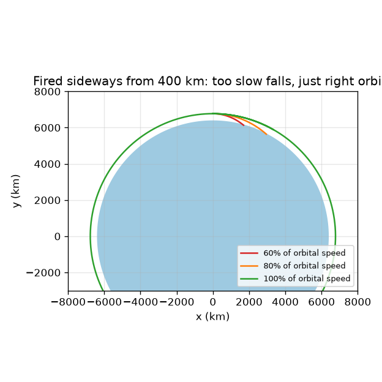
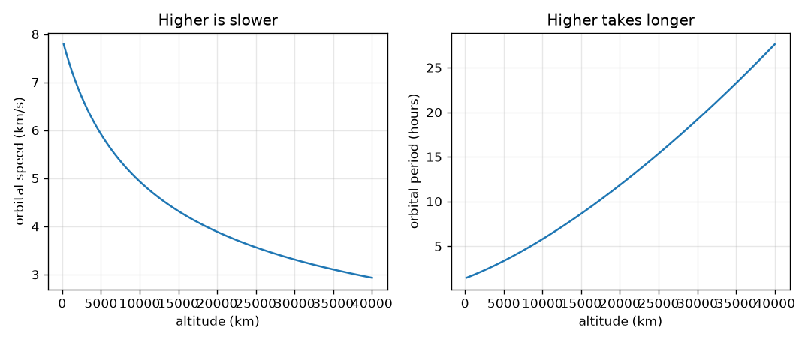

# அமர்வு 1: ஒரு செயற்கைக்கோள் பூமியைச் சுற்றி விழுந்துகொண்டிருக்கிறது

[Session 1 — हिन्दी](README.hi.md)

*நிலை 1 (கருத்தியல் ஊடாடும் மாதிரி) · சுமார் 60 நிமிடங்கள் · openorbit*

> இது எளிமைப்படுத்தப்பட்ட ஒரு கல்வி மாதிரி (educational model). இது சரிபார்க்கப்பட்ட வடிவமைப்புக் கருவி அல்ல; உண்மையான கட்டமைப்புகள், மின் நிறுவல்கள், வாகனங்கள், தொழில்துறை செயல்முறைகள் அல்லது மருத்துவ முடிவுகளுக்கு இதைப் பயன்படுத்தக் கூடாது.

**முன்தேவைகள் (Prerequisites)**

- பள்ளி இயற்கணிதம்: வர்க்கம், வர்க்கமூலம், விகிதம்.
- நீங்கள் PRIMER.md படித்து `python start.py 1` ஒருமுறை இயக்கியிருக்கிறீர்கள்.

**கற்றல் நோக்கங்கள் (Learning objectives).** இந்த அமர்வுக்குப் பிறகு உங்களால் முடியும்:

- புவியீர்ப்பு இழுத்தாலும் ஒரு செயற்கைக்கோள் தரையில் விழாதது ஏன் என்று விளக்க.
- கொடுக்கப்பட்ட உயரத்தில் வட்டச் சுற்றுப்பாதையின் வேகத்தையும் சுற்றுக்காலத்தையும் (period) கையால் மற்றும் Python-இல் கணக்கிட.
- உயர்ந்த சுற்றுப்பாதைகள் ஏன் மெதுவானவை, ஏன் அதிக நேரம் எடுக்கின்றன என்று விளக்க.
- கெப்ளரின் மூன்று விதிகளைக் கூறி ஒவ்வொன்றையும் ஒரு படமாகப் படிக்க.

## A. நிஜ உலகப் பிரச்சினை
ஒரு செயற்கைக்கோளை முன்னோக்கித் தள்ளும் எஞ்சின் இல்லை, இருந்தும் அது ஆண்டுக்கணக்கில் மேலே இருக்கிறது. அது வானத்திலிருந்து விழாதது ஏன்? பதில்: அது எப்போதும் விழுந்துகொண்டுதான் இருக்கிறது, ஆனால் அது பக்கவாட்டில் இவ்வளவு வேகமாக நகர்வதால் அது விழும் அதே வேகத்தில் பூமி அதன் கீழே வளைந்து விலகுகிறது. அது எவ்வளவு வேகம், ஒரு சுற்றுக்கு எவ்வளவு நேரம் ஆகும்? சர்வதேச விண்வெளி நிலையமும் ஒரு வானிலைச் செயற்கைக்கோளும் சுற்றி வர இவ்வளவு வேறுபட்ட நேரம் எடுப்பது ஏன்? கல்வி மாதிரி: ஒரு புள்ளிச் செயற்கைக்கோளும் முழுமையான வட்டமான பூமியும்.

## B. கருத்தும் கோட்பாடும்
பூமியின் மையத்திலிருந்து r தூரத்தில் புவியீர்ப்பு ஒவ்வொரு பொருளுக்கும் g = mu / r^2 என்ற முடுக்கத்தைத் தருகிறது, இங்கு mu = 3.986004418e14 m^3/s^2 பூமியின் ஈர்ப்பு அளபுரு. ஒரு பீரங்கிக் குண்டை பக்கவாட்டில் v வேகத்தில் சுடுங்கள்: t நேரத்தில் அது d = v t என்ற நேர்கோட்டில் செல்லும், புவியீர்ப்பு அதைச் சுமார் 0.5 g t^2 கீழே இழுக்கும், வட்டமான தரை நேர்கோட்டிலிருந்து r - sqrt(r^2 - d^2) அளவு வளைந்து விலகுகிறது. இவ்விரண்டும் சமமாகும்போது பீரங்கிக் குண்டு தரையைத் தொடாமலே தவறிக்கொண்டே செல்கிறது: அந்த வேகம் v = sqrt(mu / r), ஒரு சுற்றுக்கு T = 2 pi r / v ஆகும். தூரத்துடன் புவியீர்ப்பு பலவீனமடைவதால் r அதிகரிக்கும்போது v குறைகிறது, T இன்னும் வேகமாக அதிகரிக்கிறது. எல்லாச் சுற்றுப்பாதைகளையும் விவரிக்கும் மூன்று விதிகளை கெப்ளர் கண்டறிந்தார்: (1) சுற்றுப்பாதைகள் நீள்வட்டங்கள், பூமி ஒரு குவியத்தில்; (2) பூமியிலிருந்து செயற்கைக்கோளுக்கான கோடு சம நேரங்களில் சமப் பரப்புகளைக் கடக்கிறது, எனவே செயற்கைக்கோள் அருகில் இருக்கும்போது வேகமாகவும் தொலைவில் இருக்கும்போது மெதுவாகவும் இருக்கும்; (3) பூமியைச் சுற்றும் எல்லாச் சுற்றுப்பாதைகளுக்கும் T^2-ஐ a^3-ஆல் வகுத்தது ஒன்றே, இங்கு a அரைப் பெருநீள் அச்சு (semi-major axis) (வட்டத்துக்கு ஆரம்).

| குறியீடு | பொருள் | அலகு |
|---|---|---|
| mu | பூமியின் ஈர்ப்பு அளபுரு G பெருக்கல் நிறை | m^3/s^2 |
| r | பூமியின் மையத்திலிருந்து தூரம் (உயரம் கூட 6371 km) | m |
| g | r தூரத்தில் புவியீர்ப்பு முடுக்கம் | m/s^2 |
| v | செயற்கைக்கோளின் வேகம் | m/s |
| T | ஒரு சுற்றுக்கான நேரம் (சுற்றுக்காலம்) | s |
| a | அரைப் பெருநீள் அச்சு: நீள்வட்டத்தின் நீளமான பக்கத்தின் பாதி | m |

**அனுமானங்கள் (Assumptions)**

- பூமி சராசரி ஆரம் 6371 km கொண்ட முழுமையான கோளம், செயற்கைக்கோள் ஒரு புள்ளி.
- பூமியின் புவியீர்ப்பு மட்டுமே செயல்படுகிறது: காற்றுத் தடை இல்லை, நிலவோ சூரியனோ இல்லை.
- குறிப்பிடாவிட்டால் சுற்றுப்பாதை வட்டம் (நீள்வட்டங்கள் அமர்வு 2-இல்).

$$ g(r)=\frac{\mu}{r^{2}} $$

$$ v=\sqrt{\frac{\mu}{r}} $$

$$ T=\frac{2\pi r}{v}=2\pi\sqrt{\frac{r^{3}}{\mu}} $$

$$ \frac{T^{2}}{a^{3}}=\frac{4\pi^{2}}{\mu}\quad\text{(the same for every orbit)} $$

## C. காட்சி விளக்கம்
முதல் படம் 400 km உயரத்திலிருந்து மூன்று வேகங்களில் ஒரு பீரங்கிக் குண்டைப் பக்கவாட்டில் சுடுகிறது. வட்ட வேகத்தின் 60 சதவீதத்திலும் 80 சதவீதத்திலும் பாதை மிகக் கூர்மையாக வளைந்து தரையைத் தொடுகிறது; சரியாக வட்ட வேகத்தில் பாதை அதே உயரத்தில் நீடித்துச் சுற்றுகிறது. இரண்டாவது படம் உயரத்துக்கு எதிராக வட்ட வேகத்தையும் சுற்றுக்காலத்தையும் வரைகிறது: மேலே செல்லச் செல்ல வேகம் சீராகக் குறைகிறது, சுற்றுக்காலம் செங்குத்தாக ஏறுகிறது, தரைக்கு அருகில் சுமார் ஒன்றரை மணி நேரத்திலிருந்து புவிநிலை (geostationary) உயரத்தில் சுமார் ஒரு நாள் வரை.

*400 km-இல் இருந்து பக்கவாட்டில் சுட்டால்: மிக மெதுவாக இருந்தால் தரையில் விழும், சரியாக இருந்தால் சுற்றும்.*

*உயரத்துடன் வேகம் குறைகிறது, சுற்றுக்காலம் கூடுகிறது.*

## D. ஊடாடும் உருவகப்படுத்தல் (Interactive simulation)
பாடத்தை இயக்குங்கள் (`python start.py 1`), பிறகு நேரடிச் செயலியைத் திறக்கவும்: [அமர்வு 1: செயற்கைக்கோளைப் பக்கவாட்டில் சுடுங்கள்](https://krunalpanchal1995.github.io/pan-iit-oss/openorbit/session-01/) (அல்லது இந்தக் கோப்புறையில் உள்ள `app.html`). உயர ஸ்லைடரை நகர்த்தி வரைபடக் காட்சியில் சுற்றுக்காலத்தைப் படியுங்கள். பிறகு ஏவு வேகத்தை 100 சதவீதத்துக்குக் கீழே குறைத்து, பாதை வட்டத்திலிருந்து தரைக்குள் இறங்கும் நீள்வட்டமாக மாறுவதைக் கவனியுங்கள். 100 சதவீதத்துக்கு மேல் உயர்த்தித் தொலைவுப் புள்ளி ஏறுவதைப் பாருங்கள்.

**சவால்.** 400 km உயரத்தில், செயற்கைக்கோள் தரையைத் தொடாமல் தவறும்படி செய்யுங்கள் (அதன் மிகத் தாழ்ந்த புள்ளி பூமியின் மேற்பரப்புக்கு மேல் இருக்க வேண்டும்).

## E. தீர்க்கப்பட்ட எடுத்துக்காட்டும் சோதனையும்
**கணக்கு.** தரையிலிருந்து 400 km மேலுள்ள ஒரு செயற்கைக்கோளின் வேகம், சுற்றுக்காலம், புவியீர்ப்பு முடுக்கம் ஆகியவற்றைக் கண்டறியுங்கள், ஒரு வினாடியில் செயற்கைக்கோள் விழும் அதே வேகத்தில் பூமி வளைந்து விலகுகிறதா என்று சரிபாருங்கள்.

1. ஆரம் r = 6371 + 400 = 6771 km = 6.771e6 m.
2. புவியீர்ப்பு முடுக்கம் g = mu / r^2 = 3.986e14 / (6.771e6)^2 = 8.69 m/s^2 (மேற்பரப்பில் 9.82 m/s^2 உடன் ஒப்பிடுங்கள்).
3. வேகம் v = sqrt(mu / r) = 7.67 km/s.
4. சுற்றுக்காலம் T = 2 pi r / v = 2 pi * 6771 / 7.673 = 5545 s = 92.4 min.
5. 1 s-இல் செயற்கைக்கோள் 0.5 * 8.69 * 1^2 = 4.35 m விழுகிறது. 1 s-இல் அது பக்கவாட்டில் 7.67 km நகர்கிறது, 6771 km ஆர வட்டம் ஒரு நேர்கோட்டிலிருந்து 6771 - sqrt(6771^2 - 7.67^2) km = 4.35 m கீழே இறங்குகிறது. இரண்டும் ஒத்துப்போகின்றன.

**விடை.** v = 7.67 km/s, T = 92.4 min, g = 8.69 m/s^2, விழுதலும் வளைந்து விலகுதலும் ஒரு வினாடியில் தலா 4.35 m.

**சோதனை.** நேரடியாக: ஒரு பந்தைக் கையிலிருந்து விட்டு நேரம் அளந்து மேற்பரப்பில் g சுமார் 9.8 m/s^2 என்று உறுதிசெய்யுங்கள். சுற்றுப்பாதைகளுக்கு, ஒரு வான்-கண்காணிப்புச் செயலி மூலம் சர்வதேச விண்வெளி நிலையத்தின் ஒரு கடப்பைக் கண்டறியுங்கள்: அது சில நிமிடங்களில் வானைக் கடந்து சுமார் ஒவ்வொரு 92 நிமிடங்களுக்கும் திரும்புகிறது. மாதிரி எதிர் உண்மை: உண்மையான நிலையம் வாரத்துக்கு வாரம் சற்று உயரமாகவோ தாழ்வாகவோ இருக்கிறது, மெல்லிய காற்றால் சற்று மெதுவாகிறது, எனவே அதன் உண்மையான சுற்றுக்காலம் மாதிரியிலிருந்து மூன்றாவது இலக்கத்தில் வேறுபடுகிறது.

## F. மதிப்பீடும் வடிவமைப்புச் சவாலும்
**கேள்வி வகை A: கருத்தியல்.** நிலையத்தில் உள்ள விண்வெளி வீரர்கள் மிதக்கிறார்கள். அங்கே புவியீர்ப்பு அணைக்கப்பட்டுள்ளதா? 'எடையின்மை' (weightless) என்றால் என்ன என்று விளக்குங்கள்.

குறிப்பு

400 km-இல் புவியீர்ப்பை மேற்பரப்பு மதிப்புடன் ஒப்பிடுங்கள், ஒன்றாக விழுவதைப் பற்றிச் சிந்தியுங்கள்.

படிப்படியான தீர்வு

இல்லை. 400 km-இல் புவியீர்ப்பு 8.69 m/s^2, மேற்பரப்பில் 9.82 m/s^2, எனவே அது இன்னும் வலுவானது. விண்வெளி வீரர்களும் நிலையமும் ஒரே முடுக்கத்துடன் பூமியைச் சுற்றி ஒன்றாக விழுகின்றனர், எனவே எதுவும் அவர்களைத் தரையுடன் அழுத்துவதில்லை. புவியீர்ப்பு இல்லாததால் அல்ல, தடையற்ற வீழ்ச்சியில் (free fall) இருப்பதால் அவர்கள் எடையின்மையை உணர்கிறார்கள்.

**கேள்வி வகை B: எண்ணியல்.** தரையிலிருந்து 1000 km மேலுள்ள வட்டச் சுற்றுப்பாதையின் வேகத்தையும் சுற்றுக்காலத்தையும் கண்டறியுங்கள். 400 km சுற்றுப்பாதையுடன் ஒப்பிட்டு விடை பொருத்தமானதா எனச் சரிபாருங்கள்.

குறிப்பு

r = 6371 + 1000 km. v = sqrt(mu / r) மற்றும் T = 2 pi r / v பயன்படுத்துங்கள்.

படிப்படியான தீர்வு

r = 7371 km. v = 7.35 km/s மற்றும் T = 105.0 min. பொருத்தச் சரிபார்ப்பு: 400 km சுற்றுப்பாதையைவிட உயரம், எனவே மெதுவானது (7.67 km/s-க்குக் கீழே 7.35) மற்றும் நீண்ட சுற்றுக்காலம் (92.4 min-க்கு மேல் 105.0). அலகுகள்: km/s மற்றும் நிமிடங்கள்.

**கேள்வி வகை C: வரைபடம் மற்றும் உருவகப்படுத்தல் விளக்கம்.** வேகம் மற்றும் சுற்றுக்கால வரைபடங்களில், 200 km அருகிலும் புவிநிலை உயரத்திலும் வேகம் என்ன, சுற்றுக்காலத்துக்கு என்ன ஆகிறது? சுற்றுக்கால வளைவு வேக வளைவைவிடச் செங்குத்தாக இருப்பது ஏன்?

குறிப்பு

இரண்டு வளைவுகளின் இடது மற்றும் வலது முனைகளைப் படியுங்கள். T = 2 pi r / v நினைவில் கொள்ளுங்கள்.

படிப்படியான தீர்வு

200 km-இல்: 7.79 km/s மற்றும் சுற்றுக்காலம் 88.4 min. 35786 km-இல்: 3.07 km/s மற்றும் சுற்றுக்காலம் 1435.7 min, சுமார் 23.93 மணி. சுற்றுக்காலம் இரண்டு காரணங்களால் ஒரே நேரத்தில் கூடுகிறது: பாதை 2 pi r நீளமாகிறது, வேகம் v குறைகிறது, எனவே சுற்றுக்காலம் ஒவ்வொன்றையும்விட வேகமாக மாறுகிறது.

**கேள்வி வகை D: வடிவமைப்பு மற்றும் உகப்பாக்கம் (optimisation) சவால்.** வடிவமைப்பு: ஒரு புவி கண்காணிப்புச் செயற்கைக்கோள் வட்டச் சுற்றுப்பாதையில் ஒவ்வொரு 100 நிமிடங்களுக்கு ஒருமுறை சுற்ற வேண்டும். அது எந்த உயரத்தில் பறக்க வேண்டும், எவ்வளவு வேகத்தில் நகரும்? விடை ஒரு உண்மையான செயற்கைக்கோளுக்குப் பொருத்தமானதா?

குறிப்பு

ஆரத்துக்காக கெப்ளர் 3-ஐத் தீர்க்கவும்: T = 6000 s உடன் r = (mu (T / 2 pi)^2)^(1/3).

படிப்படியான தீர்வு

r உயரம் 765.6 km மற்றும் வேகம் 7.473 km/s தருகிறது. இது பொருத்தமானது: இது உண்மையான படமெடுக்கும் செயற்கைக்கோள்களின் வரம்பில் உள்ளது, தாழ்ந்த சுற்றுப்பாதைகளை மெதுவாக்கும் மெல்லிய காற்றின் பெரும்பகுதிக்கு மேலே. பரிமாற்றம் (trade-off): உயரமாக இருந்தால் நீண்ட சுற்றும் அகலமான பார்வையும் ஆனால் படத்தின் விவரம் குறைவு; தாழ்வாக இருந்தால் கூர்மையான படங்கள் ஆனால் அதிக இழுவை (drag).

[RUBRIC.md](../../RUBRIC.md) கொண்டு உங்களை மதிப்பிடுங்கள். தாளில் செய்ய [செயல்பாட்டுத் தாள்](activity_sheet.md)-ஐ அச்சிடுங்கள்.

## பொதுவான தவறான கருத்துகள்
| பொதுவான தவறான கருத்து | உண்மையில் சரியானது |
|---|---|
| விண்வெளியில் புவியீர்ப்பு இல்லை. | 400 km-இல் புவியீர்ப்பு 8.69 m/s^2, மேற்பரப்பின் 9.82 m/s^2-க்கு அருகில். சுற்றுவது என்பது விழுவது, புவியீர்ப்பிலிருந்து தப்பிப்பது அல்ல. |
| வேகமாகச் செல்ல ஒரு செயற்கைக்கோள் உயரமாக இருக்க வேண்டும். | உயர்ந்த சுற்றுப்பாதைகள் மெதுவானவை: r அதிகரிக்கும்போது வேகம் sqrt(mu / r) குறைகிறது. மேலே செல்ல முதலில் வேகப்படுத்துவீர்கள், சென்றடைந்ததும் வேகம் குறைப்பீர்கள். |
| தொடர்ந்து செல்ல ஒரு செயற்கைக்கோளுக்கு எஞ்சின் வேண்டும். | சரியான பக்கவாட்டு வேகம் கிடைத்தவுடன், மாதிரியில் எதுவும் அதை மெதுவாக்குவதில்லை, எனவே உந்துதல் இல்லாமல் அது சுற்றி விழுந்துகொண்டே இருக்கும். |
| கெப்ளரின் இரண்டாம் விதி மாறா வேகம் என்று பொருள். | வினாடிக்கு மாறாப் பரப்பு என்று பொருள். செயற்கைக்கோள் பூமிக்கு அருகில் இருக்கும்போது அதே பரப்பைக் கடக்க வேகமாக இருக்க வேண்டும். |

## சொற்களஞ்சியம் (Glossary)
- **சுற்றுப்பாதை (orbit)**: மற்றொரு பொருளைச் சுற்றி விழும் ஒரு பொருளின் பாதை
- **சுற்றுக்காலம் (period)**: ஒரு முழுச் சுற்றுக்கான நேரம்
- **அரைப் பெருநீள் அச்சு (semi-major axis)**: நீள்வட்டத்தின் நீளமான பக்கத்தின் பாதி; வட்டத்துக்கு ஆரத்துக்குச் சமம்
- **உயரம் (altitude)**: தரையிலிருந்து உயரம், பூமியின் மையத்திலிருந்து தூரம் அல்ல
- **ஈர்ப்பு அளபுரு mu (gravitational parameter)**: G பெருக்கல் பூமியின் நிறை; புவியீர்ப்பின் வலிமையை நிர்ணயிக்கும் ஒரே எண்

## முடிவு
1. [exercises.md](exercises.md)-இல் உள்ள மூன்று நிரலாக்கப் பணிகளைச் செய்யுங்கள்.
2. உங்கள் மாற்றங்களுக்குப் பிறகு `python start.py 1` மீண்டும் இயக்குங்கள். அது சோதனைச் சாவடியுடன் (checkpoint) முடிகிறது; அது `PASS` என்று அச்சிடும்போது நீங்கள் முடித்துவிட்டீர்கள். (சோதனைச் சாவடி மட்டும்: `python start.py check 1`.)

அடுத்து: [அமர்வு 2](../session-02/README.md)
