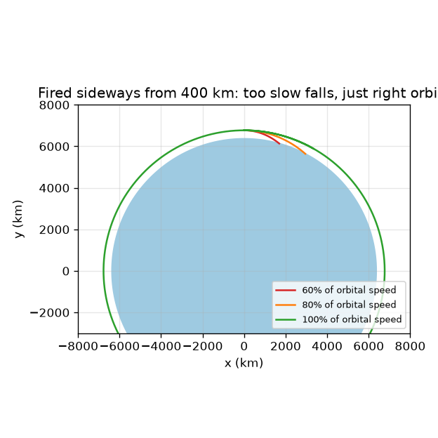
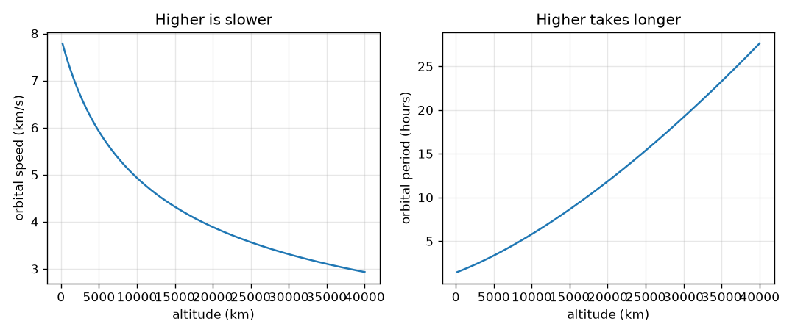

# సెషన్ 1: ఒక ఉపగ్రహం భూమి చుట్టూ పడుతూనే ఉంది

[Session 1 — हिन्दी](README.hi.md)

*స్థాయి 1 (భావనాత్మక ఇంటరాక్టివ్ నమూనా) · సుమారు 60 నిమిషాలు · openorbit*

> ఇది సరళీకరించిన ఒక విద్యా నమూనా (educational model). ఇది ధృవీకరించబడిన డిజైన్ సాధనం కాదు; నిజమైన నిర్మాణాలు, విద్యుత్ ఇన్‌స్టాలేషన్‌లు, వాహనాలు, పారిశ్రామిక ప్రక్రియలు లేదా వైద్య నిర్ణయాల కోసం దీనిని ఉపయోగించకూడదు.

**ముందస్తు జ్ఞానం (Prerequisites)**

- పాఠశాల బీజగణితం: వర్గాలు, వర్గమూలాలు, నిష్పత్తులు.
- మీరు PRIMER.md చదివి `python start.py 1` ఒకసారి రన్ చేశారు.

**అభ్యాస లక్ష్యాలు (Learning objectives).** ఈ సెషన్ తర్వాత మీరు చేయగలరు:

- గురుత్వాకర్షణ లాగుతున్నా ఉపగ్రహం నేలపై ఎందుకు పడదో వివరించడం.
- ఇచ్చిన ఎత్తులో వృత్తాకార కక్ష్య వేగాన్ని, ఆవర్తన కాలాన్ని (period) చేతితో మరియు Pythonలో లెక్కించడం.
- ఎత్తైన కక్ష్యలు ఎందుకు నెమ్మదిగా ఉంటాయో, ఎక్కువ సమయం ఎందుకు తీసుకుంటాయో వివరించడం.
- కెప్లర్ మూడు నియమాలను చెప్పి ప్రతి ఒక్కటీ ఒక చిత్రంగా చదవడం.

## A. వాస్తవ ప్రపంచ సమస్య
ఉపగ్రహాన్ని ముందుకు నెట్టే ఇంజిన్ లేదు, అయినా అది సంవత్సరాల తరబడి పైన ఉంటుంది. అది ఆకాశం నుండి ఎందుకు రాలిపోదు? సమాధానం: అది ఎల్లప్పుడూ పడుతూనే ఉంటుంది, కానీ అది పక్కకు అంత వేగంగా కదులుతుంది కాబట్టి అది పడే అదే వేగంతో భూమి దాని కింద వంగి తొలగిపోతుంది. అది ఎంత వేగం, ఒక చుట్టుకు ఎంత సమయం పడుతుంది? అంతర్జాతీయ అంతరిక్ష కేంద్రం మరియు వాతావరణ ఉపగ్రహం చుట్టి రావడానికి ఇంత భిన్నమైన సమయాలు ఎందుకు తీసుకుంటాయి? విద్యా నమూనా: ఒక బిందు ఉపగ్రహం మరియు పరిపూర్ణ గుండ్రని భూమి.

## B. భావన మరియు సిద్ధాంతం
భూమి కేంద్రం నుండి r దూరంలో గురుత్వాకర్షణ ప్రతి వస్తువుకు g = mu / r^2 అనే త్వరణాన్ని ఇస్తుంది, ఇక్కడ mu = 3.986004418e14 m^3/s^2 భూమి గురుత్వ పరామితి. ఒక ఫిరంగి గుండును పక్కకు v వేగంతో పేల్చండి: t సమయంలో అది d = v t అనే సరళ రేఖలో ప్రయాణిస్తుంది, గురుత్వాకర్షణ దానిని సుమారు 0.5 g t^2 కిందికి లాగుతుంది, గుండ్రని నేల సరళ రేఖ నుండి r - sqrt(r^2 - d^2) మేర వంగి తొలగిపోతుంది. ఈ రెండూ సమానమైనప్పుడు ఫిరంగి గుండు నేలను తాకకుండా తప్పిపోతూనే ఉంటుంది: ఆ వేగం v = sqrt(mu / r), ఒక చుట్టుకు T = 2 pi r / v పడుతుంది. దూరంతో గురుత్వాకర్షణ బలహీనపడుతుంది కాబట్టి r పెరిగేకొద్దీ v తగ్గుతుంది, T ఇంకా వేగంగా పెరుగుతుంది. అన్ని కక్ష్యలను వివరించే మూడు నియమాలను కెప్లర్ కనుగొన్నాడు: (1) కక్ష్యలు దీర్ఘవృత్తాలు, భూమి ఒక నాభి వద్ద; (2) భూమి నుండి ఉపగ్రహానికి రేఖ సమాన సమయాలలో సమాన వైశాల్యాలను ఊడ్చుతుంది, కాబట్టి ఉపగ్రహం దగ్గరగా ఉన్నప్పుడు వేగంగా, దూరంగా ఉన్నప్పుడు నెమ్మదిగా ఉంటుంది; (3) భూమి చుట్టూ ఉన్న అన్ని కక్ష్యలకు T^2 ని a^3 తో భాగించినది ఒకటే, ఇక్కడ a అర్ధ-దీర్ఘాక్షం (semi-major axis) (వృత్తానికి వ్యాసార్ధం).

| చిహ్నం | అర్థం | యూనిట్ |
|---|---|---|
| mu | భూమి గురుత్వ పరామితి G గుణకారం ద్రవ్యరాశి | m^3/s^2 |
| r | భూమి కేంద్రం నుండి దూరం (ఎత్తు కలిపి 6371 km) | m |
| g | r దూరంలో గురుత్వ త్వరణం | m/s^2 |
| v | ఉపగ్రహ వేగం | m/s |
| T | ఒక చుట్టుకు సమయం (ఆవర్తన కాలం) | s |
| a | అర్ధ-దీర్ఘాక్షం: దీర్ఘవృత్తం పొడవైన వైపు సగం | m |

**ఊహలు (Assumptions)**

- భూమి సగటు వ్యాసార్ధం 6371 km ఉన్న పరిపూర్ణ గోళం, ఉపగ్రహం ఒక బిందువు.
- భూమి గురుత్వాకర్షణ మాత్రమే పనిచేస్తుంది: గాలి నిరోధం లేదు, చంద్రుడు లేదా సూర్యుడు లేరు.
- చెప్పకపోతే కక్ష్య వృత్తాకారం (దీర్ఘవృత్తాలు సెషన్ 2లో).

$$ g(r)=\frac{\mu}{r^{2}} $$

$$ v=\sqrt{\frac{\mu}{r}} $$

$$ T=\frac{2\pi r}{v}=2\pi\sqrt{\frac{r^{3}}{\mu}} $$

$$ \frac{T^{2}}{a^{3}}=\frac{4\pi^{2}}{\mu}\quad\text{(the same for every orbit)} $$

## C. దృశ్య వివరణ
మొదటి చిత్రం 400 km ఎత్తు నుండి మూడు వేగాలలో ఒక ఫిరంగి గుండును పక్కకు పేలుస్తుంది. వృత్తాకార వేగంలో 60 శాతం మరియు 80 శాతం వద్ద మార్గం చాలా పదునుగా వంగి నేలను తాకుతుంది; సరిగ్గా వృత్తాకార వేగం వద్ద మార్గం అదే ఎత్తులో ఉండి చుట్టి వస్తుంది. రెండవ చిత్రం ఎత్తుకు వ్యతిరేకంగా వృత్తాకార వేగాన్ని, ఆవర్తన కాలాన్ని గీస్తుంది: పైకి వెళ్ళేకొద్దీ వేగం క్రమంగా తగ్గుతుంది, ఆవర్తన కాలం నిటారుగా పెరుగుతుంది, నేల దగ్గర సుమారు గంటన్నర నుండి భూస్థిర (geostationary) ఎత్తు వద్ద సుమారు ఒక రోజు వరకు.

*400 km నుండి పక్కకు పేల్చితే: చాలా నెమ్మదిగా ఉంటే నేలపై పడుతుంది, సరిగ్గా ఉంటే చుట్టి వస్తుంది.*

*ఎత్తుతో వేగం తగ్గుతుంది, ఆవర్తన కాలం పెరుగుతుంది.*

## D. ఇంటరాక్టివ్ సిమ్యులేషన్
పాఠాన్ని రన్ చేయండి (`python start.py 1`), తర్వాత లైవ్ యాప్‌ను తెరవండి: [సెషన్ 1: ఉపగ్రహాన్ని పక్కకు పేల్చండి](https://krunalpanchal1995.github.io/pan-iit-oss/openorbit/session-01/) (లేదా ఈ ఫోల్డర్‌లోని `app.html`). ఎత్తు స్లైడర్‌ను జరిపి గ్రాఫ్ వ్యూలో ఆవర్తన కాలాన్ని చదవండి. తర్వాత ప్రయోగ వేగాన్ని 100 శాతం కంటే తక్కువకు తగ్గించి, మార్గం వృత్తం నుండి నేలలోకి దిగే దీర్ఘవృత్తంగా మారడాన్ని గమనించండి. 100 శాతం పైకి పెంచి దూరపు బిందువు పైకి ఎక్కడాన్ని చూడండి.

**సవాలు.** 400 km ఎత్తులో, ఉపగ్రహం నేలను తాకకుండా తప్పిపోయేలా చేయండి (దాని అత్యల్ప బిందువు భూమి ఉపరితలం పైన ఉండాలి).

## E. సాధించిన ఉదాహరణ మరియు ప్రయోగం
**సమస్య.** నేల నుండి 400 km పైన ఉన్న ఉపగ్రహం వేగాన్ని, ఆవర్తన కాలాన్ని, గురుత్వ త్వరణాన్ని కనుగొనండి, ఒక సెకనులో ఉపగ్రహం పడే అదే వేగంతో భూమి వంగి తొలగుతుందో సరిచూడండి.

1. వ్యాసార్ధం r = 6371 + 400 = 6771 km = 6.771e6 m.
2. గురుత్వ త్వరణం g = mu / r^2 = 3.986e14 / (6.771e6)^2 = 8.69 m/s^2 (ఉపరితలం వద్ద 9.82 m/s^2 తో పోల్చండి).
3. వేగం v = sqrt(mu / r) = 7.67 km/s.
4. ఆవర్తన కాలం T = 2 pi r / v = 2 pi * 6771 / 7.673 = 5545 s = 92.4 min.
5. 1 s లో ఉపగ్రహం 0.5 * 8.69 * 1^2 = 4.35 m పడుతుంది. 1 s లో అది పక్కకు 7.67 km కదులుతుంది, 6771 km వ్యాసార్ధ వృత్తం సరళ రేఖ నుండి 6771 - sqrt(6771^2 - 7.67^2) km = 4.35 m కిందికి దిగుతుంది. రెండూ ఏకీభవిస్తాయి.

**సమాధానం.** v = 7.67 km/s, T = 92.4 min, g = 8.69 m/s^2, పడటం మరియు వంగి తొలగడం రెండూ ఒక సెకనులో 4.35 m.

**ప్రయోగం.** ప్రత్యక్షంగా: ఒక బంతిని చేతి నుండి వదిలి సమయం కొలిచి ఉపరితలం వద్ద g సుమారు 9.8 m/s^2 అని నిర్ధారించండి. కక్ష్యల కోసం, ఆకాశ-ట్రాకింగ్ యాప్‌తో అంతర్జాతీయ అంతరిక్ష కేంద్రం యొక్క ఒక పాస్‌ను కనుగొనండి: అది కొన్ని నిమిషాల్లో ఆకాశాన్ని దాటి సుమారు ప్రతి 92 నిమిషాలకు తిరిగి వస్తుంది. నమూనా వర్సెస్ వాస్తవం: నిజమైన కేంద్రం వారానికి వారం కొంచెం ఎత్తుగా లేదా తక్కువగా ఉంటుంది, పలుచని గాలి దానిని కొద్దిగా నెమ్మదిస్తుంది, కాబట్టి దాని నిజమైన ఆవర్తన కాలం నమూనా నుండి మూడవ అంకెలో భిన్నంగా ఉంటుంది.

## F. మూల్యాంకనం మరియు డిజైన్ సవాలు
**ప్రశ్న రకం A: భావనాత్మక.** కేంద్రంలోని వ్యోమగాములు తేలుతారు. అక్కడ గురుత్వాకర్షణ ఆపివేయబడిందా? 'భారరహితం' (weightless) అంటే ఏమిటో వివరించండి.

సూచన

400 km వద్ద గురుత్వాకర్షణను ఉపరితల విలువతో పోల్చండి, కలిసి పడటం గురించి ఆలోచించండి.

దశలవారీ పరిష్కారం

కాదు. 400 km వద్ద గురుత్వాకర్షణ 8.69 m/s^2, ఉపరితలం వద్ద 9.82 m/s^2, కాబట్టి అది ఇంకా బలంగా ఉంది. వ్యోమగాములు మరియు కేంద్రం ఒకే త్వరణంతో భూమి చుట్టూ కలిసి పడతారు, కాబట్టి ఏదీ వారిని నేలకు నొక్కదు. గురుత్వాకర్షణ లేనందువల్ల కాదు, స్వేచ్ఛా పతనంలో (free fall) ఉన్నందువల్ల వారు భారరహితంగా అనిపిస్తుంది.

**ప్రశ్న రకం B: సంఖ్యాత్మక.** నేల నుండి 1000 km పైన ఉన్న వృత్తాకార కక్ష్య వేగాన్ని, ఆవర్తన కాలాన్ని కనుగొనండి. 400 km కక్ష్యతో పోల్చి సమాధానం సహేతుకమో సరిచూడండి.

సూచన

r = 6371 + 1000 km. v = sqrt(mu / r) మరియు T = 2 pi r / v ఉపయోగించండి.

దశలవారీ పరిష్కారం

r = 7371 km. v = 7.35 km/s మరియు T = 105.0 min. సహేతుక పరిశీలన: 400 km కక్ష్య కంటే ఎత్తు, కాబట్టి నెమ్మదిగా (7.67 km/s కంటే తక్కువ 7.35) మరియు ఎక్కువ ఆవర్తన కాలం (92.4 min కంటే ఎక్కువ 105.0). యూనిట్‌లు: km/s మరియు నిమిషాలు.

**ప్రశ్న రకం C: గ్రాఫ్ మరియు సిమ్యులేషన్ వ్యాఖ్యానం.** వేగం మరియు ఆవర్తన కాల గ్రాఫ్‌లలో, 200 km దగ్గర మరియు భూస్థిర ఎత్తు వద్ద వేగం ఎంత, ఆవర్తన కాలానికి ఏమవుతుంది? ఆవర్తన కాల వక్రం వేగ వక్రం కంటే నిటారుగా ఎందుకు ఉంటుంది?

సూచన

రెండు వక్రాల ఎడమ మరియు కుడి చివరలను చదవండి. T = 2 pi r / v గుర్తుంచుకోండి.

దశలవారీ పరిష్కారం

200 km వద్ద: 7.79 km/s మరియు ఆవర్తన కాలం 88.4 min. 35786 km వద్ద: 3.07 km/s మరియు ఆవర్తన కాలం 1435.7 min, సుమారు 23.93 గంటలు. ఆవర్తన కాలం ఒకేసారి రెండు కారణాల వల్ల పెరుగుతుంది: మార్గం 2 pi r పొడవవుతుంది, వేగం v తగ్గుతుంది, కాబట్టి ఆవర్తన కాలం దేని కంటే అయినా వేగంగా మారుతుంది.

**ప్రశ్న రకం D: డిజైన్ మరియు ఆప్టిమైజేషన్ (optimisation) సవాలు.** డిజైన్: ఒక భూ పరిశీలన ఉపగ్రహం వృత్తాకార కక్ష్యలో ప్రతి 100 నిమిషాలకు ఒకసారి చుట్టాలి. అది ఏ ఎత్తులో ఎగరాలి, ఎంత వేగంతో కదులుతుంది? సమాధానం నిజమైన ఉపగ్రహానికి సహేతుకమేనా?

సూచన

వ్యాసార్ధం కోసం కెప్లర్ 3 సాధించండి: T = 6000 s తో r = (mu (T / 2 pi)^2)^(1/3).

దశలవారీ పరిష్కారం

r ఎత్తు 765.6 km మరియు వేగం 7.473 km/s ఇస్తుంది. ఇది సహేతుకం: ఇది నిజమైన చిత్రీకరణ ఉపగ్రహాల పరిధిలో ఉంది, తక్కువ కక్ష్యలను నెమ్మదింపజేసే పలుచని గాలిలో ఎక్కువ భాగం పైన. ట్రేడ్-ఆఫ్ (trade-off): ఎత్తుగా ఉంటే పొడవైన చుట్టు, విశాల దృశ్యం కానీ చిత్ర వివరం తక్కువ; తక్కువగా ఉంటే స్పష్టమైన చిత్రాలు కానీ ఎక్కువ లాగుడు (drag).

[RUBRIC.md](../../RUBRIC.md)తో మిమ్మల్ని మీరు స్కోర్ చేసుకోండి. కాగితంపై చేయడానికి [కార్యాచరణ పత్రం](activity_sheet.md) ప్రింట్ చేయండి.

## సాధారణ అపోహలు
| సాధారణ అపోహ | నిజానికి సరైనది |
|---|---|
| అంతరిక్షంలో గురుత్వాకర్షణ లేదు. | 400 km వద్ద గురుత్వాకర్షణ 8.69 m/s^2, ఉపరితలం వద్ద 9.82 m/s^2 కి దగ్గరగా. కక్ష్యలో తిరగడం అంటే పడటం, గురుత్వాకర్షణ నుండి తప్పించుకోవడం కాదు. |
| వేగంగా వెళ్ళడానికి ఉపగ్రహం ఎత్తుగా ఉండాలి. | ఎత్తైన కక్ష్యలు నెమ్మదిగా ఉంటాయి: r పెరిగేకొద్దీ వేగం sqrt(mu / r) తగ్గుతుంది. పైకి వెళ్ళడానికి మొదట వేగం పెంచుతారు, చేరాక వేగం తగ్గిస్తారు. |
| కొనసాగడానికి ఉపగ్రహానికి ఇంజిన్ కావాలి. | సరైన పక్క వేగం వచ్చాక, నమూనాలో ఏదీ దానిని నెమ్మదింపజేయదు, కాబట్టి థ్రస్ట్ లేకుండా అది చుట్టూ పడుతూనే ఉంటుంది. |
| కెప్లర్ రెండవ నియమం అంటే స్థిర వేగం. | సెకనుకు స్థిర వైశాల్యం అని అర్థం. ఉపగ్రహం భూమికి దగ్గరగా ఉన్నప్పుడు అదే వైశాల్యాన్ని ఊడ్చడానికి వేగంగా ఉండాలి. |

## పదకోశం (Glossary)
- **కక్ష్య (orbit)**: మరొక వస్తువు చుట్టూ పడుతున్న వస్తువు మార్గం
- **ఆవర్తన కాలం (period)**: ఒక పూర్తి చుట్టుకు సమయం
- **అర్ధ-దీర్ఘాక్షం (semi-major axis)**: దీర్ఘవృత్తం పొడవైన వైపు సగం; వృత్తానికి వ్యాసార్ధానికి సమానం
- **ఎత్తు (altitude)**: నేల నుండి ఎత్తు, భూమి కేంద్రం నుండి దూరం కాదు
- **గురుత్వ పరామితి mu (gravitational parameter)**: G గుణకారం భూమి ద్రవ్యరాశి; గురుత్వాకర్షణ బలాన్ని నిర్ణయించే ఒకే సంఖ్య

## ముగింపు
1. [exercises.md](exercises.md)లోని మూడు కోడింగ్ పనులు చేయండి.
2. మీ మార్పుల తర్వాత `python start.py 1` మళ్ళీ రన్ చేయండి. అది చెక్‌పాయింట్‌తో (checkpoint) ముగుస్తుంది; అది `PASS` అని ప్రింట్ చేసినప్పుడు మీరు పూర్తి చేశారు. (చెక్‌పాయింట్ మాత్రమే: `python start.py check 1`.)

తర్వాత: [సెషన్ 2](../session-02/README.md)
