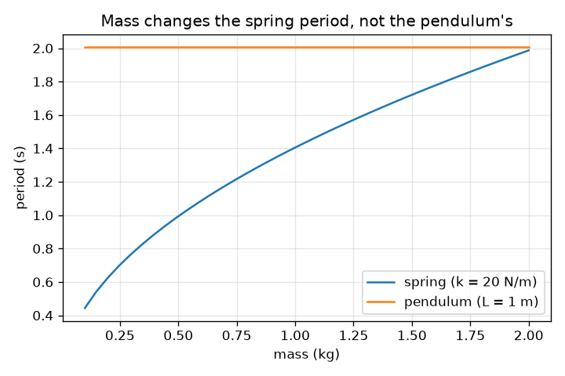
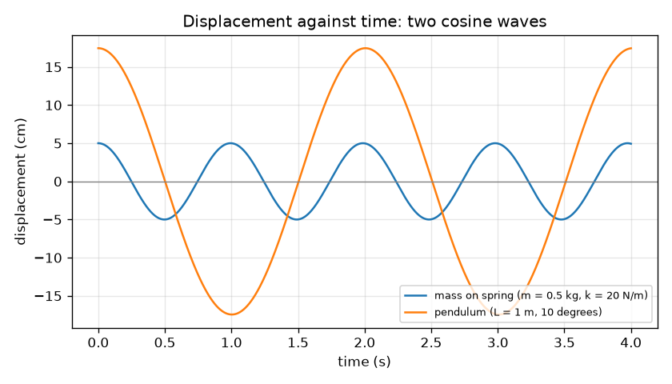

# सत्र 1: झूलने वाली चीज़ें: आवर्तकाल, आयाम और आवृत्ति

*स्तर 1 (वैचारिक इंटरैक्टिव मॉडल) · लगभग 60 मिनट · openoscillator*

> यह एक सरलीकृत शैक्षिक मॉडल है। यह कोई प्रमाणित डिज़ाइन उपकरण नहीं है और इसका उपयोग वास्तविक संरचनाओं, विद्युत स्थापनाओं, वाहनों, औद्योगिक प्रक्रियाओं या चिकित्सा संबंधी निर्णयों के लिए नहीं किया जाना चाहिए।

**पूर्वापेक्षाएँ (Prerequisites)**

- स्कूली बीजगणित और वर्गमूल।
- आपने PRIMER.md पढ़ लिया है और `python start.py 1` एक बार चला लिया है।

**सीखने के उद्देश्य (Learning objectives)।** इस सत्र के बाद आप:

- आवर्तकाल (period), आयाम (amplitude) और आवृत्ति (frequency) को परिभाषित कर सकेंगे, और आवर्तकाल तथा आवृत्ति के बीच रूपांतरण कर सकेंगे।
- आवर्तकाल का अनुमान लगाने के लिए T = 2 pi sqrt(L / g) और T = 2 pi sqrt(m / k) का उपयोग कर सकेंगे।
- विस्थापन बनाम समय के ग्राफ़ से आवर्तकाल और आयाम पढ़ सकेंगे।
- बता सकेंगे कि कौन सी राशियाँ लोलक (pendulum) का आवर्तकाल बदलती हैं और कौन सी नहीं।

## A. वास्तविक दुनिया की समस्या
खेल के मैदान का झूला, एक पुरानी लंगर वाली घड़ी और साइकिल की सीट का उछलना, सभी एक गति को बार-बार दोहराते हैं। एक झूला कितना समय लेता है? वह कितनी दूर जाता है? क्या भारी बच्चा तेज़ झूलता है? ये झूले के आवर्तकाल, आयाम और आवृत्ति के बारे में प्रश्न हैं, और स्थिति बनाम समय का एक छोटा ग्राफ़ तीनों का उत्तर देता है।

## B. अवधारणा और सिद्धांत
दोहराने वाले झूले को दोलन (oscillation) कहते हैं। एक पूरा आगे-पीछे आवर्तकाल T (सेकंड) लेता है। प्रति सेकंड झूलों की संख्या आवृत्ति f = 1 / T (हर्ट्ज़, Hz) है। मध्य से सबसे बड़ी दूरी आयाम A है। छोटे झूलों के लिए, कठोरता (stiffness) k वाली स्प्रिंग पर द्रव्यमान m का आवर्तकाल T = 2 pi sqrt(m / k) है, और लंबाई L वाले लोलक का आवर्तकाल T = 2 pi sqrt(L / g) है, जहाँ g = 9.81 m/s^2। लोलक के आवर्तकाल में न द्रव्यमान है न आयाम: गुरुत्व का खिंचाव और गोलक (bob) का जड़त्व (inertia) दोनों द्रव्यमान के समानुपाती हैं, इसलिए द्रव्यमान कट जाता है। यदि झूला अपने सबसे बड़े विस्थापन से शुरू हो, तो स्थिति एक कोज्या (cosine) तरंग का अनुसरण करती है, x(t) = A cos(2 pi t / T)।

| प्रतीक | अर्थ | इकाई |
|---|---|---|
| T | आवर्तकाल: एक पूरे झूले का समय | s |
| f | आवृत्ति: प्रति सेकंड झूले, 1 / T | Hz |
| A | आयाम: मध्य से सबसे बड़ा विस्थापन | m |
| m | स्प्रिंग पर लटका द्रव्यमान | kg |
| k | स्प्रिंग की कठोरता: प्रति मीटर खिंचाव पर बल | N/m |
| L | धुरी से गोलक के केंद्र तक लोलक की लंबाई | m |
| g | गुरुत्वीय त्वरण | m/s^2 |

**मान्यताएँ (Assumptions)**

- केवल छोटे झूले (लोलक के लिए लगभग 15 डिग्री तक); सत्र 3 दिखाता है कि उससे आगे क्या होता है।
- कोई घर्षण या वायु प्रतिरोध नहीं: झूला कभी खत्म नहीं होता (सत्र 2 अवमंदन (damping) जोड़ता है)।
- स्प्रिंग का अपना कोई द्रव्यमान नहीं है और वह हुक के नियम (Hooke's law) का पालन करती है; धागा द्रव्यमानहीन है और गोलक एक बिंदु है।

$$ T = 2\pi\sqrt{\frac{m}{k}}\qquad T = 2\pi\sqrt{\frac{L}{g}} $$

$$ f = \frac{1}{T} $$

$$ x(t) = A\cos\!\left(\frac{2\pi t}{T}\right) $$

## C. दृश्य व्याख्या
पहला चित्र 20 N/m स्प्रिंग पर 0.5 kg द्रव्यमान (आयाम 5 cm, आवर्तकाल 0.99 s) और 10 डिग्री झुलाए गए 1 m लोलक (चाप आयाम 17.5 cm, आवर्तकाल 2.01 s) के लिए विस्थापन बनाम समय खींचता है। दोनों कोज्या तरंगें हैं जो एक शिखर से शुरू होती हैं; स्प्रिंग की तरंग लगभग दुगुनी बार दोहराती है। दूसरा चित्र द्रव्यमान के सापेक्ष आवर्तकाल आलेखित करता है: स्प्रिंग की रेखा वर्गमूल की तरह बढ़ती है, जबकि लोलक की रेखा सपाट है, इसलिए भारी गोलक न धीमे झूलता है न तेज़।

*द्रव्यमान के सापेक्ष आवर्तकाल: स्प्रिंग के लिए यह बढ़ता है और लोलक के लिए सपाट रहता है।*

*एक स्प्रिंग (T = 0.99 s) और एक लोलक (T = 2.01 s) के लिए विस्थापन बनाम समय।*

## D. इंटरैक्टिव सिमुलेशन
पाठ चलाइए (`python start.py 1`), फिर लाइव ऐप खोलिए: [सत्र 1: एक लोलक और एक स्प्रिंग](https://krunalpanchal1995.github.io/pan-iit-oss/openoscillator/session-01/) (या इसी फ़ोल्डर में `app.html`)। लोलक की लंबाई और स्प्रिंग का द्रव्यमान तथा कठोरता बदलिए, रीडआउट में दोनों आवर्तकाल देखिए, फिर ग्राफ़ दृश्य पर जाइए और दोनों कोज्या तरंगों (समान ऊँचाई पर मापित) को कदम में आते और बाहर जाते देखिए।

**चुनौती।** लोलक और स्प्रिंग को एक ही लय में झुलाइए: उनके आवर्तकालों में 0.05 s से कम का अंतर होना चाहिए।

## E. हल किया गया उदाहरण और प्रयोग
**समस्या।** एक 0.5 kg द्रव्यमान 20 N/m स्प्रिंग पर लटका है, और उसके पास एक 1.0 m लोलक झूलता है। हर एक का आवर्तकाल और आवृत्ति ज्ञात कीजिए, और लोलक को समय माप से जाँचिए।

1. स्प्रिंग: m / k = 0.5 / 20 = 0.025 s^2, sqrt = 0.1581 s, इसलिए T = 2 pi * 0.1581 = 0.993 s और f = 1 / 0.993 = 1.007 Hz।
2. लोलक: L / g = 1.0 / 9.81 = 0.1019 s^2, sqrt = 0.3193 s, इसलिए T = 2 pi * 0.3193 = 2.006 s और f = 0.498 Hz।
3. लोलक लगभग दुगुना धीमा है: 2.006 / 0.993 = 2.02।
4. ग्राफ़ से जाँच: नमूना ली गई स्प्रिंग वक्र के ऊपर की ओर शून्य-पारगमनों (zero crossings) को गिनकर, प्रोग्राम 0.9935 s मापता है, जो सूत्र के बराबर है।

**उत्तर।** स्प्रिंग: T = 0.993 s, f = 1.007 Hz। लोलक: T = 2.006 s, f = 0.498 Hz।

**प्रयोग।** एक छोटा भार 1.00 m के धागे से बाँधिए, उसे लगभग 10 डिग्री झुलाइए और फ़ोन स्टॉपवॉच से 20 झूलों का समय लीजिए; 20 से भाग दीजिए। लगभग 40.1 s की अपेक्षा कीजिए, इसलिए T = 2.01 s। मानवीय प्रतिक्रिया पूरी गिनती में लगभग 0.2 s की त्रुटि जोड़ती है, प्रति झूला केवल 0.01 s। बड़ा झूला, भारी धागा या बड़ा गोलक (जिसका द्रव्यमान केंद्र धागे की लंबाई से नीचे होता है) वास्तविक मान को थोड़ा अलग बनाता है: मॉडल द्रव्यमानहीन धागे पर बिंदु गोलक के लिए सटीक है, आपका लोलक ऐसा नहीं है।

## F. मूल्यांकन और डिज़ाइन चुनौती
**प्रश्न प्रकार A: वैचारिक।** एक भारी गोलक और एक हल्का गोलक समान लंबाई के धागों से लटके हैं। छोटे झूलों के लिए किसका आवर्तकाल अधिक है? समझाइए कि T = 2 pi sqrt(L / g) में द्रव्यमान क्यों नहीं आता, और स्प्रिंग के लिए क्यों आता है।

संकेत

तुलना कीजिए कि हर स्थिति में प्रत्यानयन बल (restoring force) और जड़त्व द्रव्यमान पर कैसे निर्भर करते हैं।

चरण-दर-चरण हल

उनका आवर्तकाल समान है। झूले की दिशा में गुरुत्व का खिंचाव द्रव्यमान के समानुपाती है, और जड़त्व (त्वरण का प्रतिरोध) भी, इसलिए द्रव्यमान कट जाता है। स्प्रिंग के लिए, प्रत्यानयन बल k x द्रव्यमान के साथ नहीं बढ़ता, पर जड़त्व बढ़ता है, इसलिए बड़ा द्रव्यमान कम त्वरित होता है और झूला धीमा होता है: T, sqrt(m) की तरह बढ़ता है।

**प्रश्न प्रकार B: संख्यात्मक।** 0.25 m लंबाई वाले लोलक का आवर्तकाल और आवृत्ति ज्ञात कीजिए। यदि लंबाई चार गुना कर दी जाए तो आवर्तकाल कितने गुना बदलता है?

संकेत

g = 9.81 m/s^2 के साथ T = 2 pi sqrt(L / g)। वर्गमूल के अंदर 4 का गुणक 2 का गुणक बन जाता है।

चरण-दर-चरण हल

L / g = 0.25 / 9.81 = 0.02548 s^2, sqrt = 0.1596 s, T = 2 pi * 0.1596 = 1.003 s और f = 1 / 1.003 = 0.997 Hz। चार गुना लंबाई (1.0 m) से T = 2.006 s मिलता है, दुगुना लंबा। जाँच: 25 cm का लोलक छोटा है, लगभग एक झूला प्रति सेकंड, जो सही लगता है।

**प्रश्न प्रकार C: ग्राफ़ और सिमुलेशन की व्याख्या।** ग्राफ़ पर, स्प्रिंग की तरंग (T = 0.99 s) t = 0 पर एक शिखर से शुरू होती है। लगभग किस समय वह पहली बार शून्य को पार करती है, और लोलक (T = 2.01 s) 6 s में कितने पूरे झूले करता है?

संकेत

कोज्या तरंग शिखर के एक चौथाई आवर्तकाल बाद शून्य को पार करती है।

चरण-दर-चरण हल

एक चौथाई आवर्तकाल 0.993 / 4 = 0.248 s है, इसलिए स्प्रिंग की तरंग पहली बार लगभग 0.25 s पर शून्य पार करती है, नीचे की ओर जाते हुए। लोलक 6 s में 6 / 2.006 = 2.99, लगभग 3 पूरे झूले करता है (t = 6 s पर वह लगभग फिर से शिखर पर है)।

**प्रश्न प्रकार D: डिज़ाइन और अनुकूलन चुनौती।** डिज़ाइन: लोलक की ऐसी लंबाई चुनिए कि वह 20 N/m स्प्रिंग पर 2.0 kg द्रव्यमान के साथ एक ही लय में झूले। आवर्तकाल बताइए और बताइए कि क्या उत्तर कक्षा के लिए व्यावहारिक है।

संकेत

पहले स्प्रिंग का आवर्तकाल ज्ञात कीजिए, फिर T = 2 pi sqrt(L / g) को L के लिए हल कीजिए: L = g (T / 2 pi)^2।

चरण-दर-चरण हल

स्प्रिंग: T = 2 pi sqrt(2.0 / 20) = 1.987 s। फिर L = 9.81 * (1.987 / 6.283)^2 = 9.81 * 0.1000 = 0.981 m। लगभग 1 m का धागा दरवाज़े की चौखट से आसानी से लटकाया जा सकता है, इसलिए यह व्यावहारिक है। समझौता (trade-off): मेल उतना ही अच्छा है जितनी सटीकता से आप लंबाई और स्प्रिंग नियतांक माप सकते हैं, और L में 1 प्रतिशत का छोटा अंतर T में 0.5 प्रतिशत है। मान्यता: छोटे झूले।

[RUBRIC.md](../../RUBRIC.md) से स्वयं को अंक दीजिए। कागज़ पर काम करने के लिए [गतिविधि पत्रक](activity_sheet.md) प्रिंट कीजिए।

## आम भ्रांतियाँ
| आम भ्रांति | वास्तव में क्या सच है |
|---|---|
| भारी लोलक गोलक तेज़ (या धीमा) झूलता है। | छोटे झूलों के लिए आवर्तकाल द्रव्यमान पर बिल्कुल निर्भर नहीं करता; केवल लंबाई और गुरुत्व मायने रखते हैं। |
| बड़ा झूला हमेशा अधिक समय लेता है। | छोटे झूलों के लिए आयाम चाहे जो हो, आवर्तकाल समान रहता है। ध्यान देने योग्य अंतर केवल बड़े झूलों में दिखता है (सत्र 3 इसे मापता है)। |
| आवृत्ति और आवर्तकाल अलग चीज़ें हैं जो साथ-साथ बढ़ती हैं। | वे एक-दूसरे के व्युत्क्रम हैं: f = 1 / T। लंबे आवर्तकाल का अर्थ है कम आवृत्ति। |
| आयाम झूले के एक सिरे से दूसरे सिरे तक की दूरी है। | यह मध्य से एक सिरे तक की दूरी है, कुल यात्रा का आधा। |

## शब्दावली
- **दोलन (oscillation)**: एक गति जो दोहराती है, जैसे झूला
- **आवर्तकाल (period)**: एक पूरे आगे-पीछे झूले का समय, सेकंड में
- **आवृत्ति (frequency)**: प्रति सेकंड झूलों की संख्या, हर्ट्ज़ में; आवर्तकाल का व्युत्क्रम
- **आयाम (amplitude)**: मध्य स्थिति से सबसे बड़ी दूरी
- **कठोरता (stiffness) (k)**: स्प्रिंग प्रति मीटर खिंचाव पर कितने न्यूटन बल देती है

## समापन
1. [exercises.md](exercises.md) में दिए तीन कोडिंग कार्य कीजिए।
2. अपने बदलावों के बाद `python start.py 1` फिर से चलाइए। यह चेकपॉइंट (checkpoint) पर समाप्त होता है; जब यह `PASS` छापे, तो आपका काम पूरा है। (केवल चेकपॉइंट: `python start.py check 1`।)

अगला: [सत्र 2](../session-02/README.md)
