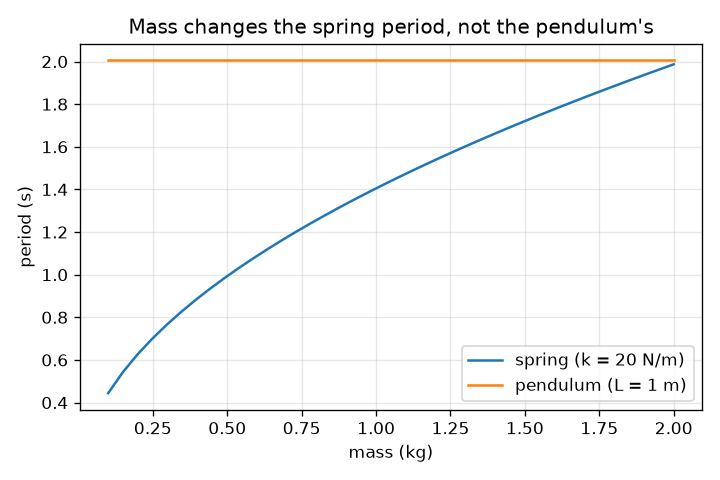
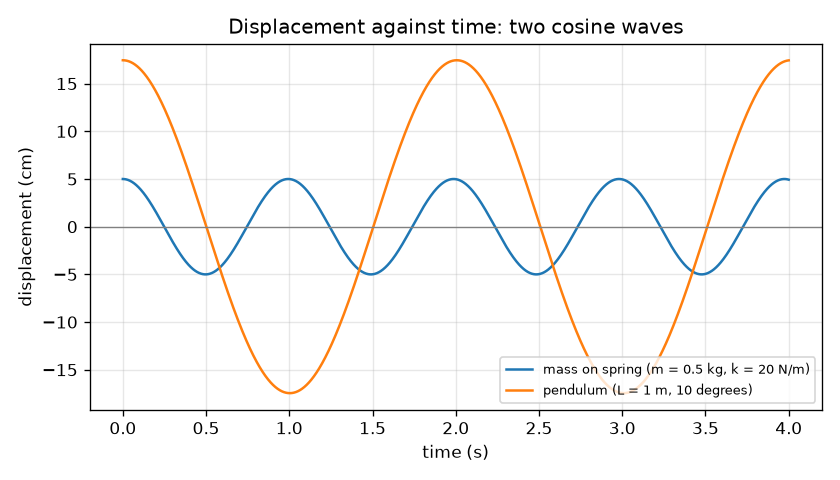

# സെഷൻ 1: ആടുന്ന വസ്തുക്കൾ: പീരിയഡ്, ആംപ്ലിറ്റ്യൂഡ്, ആവൃത്തി

[Session 1 — हिन्दी](README.hi.md)

*ലെവൽ 1 (ആശയപരമായ ഇന്ററാക്ടീവ് മോഡൽ) · ഏകദേശം 60 മിനിറ്റ് · openoscillator*

> ഇത് പഠനാവശ്യത്തിനുള്ള ലളിതമാക്കിയ ഒരു മോഡലാണ്. ഇത് സാധൂകരിക്കപ്പെട്ട ഒരു ഡിസൈൻ ഉപകരണമല്ല; യഥാർത്ഥ ഘടനകൾ, വൈദ്യുത ഇൻസ്റ്റലേഷനുകൾ, വാഹനങ്ങൾ, വ്യാവസായിക പ്രക്രിയകൾ അല്ലെങ്കിൽ വൈദ്യശാസ്ത്ര തീരുമാനങ്ങൾ എന്നിവയ്ക്കായി ഇത് ഉപയോഗിക്കരുത്.

**മുൻ‌അറിവ് (Prerequisites)**

- സ്കൂൾ ബീജഗണിതവും വർഗ്ഗമൂലങ്ങളും.
- നിങ്ങൾ PRIMER.md വായിച്ചിട്ടുണ്ട്, `python start.py 1` ഒരിക്കൽ റൺ ചെയ്തിട്ടുണ്ട്.

**പഠന ലക്ഷ്യങ്ങൾ (Learning objectives).** ഈ സെഷനു ശേഷം നിങ്ങൾക്ക് കഴിയും:

- പീരിയഡ് (period), ആംപ്ലിറ്റ്യൂഡ് (amplitude), ആവൃത്തി (frequency) എന്നിവ നിർവചിക്കാനും പീരിയഡും ആവൃത്തിയും തമ്മിൽ മാറ്റാനും.
- ഒരു പീരിയഡ് പ്രവചിക്കാൻ T = 2 pi sqrt(L / g), T = 2 pi sqrt(m / k) എന്നിവ ഉപയോഗിക്കാൻ.
- സ്ഥാനാന്തരം-സമയം ഗ്രാഫിൽ നിന്ന് പീരിയഡും ആംപ്ലിറ്റ്യൂഡും വായിക്കാൻ.
- ഒരു പെൻഡുലത്തിന്റെ പീരിയഡിനെ ഏതൊക്കെ അളവുകൾ മാറ്റുന്നു, ഏതൊക്കെ മാറ്റുന്നില്ല എന്ന് പറയാൻ.

## A. യഥാർത്ഥ ലോക പ്രശ്നം
ഒരു കളിസ്ഥലത്തെ ഊഞ്ഞാൽ, ഒരു ഗ്രാൻഡ്ഫാദർ ക്ലോക്ക്, ഒരു സൈക്കിൾ സീറ്റിന്റെ തുള്ളൽ എന്നിവയെല്ലാം ഒരു ചലനം വീണ്ടും വീണ്ടും ആവർത്തിക്കുന്നു. ഒരു ആട്ടത്തിന് എത്ര സമയം വേണം? അത് എത്ര ദൂരം പോകുന്നു? ഭാരമുള്ള കുട്ടി വേഗത്തിൽ ആടുമോ? ഇവ ഒരു ഊഞ്ഞാലിന്റെ പീരിയഡ്, ആംപ്ലിറ്റ്യൂഡ്, ആവൃത്തി എന്നിവയെക്കുറിച്ചുള്ള ചോദ്യങ്ങളാണ്, സ്ഥാനം-സമയം എന്ന ഒരു ചെറിയ ഗ്രാഫ് മൂന്നിനും ഉത്തരം നൽകുന്നു.

## B. ആശയവും സിദ്ധാന്തവും
ആവർത്തിക്കുന്ന ആട്ടത്തെ ദോലനം (oscillation) എന്ന് വിളിക്കുന്നു. ഒരു പൂർണ്ണ മുന്നോട്ടും പിന്നോട്ടും ആട്ടത്തിന് പീരിയഡ് T (സെക്കൻഡ്) വേണം. സെക്കൻഡിലെ ആട്ടങ്ങളുടെ എണ്ണം ആവൃത്തി f = 1 / T (ഹെർട്സ്, Hz) ആണ്. മധ്യത്തിൽ നിന്നുള്ള ഏറ്റവും വലിയ ദൂരം ആംപ്ലിറ്റ്യൂഡ് A ആണ്. ചെറിയ ആട്ടങ്ങൾക്ക്, സ്റ്റിഫ്നെസ് k ഉള്ള സ്പ്രിംഗിലെ പിണ്ഡം m-ന്റെ പീരിയഡ് T = 2 pi sqrt(m / k) ആണ്, നീളം L ഉള്ള പെൻഡുലത്തിന്റെ പീരിയഡ് T = 2 pi sqrt(L / g) ആണ്, ഇവിടെ g = 9.81 m/s^2. പെൻഡുലത്തിന്റെ പീരിയഡിൽ പിണ്ഡമോ ആംപ്ലിറ്റ്യൂഡോ ഇല്ല: ഗുരുത്വാകർഷണ വലിവും ബോബിന്റെ ജഡത്വവും (inertia) രണ്ടും പിണ്ഡത്തിന് ആനുപാതികമാണ്, അതിനാൽ പിണ്ഡം ഇല്ലാതാകുന്നു. ആട്ടം ഏറ്റവും വലിയ സ്ഥാനാന്തരത്തിൽ തുടങ്ങുകയാണെങ്കിൽ സ്ഥാനം ഒരു കോസൈൻ തരംഗം പിന്തുടരുന്നു, x(t) = A cos(2 pi t / T).

| ചിഹ്നം | അർത്ഥം | യൂണിറ്റ് |
|---|---|---|
| T | പീരിയഡ്: ഒരു പൂർണ്ണ ആട്ടത്തിനുള്ള സമയം | s |
| f | ആവൃത്തി: സെക്കൻഡിലെ ആട്ടങ്ങൾ, 1 / T | Hz |
| A | ആംപ്ലിറ്റ്യൂഡ്: മധ്യത്തിൽ നിന്നുള്ള ഏറ്റവും വലിയ സ്ഥാനാന്തരം | m |
| m | സ്പ്രിംഗിൽ തൂങ്ങുന്ന പിണ്ഡം | kg |
| k | സ്പ്രിംഗ് സ്റ്റിഫ്നെസ്: ഓരോ മീറ്റർ വലിവിനും ബലം | N/m |
| L | പിവറ്റിൽ നിന്ന് ബോബിന്റെ കേന്ദ്രം വരെയുള്ള പെൻഡുലത്തിന്റെ നീളം | m |
| g | ഗുരുത്വാകർഷണ ത്വരണം | m/s^2 |

**അനുമാനങ്ങൾ (Assumptions)**

- ചെറിയ ആട്ടങ്ങൾ മാത്രം (പെൻഡുലത്തിന് ഏകദേശം 15 ഡിഗ്രി വരെ); അതിനപ്പുറം എന്ത് സംഭവിക്കുന്നു എന്ന് സെഷൻ 3 കാണിക്കുന്നു.
- ഘർഷണമോ വായു പ്രതിരോധമോ ഇല്ല: ആട്ടം ഒരിക്കലും ശമിക്കുന്നില്ല (സെഷൻ 2 ഡാമ്പിംഗ് ചേർക്കുന്നു).
- സ്പ്രിംഗിന് സ്വന്തമായി പിണ്ഡമില്ല, അത് ഹൂക്കിന്റെ നിയമം അനുസരിക്കുന്നു; ചരടിന് പിണ്ഡമില്ല, ബോബ് ഒരു ബിന്ദുവാണ്.

$$ T = 2\pi\sqrt{\frac{m}{k}}\qquad T = 2\pi\sqrt{\frac{L}{g}} $$

$$ f = \frac{1}{T} $$

$$ x(t) = A\cos\!\left(\frac{2\pi t}{T}\right) $$

## C. ദൃശ്യ വിശദീകരണം
ആദ്യത്തെ ചിത്രം 20 N/m സ്പ്രിംഗിലെ 0.5 kg പിണ്ഡത്തിന്റെയും (ആംപ്ലിറ്റ്യൂഡ് 5 cm, പീരിയഡ് 0.99 s) 10 ഡിഗ്രി ആട്ടിയ 1 m പെൻഡുലത്തിന്റെയും (ആർക്ക് ആംപ്ലിറ്റ്യൂഡ് 17.5 cm, പീരിയഡ് 2.01 s) സ്ഥാനാന്തരം സമയത്തിനെതിരെ വരയ്ക്കുന്നു. രണ്ടും ഒരു ശിഖരത്തിൽ തുടങ്ങുന്ന കോസൈൻ തരംഗങ്ങളാണ്; സ്പ്രിംഗ് തരംഗം ഏകദേശം രണ്ടിരട്ടി തവണ ആവർത്തിക്കുന്നു. രണ്ടാമത്തെ ചിത്രം പിണ്ഡത്തിനെതിരെ പീരിയഡ് വരയ്ക്കുന്നു: സ്പ്രിംഗ് രേഖ വർഗ്ഗമൂലം പോലെ ഉയരുന്നു, പെൻഡുലം രേഖ പരന്നതാണ്, അതിനാൽ ഭാരമുള്ള ബോബ് സാവധാനമോ വേഗത്തിലോ ആടുന്നില്ല.

*പിണ്ഡത്തിനെതിരെ പീരിയഡ്: സ്പ്രിംഗിന് അത് വളരുന്നു, പെൻഡുലത്തിന് പരന്നതായി നിൽക്കുന്നു.*

*ഒരു സ്പ്രിംഗിന്റെ (T = 0.99 s) പെൻഡുലത്തിന്റെ (T = 2.01 s) സ്ഥാനാന്തരം സമയത്തിനെതിരെ.*

## D. ഇന്ററാക്ടീവ് സിമുലേഷൻ
പാഠം റൺ ചെയ്യുക (`python start.py 1`), എന്നിട്ട് ലൈവ് ആപ്പ് തുറക്കുക: [സെഷൻ 1: ഒരു പെൻഡുലവും ഒരു സ്പ്രിംഗും](https://krunalpanchal1995.github.io/pan-iit-oss/openoscillator/session-01/) (അല്ലെങ്കിൽ ഈ ഫോൾഡറിലെ `app.html`). പെൻഡുലത്തിന്റെ നീളവും സ്പ്രിംഗിന്റെ പിണ്ഡവും സ്റ്റിഫ്നെസും നീക്കി റീഡൗട്ടിലെ രണ്ട് പീരിയഡുകൾ നിരീക്ഷിക്കുക, പിന്നെ ഗ്രാഫ് വ്യൂവിലേക്ക് മാറി രണ്ട് കോസൈൻ തരംഗങ്ങൾ (ഒരേ ഉയരത്തിലേക്ക് സ്കെയിൽ ചെയ്തത്) ഒത്തുചേരുകയും വേർപിരിയുകയും ചെയ്യുന്നത് കാണുക.

**വെല്ലുവിളി.** പെൻഡുലവും സ്പ്രിംഗും ഒരേ താളത്തിൽ ആടിക്കുക: അവയുടെ പീരിയഡുകൾ 0.05 s-ൽ കുറവ് വ്യത്യാസപ്പെടണം.

## E. ചെയ്തുകാണിച്ച ഉദാഹരണവും പരീക്ഷണവും
**പ്രശ്നം.** ഒരു 0.5 kg പിണ്ഡം 20 N/m സ്പ്രിംഗിൽ തൂങ്ങുന്നു, അതിനടുത്ത് ഒരു 1.0 m പെൻഡുലം ആടുന്നു. ഓരോന്നിന്റെയും പീരിയഡും ആവൃത്തിയും കണ്ടെത്തുക, ഒരു സമയ അളവെടുപ്പ് ഉപയോഗിച്ച് പെൻഡുലം പരിശോധിക്കുക.

1. സ്പ്രിംഗ്: m / k = 0.5 / 20 = 0.025 s^2, വർഗ്ഗമൂലം = 0.1581 s, അതിനാൽ T = 2 pi * 0.1581 = 0.993 s, f = 1 / 0.993 = 1.007 Hz.
2. പെൻഡുലം: L / g = 1.0 / 9.81 = 0.1019 s^2, വർഗ്ഗമൂലം = 0.3193 s, അതിനാൽ T = 2 pi * 0.3193 = 2.006 s, f = 0.498 Hz.
3. പെൻഡുലം ഏകദേശം രണ്ടിരട്ടി സാവധാനമാണ്: 2.006 / 0.993 = 2.02.
4. ഗ്രാഫിൽ നിന്നുള്ള പരിശോധന: സാമ്പിൾ ചെയ്ത സ്പ്രിംഗ് വക്രത്തിന്റെ മുകളിലേക്കുള്ള പൂജ്യം കടക്കലുകൾ എണ്ണി, പ്രോഗ്രാം 0.9935 s അളക്കുന്നു, സൂത്രവാക്യത്തിന് തുല്യം.

**ഉത്തരം.** സ്പ്രിംഗ്: T = 0.993 s, f = 1.007 Hz. പെൻഡുലം: T = 2.006 s, f = 0.498 Hz.

**പരീക്ഷണം.** 1.00 m ചരടിൽ ഒരു ചെറിയ ഭാരം കെട്ടി, ഏകദേശം 10 ഡിഗ്രി ആട്ടി, ഒരു ഫോൺ സ്റ്റോപ്പ് വാച്ച് ഉപയോഗിച്ച് 20 ആട്ടങ്ങൾ സമയം അളക്കുക; 20 കൊണ്ട് ഹരിക്കുക. ഏകദേശം 40.1 s പ്രതീക്ഷിക്കാം, അതിനാൽ T = 2.01 s. മനുഷ്യ പ്രതികരണം മുഴുവൻ എണ്ണത്തിലും ഏകദേശം 0.2 s പിശക് ചേർക്കുന്നു, ഓരോ ആട്ടത്തിനും 0.01 s മാത്രം. വലിയ ആട്ടം, ഭാരമുള്ള ചരട്, അല്ലെങ്കിൽ വലിയ ബോബ് (ചരടിന്റെ നീളത്തേക്കാൾ താഴെയാണ് അതിന്റെ പിണ്ഡകേന്ദ്രം) യഥാർത്ഥ മൂല്യത്തെ അല്പം വ്യത്യസ്തമാക്കുന്നു: പിണ്ഡമില്ലാത്ത ചരടിലെ ബിന്ദു ബോബിന് മോഡൽ കൃത്യമാണ്, നിങ്ങളുടെ പെൻഡുലം അങ്ങനെയല്ല.

## F. മൂല്യനിർണ്ണയവും ഡിസൈൻ വെല്ലുവിളിയും
**ചോദ്യ തരം A: ആശയപരം.** ഒരു ഭാരമുള്ള ബോബും ഒരു ഭാരം കുറഞ്ഞ ബോബും ഒരേ നീളമുള്ള ചരടുകളിൽ തൂങ്ങുന്നു. ചെറിയ ആട്ടങ്ങൾക്ക് ഏതിനാണ് നീണ്ട പീരിയഡ്? T = 2 pi sqrt(L / g)-ൽ പിണ്ഡം വരാത്തത് എന്തുകൊണ്ട്, ഒരു സ്പ്രിംഗിന് അത് വരുന്നത് എന്തുകൊണ്ട്?

സൂചന

ഓരോ സാഹചര്യത്തിലും പുനഃസ്ഥാപന ബലവും ജഡത്വവും പിണ്ഡത്തെ എങ്ങനെ ആശ്രയിക്കുന്നു എന്ന് താരതമ്യം ചെയ്യുക.

പടിപടിയായുള്ള പരിഹാരം

അവയ്ക്ക് ഒരേ പീരിയഡ് ആണ്. ആട്ടത്തിന്റെ ദിശയിലുള്ള ഗുരുത്വാകർഷണ വലിവ് പിണ്ഡത്തിന് ആനുപാതികമാണ്, ജഡത്വവും (ത്വരണത്തോടുള്ള പ്രതിരോധം) അങ്ങനെ തന്നെ, അതിനാൽ പിണ്ഡം ഇല്ലാതാകുന്നു. ഒരു സ്പ്രിംഗിന്, പുനഃസ്ഥാപന ബലം k x പിണ്ഡത്തോടൊപ്പം വളരുന്നില്ല, പക്ഷേ ജഡത്വം വളരുന്നു, അതിനാൽ വലിയ പിണ്ഡം കുറച്ച് മാത്രം ത്വരിക്കുന്നു, ആട്ടം സാവധാനമാണ്: T, sqrt(m) പോലെ വളരുന്നു.

**ചോദ്യ തരം B: സംഖ്യാപരം.** 0.25 m നീളമുള്ള ഒരു പെൻഡുലത്തിന്റെ പീരിയഡും ആവൃത്തിയും കണ്ടെത്തുക. നീളം നാലിരട്ടിയാക്കിയാൽ പീരിയഡ് എത്ര മടങ്ങ് മാറും?

സൂചന

g = 9.81 m/s^2 ഉള്ള T = 2 pi sqrt(L / g). വർഗ്ഗമൂലത്തിനുള്ളിലെ 4 എന്ന ഘടകം 2 എന്ന ഘടകമാകുന്നു.

പടിപടിയായുള്ള പരിഹാരം

L / g = 0.25 / 9.81 = 0.02548 s^2, വർഗ്ഗമൂലം = 0.1596 s, T = 2 pi * 0.1596 = 1.003 s, f = 1 / 1.003 = 0.997 Hz. നാലിരട്ടി നീളം (1.0 m) T = 2.006 s നൽകുന്നു, രണ്ടിരട്ടി നീളം. യുക്തിപരിശോധന: 25 cm പെൻഡുലം ഒരു ചെറിയതാണ്, സെക്കൻഡിൽ ഏകദേശം ഒരു ആട്ടം, അത് ശരിയായി തോന്നുന്നു.

**ചോദ്യ തരം C: ഗ്രാഫ്, സിമുലേഷൻ വ്യാഖ്യാനം.** ഗ്രാഫിൽ, സ്പ്രിംഗ് തരംഗം (T = 0.99 s) t = 0-ൽ ഒരു ശിഖരത്തിൽ തുടങ്ങുന്നു. ഏകദേശം ഏത് സമയത്ത് അത് ആദ്യമായി പൂജ്യം കടക്കുന്നു, 6 s-ൽ പെൻഡുലം (T = 2.01 s) എത്ര പൂർണ്ണ ആട്ടങ്ങൾ നടത്തുന്നു?

സൂചന

ഒരു കോസൈൻ ശിഖരത്തിന് ശേഷം ഒരു പീരിയഡിന്റെ കാൽ ഭാഗത്ത് പൂജ്യം കടക്കുന്നു.

പടിപടിയായുള്ള പരിഹാരം

ഒരു പീരിയഡിന്റെ കാൽ ഭാഗം 0.993 / 4 = 0.248 s ആണ്, അതിനാൽ സ്പ്രിംഗ് തരംഗം ഏകദേശം 0.25 s-ൽ താഴേക്ക് പോകുമ്പോൾ ആദ്യമായി പൂജ്യം കടക്കുന്നു. പെൻഡുലം 6 s-ൽ 6 / 2.006 = 2.99, ഏകദേശം 3 പൂർണ്ണ ആട്ടങ്ങൾ നടത്തുന്നു (t = 6 s-ൽ അത് ഏതാണ്ട് ഒരു ശിഖരത്തിൽ തിരിച്ചെത്തുന്നു).

**ചോദ്യ തരം D: ഡിസൈൻ, ഒപ്റ്റിമൈസേഷൻ വെല്ലുവിളി.** ഡിസൈൻ: 20 N/m സ്പ്രിംഗിലെ 2.0 kg പിണ്ഡത്തോടൊപ്പം ഒരേ താളത്തിൽ ആടുന്ന വിധം ഒരു പെൻഡുലത്തിന്റെ നീളം തിരഞ്ഞെടുക്കുക. പീരിയഡ് പറയുക, ഉത്തരം ഒരു ക്ലാസ് മുറിക്ക് പ്രായോഗികമാണോ എന്ന് പറയുക.

സൂചന

ആദ്യം സ്പ്രിംഗിന്റെ പീരിയഡ് കണ്ടെത്തുക, പിന്നെ T = 2 pi sqrt(L / g) L-ന് വേണ്ടി പരിഹരിക്കുക: L = g (T / 2 pi)^2.

പടിപടിയായുള്ള പരിഹാരം

സ്പ്രിംഗ്: T = 2 pi sqrt(2.0 / 20) = 1.987 s. പിന്നെ L = 9.81 * (1.987 / 6.283)^2 = 9.81 * 0.1000 = 0.981 m. ഏകദേശം 1 m ചരട് ഒരു വാതിൽ ഫ്രെയിമിൽ തൂക്കാൻ എളുപ്പമാണ്, അതിനാൽ ഇത് പ്രായോഗികമാണ്. വിട്ടുവീഴ്ച (trade-off): നിങ്ങൾക്ക് അളക്കാൻ കഴിയുന്ന നീളത്തിനും സ്പ്രിംഗ് സ്ഥിരാങ്കത്തിനും അനുസരിച്ചേ പൊരുത്തം നല്ലതാകൂ, L-ൽ 1 ശതമാനത്തിന്റെ ചെറിയ പൊരുത്തക്കേട് T-യിൽ 0.5 ശതമാനമാണ്. അനുമാനം: ചെറിയ ആട്ടങ്ങൾ.

[RUBRIC.md](../../RUBRIC.md) ഉപയോഗിച്ച് സ്വയം സ്കോർ ചെയ്യുക. കടലാസിൽ പ്രവർത്തിക്കാൻ [ആക്ടിവിറ്റി ഷീറ്റ്](activity_sheet.md) പ്രിന്റ് ചെയ്യുക.

## സാധാരണ തെറ്റിദ്ധാരണകൾ
| സാധാരണ തെറ്റിദ്ധാരണ | യഥാർത്ഥത്തിൽ ശരിയായത് |
|---|---|
| ഭാരമുള്ള പെൻഡുലം ബോബ് വേഗത്തിൽ (അല്ലെങ്കിൽ സാവധാനത്തിൽ) ആടുന്നു. | ചെറിയ ആട്ടങ്ങൾക്ക് പീരിയഡ് പിണ്ഡത്തെ ഒട്ടും ആശ്രയിക്കുന്നില്ല; നീളവും ഗുരുത്വാകർഷണവും മാത്രമേ പ്രധാനമുള്ളൂ. |
| വലിയ ആട്ടം എപ്പോഴും കൂടുതൽ സമയം എടുക്കുന്നു. | ചെറിയ ആട്ടങ്ങൾക്ക് ആംപ്ലിറ്റ്യൂഡ് എന്തായാലും പീരിയഡ് ഒന്നുതന്നെ. വലിയ ആട്ടങ്ങളിൽ മാത്രമേ ശ്രദ്ധേയമായ വ്യത്യാസം ഉണ്ടാകൂ (സെഷൻ 3 അത് അളക്കുന്നു). |
| ആവൃത്തിയും പീരിയഡും ഒരുമിച്ച് വളരുന്ന വ്യത്യസ്ത കാര്യങ്ങളാണ്. | അവ വിപരീതങ്ങളാണ്: f = 1 / T. നീണ്ട പീരിയഡ് എന്നാൽ താഴ്ന്ന ആവൃത്തി. |
| ആംപ്ലിറ്റ്യൂഡ് എന്നത് ആട്ടത്തിന്റെ ഒരറ്റം മുതൽ മറ്റേ അറ്റം വരെയുള്ള ദൂരമാണ്. | അത് മധ്യത്തിൽ നിന്ന് ഒരറ്റം വരെയുള്ള ദൂരമാണ്, ആകെ സഞ്ചാരത്തിന്റെ പകുതി. |

## പദാവലി
- **ദോലനം (oscillation)**: ഒരു ആട്ടം പോലെ ആവർത്തിക്കുന്ന ചലനം
- **പീരിയഡ് (period)**: ഒരു പൂർണ്ണ മുന്നോട്ടും പിന്നോട്ടുമുള്ള ആട്ടത്തിനുള്ള സമയം, സെക്കൻഡിൽ
- **ആവൃത്തി (frequency)**: സെക്കൻഡിലെ ആട്ടങ്ങളുടെ എണ്ണം, ഹെർട്സിൽ; പീരിയഡിന്റെ വിപരീതം
- **ആംപ്ലിറ്റ്യൂഡ് (amplitude)**: മധ്യ സ്ഥാനത്ത് നിന്നുള്ള ഏറ്റവും വലിയ ദൂരം
- **സ്റ്റിഫ്നെസ് (k)**: ഒരു സ്പ്രിംഗ് ഓരോ മീറ്റർ വലിക്കുമ്പോഴും എത്ര ന്യൂട്ടൺ ബലം നൽകുന്നു

## പൂർത്തിയാക്കുക
1. [exercises.md](exercises.md)-ലെ മൂന്ന് കോഡിംഗ് ജോലികൾ ചെയ്യുക.
2. നിങ്ങളുടെ മാറ്റങ്ങൾക്ക് ശേഷം `python start.py 1` വീണ്ടും റൺ ചെയ്യുക. അത് ചെക്ക്‌പോയിന്റോടെ അവസാനിക്കുന്നു; അത് `PASS` എന്ന് പ്രിന്റ് ചെയ്യുമ്പോൾ നിങ്ങൾ പൂർത്തിയാക്കി. (ചെക്ക്‌പോയിന്റ് മാത്രം: `python start.py check 1`.)

അടുത്തത്: [സെഷൻ 2](../session-02/README.md)
