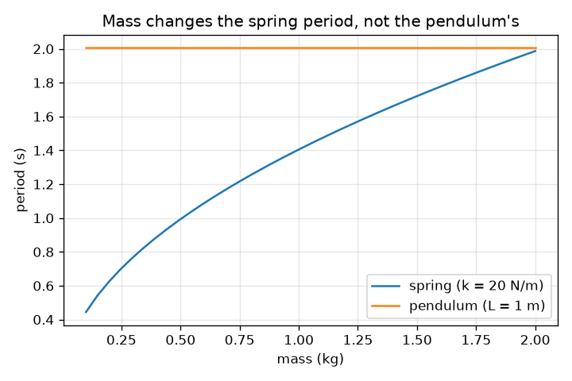
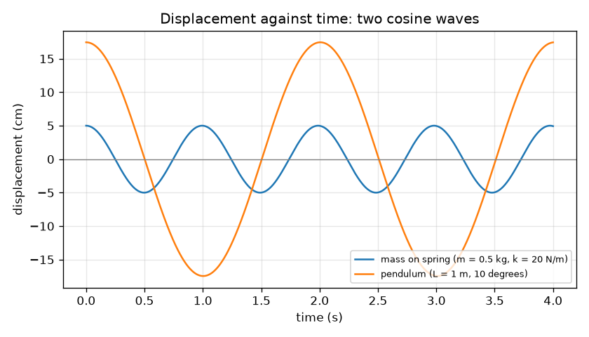

# அமர்வு 1: ஊசலாடும் பொருட்கள்: periodம், வீச்சும், அதிர்வெண்ணும்

[Session 1 — हिन्दी](README.hi.md) · [Session 1 — മലയാളം](README.ml.md)

*நிலை 1 (கருத்தியல் ஊடாடும் மாதிரி) · சுமார் 60 நிமிடங்கள் · openoscillator*

> இது கல்விக்கான எளிமைப்படுத்தப்பட்ட மாதிரி. இது சரிபார்க்கப்பட்ட வடிவமைப்புக் கருவி அல்ல; உண்மையான கட்டமைப்புகள், மின் நிறுவல்கள், வாகனங்கள், தொழில்துறை செயல்முறைகள் அல்லது மருத்துவ முடிவுகளுக்கு இதைப் பயன்படுத்தக் கூடாது.

**முன்தேவைகள் (Prerequisites)**

- பள்ளி இயற்கணிதமும் வர்க்க மூலங்களும்.
- நீங்கள் PRIMER.md படித்து, `python start.py 1` ஒருமுறை இயக்கியுள்ளீர்கள்.

**கற்றல் நோக்கங்கள் (Learning objectives).** இந்த அமர்வுக்குப் பிறகு நீங்கள்:

- அலைவுநேரம் (period), வீச்சு (amplitude), அதிர்வெண் (frequency) ஆகியவற்றை வரையறுத்து, periodக்கும் அதிர்வெண்ணுக்கும் இடையே மாற்ற முடியும்.
- ஒரு periodஐக் கணிக்க T = 2 pi sqrt(L / g) மற்றும் T = 2 pi sqrt(m / k) பயன்படுத்த முடியும்.
- இடப்பெயர்ச்சி-நேர வரைபடத்திலிருந்து period மற்றும் வீச்சைப் படிக்க முடியும்.
- ஒரு ஊசலின் periodஐ எந்த அளவுகள் மாற்றுகின்றன, எவை மாற்றுவதில்லை என்று சொல்ல முடியும்.

## A. நிஜ உலகப் பிரச்சினை
ஒரு விளையாட்டு மைதான ஊஞ்சல், ஒரு தாத்தா கடிகாரம், ஒரு மிதிவண்டி இருக்கையின் துள்ளல் ஆகிய அனைத்தும் ஓர் இயக்கத்தை மீண்டும் மீண்டும் செய்கின்றன. ஒரு ஆட்டத்துக்கு எவ்வளவு நேரம் ஆகிறது? அது எவ்வளவு தூரம் போகிறது? கனமான குழந்தை வேகமாக ஆடுமா? இவை ஒரு ஊஞ்சலின் period, வீச்சு, அதிர்வெண் பற்றிய கேள்விகள், நிலை-நேரம் பற்றிய ஒரு சிறிய வரைபடம் மூன்றுக்கும் விடை தருகிறது.

## B. கருத்தும் கோட்பாடும்
திரும்பத் திரும்ப நிகழும் ஆட்டம் அலைவு (oscillation) எனப்படும். ஒரு முழு முன்-பின் ஆட்டத்துக்கு period T (வினாடிகள்) ஆகும். வினாடிக்கான ஆட்டங்களின் எண்ணிக்கை அதிர்வெண் f = 1 / T (ஹெர்ட்ஸ், Hz). நடுவிலிருந்து மிகப் பெரிய தொலைவு வீச்சு A. சிறிய ஆட்டங்களுக்கு, விறைப்பு k கொண்ட வில்லின் மீதுள்ள நிறை m-இன் period T = 2 pi sqrt(m / k), நீளம் L கொண்ட ஊசலின் period T = 2 pi sqrt(L / g), இங்கு g = 9.81 m/s^2. ஊசலின் periodஇல் நிறையோ வீச்சோ இல்லை: ஈர்ப்பு இழுப்பும் குண்டின் நிலைம (inertia) இரண்டும் நிறைக்கு விகிதசமம், எனவே நிறை நீங்கிவிடுகிறது. ஆட்டம் மிகப் பெரிய இடப்பெயர்ச்சியில் தொடங்கினால் நிலை ஒரு கொசைன் அலையைப் பின்பற்றுகிறது, x(t) = A cos(2 pi t / T).

| குறியீடு | பொருள் | அலகு |
|---|---|---|
| T | period: ஒரு முழு ஆட்டத்துக்கான நேரம் | s |
| f | அதிர்வெண்: வினாடிக்கான ஆட்டங்கள், 1 / T | Hz |
| A | வீச்சு: நடுவிலிருந்து மிகப் பெரிய இடப்பெயர்ச்சி | m |
| m | வில்லில் தொங்கும் நிறை | kg |
| k | வில் விறைப்பு: ஒவ்வொரு மீட்டர் நீட்சிக்குமான விசை | N/m |
| L | சுழலிடத்திலிருந்து குண்டின் மையம் வரையிலான ஊசலின் நீளம் | m |
| g | ஈர்ப்பு முடுக்கம் | m/s^2 |

**அனுமானங்கள் (Assumptions)**

- சிறிய ஆட்டங்கள் மட்டும் (ஊசலுக்குச் சுமார் 15 பாகை வரை); அதற்கு அப்பால் என்ன நடக்கிறது என்று அமர்வு 3 காட்டுகிறது.
- உராய்வோ காற்றுத் தடையோ இல்லை: ஆட்டம் ஒருபோதும் தணிவதில்லை (அமர்வு 2 தணிப்பைச் சேர்க்கிறது).
- வில்லுக்கு சொந்த நிறை இல்லை, அது ஹூக் விதியைப் பின்பற்றுகிறது; நூல் நிறையற்றது, குண்டு ஒரு புள்ளி.

$$ T = 2\pi\sqrt{\frac{m}{k}}\qquad T = 2\pi\sqrt{\frac{L}{g}} $$

$$ f = \frac{1}{T} $$

$$ x(t) = A\cos\!\left(\frac{2\pi t}{T}\right) $$

## C. காட்சி விளக்கம்
முதல் படம் 20 N/m வில்லில் உள்ள 0.5 kg நிறைக்கும் (வீச்சு 5 cm, period 0.99 s) 10 பாகை ஆட்டிய 1 m ஊசலுக்கும் (வில் வீச்சு 17.5 cm, period 2.01 s) இடப்பெயர்ச்சியை நேரத்துக்கு எதிராக வரைகிறது. இரண்டும் உச்சியில் தொடங்கும் கொசைன் அலைகள்; வில் அலை சுமார் இரு மடங்கு அடிக்கடி திரும்பத் திரும்ப வருகிறது. இரண்டாவது படம் நிறைக்கு எதிராக periodஐ வரைகிறது: வில் கோடு வர்க்க மூலம் போல் உயர்கிறது, ஊசல் கோடு தட்டையானது, எனவே கனமான குண்டு மெதுவாகவோ வேகமாகவோ ஆடுவதில்லை.

*நிறைக்கு எதிராக period: வில்லுக்கு அது வளர்கிறது, ஊசலுக்குத் தட்டையாக இருக்கிறது.*

*ஒரு வில்லின் (T = 0.99 s) மற்றும் ஊசலின் (T = 2.01 s) இடப்பெயர்ச்சி நேரத்துக்கு எதிராக.*

## D. ஊடாடும் உருவகப்படுத்தல்
பாடத்தை இயக்குங்கள் (`python start.py 1`), பிறகு நேரடிச் செயலியைத் திறங்கள்: [அமர்வு 1: ஒரு ஊசலும் ஒரு வில்லும்](https://krunalpanchal1995.github.io/pan-iit-oss/openoscillator/session-01/) (அல்லது இந்தக் கோப்புறையிலுள்ள `app.html`). ஊசலின் நீளத்தையும் வில்லின் நிறை மற்றும் விறைப்பையும் நகர்த்தி அளவீட்டில் இரண்டு periodகளைப் பாருங்கள், பிறகு வரைபடக் காட்சிக்கு மாறி இரண்டு கொசைன் அலைகள் (அதே உயரத்துக்கு அளவிடப்பட்டவை) ஒத்திசைவதையும் விலகுவதையும் பாருங்கள்.

**சவால்.** ஊசலையும் வில்லையும் ஒரே தாளத்தில் ஆடச் செய்யுங்கள்: அவற்றின் periodகள் 0.05 s-க்கும் குறைவாக வேறுபட வேண்டும்.

## E. தீர்க்கப்பட்ட எடுத்துக்காட்டும் பரிசோதனையும்
**பிரச்சினை.** ஒரு 0.5 kg நிறை 20 N/m வில்லில் தொங்குகிறது, அதன் அருகில் ஒரு 1.0 m ஊசல் ஆடுகிறது. ஒவ்வொன்றின் periodஐயும் அதிர்வெண்ணையும் காணுங்கள், ஒரு நேர அளவீட்டுடன் ஊசலைச் சரிபாருங்கள்.

1. வில்: m / k = 0.5 / 20 = 0.025 s^2, வர்க்க மூலம் = 0.1581 s, எனவே T = 2 pi * 0.1581 = 0.993 s, f = 1 / 0.993 = 1.007 Hz.
2. ஊசல்: L / g = 1.0 / 9.81 = 0.1019 s^2, வர்க்க மூலம் = 0.3193 s, எனவே T = 2 pi * 0.3193 = 2.006 s, f = 0.498 Hz.
3. ஊசல் சுமார் இரு மடங்கு மெதுவானது: 2.006 / 0.993 = 2.02.
4. வரைபடத்திலிருந்து சரிபார்ப்பு: மாதிரியெடுத்த வில் வளைவின் மேல்நோக்கிய பூஜ்ஜியக் கடப்புகளை எண்ணி, நிரல் 0.9935 s அளக்கிறது, சூத்திரத்துக்குச் சமம்.

**விடை.** வில்: T = 0.993 s, f = 1.007 Hz. ஊசல்: T = 2.006 s, f = 0.498 Hz.

**பரிசோதனை.** 1.00 m நூலில் ஒரு சிறிய எடையைக் கட்டி, சுமார் 10 பாகை ஆட்டி, ஒரு தொலைபேசி நிறுத்தக் கடிகாரத்தால் 20 ஆட்டங்களின் நேரத்தை அளவிடுங்கள்; 20-ஆல் வகுங்கள். சுமார் 40.1 s எதிர்பார்க்கலாம், எனவே T = 2.01 s. மனித எதிர்வினை முழு எண்ணிக்கையிலும் சுமார் 0.2 s பிழையைச் சேர்க்கிறது, ஒரு ஆட்டத்துக்கு 0.01 s மட்டுமே. பெரிய ஆட்டம், கனமான நூல், அல்லது பெரிய குண்டு (அதன் நிறை மையம் நூலின் நீளத்தை விடக் கீழே இருக்கும்) உண்மை மதிப்பைச் சற்று வேறுபடுத்துகிறது: நிறையற்ற நூலில் ஒரு புள்ளிக் குண்டுக்கு மாதிரி துல்லியமானது, உங்கள் ஊசல் அப்படியல்ல.

## F. மதிப்பீடும் வடிவமைப்புச் சவாலும்
**கேள்வி வகை A: கருத்தியல்.** ஒரு கனமான குண்டும் ஒரு இலேசான குண்டும் ஒரே நீளமுள்ள நூல்களில் தொங்குகின்றன. சிறிய ஆட்டங்களுக்கு எதன் period நீளமானது? T = 2 pi sqrt(L / g)-இல் நிறை ஏன் வருவதில்லை, வில்லுக்கு அது ஏன் வருகிறது?

குறிப்பு

ஒவ்வொரு நிகழ்விலும் மீட்பு விசையும் நிலைமமும் நிறையைச் சார்ந்திருக்கும் விதத்தை ஒப்பிடுங்கள்.

படிப்படியான தீர்வு

அவற்றுக்கு ஒரே period. ஆட்டத்தின் திசையில் ஈர்ப்பு இழுப்பு நிறைக்கு விகிதசமம், நிலைமமும் (முடுக்கத்துக்கான எதிர்ப்பு) அப்படியே, எனவே நிறை நீங்கிவிடுகிறது. ஒரு வில்லுக்கு, மீட்பு விசை k x நிறையுடன் வளர்வதில்லை, ஆனால் நிலைமம் வளர்கிறது, எனவே பெரிய நிறை குறைவாக முடுக்கமடைகிறது, ஆட்டம் மெதுவாகிறது: T, sqrt(m) போல் வளர்கிறது.

**கேள்வி வகை B: எண்ணியல்.** 0.25 m நீளமுள்ள ஊசலின் periodஐயும் அதிர்வெண்ணையும் காணுங்கள். நீளத்தை நான்கு மடங்காக்கினால் period எத்தனை மடங்கு மாறும்?

குறிப்பு

g = 9.81 m/s^2 உடன் T = 2 pi sqrt(L / g). வர்க்க மூலத்துக்குள் காரணி 4, காரணி 2 ஆகிறது.

படிப்படியான தீர்வு

L / g = 0.25 / 9.81 = 0.02548 s^2, வர்க்க மூலம் = 0.1596 s, T = 2 pi * 0.1596 = 1.003 s, f = 1 / 1.003 = 0.997 Hz. நான்கு மடங்கு நீளம் (1.0 m) T = 2.006 s தருகிறது, இரு மடங்கு நீளம். சரிபார்ப்பு: 25 cm ஊசல் சிறியது, வினாடிக்குச் சுமார் ஒரு ஆட்டம், அது சரியாகத் தோன்றுகிறது.

**கேள்வி வகை C: வரைபடம் மற்றும் உருவகப்படுத்தல் விளக்கம்.** வரைபடத்தில், வில் அலை (T = 0.99 s) t = 0-இல் உச்சியில் தொடங்குகிறது. சுமார் எந்த நேரத்தில் அது முதலில் பூஜ்ஜியத்தைக் கடக்கிறது, 6 s-இல் ஊசல் (T = 2.01 s) எத்தனை முழு ஆட்டங்கள் ஆடுகிறது?

குறிப்பு

ஒரு கொசைன் உச்சிக்குப் பிறகு ஒரு periodஇன் கால் பங்கில் பூஜ்ஜியத்தைக் கடக்கிறது.

படிப்படியான தீர்வு

ஒரு periodஇன் கால் பங்கு 0.993 / 4 = 0.248 s, எனவே வில் அலை சுமார் 0.25 s-இல் கீழ்நோக்கிச் செல்லும்போது முதலில் பூஜ்ஜியத்தைக் கடக்கிறது. ஊசல் 6 s-இல் 6 / 2.006 = 2.99, சுமார் 3 முழு ஆட்டங்கள் ஆடுகிறது (t = 6 s-இல் அது கிட்டத்தட்ட மீண்டும் உச்சியில் உள்ளது).

**கேள்வி வகை D: வடிவமைப்பு மற்றும் உகப்பாக்கச் சவால்.** வடிவமைப்பு: 20 N/m வில்லில் உள்ள 2.0 kg நிறையுடன் ஒரே தாளத்தில் ஆடும்படி ஊசலின் நீளத்தைத் தேர்ந்தெடுங்கள். periodஐக் குறிப்பிட்டு, விடை வகுப்பறைக்கு நடைமுறைக்கு உகந்ததா என்று சொல்லுங்கள்.

குறிப்பு

முதலில் வில்லின் periodஐக் காணுங்கள், பிறகு T = 2 pi sqrt(L / g)-ஐ L-க்குத் தீருங்கள்: L = g (T / 2 pi)^2.

படிப்படியான தீர்வு

வில்: T = 2 pi sqrt(2.0 / 20) = 1.987 s. பிறகு L = 9.81 * (1.987 / 6.283)^2 = 9.81 * 0.1000 = 0.981 m. சுமார் 1 m நூலை ஒரு கதவுச் சட்டத்தில் தொங்கவிடுவது எளிது, எனவே இது நடைமுறைக்கு உகந்தது. சமரசம் (trade-off): நீங்கள் அளக்கக்கூடிய நீளத்தையும் வில் மாறிலியையும் பொறுத்தே பொருத்தம் நன்றாக இருக்கும், L-இல் 1 சதவீதம் சிறிய பொருத்தமின்மை T-இல் 0.5 சதவீதம். அனுமானம்: சிறிய ஆட்டங்கள்.

[RUBRIC.md](../../RUBRIC.md) மூலம் உங்களை மதிப்பிடுங்கள். தாளில் வேலை செய்ய [செயல்பாட்டுத் தாளை](activity_sheet.md) அச்சிடுங்கள்.

## பொதுவான தவறான கருத்துகள்
| பொதுவான தவறான கருத்து | உண்மையில் சரியானது |
|---|---|
| கனமான ஊசல் குண்டு வேகமாக (அல்லது மெதுவாக) ஆடுகிறது. | சிறிய ஆட்டங்களுக்கு period நிறையைச் சார்ந்ததே இல்லை; நீளமும் ஈர்ப்பும் மட்டுமே முக்கியம். |
| பெரிய ஆட்டம் எப்போதும் அதிக நேரம் எடுக்கும். | சிறிய ஆட்டங்களுக்கு வீச்சு எதுவாக இருந்தாலும் period ஒன்றே. பெரிய ஆட்டங்களில் மட்டுமே குறிப்பிடத்தக்க வேறுபாடு தோன்றும் (அமர்வு 3 அதை அளக்கிறது). |
| அதிர்வெண்ணும் periodஉம் சேர்ந்து வளரும் வெவ்வேறு விஷயங்கள். | அவை தலைகீழிகள்: f = 1 / T. நீண்ட period என்றால் குறைந்த அதிர்வெண். |
| வீச்சு என்பது ஆட்டத்தின் ஒரு முனையிலிருந்து மறு முனை வரையிலான தொலைவு. | அது நடுவிலிருந்து ஒரு முனை வரையிலான தொலைவு, மொத்தப் பயணத்தின் பாதி. |

## சொற்களஞ்சியம்
- **அலைவு (oscillation)**: ஓர் ஆட்டம் போலத் திரும்பத் திரும்ப நிகழும் இயக்கம்
- **period**: ஒரு முழு முன்-பின் ஆட்டத்துக்கான நேரம், வினாடிகளில்
- **அதிர்வெண் (frequency)**: வினாடிக்கான ஆட்டங்களின் எண்ணிக்கை, ஹெர்ட்ஸில்; periodஇன் தலைகீழி
- **வீச்சு (amplitude)**: நடு நிலையிலிருந்து மிகப் பெரிய தொலைவு
- **விறைப்பு (k)**: ஒரு வில் ஒவ்வொரு மீட்டர் நீட்டப்படும்போதும் எத்தனை நியூட்டன் விசை தருகிறது

## முடிவு
1. [exercises.md](exercises.md)-இல் உள்ள மூன்று நிரலாக்கப் பணிகளைச் செய்யுங்கள்.
2. உங்கள் மாற்றங்களுக்குப் பிறகு `python start.py 1` மீண்டும் இயக்குங்கள். அது சோதனைச் சாவடியுடன் முடிகிறது; அது `PASS` என்று அச்சிடும்போது நீங்கள் முடித்துவிட்டீர்கள். (சோதனைச் சாவடி மட்டும்: `python start.py check 1`.)

அடுத்து: [அமர்வு 2](../session-02/README.md)
