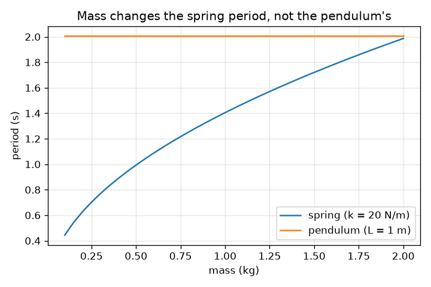
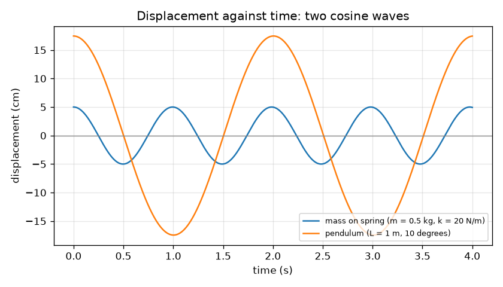

# సెషన్ 1: ఊగే వస్తువులు: ఆవర్తన కాలం, కంపన పరిమాణం, పౌనఃపున్యం

[Session 1 — हिन्दी](README.hi.md) · [Session 1 — മലയാളം](README.ml.md) · [Session 1 — தமிழ்](README.ta.md)

*స్థాయి 1 (భావనాత్మక ఇంటరాక్టివ్ నమూనా) · సుమారు 60 నిమిషాలు · openoscillator*

> ఇది విద్య కోసం సరళీకరించిన నమూనా. ఇది ధ్రువీకరించబడిన డిజైన్ సాధనం కాదు; నిజమైన నిర్మాణాలు, విద్యుత్ ఇన్‌స్టలేషన్లు, వాహనాలు, పారిశ్రామిక ప్రక్రియలు లేదా వైద్య నిర్ణయాల కోసం దీనిని ఉపయోగించకూడదు.

**ముందస్తు అవసరాలు (Prerequisites)**

- పాఠశాల బీజగణితం మరియు వర్గమూలాలు.
- మీరు PRIMER.md చదివి, `python start.py 1` ఒకసారి రన్ చేశారు.

**అభ్యసన లక్ష్యాలు (Learning objectives).** ఈ సెషన్ తర్వాత మీరు:

- ఆవర్తన కాలం (period), కంపన పరిమాణం (amplitude), పౌనఃపున్యం (frequency) లను నిర్వచించి, ఆవర్తన కాలం మరియు పౌనఃపున్యం మధ్య మార్చగలరు.
- ఒక ఆవర్తన కాలాన్ని అంచనా వేయడానికి T = 2 pi sqrt(L / g) మరియు T = 2 pi sqrt(m / k) ఉపయోగించగలరు.
- స్థానభ్రంశం-కాలం గ్రాఫ్ నుండి ఆవర్తన కాలాన్ని మరియు కంపన పరిమాణాన్ని చదవగలరు.
- ఒక లోలకం యొక్క ఆవర్తన కాలాన్ని ఏ రాశులు మారుస్తాయో, ఏవి మార్చవో చెప్పగలరు.

## A. నిజ జీవిత సమస్య
ఆటస్థలంలోని ఊయల, ఒక గ్రాండ్‌ఫాదర్ గడియారం, సైకిల్ సీటు ఎగరడం అన్నీ ఒక కదలికను మళ్లీ మళ్లీ పునరావృతం చేస్తాయి. ఒక ఊపుకు ఎంత సమయం పడుతుంది? అది ఎంత దూరం వెళ్తుంది? బరువైన పిల్లవాడు వేగంగా ఊగుతాడా? ఇవి ఒక ఊయల ఆవర్తన కాలం, కంపన పరిమాణం, పౌనఃపున్యం గురించిన ప్రశ్నలు, స్థానం-కాలం యొక్క ఒక చిన్న గ్రాఫ్ మూడింటికీ సమాధానం ఇస్తుంది.

## B. భావన మరియు సిద్ధాంతం
పునరావృతమయ్యే ఊపును డోలనం (oscillation) అంటారు. ఒక పూర్తి ముందుకు-వెనక్కి ఊపుకు ఆవర్తన కాలం T (సెకన్లు) పడుతుంది. సెకనుకు ఊపుల సంఖ్య పౌనఃపున్యం f = 1 / T (హెర్ట్జ్, Hz). మధ్య నుండి అతిపెద్ద దూరం కంపన పరిమాణం A. చిన్న ఊపులకు, దృఢత్వం k ఉన్న స్ప్రింగ్‌పై ద్రవ్యరాశి m యొక్క ఆవర్తన కాలం T = 2 pi sqrt(m / k), పొడవు L ఉన్న లోలకం యొక్క ఆవర్తన కాలం T = 2 pi sqrt(L / g), ఇక్కడ g = 9.81 m/s^2. లోలకం ఆవర్తన కాలంలో ద్రవ్యరాశి గానీ కంపన పరిమాణం గానీ లేవు: గురుత్వాకర్షణ లాగుడు మరియు బాబ్ యొక్క జడత్వం (inertia) రెండూ ద్రవ్యరాశికి అనులోమానుపాతంలో ఉంటాయి, కాబట్టి ద్రవ్యరాశి రద్దవుతుంది. ఊపు అతిపెద్ద స్థానభ్రంశం వద్ద మొదలైతే స్థానం ఒక కొసైన్ తరంగాన్ని అనుసరిస్తుంది, x(t) = A cos(2 pi t / T).

| గుర్తు | అర్థం | యూనిట్ |
|---|---|---|
| T | ఆవర్తన కాలం: ఒక పూర్తి ఊపుకు సమయం | s |
| f | పౌనఃపున్యం: సెకనుకు ఊపులు, 1 / T | Hz |
| A | కంపన పరిమాణం: మధ్య నుండి అతిపెద్ద స్థానభ్రంశం | m |
| m | స్ప్రింగ్‌కు వేలాడే ద్రవ్యరాశి | kg |
| k | స్ప్రింగ్ దృఢత్వం: ప్రతి మీటరు సాగుదలకు బలం | N/m |
| L | పివోట్ నుండి బాబ్ కేంద్రం వరకు లోలకం పొడవు | m |
| g | గురుత్వ త్వరణం | m/s^2 |

**ఊహలు (Assumptions)**

- చిన్న ఊపులు మాత్రమే (లోలకానికి సుమారు 15 డిగ్రీల వరకు); దానికి మించి ఏమి జరుగుతుందో సెషన్ 3 చూపిస్తుంది.
- ఘర్షణ లేదా గాలి నిరోధం లేదు: ఊపు ఎప్పటికీ ఆగదు (సెషన్ 2 డాంపింగ్ జోడిస్తుంది).
- స్ప్రింగ్‌కు స్వంత ద్రవ్యరాశి లేదు మరియు అది హుక్ నియమాన్ని పాటిస్తుంది; దారం ద్రవ్యరాశి లేనిది, బాబ్ ఒక బిందువు.

$$ T = 2\pi\sqrt{\frac{m}{k}}\qquad T = 2\pi\sqrt{\frac{L}{g}} $$

$$ f = \frac{1}{T} $$

$$ x(t) = A\cos\!\left(\frac{2\pi t}{T}\right) $$

## C. దృశ్య వివరణ
మొదటి చిత్రం 20 N/m స్ప్రింగ్‌పై 0.5 kg ద్రవ్యరాశికి (కంపన పరిమాణం 5 cm, ఆవర్తన కాలం 0.99 s) మరియు 10 డిగ్రీలు ఊపిన 1 m లోలకానికి (ఆర్క్ కంపన పరిమాణం 17.5 cm, ఆవర్తన కాలం 2.01 s) స్థానభ్రంశాన్ని కాలానికి వ్యతిరేకంగా గీస్తుంది. రెండూ శిఖరం వద్ద మొదలయ్యే కొసైన్ తరంగాలు; స్ప్రింగ్ తరంగం సుమారు రెండింతలు తరచుగా పునరావృతమవుతుంది. రెండవ చిత్రం ద్రవ్యరాశికి వ్యతిరేకంగా ఆవర్తన కాలాన్ని గీస్తుంది: స్ప్రింగ్ రేఖ వర్గమూలంలా పెరుగుతుంది, లోలకం రేఖ చదునుగా ఉంటుంది, కాబట్టి బరువైన బాబ్ నెమ్మదిగా లేదా వేగంగా ఊగదు.

*ద్రవ్యరాశికి వ్యతిరేకంగా ఆవర్తన కాలం: స్ప్రింగ్‌కు పెరుగుతుంది, లోలకానికి చదునుగా ఉంటుంది.*

*ఒక స్ప్రింగ్ (T = 0.99 s) మరియు ఒక లోలకం (T = 2.01 s) స్థానభ్రంశం కాలానికి వ్యతిరేకంగా.*

## D. ఇంటరాక్టివ్ సిమ్యులేషన్
పాఠాన్ని రన్ చేయండి (`python start.py 1`), తర్వాత లైవ్ యాప్ తెరవండి: [సెషన్ 1: ఒక లోలకం మరియు ఒక స్ప్రింగ్](https://krunalpanchal1995.github.io/pan-iit-oss/openoscillator/session-01/) (లేదా ఈ ఫోల్డర్‌లోని `app.html`). లోలకం పొడవును మరియు స్ప్రింగ్ ద్రవ్యరాశి, దృఢత్వాలను కదిలించి రీడౌట్‌లో రెండు ఆవర్తన కాలాలను గమనించండి, తర్వాత గ్రాఫ్ వ్యూకు మారి రెండు కొసైన్ తరంగాలు (ఒకే ఎత్తుకు స్కేల్ చేసినవి) కలిసి, విడిపోవడం చూడండి.

**సవాలు.** లోలకం మరియు స్ప్రింగ్ ఒకే లయలో ఊగేలా చేయండి: వాటి ఆవర్తన కాలాలు 0.05 s కంటే తక్కువ తేడా ఉండాలి.

## E. సాధించిన ఉదాహరణ మరియు ప్రయోగం
**సమస్య.** ఒక 0.5 kg ద్రవ్యరాశి 20 N/m స్ప్రింగ్‌కు వేలాడుతుంది, దాని పక్కన ఒక 1.0 m లోలకం ఊగుతుంది. ప్రతిదాని ఆవర్తన కాలం మరియు పౌనఃపున్యం కనుగొనండి, ఒక సమయ కొలతతో లోలకాన్ని సరిచూడండి.

1. స్ప్రింగ్: m / k = 0.5 / 20 = 0.025 s^2, వర్గమూలం = 0.1581 s, కాబట్టి T = 2 pi * 0.1581 = 0.993 s, f = 1 / 0.993 = 1.007 Hz.
2. లోలకం: L / g = 1.0 / 9.81 = 0.1019 s^2, వర్గమూలం = 0.3193 s, కాబట్టి T = 2 pi * 0.3193 = 2.006 s, f = 0.498 Hz.
3. లోలకం సుమారు రెండింతలు నెమ్మదిగా ఉంది: 2.006 / 0.993 = 2.02.
4. గ్రాఫ్ నుండి సరిచూపు: నమూనా తీసిన స్ప్రింగ్ వక్రం యొక్క పైకి సున్నా దాటడాలను లెక్కించి, ప్రోగ్రామ్ 0.9935 s కొలుస్తుంది, సూత్రానికి సమానం.

**సమాధానం.** స్ప్రింగ్: T = 0.993 s, f = 1.007 Hz. లోలకం: T = 2.006 s, f = 0.498 Hz.

**ప్రయోగం.** 1.00 m దారానికి ఒక చిన్న బరువు కట్టి, సుమారు 10 డిగ్రీలు ఊపి, ఫోన్ స్టాప్‌వాచ్‌తో 20 ఊపుల సమయం కొలవండి; 20 తో భాగించండి. సుమారు 40.1 s ఆశించండి, కాబట్టి T = 2.01 s. మానవ ప్రతిస్పందన మొత్తం లెక్కలో సుమారు 0.2 s లోపం కలుపుతుంది, ఒక్క ఊపుకు 0.01 s మాత్రమే. పెద్ద ఊపు, బరువైన దారం లేదా పెద్ద బాబ్ (దాని ద్రవ్యరాశి కేంద్రం దారం పొడవు కంటే కింద ఉంటుంది) నిజమైన విలువను కొంచెం భిన్నంగా చేస్తాయి: ద్రవ్యరాశి లేని దారంపై బిందు బాబ్‌కు నమూనా ఖచ్చితమైనది, మీ లోలకం అలా కాదు.

## F. మూల్యాంకనం మరియు డిజైన్ సవాలు
**ప్రశ్న రకం A: భావనాత్మక.** ఒక బరువైన బాబ్ మరియు ఒక తేలికైన బాబ్ ఒకే పొడవు దారాలకు వేలాడుతున్నాయి. చిన్న ఊపులకు ఏ దాని ఆవర్తన కాలం ఎక్కువ? T = 2 pi sqrt(L / g) లో ద్రవ్యరాశి ఎందుకు రాదు, స్ప్రింగ్‌కు ఎందుకు వస్తుంది?

సూచన

ప్రతి సందర్భంలో పునరుద్ధరణ బలం మరియు జడత్వం ద్రవ్యరాశిపై ఎలా ఆధారపడతాయో పోల్చండి.

దశలవారీ పరిష్కారం

వాటికి ఒకే ఆవర్తన కాలం. ఊపు వెంట గురుత్వాకర్షణ లాగుడు ద్రవ్యరాశికి అనులోమానుపాతంలో ఉంటుంది, జడత్వం (త్వరణానికి నిరోధం) కూడా, కాబట్టి ద్రవ్యరాశి రద్దవుతుంది. స్ప్రింగ్‌కు, పునరుద్ధరణ బలం k x ద్రవ్యరాశితో పెరగదు, కానీ జడత్వం పెరుగుతుంది, కాబట్టి పెద్ద ద్రవ్యరాశి తక్కువ త్వరణం పొందుతుంది, ఊపు నెమ్మదిగా ఉంటుంది: T, sqrt(m) లా పెరుగుతుంది.

**ప్రశ్న రకం B: సంఖ్యాత్మక.** 0.25 m పొడవు గల లోలకం ఆవర్తన కాలం మరియు పౌనఃపున్యం కనుగొనండి. పొడవును నాలుగు రెట్లు చేస్తే ఆవర్తన కాలం ఎన్ని రెట్లు మారుతుంది?

సూచన

g = 9.81 m/s^2 తో T = 2 pi sqrt(L / g). వర్గమూలం లోపల కారకం 4, కారకం 2 అవుతుంది.

దశలవారీ పరిష్కారం

L / g = 0.25 / 9.81 = 0.02548 s^2, వర్గమూలం = 0.1596 s, T = 2 pi * 0.1596 = 1.003 s, f = 1 / 1.003 = 0.997 Hz. నాలుగు రెట్ల పొడవు (1.0 m) T = 2.006 s ఇస్తుంది, రెండింతలు. సరిచూపు: 25 cm లోలకం చిన్నది, సెకనుకు సుమారు ఒక ఊపు, అది సరైనదిగా అనిపిస్తుంది.

**ప్రశ్న రకం C: గ్రాఫ్ మరియు సిమ్యులేషన్ వ్యాఖ్యానం.** గ్రాఫ్‌లో, స్ప్రింగ్ తరంగం (T = 0.99 s) t = 0 వద్ద శిఖరం వద్ద మొదలవుతుంది. సుమారు ఏ సమయంలో అది మొదటిసారి సున్నా దాటుతుంది, 6 s లో లోలకం (T = 2.01 s) ఎన్ని పూర్తి ఊపులు చేస్తుంది?

సూచన

కొసైన్ శిఖరం తర్వాత ఆవర్తన కాలంలో నాలుగో వంతు వద్ద సున్నా దాటుతుంది.

దశలవారీ పరిష్కారం

ఆవర్తన కాలంలో నాలుగో వంతు 0.993 / 4 = 0.248 s, కాబట్టి స్ప్రింగ్ తరంగం కిందికి వెళ్తూ సుమారు 0.25 s వద్ద మొదటిసారి సున్నా దాటుతుంది. లోలకం 6 s లో 6 / 2.006 = 2.99, సుమారు 3 పూర్తి ఊపులు చేస్తుంది (t = 6 s వద్ద అది దాదాపు మళ్లీ శిఖరం వద్ద ఉంటుంది).

**ప్రశ్న రకం D: డిజైన్ మరియు ఆప్టిమైజేషన్ సవాలు.** డిజైన్: 20 N/m స్ప్రింగ్‌పై 2.0 kg ద్రవ్యరాశితో ఒకే లయలో ఊగేలా లోలకం పొడవును ఎంచుకోండి. ఆవర్తన కాలాన్ని చెప్పి, సమాధానం తరగతి గదికి ఆచరణాత్మకమా కాదా చెప్పండి.

సూచన

మొదట స్ప్రింగ్ ఆవర్తన కాలం కనుగొనండి, తర్వాత T = 2 pi sqrt(L / g) ను L కోసం సాధించండి: L = g (T / 2 pi)^2.

దశలవారీ పరిష్కారం

స్ప్రింగ్: T = 2 pi sqrt(2.0 / 20) = 1.987 s. తర్వాత L = 9.81 * (1.987 / 6.283)^2 = 9.81 * 0.1000 = 0.981 m. సుమారు 1 m దారాన్ని తలుపు చట్రానికి వేలాడదీయడం సులభం, కాబట్టి ఇది ఆచరణాత్మకం. రాజీ (trade-off): మీరు కొలవగల పొడవు మరియు స్ప్రింగ్ స్థిరాంకం ఎంత బాగుంటే సరిపోలిక అంత బాగుంటుంది, L లో 1 శాతం చిన్న తేడా T లో 0.5 శాతం. ఊహ: చిన్న ఊపులు.

[RUBRIC.md](../../RUBRIC.md) తో మిమ్మల్ని మీరు స్కోర్ చేసుకోండి. కాగితంపై పని చేయడానికి [కార్యాచరణ పత్రం](activity_sheet.md) ప్రింట్ చేయండి.

## సాధారణ అపోహలు
| సాధారణ అపోహ | నిజానికి ఏది సరైనది |
|---|---|
| బరువైన లోలకం బాబ్ వేగంగా (లేదా నెమ్మదిగా) ఊగుతుంది. | చిన్న ఊపులకు ఆవర్తన కాలం ద్రవ్యరాశిపై అసలు ఆధారపడదు; పొడవు మరియు గురుత్వం మాత్రమే ముఖ్యం. |
| పెద్ద ఊపు ఎల్లప్పుడూ ఎక్కువ సమయం తీసుకుంటుంది. | చిన్న ఊపులకు కంపన పరిమాణం ఏదైనా ఆవర్తన కాలం ఒకటే. పెద్ద ఊపులలో మాత్రమే గమనించదగిన తేడా కనిపిస్తుంది (సెషన్ 3 దానిని కొలుస్తుంది). |
| పౌనఃపున్యం మరియు ఆవర్తన కాలం కలిసి పెరిగే వేర్వేరు విషయాలు. | అవి విలోమాలు: f = 1 / T. పొడవైన ఆవర్తన కాలం అంటే తక్కువ పౌనఃపున్యం. |
| కంపన పరిమాణం అంటే ఊపు ఒక చివర నుండి మరో చివరకు దూరం. | అది మధ్య నుండి ఒక చివరకు దూరం, మొత్తం ప్రయాణంలో సగం. |

## పదకోశం
- **డోలనం (oscillation)**: ఊపు లాగా పునరావృతమయ్యే కదలిక
- **ఆవర్తన కాలం (period)**: ఒక పూర్తి ముందుకు-వెనక్కి ఊపుకు సమయం, సెకన్లలో
- **పౌనఃపున్యం (frequency)**: సెకనుకు ఊపుల సంఖ్య, హెర్ట్జ్‌లో; ఆవర్తన కాలం యొక్క విలోమం
- **కంపన పరిమాణం (amplitude)**: మధ్య స్థానం నుండి అతిపెద్ద దూరం
- **దృఢత్వం (k)**: ఒక స్ప్రింగ్‌ను ప్రతి మీటరు సాగదీసినప్పుడు ఎన్ని న్యూటన్ల బలం ఇస్తుంది

## ముగింపు
1. [exercises.md](exercises.md) లోని మూడు కోడింగ్ పనులు చేయండి.
2. మీ మార్పుల తర్వాత `python start.py 1` మళ్లీ రన్ చేయండి. అది చెక్‌పాయింట్‌తో ముగుస్తుంది; అది `PASS` అని ప్రింట్ చేసినప్పుడు మీరు పూర్తి చేశారు. (చెక్‌పాయింట్ మాత్రమే: `python start.py check 1`.)

తర్వాత: [సెషన్ 2](../session-02/README.md)
