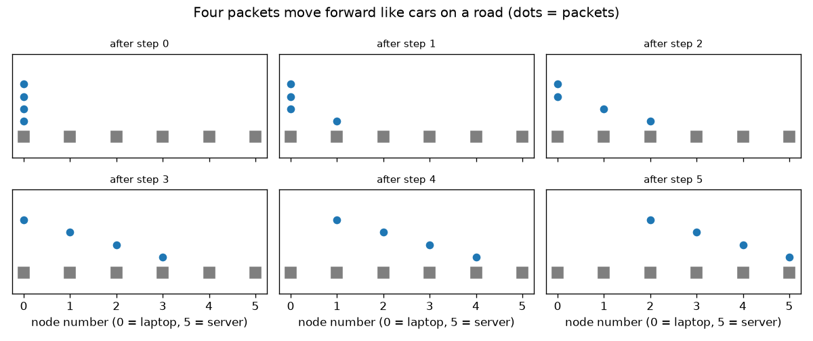
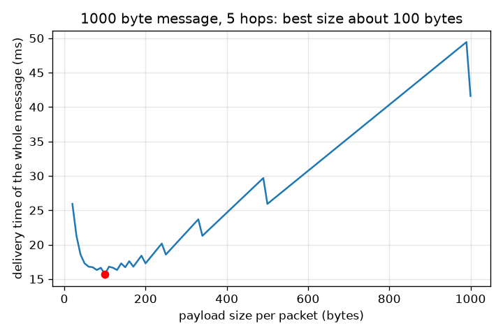

# सत्र 1: एक संदेश को पैकेटों (packets) में काटा जाता है जो राउटर से राउटर तक कूदते हैं

*स्तर 1 (वैचारिक इंटरैक्टिव मॉडल) · लगभग 60 मिनट · openpacket*

> यह एक सरलीकृत शैक्षिक मॉडल है। यह कोई प्रमाणित डिज़ाइन उपकरण नहीं है और इसका उपयोग वास्तविक संरचनाओं, विद्युत संस्थापनों, वाहनों, औद्योगिक प्रक्रियाओं या चिकित्सा निर्णयों के लिए नहीं किया जाना चाहिए।

**पूर्वापेक्षाएँ (Prerequisites)**

- गिनती, भाग और ऊपर की ओर पूर्णांकन (rounding up)।
- आपने PRIMER.md पढ़ लिया है और एक बार `python start.py 1` चला लिया है।

**सीखने के उद्देश्य (Learning objectives)।** इस सत्र के बाद आप:

- समझा सकेंगे कि संदेश को क्रमांकित पैकेटों में क्यों काटा जाता है और लेबल (हेडर, header) किस काम आता है।
- एक संदेश को पैकेटों में काट सकेंगे और उसे फिर से बना सकेंगे, तब भी जब पैकेट ग़लत क्रम में पहुँचें।
- केवल नेक्स्ट-हॉप तालिकाओं (next-hop tables) का उपयोग करके एक मार्ग का हॉप-दर-हॉप अनुसरण कर सकेंगे।
- steps = hops + packets - 1 से गिन सकेंगे कि एक संदेश को कितने समय-चरण चाहिए, और समझा सकेंगे कि बहुत छोटे और बहुत बड़े दोनों पैकेट धीमे क्यों होते हैं।

## A. वास्तविक दुनिया की समस्या
जब आप एक वेब पेज खोलते हैं, तो सर्वर उसे एक टुकड़े में नहीं भेजता। पेज को कई छोटे पैकेटों में काटा जाता है। हर पैकेट पर लेबल लगा होता है कि वह कहाँ जा रहा है और वह कौन-सा टुकड़ा है, और राउटर (routers) उसे एक से अगले तक आगे बढ़ाते हैं, जैसे डाकघर एक पार्सल को आगे बढ़ाते हैं। पूरा पेज एक बार में क्यों नहीं भेजा जाता? और टुकड़े कितने छोटे होने चाहिए? (यह इंटरनेट का एक सरलीकृत शैक्षिक मॉडल है।)

## B. अवधारणा और सिद्धांत
M बाइट के संदेश को अधिकतम s बाइट पेलोड (payload) वाले पैकेटों में काटा जाता है, इसलिए पैकेटों की संख्या N = ceil(M / s) है: ऊपर की ओर पूर्णांकन करें, क्योंकि अंतिम पैकेट छोटा हो सकता है। हर पैकेट पते (addresses) और क्रम संख्या (sequence number) के साथ h बाइट का एक लेबल (हेडर) भी ले जाता है; यहाँ h = 40 बाइट। हर राउटर हर गंतव्य के लिए केवल अगला हॉप (next hop) जानता है, पूरा मार्ग कभी नहीं। एक लिंक एक समय में एक पैकेट ले जाता है और एक राउटर पैकेट को पूरा प्राप्त करने के बाद ही आगे भेज सकता है (स्टोर एंड फ़ॉरवर्ड, store and forward)। मान लें एक चरण वह समय है जो एक पैकेट को एक लिंक पार करने में लगता है। पहले पैकेट को H हॉप के लिए H चरण चाहिए और हर दूसरा पैकेट अपने से पहले वाले के एक चरण बाद पहुँचता है, इसलिए पूरे संदेश को H + N - 1 चरण चाहिए। R bit/s वाले लिंक पर एक चरण (s + h) * 8 / R सेकंड का होता है, जिससे वितरण समय (delivery time) मिलता है।

| प्रतीक | अर्थ | इकाई |
|---|---|---|
| M | संदेश का आकार | bytes |
| s | प्रति पैकेट पेलोड | bytes |
| h | प्रति पैकेट लेबल (हेडर), यहाँ 40 | bytes |
| N | पैकेटों की संख्या | कोई इकाई नहीं |
| H | मार्ग पर हॉप (लिंक) की संख्या | कोई इकाई नहीं |
| R | लिंक दर, यहाँ 1 000 000 | bit/s |
| T | पूरे संदेश का वितरण समय | s या ms |

**मान्यताएँ (Assumptions)**

- सभी लिंकों की दर एक जैसी है और वे एक समय में एक पैकेट ले जाते हैं।
- राउटर पैकेट को पूरा प्राप्त करने के बाद ही आगे भेजते हैं।
- अन्य उपयोगकर्ताओं के ट्रैफ़िक के लिए कोई प्रतीक्षा नहीं है और कोई हानि (loss) नहीं है।
- इस सत्र में तार (प्रसार, propagation) विलंब को अनदेखा किया गया है; सत्र 2 इसे जोड़ता है।

$$ N=\left\lceil \frac{M}{s}\right\rceil $$

$$ \text{steps}=H+N-1 $$

$$ T=(H+N-1)\,\frac{8\,(s+h)}{R} $$

## C. दृश्य व्याख्या
पहला चित्र पाँच हॉप के मार्ग पर चार पैकेट दिखाता है, हर समय-चरण का एक चित्र: पैकेट सड़क पर कारों की तरह एक-दूसरे के पीछे चलते हैं, हर एक अपने आगे वाले से एक चरण पीछे। दूसरा चित्र 5 हॉप पर 1000 बाइट के संदेश का वितरण समय पेलोड आकार के सापेक्ष दिखाता है। बहुत छोटे पैकेटों को कई चरण चाहिए और वे लेबलों पर बाइट बर्बाद करते हैं; एक बहुत बड़ा पैकेट हर चरण को लंबा बना देता है और कुछ भी एक साथ (overlap) नहीं हो पाता; सबसे अच्छा आकार लगभग 100 बाइट है।

*पाँच हॉप पार करते चार पैकेट, हर चरण का एक चित्र: वे सड़क पर कारों की तरह एक-दूसरे के पीछे चलते हैं।*

*5 हॉप पर 1000 बाइट के संदेश का वितरण समय: लगभग 100 बाइट पेलोड पर सबसे कम।*

## D. इंटरैक्टिव सिमुलेशन
पाठ चलाएँ (`python start.py 1`), फिर लाइव ऐप खोलें: [सत्र 1: संदेश को पैकेटों में काटें](https://krunalpanchal1995.github.io/pan-iit-oss/openpacket/session-01/) (या इस फ़ोल्डर में `app.html`)। संदेश का आकार, पैकेट का आकार और हॉप की संख्या बदलें। मार्ग दृश्य में पैकेटों और चरणों की संख्या देखें; ग्राफ़ दृश्य में देखें कि वक्र कहाँ सबसे नीचे है।

**चुनौती।** 1000 बाइट के संदेश को 5 हॉप पर 16 ms से कम में पहुँचाएँ।

## E. हल किया गया उदाहरण और प्रयोग
**समस्या।** 1000 बाइट का एक संदेश 300 बाइट पेलोड वाले पैकेटों में 3 हॉप पर भेजा जाता है। लिंक 1 Mbit/s पर चलते हैं और हर पैकेट पर 40 बाइट का लेबल है। कितने पैकेट हैं, कितने चरण, और वितरण में कितना समय लगता है?

1. N = ceil(1000 / 300) = ceil(3.33) = 4 पैकेट (300, 300, 300 और 100 बाइट)।
2. चरण = H + N - 1 = 3 + 4 - 1 = 6।
3. एक चरण = (300 + 40) * 8 / 1 000 000 = 0.00272 s = 2.72 ms।
4. T = 6 * 2.72 ms = 16.32 ms।
5. सिमुलेशन से जाँच: journey_steps(4, 3) पैकेटों को एक-एक चरण आगे बढ़ाता है और वह भी 6 देता है।

**उत्तर।** 4 पैकेट, 6 चरण और 16.32 ms।

**प्रयोग।** काग़ज़ की एक शीट को 4 पट्टियों में काटें, उन पर संख्या लिखें, उन्हें फेंटें, और उन्हें एक-एक करके 3 दोस्तों की पंक्ति में आगे बढ़ाएँ; हर दोस्त एक बारी में केवल एक पट्टी आगे दे सकता है। सभी पट्टियों के अंत तक पहुँचने तक बारियाँ गिनें: आपको 6 मिलना चाहिए। वास्तविक नेटवर्क अलग होते हैं: राउटर दूसरे लोगों के पैकेटों के लिए भी प्रतीक्षा करते हैं, लिंकों में तार विलंब होता है, और पैकेट खो सकते हैं, जिन्हें यह मॉडल छोड़ देता है।

## F. मूल्यांकन और डिज़ाइन चुनौती
**प्रश्न प्रकार A: वैचारिक।** हर पैकेट एक क्रम संख्या क्यों ले जाता है? उसके बिना क्या गड़बड़ होती है?

संकेत

पैकेट अलग-अलग मार्ग ले सकते हैं या अलग-अलग समय तक कतार में रह सकते हैं।

चरण-दर-चरण हल

अलग-अलग पैकेट अलग-अलग मार्ग ले सकते हैं या अलग-अलग कतारों (queues) में प्रतीक्षा कर सकते हैं, इसलिए वे उस क्रम से भिन्न क्रम में पहुँच सकते हैं जिसमें उन्हें भेजा गया था। क्रम संख्या प्राप्तकर्ता को उन्हें छाँटने और संदेश को फिर से बनाने देती है; यह यह भी दिखाती है कि कौन-सा पैकेट ग़ायब है। इसके बिना प्राप्तकर्ता को पहुँचने के क्रम पर भरोसा करना पड़ता, और पेज गड़बड़ हो जाता।

**प्रश्न प्रकार B: संख्यात्मक।** 900 बाइट का एक संदेश 250 बाइट पेलोड वाले पैकेटों में 4 हॉप पर 1 Mbit/s पर भेजा जाता है, प्रति पैकेट 40 बाइट के लेबल के साथ। पैकेटों की संख्या, उनके आकार, चरण और वितरण समय ज्ञात करें।

संकेत

N के लिए ऊपर की ओर पूर्णांकन करें; एक चरण (s + h) * 8 / R है।

चरण-दर-चरण हल

N = ceil(900 / 250) = ceil(3.6) = 4 पैकेट, 250, 250, 250 और 150 बाइट के। चरण = 4 + 4 - 1 = 7। एक चरण = (250 + 40) * 8 / 1 000 000 = 2.32 ms, इसलिए T = 7 * 2.32 = 16.24 ms। (अंतिम पैकेट छोटा है, इसलिए वास्तविक समय थोड़ा कम है; मॉडल हर पैकेट को पूरे आकार का मानता है।) सामान्य जाँच (sanity check): उत्तर हल किए गए उदाहरण के क़रीब है, जिसका आकार मिलता-जुलता है।

**प्रश्न प्रकार C: ग्राफ़ और सिमुलेशन की व्याख्या।** पेलोड आकार के सापेक्ष वितरण समय के ग्राफ़ में (1000 बाइट संदेश, 5 हॉप), 20 बाइट पैकेटों के लिए समय 25.92 ms, 100 बाइट पैकेटों के लिए 15.68 ms और एक 1000 बाइट पैकेट के लिए 41.6 ms है। वक्र के आकार को समझाइए।

संकेत

दो प्रभाव विपरीत दिशाओं में खींचते हैं: चरणों की संख्या और एक चरण की लंबाई।

चरण-दर-चरण हल

बहुत छोटे पैकेटों के साथ पैकेट बहुत होते हैं, इसलिए चरण भी बहुत, और हर पैकेट का एक बड़ा हिस्सा लेबल होता है: 20 बाइट पैकेटों को 50 पैकेट, 54 चरण चाहिए, हर एक केवल 60 बाइट लंबा। एक बहुत बड़े पैकेट के साथ केवल 5 चरण होते हैं लेकिन हर एक 1040 बाइट ले जाता है और कुछ भी एक साथ नहीं होता, क्योंकि एक समय में केवल एक लिंक व्यस्त होता है। बीच में, पैकेट एक-दूसरे के पीछे चलते हैं और लिंक समानांतर (parallel) काम करते हैं, और वक्र का सबसे निचला बिंदु लगभग 100 बाइट पर है। न्यूनतम लगभग सपाट है: 100 के आसपास के सभी आकार अच्छे हैं।

**प्रश्न प्रकार D: डिज़ाइन और अनुकूलन (optimisation) चुनौती।** डिज़ाइन: 5 हॉप पर 1000 बाइट के संदेश के लिए, 50, 100, 200 और 500 बाइट के पेलोड की तुलना करें और एक चुनें। वास्तविक जीवन में आपको बड़ा आकार चुनने के लिए क्या प्रेरित करेगा?

संकेत

हर आकार के लिए N, चरण और T की गणना करें।

चरण-दर-चरण हल

50 बाइट: 20 पैकेट, 24 चरण, 17.28 ms। 100 बाइट: 10 पैकेट, 14 चरण, 15.68 ms। 200 बाइट: 5 पैकेट, 9 चरण, 17.28 ms। 500 बाइट: 2 पैकेट, 6 चरण, 25.92 ms। सबसे अच्छा 100 बाइट है। वास्तविक जीवन में राउटर हर पैकेट पर मेहनत भी करते हैं, इसलिए कम पैकेट काम बचाते हैं, और वास्तविक लेबल बड़े पैकेट का छोटा हिस्सा होते हैं; लेकिन तब एक खोए पैकेट को फिर से भेजना महँगा पड़ता है। यही समझौता (trade-off) कारण है कि वास्तविक पैकेट लगभग 1500 बाइट के होते हैं, 100 के नहीं।

[RUBRIC.md](../../RUBRIC.md) से स्वयं को अंक दें। काग़ज़ पर काम करने के लिए [गतिविधि पत्रक](activity_sheet.md) प्रिंट करें।

## सामान्य भ्रांतियाँ (Common misconceptions)
| सामान्य भ्रांति | वास्तव में क्या सही है |
|---|---|
| एक संदेश तार पर एक खंड (block) के रूप में चलता है। | उसे पैकेटों में काटा जाता है और हर पैकेट अलग से आगे भेजा जाता है, इसलिए एक ही संदेश के अलग-अलग पैकेट एक ही समय में अलग-अलग लिंकों पर हो सकते हैं। |
| हर राउटर गंतव्य तक का पूरा मार्ग जानता है। | हर राउटर हर गंतव्य के लिए केवल अगला हॉप जानता है; मार्ग कई छोटे निर्णयों से बनता है। |
| छोटे पैकेट हमेशा तेज़ होते हैं क्योंकि वे छोटे हैं। | हर पैकेट एक निश्चित लेबल ले जाता है, और गिनने को अधिक चरण होते हैं; बहुत छोटे पैकेट मध्यम पैकेटों से धीमे हो सकते हैं। |
| पैकेट हमेशा उसी क्रम में पहुँचते हैं जिसमें उन्हें भेजा गया था। | वे किसी भी क्रम में पहुँच सकते हैं, इसीलिए वे एक क्रम संख्या ले जाते हैं। |

## शब्दावली (Glossary)
- **पैकेट (packet)**: संदेश का एक छोटा टुकड़ा जिस पर लेबल है कि वह कहाँ जाता है और कौन-सा टुकड़ा है
- **हेडर (header)**: पैकेट के आगे का लेबल (पते, क्रम संख्या, चेकसम (checksum))
- **पेलोड (payload)**: पैकेट का वह भाग जो स्वयं संदेश ले जाता है
- **राउटर (router)**: एक उपकरण जो पैकेट प्राप्त करता है और हर एक को उसके गंतव्य की ओर आगे भेजता है
- **हॉप (hop)**: मार्ग पर दो पड़ोसी नोड (nodes) के बीच एक लिंक
- **अगला हॉप (next hop)**: वह पड़ोसी जिसे राउटर किसी दिए गए गंतव्य के लिए पैकेट आगे देता है
- **स्टोर एंड फ़ॉरवर्ड (store and forward)**: राउटर पैकेट को आगे भेजने से पहले उसे पूरा प्राप्त करता है

## समापन
1. [exercises.md](exercises.md) में दिए तीन कोडिंग कार्य करें।
2. अपने बदलावों के बाद `python start.py 1` फिर से चलाएँ। यह चेकपॉइंट (checkpoint) के साथ समाप्त होता है; जब यह `PASS` प्रिंट करे, तो आपका काम पूरा है। (केवल चेकपॉइंट: `python start.py check 1`।)

आगे: [सत्र 2](../session-02/README.md)
