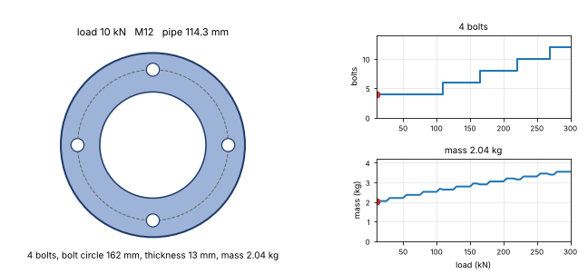
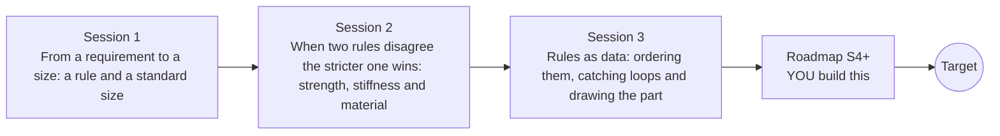

# openparametric

[](https://github.com/KrunalPanchal1995/pan-iit-oss/actions/workflows/tests.yml)   [](https://colab.research.google.com/github/KrunalPanchal1995/pan-iit-oss/blob/main/openparametric/sessions/session-01/lesson.ipynb) [](https://krunalpanchal1995.github.io/pan-iit-oss/openparametric/)

**Learn how rules and equations turn requirements into engineered parts, in three sessions.**

openparametric teaches how rules and equations generate a whole part that changes when the requirements change: a rule that turns a torque into a standard shaft size, two competing rules (strength and stiffness) that decide the thickness of a bracket and the choice of material, and a rule engine that sorts rules written as text, catches circular rules and draws the bolted flange they produce, using only Python and a browser.

- **Start from the question.** Session 1 asks what diameter a shaft needs for a given torque, and why the answer must be rounded up to a size you can buy.
- **See it move.** Every session ships a slider app that runs in the browser, with labelled graphs, drawings of the part and bar charts.
- **Know you got it right.** Each session ends with a checkpoint that prints PASS or FAIL against hand calculations, an independent method and the refusal of unsafe or circular rules.
- **Build the missing half.** The repo stops at Session 3 on purpose; the roadmap shows the path to the Target.

[Target](#the-target) · [Who is this for](#who-is-this-for) · [Quick start](#quick-start) · [Sessions](#sessions) · [Roadmap](#roadmap) · [Contribute](#contribute) · [Explainer PDF](docs/explainer.pdf)

> **This repo is incomplete on purpose.** Sessions 1 to 3 are here and fully working. The finished Target below is a preview of what the community can build next. We show you the path, not the code. Sessions 4 and up are yours.

## The Target
A bolted pipe flange is regenerated by the same list of rules while the load it must carry grows from 10 kN to 300 kN. On the left, the flange is drawn with its bore, its bolt circle and its bolts: the number of bolts steps up from 4 to 12 and the ring becomes thicker. On the right, the number of bolts and the mass of the flange are plotted against the load, with a marker at the current load. The Target draws the part from the rules of Session 3; the repo stops at the rules, the order and one picture. Your goal over the coming sessions is to extend the engine and build it yourself.



*Target: a bolted flange regenerates as the load grows: more bolts, a thicker ring, and the mass follows from the same rules*

How the Target was made is shown only as a path in [promo/roadmap.md](promo/roadmap.md).

## Who is this for
**diploma/undergrad to advanced undergrad (levels 2-4).** Topic area: Mechanical Engineering.

Prerequisites:

- Stress as force per area and the idea of a load on a beam at school level.
- Formulas with powers and square roots; a calculator with a power key is enough.
- Python 3.10 or newer; if `python --version` works, you are ready. PRIMER.md explains the rest.
- No prior GitHub or engineering design experience is needed.

New to Python? Read [PRIMER.md](PRIMER.md) first (10 minutes).

## Quick start

No installation knowledge needed. You need [Git](https://git-scm.com/downloads) and [Python 3.10+](https://www.python.org/downloads/) (Windows: tick "Add Python to PATH"). On Mac and Linux type `python3` wherever this page says `python`.

```bash
git clone https://github.com/KrunalPanchal1995/pan-iit-oss.git
cd pan-iit-oss/openparametric
python start.py 1
```

`start.py` creates a private environment, installs what is needed and runs Session 1 with its checkpoint. Next: `python start.py 2`, `python start.py 3`, or `python start.py test` to check everything. Only a checkpoint: `python start.py check 1`.

<!-- friendly-help -->
<details>
<summary><b>Not working? Common fixes (no Git, "python not found", no internet)</b></summary>

- **No Git?** You do not need it. On the main page of this collection click the green **Code** button, then **Download ZIP**, unzip it, open a terminal inside the folder `pan-iit-oss-main/openparametric` and run `python start.py 1`. The ZIP holds every project, so it is large; the live apps need no download at all.
- **"python is not recognized" or "command not found".** On Windows try `py start.py 1`. On Mac and Linux try `python3 start.py 1`. If neither works, install Python from [python.org](https://www.python.org/downloads/) and tick "Add Python to PATH".
- **Needs internet once.** The first run downloads NumPy and Matplotlib into a private folder (`.venv`); after that it works offline.
- **Rather not install anything?** Open the [live apps](https://krunalpanchal1995.github.io/pan-iit-oss/openparametric/) in your browser, or use the Colab badge at the top of this page.
- **Still stuck?** [Open an issue](https://github.com/KrunalPanchal1995/pan-iit-oss/issues/new?title=%5Bopenparametric%5D%20) with your operating system and the message you see. Questions from beginners are welcome.

</details>

Four lines turn the idea of Session 1 into a result (they work as they are). Save them as `try.py` and run it with `python start.py run try.py`:

```python
import math
tau = 0.577 * 350 / 2.5                                # allowable shear stress (MPa)
d = (16 * 200 * 1000 / (math.pi * tau)) ** (1 / 3)   # smallest shaft for 200 N m
print(round(d, 1))                                    # -> 23.3 mm; the next standard size is 25 mm
```

Every session also opens in your browser with sliders (no install): [live apps](https://krunalpanchal1995.github.io/pan-iit-oss/openparametric/). Or use the Colab badge above for the notebook.

## Sessions

| # | Session | Model level | Time | Live app |
|---|---|---|---|---|
| 1 | [From a requirement to a size: a rule and a standard size](sessions/session-01/README.md) | Level 2: mathematical engineering model | 60 min | [open](https://krunalpanchal1995.github.io/pan-iit-oss/openparametric/session-01/) |
| 2 | [When two rules disagree the stricter one wins: strength, stiffness and material](sessions/session-02/README.md) | Level 3: simulation and validation | 75 min | [open](https://krunalpanchal1995.github.io/pan-iit-oss/openparametric/session-02/) |
| 3 | [Rules as data: ordering them, catching loops and drawing the part](sessions/session-03/README.md) | Level 3: simulation and validation | 90 min | [open](https://krunalpanchal1995.github.io/pan-iit-oss/openparametric/session-03/) |

Each session follows the same six steps: A real-world problem, B concept and theory, C visual explanation, D interactive simulation, E worked example and experiment, F assessment and design challenge. Each ends with `checkpoint.py`, which prints `PASS` or `FAIL` against reference numbers. Session 3 also contains the real-world mini-project: **Generate a bolted flange and a bracket for a customer's load and compare materials**.

## Architecture



| Folder or file | What is inside |
|---|---|
| `sessions/` | three sessions: README (A-F), `lesson.py`, notebook, live app, exercises, activity sheet, checkpoint |
| `promo/` | the Target: media and the roadmap (path only) |
| `docs/` | `explainer.tex` and the built `explainer.pdf` |
| `tests/` | runs every lesson and checkpoint headless, and checks every live app |
| `start.py` | one command to set up and run anything |
| `QUALITY.md`, `RUBRIC.md` | the quality checklist and the scoring rubric |
| `.github/` | CI, PDF build, Pages deploy, issue and PR templates |

## Roadmap

| Milestone | What you will build | Difficulty |
|---|---|---|
| Session 4: Units that the rules check | Give every input and rule a unit (mass, length, force, stress as powers of kg, m and s) and make the engine refuse an equation whose units do not match. | intermediate |
| Session 5: Tables of standard sizes inside the rules | Add a lookup function to the engine for tables such as DN to outside diameter, and an interpolation function for a table of stress against temperature. | beginner |
| Session 6: Conditional rules and two rings of bolts | Add a conditional form to the engine and a second ring to the flange when the bolts of one ring would be closer than 2.5 M. | intermediate |
| Session 7: Explaining a result: why is n = 8? | Record which values every rule read and print the chain of rules that led to a chosen value, with their equations. | intermediate |
| Session 8: Searching for the lightest design | A search over the bolt size and the bracket material that returns the lightest design that passes all checks. | advanced |

Full detail with a checkpoint per milestone: [promo/roadmap.md](promo/roadmap.md).

## Contribute
New to GitHub? Read [CONTRIBUTING.md](CONTRIBUTING.md); it starts from zero. Pick an issue labelled `good first issue`. Translations into Hindi, Telugu, Tamil and Malayalam are welcome.

<details>
<summary>Development</summary>

```bash
python start.py test        # runs every lesson and checkpoint, and checks every live app
```
Lessons use `# %%` cell markers so they open as notebooks in VS Code. See [QUALITY.md](QUALITY.md) for the standard every session meets.
</details>

## License
MIT. See [LICENSE](LICENSE). Media in `promo/media` is (c) Krunal Panchal, CC BY 4.0.

## Acknowledgments
Part of the [PAN IIT OSS](https://hellofoss.tech-iitb.org/projects) open-source teaching collection, modelled on the structure of [openspline](https://github.com/openspline/openspline).
