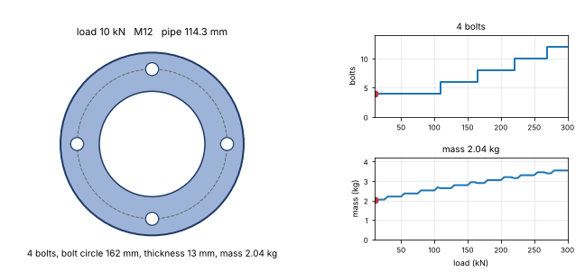

# What you are building toward

A bolted pipe flange is regenerated by the same list of rules while the load it must carry grows from 10 kN to 300 kN. On the left, the flange is drawn with its bore, its bolt circle and its bolts: the number of bolts steps up from 4 to 12 and the ring becomes thicker. On the right, the number of bolts and the mass of the flange are plotted against the load, with a marker at the current load. The Target draws the part from the rules of Session 3; the repo stops at the rules, the order and one picture. Your goal over the coming sessions is to extend the engine and build it yourself.

*Target: a bolted flange regenerates as the load grows: more bolts, a thicker ring, and the mass follows from the same rules*

The code behind the Target is not published; the roadmap shows the path so you can build your own.
