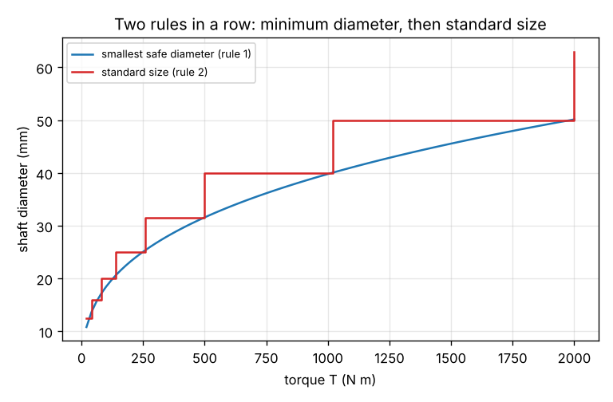
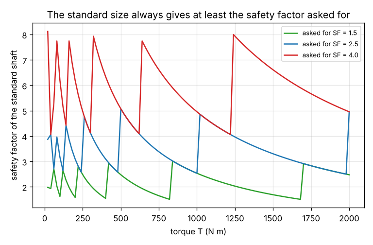

# Session 1: From a requirement to a size: a rule and a standard size

*Level 2 (mathematical engineering model) · about 60 minutes · openparametric*

> This is a simplified educational model. It is not a validated design tool and must not be used for real structures, electrical installations, vehicles, industrial processes or medical decisions.

**Prerequisites**

- Stress as force divided by area, and the idea that a material has a yield strength.
- Cube roots on a calculator (x^(1/3)).
- The idea of a safety factor: a margin between what is allowed and what would break.

**Learning objectives.** After this session you can:

- Write the stress rule for a round shaft in torsion and solve it for the smallest safe diameter.
- Round up to a standard R10 size and say why rounding to the nearest is not allowed.
- Check the result: the stress and the safety factor of the shaft that is really bought.
- Explain how one rule feeds the next, and how the whole chain responds when the requirement changes.

## A. Real-world problem
A motor must turn a machine with a torque of 200 N m. What diameter should the steel shaft have? A designer does not guess: there is a rule that links the torque, the strength of the steel and a safety margin to the smallest safe diameter, and a second rule that rounds it up to a size that can be bought. If the requirement changes, the rules give a new shaft at once. How do such rules work, and how do we know the shaft is safe?

## B. Concept and theory
When a solid round shaft of diameter d carries a torque T, the largest shear stress is at its surface: tau = 16 T / (pi d^3), with T in N mm and d in mm giving tau in MPa (N/mm^2). The steel may only be loaded to an allowable stress: its shear yield strength, about 0.577 times the tensile yield strength sigma_y, divided by a safety factor SF, so tau_allow = 0.577 sigma_y / SF. Setting tau equal to tau_allow and solving for d gives the first rule, the smallest safe diameter d_min = (16 T / (pi tau_allow))^(1/3). Because of the cube root, doubling the torque makes the shaft only 26 percent thicker. Shafts are sold in standard sizes from the preferred-number series R10, in which each size is about 1.26 times the previous one: 10, 12.5, 16, 20, 25, 31.5, 40, 50, 63, 80, 100 mm and so on. The second rule picks the smallest standard size that is not smaller than d_min; rounding down, or to the nearest size, could give a shaft that is too weak. Then we check what we really have: the stress tau in the standard shaft and the safety factor 0.577 sigma_y / tau, which is a little larger than the one we asked for because we rounded up. For a motor the torque follows from the power P (kW) and the speed n (rpm) as T = 9549 P / n in N m.

| Symbol | Meaning | Unit |
|---|---|---|
| T | torque transmitted by the shaft | N m (1 N m = 1000 N mm) |
| d | diameter of the solid round shaft | mm |
| tau | largest shear stress at the surface | MPa (N/mm^2) |
| sigma_y | tensile yield strength of the steel | MPa |
| SF | safety factor (a margin of at least 1) | no unit |
| tau_allow | allowable shear stress, 0.577 sigma_y / SF | MPa |
| d_min | smallest diameter that keeps tau within tau_allow | mm |

**Assumptions**

- The shaft is solid, round and loaded in pure torsion; bending, shock loads, keyways and fatigue are ignored.
- The steel is elastic up to the yield strength, with shear yield 0.577 times tensile yield.
- A constant torque, and a safety factor chosen by the designer.
- Standard sizes follow the R10 series of preferred numbers.

$$ \tau = \frac{16\,T}{\pi d^{3}},\qquad \tau_{\text{allow}} = \frac{0.577\,\sigma_y}{\mathrm{SF}} $$

$$ d_{\min} = \left(\frac{16\,T}{\pi\,\tau_{\text{allow}}}\right)^{1/3} $$

$$ T = \frac{9549\,P}{n}\qquad(P\ \text{in kW},\ n\ \text{in rpm},\ T\ \text{in N m}) $$

## C. Visual explanation
The first figure plots the smallest safe diameter (smooth curve) and the standard size (steps) against the torque. The steps always lie on or above the curve. The second figure shows the safety factor of the standard shaft against the torque for three requested safety factors: it is never below the requested value, and it jumps up right after each step to the next size.

*Smallest safe diameter (curve) and standard size (steps) against the torque.*

*Safety factor of the standard shaft against the torque, for three requested values.*

## D. Interactive simulation
Run the lesson (`python start.py 1`), then open the live app: [Session 1: from a torque to a standard shaft](https://krunalpanchal1995.github.io/pan-iit-oss/openparametric/session-01/) (or `app.html` in this folder). Change the torque, the steel and the safety factor and watch d_min move along the ladder of standard sizes, and the bars show why rounding down would break the allowable stress.

**Challenge.** Carry at least 400 N m with a standard shaft of at most 25 mm and a safety factor of at least 2 for the shaft that is bought.

## E. Worked example and experiment
**Problem.** A shaft must carry 200 N m. The steel has a tensile yield strength of 350 MPa and the safety factor is 2.5. Find the smallest safe diameter, the standard size, and the stress and safety factor of that shaft.

1. Allowable shear stress: tau_allow = 0.577 x 350 / 2.5 = 80.8 MPa.
2. Smallest diameter: d_min = (16 x 200 000 / (pi x 80.8))^(1/3) = 23.28 mm.
3. Standard size: the next R10 size not below 23.28 mm is 25 mm (the one below is 20 mm, which is too small).
4. Check: tau = 16 x 200 000 / (pi x 25^3) = 65.2 MPa, which is below 80.8 MPa.
5. Safety factor actually obtained: 0.577 x 350 / 65.2 = 3.10, a little above the 2.5 asked for, because we rounded up by 7 percent.
6. Mass per metre of the shaft: 7850 x pi / 4 x 0.025^2 = 3.85 kg/m.

**Answer.** The rules give d_min = 23.28 mm and a standard shaft of 25 mm, which carries 200 N m with a safety factor of 3.10.

**Experiment.** Feel the cube law with a wooden dowel or a plastic rod of two diameters, for example 6 mm and 12 mm and the same length. Clamp one end in a vice or hold it in a drill chuck and twist the other end with a small spanner or by hand until it just starts to twist visibly. The 12 mm rod, with twice the diameter, needs about eight times the torque to reach the same stress (the strength grows with d^3) and about sixteen times the torque for the same twist angle (the twisting stiffness grows with d^4). The experiment shows the direction of the rule; do not use it to measure a real strength: wood is not steel and a hand is not a torque wrench.

## F. Assessment and design challenge
**Question type A: Conceptual.** A shaft must carry 135 N m with the same steel and safety factor (yield 350 MPa, SF 2.5), so d_min = 20.4 mm. The nearest standard size is 20 mm. Why is 20 mm not acceptable? Show it with the safety factor.

Hint

Compute the stress in a 20 mm shaft for 135 N m and compare with the allowable stress of 80.8 MPa.

Step-by-step solution

The stress in a 20 mm shaft is 16 x 135 000 / (pi x 20^3) = 85.8 MPa, which is above the allowable 80.8 MPa, and the safety factor is 0.577 x 350 / 85.8 = 2.36, below the 2.5 we require. So the shaft is too weak although it is the nearest size. The rule must round up: the next size is 25 mm.

**Question type B: Numerical.** A 15 kW motor runs at 1450 rpm. Find the torque, the smallest safe shaft diameter (yield 350 MPa, SF 2.5) and the standard size.

Hint

T = 9549 P / n, then d_min = (16 T 1000 / (pi tau_allow))^(1/3) with tau_allow = 80.8 MPa.

Step-by-step solution

T = 9549 x 15 / 1450 = 98.8 N m. d_min = (16 x 98783 / (pi x 80.8))^(1/3) = 18.40 mm, so the standard size is 20 mm. The 20 mm shaft has a stress of 62.9 MPa and a safety factor of 3.21. Sanity check: half the torque of the worked example, so about 0.79 times the diameter: 23.28 x 0.79 = 18.4 mm.

**Question type C: Graph and simulation interpretation.** If the torque is doubled, by what factor does d_min grow, and by what factor does the mass per metre of the minimum shaft grow? Check with the torques 200 and 400 N m.

Hint

d_min is proportional to T^(1/3) and the mass per metre to d^2.

Step-by-step solution

d_min grows by 2^(1/3) = 1.26 and the mass per metre by 2^(2/3) = 1.59. The lesson gives d_min = 23.28 mm for 200 N m and 29.33 mm for 400 N m: the ratio is 1.26. The standard shafts are 25 and 31.5 mm, whose masses per metre are 3.85 and 6.12 kg/m, a factor of 1.59: the steps of the standard sizes make the real change differ from the smooth law.

**Question type D: Design and optimisation challenge.** Design: a 22 kW motor at 960 rpm drives a machine that needs a safety factor of 3 (yield 350 MPa). Find the standard shaft, how much it is oversize, and the stress if we had wrongly rounded down to the size below.

Hint

Find T, then d_min with tau_allow = 0.577 x 350 / 3, then the standard sizes on both sides of d_min.

Step-by-step solution

T = 9549 x 22 / 960 = 218.8 N m and tau_allow = 0.577 x 350 / 3 = 67.3 MPa, so d_min = 25.49 mm. The standard sizes around it are 25 mm and 31.5 mm, so the shaft is 31.5 mm, which is 24 percent above d_min and has a safety factor of 5.66. The size below, 25 mm, would carry a stress of 71.3 MPa, above the allowable 67.3 MPa. A jump of up to 26 percent is the price of standard sizes; a designer might accept it or ask for a stronger steel instead (see the app).

Score yourself with [RUBRIC.md](../../RUBRIC.md). Print the [activity sheet](activity_sheet.md) to work on paper.

## Common misconceptions
| Common misconception | What is actually true |
|---|---|
| The nearest standard size is always good enough. | Only a size at or above d_min keeps the stress within the allowable value. Rounding to the nearest can round down. |
| Doubling the torque doubles the diameter. | The diameter follows the cube root of the torque: it grows by 26 percent, and the mass per metre by 59 percent. |
| A safety factor of 2.5 means the shaft will fail at 2.5 times the torque. | It is a margin in the design rule. The actual margin is larger after rounding up, and the real failure also depends on fatigue, shock and defects that this rule ignores. |
| A rule gives the answer, so no check is needed. | The check after the rules (stress and safety factor of the part that is bought) is what shows that the chain of rules did its job. |

## Glossary
- **torque**: the twisting moment a shaft transmits, in N m
- **shear stress**: force per area acting along a surface, here at the rim of the twisted shaft
- **yield strength**: the stress at which steel starts to deform permanently
- **safety factor**: the ratio between a limit and the load allowed in the design
- **R10**: the preferred-number series with 10 sizes per decade, each about 1.26 times the previous one
- **rule**: an equation or lookup that turns inputs into one value

## Finish
1. Do the three coding tasks in [exercises.md](exercises.md).
2. Run `python start.py 1` again after your changes. It ends with the checkpoint; when it prints `PASS`, you are done. (Checkpoint only: `python start.py check 1`.)

Next: [Session 2](../session-02/README.md)
