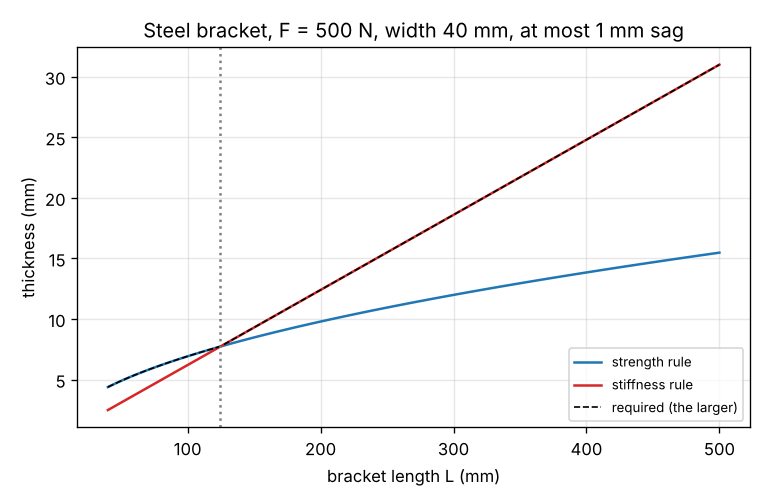
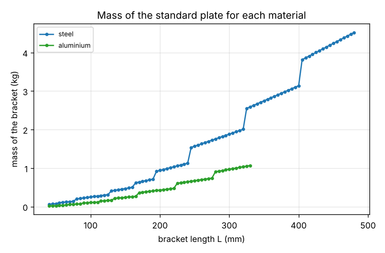

# Session 2: When two rules disagree the stricter one wins: strength, stiffness and material

*Level 3 (simulation and validation) · about 75 minutes · openparametric*

> This is a simplified educational model. It is not a validated design tool and must not be used for real structures, electrical installations, vehicles, industrial processes or medical decisions.

**Prerequisites**

- Session 1, or the idea of a rule that gives a size.
- Bending of a beam at school level: a load on a beam bends it and causes stress.
- Powers and roots: square root and cube root.

**Learning objectives.** After this session you can:

- Write the strength rule and the stiffness rule for a cantilever plate and solve each for the thickness.
- Take the larger thickness, round up to a plate that is sold, and check the stress and the sag.
- Find the critical length at which the governing rule changes.
- Run the same rules for two materials and choose the lightest, and check the deflection formula by numerical integration.

## A. Real-world problem
A bracket sticks out from a wall and carries a load at its tip. It must not break (strength) and it must not sag more than a given amount (stiffness). Each requirement gives its own minimum thickness, and the plate that is sold comes in fixed thicknesses. Which rule decides, does it change when the bracket gets longer, and is a steel or an aluminium bracket lighter? Take a load of 500 N at 200 mm from the wall, a plate 40 mm wide and at most 1 mm of sag.

## B. Concept and theory
For a plate of width b and thickness t fixed at one end, with a load F at the free end a distance L away, the second moment of area is I = b t^3 / 12. The largest bending stress is at the fixing, sigma = M c / I = 6 F L / (b t^2), where M = F L and c = t / 2. The strength rule requires sigma not above the allowable stress sigma_allow = yield / SF, which gives t_strength = sqrt(6 F L / (b sigma_allow)). The tip sinks by delta = F L^3 / (3 E I) = 4 F L^3 / (E b t^3), with E the elastic modulus of the material. The stiffness rule requires delta not above delta_max, which gives t_stiffness = (4 F L^3 / (E b delta_max))^(1/3). The plate must satisfy both, so the required thickness is the larger of the two, and the rule that gives the larger one is the governing rule; then we take the next plate thickness that is sold and check the stress, the sag and the mass b t L rho. Since t_strength grows with the square root of L and t_stiffness grows in proportion to L, stiffness governs long brackets and strength short ones; they cross at the critical length. Different materials have different E, yield and density, so the same rules give different plates and masses, and we choose the material with the smallest mass. Aluminium has a third of the elastic modulus of steel but a third of its density, so it needs a thicker plate that can still be lighter. To check the deflection formula independently, we integrate the beam equation E I y'' = M(x) = F (L - x) numerically twice along the plate.

| Symbol | Meaning | Unit |
|---|---|---|
| F | load at the free end | N |
| L | distance from the wall to the load | mm |
| b, t | width and thickness of the plate | mm |
| E | elastic modulus | MPa (N/mm^2) |
| sigma_allow | allowable stress, yield / SF | MPa |
| delta_max | largest sag allowed at the tip | mm |
| rho | density | kg/m^3 |

**Assumptions**

- A uniform rectangular plate fixed at one end with a single load at the other, in the elastic range.
- A safety factor of 1.5 on the yield strength; steel with E = 210 GPa and yield 235 MPa, aluminium with E = 69 GPa and yield 240 MPa.
- Plates are available only in the thicknesses 2, 3, 4, 5, 6, 8, 10, 12, 15, 20, 25 and 30 mm.
- No stress concentration at the fixing, buckling, fatigue or weight of the bracket itself.

$$ t_{\text{strength}} = \sqrt{\frac{6\,F\,L}{b\,\sigma_{\text{allow}}}},\qquad t_{\text{stiffness}} = \left(\frac{4\,F\,L^{3}}{E\,b\,\delta_{\max}}\right)^{1/3} $$

$$ t = \max\left(t_{\text{strength}},\,t_{\text{stiffness}}\right),\ \text{then the next plate that is sold} $$

$$ L_c = \left[\left(\frac{6F}{b\,\sigma_{\text{allow}}}\right)^{3/2}\frac{E\,b\,\delta_{\max}}{4F}\right]^{2/3} $$

## C. Visual explanation
The first figure shows the thickness from each rule against the length for the steel bracket. The strength rule (curved) is above the stiffness rule (straight-ish) for short brackets and below it for long ones; the dotted line marks the critical length of about 125 mm. The second figure plots the mass of the standard plate for steel and aluminium against the length: aluminium is lighter at all the lengths shown, and both curves jump when the next plate size is needed.

*Thickness from the strength rule and the stiffness rule against the length.*

*Mass of the standard plate against the length, for steel and aluminium.*

## D. Interactive simulation
Run the lesson (`python start.py 2`), then open the live app: [Session 2: strength against stiffness](https://krunalpanchal1995.github.io/pan-iit-oss/openparametric/session-02/) (or `app.html` in this folder). Change the length and watch the governing rule switch at the critical length; flip the material and see the plate and the mass change.

**Challenge.** Carry at least 1000 N at a length of at least 150 mm with a bracket that weighs at most 0.4 kg, using a plate that is sold.

## E. Worked example and experiment
**Problem.** A bracket 40 mm wide carries 500 N at 200 mm from the wall and may sag at most 1.0 mm. Take steel with a safety factor of 1.5. Find the thickness from each rule, the plate that is sold, the mass, and the stress and sag of that plate. Then do the same for aluminium.

1. Allowable stress: 235 / 1.5 = 156.7 MPa. Strength: t = sqrt(6 x 500 x 200 / (40 x 156.7)) = 9.78 mm.
2. Stiffness: t = (4 x 500 x 200^3 / (210 000 x 40 x 1.0))^(1/3) = 12.40 mm. The larger value is 12.40 mm, so stiffness governs.
3. The next plate that is sold is 15 mm. Mass: 40 x 15 x 200 x 7850 x 1e-9 = 0.942 kg.
4. Check the plate: stress 6 x 500 x 200 / (40 x 15^2) = 67 MPa (below 157) and sag 4 x 500 x 200^3 / (210 000 x 40 x 15^3) = 0.56 mm (below 1.0).
5. Aluminium: strength gives 9.68 mm and stiffness gives 17.96 mm (E is only 69 GPa), so the plate is 20 mm, with a mass of 0.432 kg, a sag of 0.72 mm and a stress of 38 MPa.
6. The lightest is aluminium: 0.432 kg against 0.942 kg, even though its plate is thicker.

**Answer.** Steel needs a 15 mm plate of 0.942 kg (stiffness governs); aluminium needs a 20 mm plate of 0.432 kg, less than half, so the lightest bracket is aluminium.

**Experiment.** Lay a plastic ruler or a strip of stiff card on a table so that 20 cm sticks out over the edge, and hold the other end down with a book. Hang a small weight, such as a bag of coins, from the tip and measure how far the tip sinks. Now push the ruler out to 30 cm: the sag does not grow by 1.5 but by about 3.4 times, as L^3 says. Then lay a second ruler on top to double the thickness: the sag falls by about a factor 8, as t^3 says (the rulers must be glued or taped together to act as one plate; two loose rulers only halve the sag). These are the powers inside the stiffness rule.

## F. Assessment and design challenge
**Question type A: Conceptual.** Why does the governing rule change from strength to stiffness when the bracket gets longer? Show it for the steel bracket at L = 100 mm and L = 200 mm.

Hint

Strength needs t proportional to sqrt(L) and stiffness needs t proportional to L.

Step-by-step solution

At L = 100 mm the strength rule gives 6.92 mm and the stiffness rule 6.20 mm, so strength governs. At L = 200 mm they give 9.78 and 12.40 mm: stiffness governs. Doubling L multiplies the strength thickness by sqrt(2) = 1.41 but the stiffness thickness by 2, so the stiffness curve overtakes the strength curve at some length, here about 125 mm. A designer who checks only the strength of a long bracket would build a plate that does not break but sags too much.

**Question type B: Numerical.** For the steel bracket (F = 500 N, L = 200 mm, b = 40 mm, at most 1.0 mm sag), find the stress and the sag if a 12 mm plate is used instead of the 15 mm plate. Does it pass?

Hint

Use sigma = 6 F L / (b t^2) and delta = 4 F L^3 / (E b t^3) with t = 12.

Step-by-step solution

With t = 12 mm the stress is 6 x 500 x 200 / (40 x 12^2) = 104.2 MPa, below the allowable 156.7 MPa, but the sag is 4 x 500 x 200^3 / (210 000 x 40 x 12^3) = 1.10 mm, above 1.0 mm. So the 12 mm plate is strong enough and too flexible: it fails the stiffness rule (t_stiffness = 12.40 mm). The next plate, 15 mm, passes both. The numerical integration of the lesson gives the same sag of 1.10 mm.

**Question type C: Graph and simulation interpretation.** On the graph of thickness against length, the two curves cross at about 125 mm. By what factor does the required thickness grow when the length doubles from 125 mm to 250 mm?

Hint

Past the crossing the stiffness rule governs, and t_stiffness is proportional to L. Check with the lesson code.

Step-by-step solution

At L = 125 mm both rules give about 7.74 mm. At 250 mm the strength rule gives 10.94 mm but the stiffness rule gives 15.49 mm, which governs: a factor of 2.00, close to 2 because t_stiffness is proportional to L. If strength still governed it would be only sqrt(2) = 1.41. The mass of the plate grows by the factor of the thickness times the factor of the length, here about 4.

**Question type D: Design and optimisation challenge.** Design: a bracket must carry 1000 N at 150 mm, 40 mm wide, with at most 3.0 mm of sag. Find the plate for steel and for aluminium, say which governs, and which bracket is lighter and by how many times.

Hint

Run `design(1000, 150, 40, 3.0, 'steel')` and the same for aluminium, or use the formulas by hand.

Step-by-step solution

Steel: strength 11.98 mm, stiffness 8.12 mm, so strength governs and the plate is 12 mm with 0.565 kg and 0.93 mm of sag. Aluminium: strength 11.86 mm, stiffness 11.77 mm, so strength governs (barely) and the plate is also 12 mm, with 0.194 kg and a sag of 2.83 mm, close to the 3.0 mm limit. The aluminium bracket is 2.9 times lighter, because the plates are equally thick and the density is 2.9 times smaller. Assumption: the safety factor of 1.5 and no corrosion or joining effects.

Score yourself with [RUBRIC.md](../../RUBRIC.md). Print the [activity sheet](activity_sheet.md) to work on paper.

## Common misconceptions
| Common misconception | What is actually true |
|---|---|
| A bracket that is strong enough is stiff enough. | Strength and stiffness are different rules. For long brackets the stiffness rule needs the thicker plate. |
| The lighter material always needs the thinner plate. | Aluminium has a lower stiffness, so its plate is thicker; it is lighter only because its density is lower still. |
| A plate of the required thickness can be bought. | Plates come in fixed thicknesses, so we must round up, and the check must be done on the plate that is really used. |
| A formula that gives a reasonable number must be right. | The lesson checks the sag formula against a numerical integration of the beam equation; an independent method is the proof that the formula and its units are right. |

## Glossary
- **cantilever**: a beam fixed at one end and free at the other
- **elastic modulus E**: how much stress a material needs for a given stretch, in MPa
- **second moment of area**: b t^3 / 12 for a rectangle; how stiff the section is in bending
- **governing rule**: the rule that gives the largest requirement
- **critical length**: the length at which two rules give the same thickness
- **deflection**: how far the loaded tip moves, here called the sag

## Finish
1. Do the three coding tasks in [exercises.md](exercises.md).
2. Run `python start.py 2` again after your changes. It ends with the checkpoint; when it prints `PASS`, you are done. (Checkpoint only: `python start.py check 2`.)

Next: [Session 3](../session-03/README.md)
