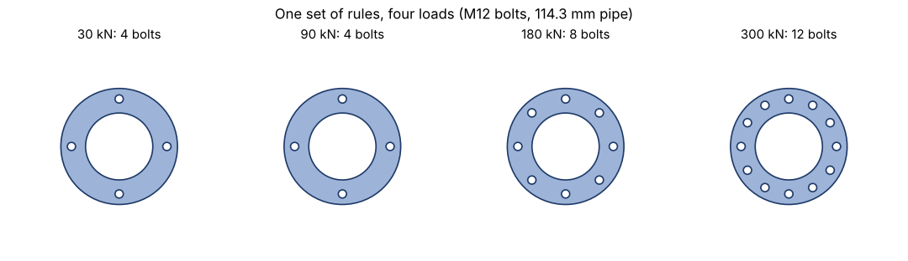
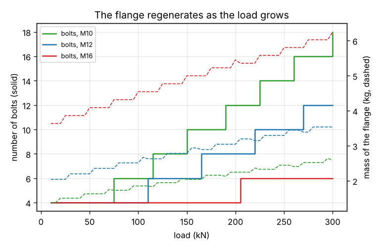

# Session 3: Rules as data: ordering them, catching loops and drawing the part

*Level 3 (simulation and validation) · about 90 minutes · openparametric*

> This is a simplified educational model. It is not a validated design tool and must not be used for real structures, electrical installations, vehicles, industrial processes or medical decisions.

**Prerequisites**

- Sessions 1 and 2, or the idea of rules that give sizes.
- Lists and dictionaries in Python at the level of the primer.
- The idea of one value depending on another (a spreadsheet cell that uses other cells).

**Learning objectives.** After this session you can:

- Store rules as text and find the names each rule depends on.
- Sort the rules into an order in which they can be evaluated, and explain why the order of writing does not matter.
- Detect circular rules, unknown names and unsafe expressions and report them clearly.
- Generate a bolted flange from three inputs and check the drawing against the formula by measuring its area.

## A. Real-world problem
A pipe flange joins two pipes with a ring of bolts. How many bolts it needs depends on the load and the bolt size, the size of the bolt circle depends on the number of bolts and on the pipe, the outside diameter depends on the bolt circle, and so on. A designer keeps all this in a list of rules. If the load doubles, the whole flange should be regenerated. Which rule has to be evaluated first, how do we notice a rule that depends on itself, and how do we know the drawing agrees with the numbers? Take a load of 60 kN, M12 bolts and a pipe of 114.3 mm outside diameter.

## B. Concept and theory
A rule is a name and an equation in text, for example ('n', 'max(4, 2 * ceil(n_min / 2))'). The names in the equation are its dependencies; each is either an input (load, bolt size, pipe diameter) or another rule. The evaluator accepts only numbers, names, + - * / **, brackets and a short list of functions (sqrt, ceil, max, min and a lookup for the bolt pitch), so a list of rules from a file can never run arbitrary code. The rules may be written in any order, but a rule can be evaluated only after all the rules it depends on. The engine finds an order by a topological sort: repeatedly take the first rule whose dependencies are all available. If rules are left and none can be taken, they depend on each other in a circle and no order exists; the engine must then stop and name the circle (for example a -> b -> c -> a) instead of looping for ever. It must also refuse names that nobody defines, two rules with the same name and rules that overwrite an input. The flange rules are textbook rules of thumb: the hole is 2 mm wider than the bolt; the thread's tensile stress area is pi / 4 (M - 0.9382 pitch)^2; a bolt carries area x 320 MPa; the number of bolts is the load divided by that, rounded up to an even number of at least 4; the bolt circle is the larger of pipe + 4 M and the size that keeps the bolts 2.5 M apart; the flange is 3 M wider than the bolt circle; the thickness grows with the bolt size, the pipe and the load; and the mass is the density times the material area times the thickness. Last, the part is drawn as an SVG picture. To check that the drawing and the mass formula describe the same part, we measure the area from the drawing by laying a fine grid over it and counting the grid points inside the ring and outside every hole.

| Symbol | Meaning | Unit |
|---|---|---|
| load | force the flange must carry through its bolts | kN |
| M | bolt size (nominal diameter) | mm |
| od | outside diameter of the pipe, which is the bore of the flange | mm |
| n | number of bolts (even, at least 4) | no unit |
| pcd | diameter of the bolt circle | mm |
| fod | outside diameter of the flange, pcd + 3 M | mm |
| t | thickness of the flange | mm |
| area_b | tensile stress area of one bolt | mm^2 |

**Assumptions**

- A flat circular flange with a bore equal to the pipe, one ring of equal bolts and coarse metric threads of strength class 8.8 (allowable stress 320 MPa).
- The geometry and thickness rules are rules of thumb for teaching, not a flange standard.
- The load is carried by the bolts only and shared equally; pressure, gasket and temperature are ignored.
- Rules use only numbers, names, + - * / **, brackets and the functions sqrt, ceil, max, min and pitch.

$$ n = \max\left(4,\ 2\left\lceil \tfrac12 \left\lceil \frac{\mathrm{load}}{A_b\,\sigma_b} \right\rceil \right\rceil\right),\qquad A_b = \frac{\pi}{4}\left(M - 0.9382\,p\right)^{2} $$

$$ p_{cd} = \max\left(\mathrm{od} + 4M,\ \frac{2.5\,M\,n}{\pi}\right),\qquad f_{od} = p_{cd} + 3M $$

$$ m = \rho\,t\left[\frac{\pi}{4}\left(f_{od}^{2} - \mathrm{od}^{2}\right) - n\,\frac{\pi}{4}\,(M+2)^{2}\right] $$

## C. Visual explanation
The first figure shows four flanges produced by the same list of rules for loads of 30, 90, 180 and 300 kN: more bolts as the load grows, and a bolt circle that stays the same because the pipe, not the bolts, sets it. The second figure plots the number of bolts (steps) and the mass (dashed lines) against the load for three bolt sizes: larger bolts need fewer bolts but a thicker, heavier ring.

*Four flanges generated by the same rules for loads of 30, 90, 180 and 300 kN.*

*Number of bolts (steps) and mass (dashed) against the load, for M10, M12 and M16 bolts.*

## D. Interactive simulation
Run the lesson (`python start.py 3`), then open the live app: [Session 3: a rule engine that draws a flange](https://krunalpanchal1995.github.io/pan-iit-oss/openparametric/session-03/) (or `app.html` in this folder). Change the load, the bolt size and the pipe and watch the flange regenerate; the second graph lists the rules in the order the engine evaluates them, with the value of each.

**Challenge.** Make a flange for at least 150 kN with at most 8 bolts and a mass of at most 4 kg.

## E. Worked example and experiment
**Problem.** A flange must carry 60 kN with M12 bolts around a pipe of 114.3 mm outside diameter. Apply the rules in a valid order and find the number of bolts, the bolt circle, the outside diameter, the thickness and the mass.

1. Order found by the engine: t -> area_b -> f_bolt -> n_min -> n -> pcd -> fod -> hole -> mass.
2. Bolt: the stress area is pi / 4 (12 - 0.9382 x 1.75)^2 = 84.3 mm2, so one bolt carries 27.0 kN.
3. Number of bolts: 60 / 27.0 = 2.22, rounded up to 3, then to an even number of at least 4: n = 4.
4. Bolt circle: the larger of 114.3 + 4 x 12 = 162.3 mm and 4 x 2.5 x 12 / pi = 38.2 mm, so 162.3 mm. Outside diameter: 162.3 + 36 = 198.3 mm.
5. Thickness: 0.8 x 12 + 0.02 x 114.3 + 0.04 x 60 = 14.3, rounded up to 15 mm. Hole: 14 mm.
6. Mass: area = pi / 4 (198.3^2 - 114.3^2) - 4 x pi / 4 x 14^2 = 20008 mm2, and 7850 x 20008 x 15 x 1e-9 = 2.356 kg.
7. Check: counting grid points in the drawing gives 20005 mm2, within 0.01 percent of the formula.

**Answer.** The rules give 4 bolts on a 162.3 mm bolt circle, a flange of 198.3 mm outside diameter and 15 mm thickness, and a mass of 2.356 kg.

**Experiment.** Find the order of dependence in something you already use: a spreadsheet. In three cells write, say, A1 = 12 (a bolt size), B1 = A1 + 2 (the hole) and C1 = B1 * 2 (twice the hole). Now change A1 and watch B1 and C1 follow. Then type the formula =C1 + 1 into A1, which makes A1 depend on C1 and thereby on itself. The spreadsheet warns of a circular reference, as the engine of this session does: that is the same problem, and the same remedy (find the circle and break it).

## F. Assessment and design challenge
**Question type A: Conceptual.** The flange rules are written with 'mass' first and 'hole' last. Why can the engine still evaluate them, and in what order does it do it?

Hint

A rule can be evaluated once everything it uses is available; look at what each rule needs.

Step-by-step solution

The order of writing does not matter: the engine repeatedly takes the first rule whose dependencies are all available. The order it finds is t -> area_b -> f_bolt -> n_min -> n -> pcd -> fod -> hole -> mass. 'mass' is written first but needs fod, od, n, hole, t and rho, so it comes last; 'hole' is written last but needs only M, so it can be placed early. The lesson's checkpoint shuffles the list 25 times and gets exactly the same flange each time.

**Question type B: Numerical.** By hand, find the flange for 150 kN with M16 bolts and the 114.3 mm pipe: the number of bolts, the bolt circle, the thickness and the mass.

Hint

As = pi / 4 (16 - 0.9382 x 2)^2, one bolt carries As x 320 / 1000 kN. Then n, pcd = max(od + 4 M, n 2.5 M / pi), fod = pcd + 3 M.

Step-by-step solution

As = 156.7 mm2 and one bolt carries 50.1 kN, so 150 / 50.1 = 2.99 gives 3 bolts, and the rule for an even number of at least 4 gives n = 4. The bolt circle is the larger of 114.3 + 64 = 178.3 mm and 4 x 2.5 x 16 / pi = 50.9 mm: 178.3 mm, and fod = 178.3 + 48 = 226.3 mm. Thickness: 0.8 x 16 + 0.02 x 114.3 + 0.04 x 150 = 21.1, so 22 mm; the hole is 18 mm. Mass = 4.998 kg. Sanity check: the load is 2.5 times that of the worked example, but the larger bolts keep the bolt count at 4, so most of the extra mass comes from the thicker ring.

**Question type C: Graph and simulation interpretation.** What does the engine do with the rules a = b + 1, b = c * 2, c = a - 3? And with a rule 'x = y + 1' when nothing defines y? Why is stopping better than trying anyway?

Hint

Follow what each rule needs, and ask whether any of them can go first.

Step-by-step solution

a needs b, b needs c and c needs a, so none can go first: the engine reports 'circular rules: a -> b -> c -> a' and evaluates nothing. For x = y + 1 with y undefined, it reports that rule 'x' uses the unknown name y. Trying anyway would either loop for ever or invent a value for y, and the flange would be generated from a silent guess. An engineer would rather see a clear message with the circle named and break it by deciding which value is the input.

**Question type D: Design and optimisation challenge.** Design: the load is 300 kN on the 114.3 mm pipe. Which bolt size from M8 to M24 gives the lightest flange, and which rule decides the bolt circle for M8?

Hint

Run `flange(load=300, M=m)` for each m in PITCH and compare the masses; for M8 compare 'od + 4 M' with 'n 2.5 M / pi'.

Step-by-step solution

The masses are M8: 2.62 kg, M10: 2.60 kg, M12: 3.54 kg, M16: 6.25 kg, M24: 13.40 kg. The lightest is M10 with 18 bolts and 2.60 kg, only slightly below M8 (2.62 kg with 26 bolts). For M8 the load needs 26 bolts; the wrench-room rule then gives n x 2.5 M / pi = 165.5 mm, which is larger than od + 4 M = 146.3 mm, so the crowding of the bolts, not the pipe, sets the bolt circle. A designer would probably still choose a middle size such as M12, which needs far fewer bolts to tighten; the mass is only one of the requirements.

Score yourself with [RUBRIC.md](../../RUBRIC.md). Print the [activity sheet](activity_sheet.md) to work on paper.

## Common misconceptions
| Common misconception | What is actually true |
|---|---|
| The order in which rules are written is the order in which they run. | The engine finds the order from the dependencies. The rules can be written in the order that is easiest to read. |
| A circular rule is just a slow rule. | No order exists, so the engine can never finish. It must say so and name the circle. |
| More bolts always make a heavier flange. | In these rules the holes remove material, and a bigger bolt needs a thicker ring. The lightest design is found by running the rules, not by guessing. |
| If the picture looks right, the numbers are right. | The drawing and the formula are two descriptions of the same part. Counting the area from the drawing and comparing it with the formula is the check that they agree. |

## Glossary
- **dependency**: a name that a rule uses; it must be evaluated before the rule
- **topological sort**: putting items in an order in which every item comes after the items it depends on
- **circular rules**: rules that depend on each other in a circle, so that no order exists
- **pitch circle diameter**: the diameter of the circle through the centres of the bolts
- **tensile stress area**: the effective area of a threaded bolt that carries the load
- **SVG**: a text format for drawings made of shapes such as circles

## Finish
1. Do the three coding tasks in [exercises.md](exercises.md).
2. Run `python start.py 3` again after your changes. It ends with the checkpoint; when it prints `PASS`, you are done. (Checkpoint only: `python start.py check 3`.)

Next: the [roadmap](../../promo/roadmap.md): Sessions 4 and up are yours to build.
