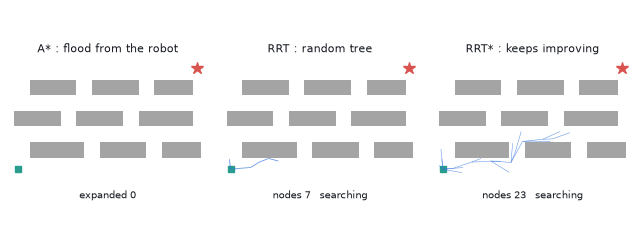
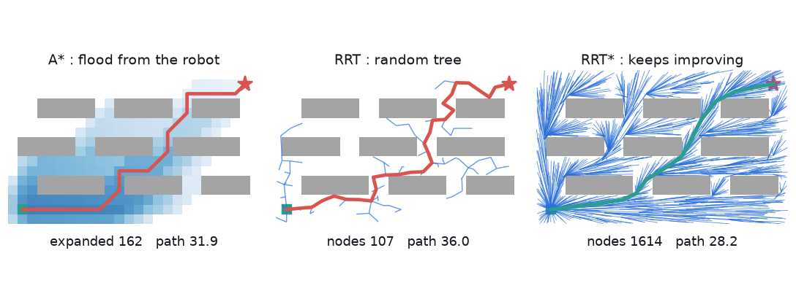
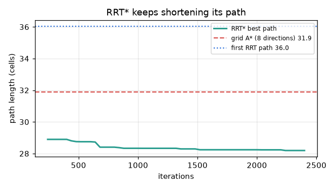
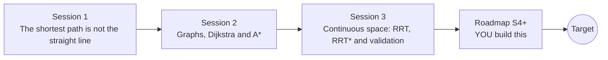

# openpathplanner

[](https://github.com/KrunalPanchal1995/pan-iit-oss/actions/workflows/tests.yml)   [](https://colab.research.google.com/github/KrunalPanchal1995/pan-iit-oss/blob/main/openpathplanner/sessions/session-01/lesson.ipynb) [](https://krunalpanchal1995.github.io/pan-iit-oss/openpathplanner/)

**Plan routes for a warehouse robot with A* and RRT, in three sessions.**

openpathplanner teaches how a robot finds a route around obstacles: grid search with BFS, Dijkstra and A*, then sampling-based RRT and RRT*, using only Python and a browser.

- **Start from a picture.** Session 1 needs only counting: a robot, a wall and a shelf on a grid.
- **Write the algorithms yourself.** BFS, Dijkstra, A*, RRT and RRT* are short functions you can read in one sitting.
- **Know you got it right.** Each session ends with a checkpoint that prints PASS or FAIL against hand calculations and an exact reference.
- **Build the missing half.** The repo stops at Session 3 on purpose; the roadmap shows the path to the Target.

[Target](#the-target) · [Who is this for](#who-is-this-for) · [Quick start](#quick-start) · [Sessions](#sessions) · [Roadmap](#roadmap) · [Contribute](#contribute) · [Explainer PDF](docs/explainer.pdf)

> **This repo is incomplete on purpose.** Sessions 1 to 3 are here and fully working. The finished Target below is a preview of what the community can build next. We show you the path, not the code. Sessions 4 and up are yours.

## The Target

An animated warehouse with shelves. On the left, A* floods outward from the robot and the route appears when it reaches the shelf. In the middle, an RRT tree grows between the shelves and finds a wiggly path. On the right, RRT* keeps improving its path as it samples. Live counters show expanded nodes, tree size and path length. Your goal over the coming sessions: build all three planners yourself, then make the routes smooth and drivable.



*Target: A* flood-fill, an RRT tree and RRT* improving, with live counters*



*Target still: three planners on the same warehouse*



*Target: RRT* path length falls toward the optimum while sampling continues*

Try it live:

- [Math Visual Studio (open the Studio and explore geometry and graphs)](https://krunalpanchal1995.github.io/studio/)

How the Target was made is shown only as a path in [promo/roadmap.md](promo/roadmap.md).

## Who is this for
**higher secondary to advanced undergraduate (levels 4-6).** Topic area: Artificial Intelligence, Data Science and Robotics.

Prerequisites:

- Distances with Pythagoras (square root of dx squared plus dy squared); school maths is enough.
- Python 3.10 or newer; if `python --version` works, you are ready. PRIMER.md explains the rest.
- No prior GitHub, graph theory or robotics experience is needed.

New to Python? Read [PRIMER.md](PRIMER.md) first (10 minutes).

## Quick start

No installation knowledge needed. You need [Git](https://git-scm.com/downloads) and [Python 3.10+](https://www.python.org/downloads/) (Windows: tick "Add Python to PATH"). On Mac and Linux type `python3` wherever this page says `python`.

```bash
git clone https://github.com/KrunalPanchal1995/pan-iit-oss.git
cd pan-iit-oss/openpathplanner
python start.py 1
```

`start.py` creates a private environment, installs what is needed and runs Session 1 with its checkpoint. Next: `python start.py 2`, `python start.py 3`, or `python start.py test` to check everything. Only a checkpoint: `python start.py check 1`.

<!-- friendly-help -->
<details>
<summary><b>Not working? Common fixes (no Git, "python not found", no internet)</b></summary>

- **No Git?** You do not need it. On the main page of this collection click the green **Code** button, then **Download ZIP**, unzip it, open a terminal inside the folder `pan-iit-oss-main/openpathplanner` and run `python start.py 1`. The ZIP holds every project, so it is large; the live apps need no download at all.
- **"python is not recognized" or "command not found".** On Windows try `py start.py 1`. On Mac and Linux try `python3 start.py 1`. If neither works, install Python from [python.org](https://www.python.org/downloads/) and tick "Add Python to PATH".
- **Needs internet once.** The first run downloads NumPy and Matplotlib into a private folder (`.venv`); after that it works offline.
- **Rather not install anything?** Open the [live apps](https://krunalpanchal1995.github.io/pan-iit-oss/openpathplanner/) in your browser, or use the Colab badge at the top of this page.
- **Still stuck?** [Open an issue](https://github.com/KrunalPanchal1995/pan-iit-oss/issues/new?title=%5Bopenpathplanner%5D%20) with your operating system and the message you see. Questions from beginners are welcome.

</details>

Three lines compute the exact shortest path around a wall, the reference answer of Session 3 (they work as they are): Save it as `try.py` and run it with `python start.py run try.py` (this uses the private environment, where NumPy is installed):

```python
import math
a = math.hypot(4.8 - 1, 6 - 1)       # robot (1, 1) to the wall's left top corner (4.8, 6)
print(round(2 * a + 0.4, 3))             # -> 12.96 m: two equal legs plus the 0.4 m wall top
```

Every session also opens in your browser with sliders (no install): [live apps](https://krunalpanchal1995.github.io/pan-iit-oss/openpathplanner/). Or use the Colab badge above for the notebook.

## Sessions

| # | Session | Model level | Time | Live app |
|---|---|---|---|---|
| 1 | [The shortest path is not the straight line](sessions/session-01/README.md) | Level 1: conceptual interactive model | 60 min | [open](https://krunalpanchal1995.github.io/pan-iit-oss/openpathplanner/session-01/) |
| 2 | [Graphs, Dijkstra and A*](sessions/session-02/README.md) | Level 2: mathematical engineering model | 80 min | [open](https://krunalpanchal1995.github.io/pan-iit-oss/openpathplanner/session-02/) |
| 3 | [Continuous space: RRT, RRT* and validation](sessions/session-03/README.md) | Level 3: simulation and validation | 90 min | [open](https://krunalpanchal1995.github.io/pan-iit-oss/openpathplanner/session-03/) |

Each session follows the same six steps: A real-world problem, B concept and theory, C visual explanation, D interactive simulation, E worked example and experiment, F assessment and design challenge. Each ends with `checkpoint.py`, which prints `PASS` or `FAIL` against reference numbers. Session 3 also contains the real-world mini-project: **Plan the pick route for a warehouse robot**.

## Architecture



| Folder or file | What is inside |
|---|---|
| `sessions/` | three sessions: README (A-F), `lesson.py`, notebook, live app, exercises, activity sheet, checkpoint |
| `promo/` | the Target: media, live links, and the roadmap (path only) |
| `docs/` | `explainer.tex` and the built `explainer.pdf` |
| `tests/` | runs every lesson and checkpoint headless |
| `start.py` | one command to set up and run anything |
| `QUALITY.md`, `RUBRIC.md` | the quality checklist and the scoring rubric |
| `.github/` | CI, PDF build, Pages deploy, issue and PR templates |

## Roadmap

| Milestone | What you will build | Difficulty |
|---|---|---|
| Session 4: Choose the pick order | A planner that reorders the four picks (then ten picks with a heuristic) before running A* between them. | intermediate |
| Session 5: Keep a safe distance | Inflated obstacles and a path-clearance function, used by both grid A* and RRT*. | intermediate |
| Session 6: Find the narrow passage | An RRT variant that samples more near obstacle edges. | advanced |
| Session 7: Replan when an aisle is blocked | A replanner that updates its route when one aisle cell becomes blocked. | advanced |
| Session 8: Drivable paths for a car-like robot | A planner whose paths have bounded curvature. | advanced |

Full detail with a checkpoint per milestone: [promo/roadmap.md](promo/roadmap.md).

## Contribute
New to GitHub? Read [CONTRIBUTING.md](CONTRIBUTING.md); it starts from zero. Pick an issue labelled `good first issue`. Translations into Hindi, Telugu, Tamil and Malayalam are welcome.

<details>
<summary>Development</summary>

```bash
python start.py test        # runs every lesson and checkpoint
```
Lessons use `# %%` cell markers so they open as notebooks in VS Code. See [QUALITY.md](QUALITY.md) for the standard every session meets.
</details>

## License
MIT. See [LICENSE](LICENSE). Media in `promo/media` is (c) Krunal Panchal, CC BY 4.0.

## Acknowledgments
Part of the [PAN IIT OSS](https://hellofoss.tech-iitb.org/projects) open-source teaching collection, modelled on the structure of [openspline](https://github.com/openspline/openspline). Built on ideas from the Math Visual Studio at https://krunalpanchal1995.github.io/studio/.
