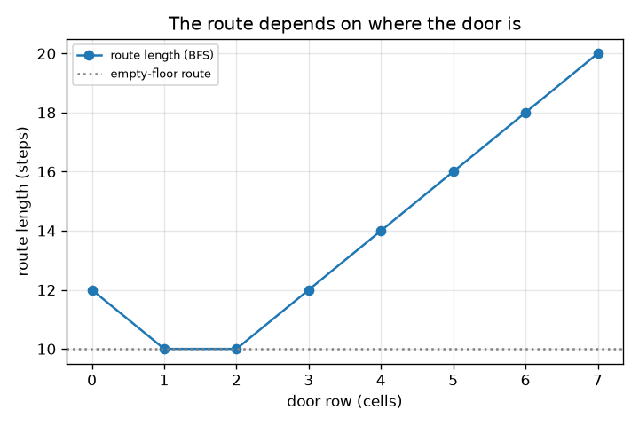
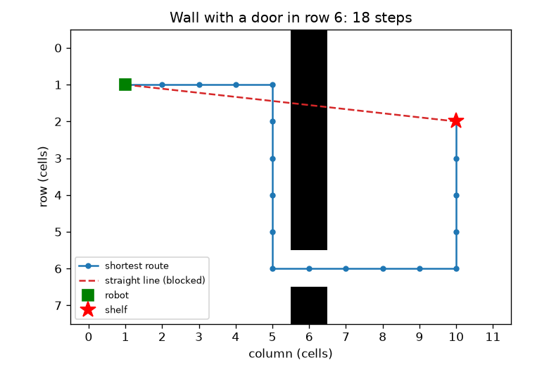

# सत्र 1: सबसे छोटा पथ सीधी रेखा नहीं है

*स्तर 1 (संकल्पनात्मक इंटरैक्टिव मॉडल) · लगभग 60 मिनट · openpathplanner*

> यह एक सरलीकृत शैक्षिक मॉडल है। यह कोई प्रमाणित डिज़ाइन टूल नहीं है और इसका उपयोग वास्तविक संरचनाओं, विद्युत स्थापनाओं, वाहनों, औद्योगिक प्रक्रियाओं या चिकित्सा निर्णयों के लिए नहीं किया जाना चाहिए।

**पूर्व-आवश्यकताएँ (Prerequisites)**

- गिनती और दूरी सूत्र (पाइथागोरस)।
- आपने PRIMER.md पढ़ लिया है और `python start.py 1` एक बार चला लिया है।

**सीखने के उद्देश्य (Learning objectives)।** इस सत्र के बाद आप:

- किसी गोदाम के फ़र्श को खाली और अवरुद्ध (blocked) कोष्ठों (cells) के ग्रिड (grid) के रूप में वर्णित कर सकेंगे।
- समझा सकेंगे कि दीवार के चारों ओर का सबसे अच्छा मार्ग सीधी रेखा से लंबा क्यों होता है।
- चौड़ाई-प्रथम खोज (breadth-first search, BFS) से सबसे छोटा मार्ग ढूँढ़ सकेंगे और उसकी लंबाई चरणों (steps) में पढ़ सकेंगे।
- दीवार में दरवाज़े की स्थिति के विरुद्ध मार्ग की लंबाई का ग्राफ़ पढ़ सकेंगे।

## A. वास्तविक दुनिया की समस्या
फ़र्श के बाईं ओर एक गोदाम रोबोट को दाईं ओर की एक शेल्फ़ तक पहुँचना है। उनके बीच एक दरवाज़े वाली एक लंबी दीवार खड़ी है। रोबोट से शेल्फ़ तक की सीधी रेखा दीवार से होकर जाती है, इसलिए रोबोट को दरवाज़े तक चलकर वापस आना पड़ता है। असली मार्ग कितना लंबा है, और एक प्रोग्राम हर संभव चाल आज़माए बिना इसे कैसे ढूँढ़ सकता है? यह एक सरलीकृत शिक्षण मॉडल है, किसी वास्तविक रोबोट को नियंत्रित करने का सॉफ़्टवेयर नहीं।

## B. संकल्पना और सिद्धांत
हम फ़र्श को वर्गाकार कोष्ठों में काटते हैं। हर कोष्ठ खाली या अवरुद्ध है। रोबोट एक बार में एक कोष्ठ ऊपर, नीचे, बाएँ या दाएँ चलता है, और हर चाल की लागत एक चरण है। चौड़ाई-प्रथम खोज (BFS) फ़र्श को छल्लों में खोजती है: पहले रोबोट से एक चरण दूर के सभी कोष्ठ, फिर दो चरण दूर के सभी कोष्ठ, और इसी तरह। पहली बार जब कोई छल्ला शेल्फ़ को छूता है, तो छल्ले की संख्या ही न्यूनतम संभव चरण है। dx स्तंभ और dy पंक्ति दूर कोष्ठों के लिए, सीधी रेखा की दूरी sqrt(dx^2 + dy^2) है, पर खाली फ़र्श पर 4-चाल वाले मार्ग को dx + dy चरण चाहिए, और कोई भी दीवार मार्ग को केवल लंबा बना सकती है, कभी छोटा नहीं।

| प्रतीक | अर्थ | इकाई |
|---|---|---|
| dx, dy | रोबोट और शेल्फ़ के बीच स्तंभ और पंक्तियाँ | कोष्ठ |
| steps | किसी मार्ग में चालों की संख्या | चरण (1 चरण = 1 कोष्ठ) |
| d | दीवार में दरवाज़े की पंक्ति | कोष्ठ |
| s | शेल्फ़ की पंक्ति | कोष्ठ |

**मान्यताएँ (Assumptions)**

- फ़र्श समतल है; रोबोट एक बिंदु है जो एक कोष्ठ भरता है।
- चालें केवल ऊपर, नीचे, बाएँ, दाएँ हैं, हर एक की लागत 1 चरण।
- दीवार स्तंभ 6 में है और उसमें ठीक एक दरवाज़ा है; रोबोट स्तंभ 1, पंक्ति 1 पर; शेल्फ़ स्तंभ 10 पर।
- शेल्फ़ वाले कोष्ठ पर खड़ा हुआ जा सकता है।

$$ \text{straight line}=\sqrt{dx^2+dy^2} $$

$$ \text{empty floor, 4 moves: } dx+dy $$

$$ \text{steps}=(10-1)+|1-d|+|d-s|=9+|1-d|+|d-s| $$

## C. दृश्य व्याख्या
पहला चित्र 12 गुणा 8 का फ़र्श दिखाता है। धूसर कोष्ठ दीवार हैं, लाल डैश वाली रेखा वह सीधी रेखा है जिसे दीवार रोकती है, और नीली रेखा पंक्ति 6 के दरवाज़े से होकर सबसे छोटा मार्ग है: 9.06 कोष्ठ की सीधी रेखा के मुक़ाबले 18 चरण। दूसरा चित्र दरवाज़े की पंक्ति के विरुद्ध मार्ग की लंबाई आलेखित करता है। सबसे अच्छे दरवाज़े पंक्ति 1 और 2 हैं जिनमें 10 चरण लगते हैं, खाली फ़र्श के बराबर, क्योंकि रोबोट को कभी अपना रास्ता छोड़ना नहीं पड़ता। पंक्ति 7 के दरवाज़े में 20 चरण लगते हैं।

*दरवाज़े की पंक्ति के विरुद्ध मार्ग की लंबाई: पंक्ति 1 और 2 पर सबसे अच्छा (10 चरण), पंक्ति 7 पर सबसे बुरा (20 चरण)।*

*पंक्ति 6 में दरवाज़े वाली एक दीवार: सबसे छोटा मार्ग 18 चरण का है; सीधी रेखा अवरुद्ध है।*

## D. इंटरैक्टिव सिमुलेशन
पाठ चलाइए (`python start.py 1`), फिर लाइव ऐप खोलिए: [सत्र 1: रोबोट, दीवार और दरवाज़ा](https://krunalpanchal1995.github.io/pan-iit-oss/openpathplanner/session-01/) (या इसी फ़ोल्डर में `app.html`)। दरवाज़ा स्लाइडर खिसकाइए और नीले मार्ग को खिंचते और सिकुड़ते देखिए, फिर ग्राफ़ दृश्य पर जाइए। शेल्फ़ की पंक्ति खिसकाइए और देखिए कि सबसे अच्छी दरवाज़ा पंक्ति उसका कैसे अनुसरण करती है।

**चुनौती।** शेल्फ़ तक के मार्ग को अधिकतम 11 चरण लंबा बनाइए।

## E. हल किया गया उदाहरण और प्रयोग
**समस्या।** दरवाज़ा पंक्ति 6 में है और शेल्फ़ पंक्ति 2 में है। चरणों की संख्या, सीधी रेखा की दूरी और दीवार के कारण लगे अतिरिक्त चरण ज्ञात कीजिए।

1. रोबोट स्तंभ 1, पंक्ति 1 से शुरू करता है। शेल्फ़ स्तंभ 10, पंक्ति 2 पर है। रोबोट को स्तंभ 1 से स्तंभ 10 तक पार करना है: दाईं ओर 9 चरण।
2. दीवार पार करने के लिए उसे पंक्ति 6 में खड़ा होना होगा: पंक्ति 1 से नीचे पंक्ति 6 तक |1 - 6| = 5 चरण हैं।
3. दरवाज़े के बाद उसे पंक्ति 6 से शेल्फ़ की पंक्ति 2 तक जाना है: |6 - 2| = 4 चरण।
4. कुल = 9 + 5 + 4 = 18 चरण। checkpoint में BFS भी 18 लौटाता है।
5. सीधी रेखा = sqrt(9^2 + 1^2) = sqrt(82) = 9.06 कोष्ठ। खाली फ़र्श पर मार्ग 9 + 1 = 10 चरण होता, इसलिए दीवार 8 अतिरिक्त चरण लेती है।

**उत्तर।** मार्ग में 18 चरण हैं; सीधी रेखा 9.06 कोष्ठ है; दीवार 8 चरण जोड़ती है।

**प्रयोग।** वर्गाकार ख़ानों वाले कागज़ पर फ़र्श बनाइए, दीवार को छायांकित कीजिए और एक सिक्के को रोबोट से शेल्फ़ तक चलाइए, चालें गिनते हुए। आपको 18 गिनना चाहिए। असली रोबोट मॉडल से भिन्न होते हैं: उनकी एक चौड़ाई होती है, इसलिए दरवाज़ा रोबोट से चौड़ा होना चाहिए, और वे तिरछे काट सकते हैं, जिसे सत्र 2 जोड़ता है। मॉडल ग्रिड के लिए सटीक है, पर ग्रिड एक वास्तविक फ़र्श का केवल सन्निकटन है।

## F. मूल्यांकन और डिज़ाइन चुनौती
**प्रश्न प्रकार A: संकल्पनात्मक।** शेल्फ़ तक का सबसे छोटा मार्ग सीधी रेखा से लंबा क्यों है, और BFS शेल्फ़ तक पहुँचते ही क्यों रुक सकता है?

संकेत

सोचिए कि दीवार क्या रोकती है, और BFS किस क्रम में कोष्ठों पर जाता है।

चरण-दर-चरण हल

सीधी रेखा अवरुद्ध कोष्ठों से होकर जाती है, इसलिए रोबोट उसका अनुसरण नहीं कर सकता; किसी भी अनुमत मार्ग को दरवाज़े से होकर मुड़ना होगा, इसलिए वह लंबा है। BFS दो चरण दूर के किसी भी कोष्ठ से पहले एक चरण दूर के सभी कोष्ठों पर जाता है, और इसी तरह, इसलिए पहली बार जब यह शेल्फ़ तक पहुँचता है तब इसने न्यूनतम संभव चरण उपयोग किए होते हैं। कोई बाद की यात्रा छोटी नहीं हो सकती।

**प्रश्न प्रकार B: संख्यात्मक।** दरवाज़ा पंक्ति 4 में है और शेल्फ़ पंक्ति 2 में है। मार्ग कितने चरण का है, और सीधी रेखा की दूरी क्या है? जाँचिए कि मार्ग सीधी रेखा से छोटा नहीं है।

संकेत

steps = 9 + |1 - d| + |d - s| का उपयोग कीजिए।

चरण-दर-चरण हल

steps = 9 + |1 - 4| + |4 - 2| = 9 + 3 + 2 = 14 चरण। सीधी रेखा = sqrt(82) = 9.06 कोष्ठ। 14, 9.06 से बड़ा है, जैसा होना चाहिए। इकाइयाँ: एक कोष्ठ के चरण।

**प्रश्न प्रकार C: ग्राफ़ और सिमुलेशन की व्याख्या।** दरवाज़े की पंक्ति के विरुद्ध मार्ग की लंबाई के ग्राफ़ में (शेल्फ़ पंक्ति 2 में), कौन-सी दरवाज़ा पंक्तियाँ सबसे छोटा मार्ग देती हैं, वह लंबाई क्या है, और यह इससे छोटी क्यों नहीं है?

संकेत

सबसे निचले बिंदु ढूँढ़िए और खाली-फ़र्श रेखा से तुलना कीजिए।

चरण-दर-चरण हल

दरवाज़ा पंक्ति 1 और 2 से 10 चरण मिलते हैं। 10 = 9 + 1 खाली-फ़र्श मान है (9 स्तंभ और 1 पंक्ति), इसलिए कोई भी दीवार स्थिति इससे बेहतर नहीं कर सकती: दीवार केवल चरण जोड़ सकती है। पंक्ति 0 और 3 से 12 चरण मिलते हैं, और पंक्ति 7 से 20।

**प्रश्न प्रकार D: डिज़ाइन और इष्टतमीकरण (optimisation) चुनौती।** डिज़ाइन: दो प्रकार के ऑर्डर पंक्ति 2 और पंक्ति 6 की शेल्फ़ों पर, बराबर बार जाते हैं। वह दरवाज़ा पंक्ति चुनिए जो हर शेल्फ़ तक एक यात्रा के कुल चरणों को न्यूनतम करे। कुल क्या है? यह मॉडल कौन-सा वास्तविक कारक अनदेखा करता है जो आपका चुनाव बदल सकता है?

संकेत

हर दरवाज़ा पंक्ति 0 से 7 के लिए दोनों सूत्रों को जोड़िए और तुलना कीजिए।

चरण-दर-चरण हल

दरवाज़ा पंक्ति 0 से 7 के लिए कुल 28, 24, 24, 26, 28, 30, 32, 36 हैं। पंक्ति 1 और 2, 24 चरणों के साथ बराबर हैं। मॉडल भीड़ (congestion) को अनदेखा करता है: यदि कई रोबोट एक दरवाज़ा उपयोग करते हैं तो वे क़तार में लगते हैं, इसलिए एक वास्तविक डिज़ाइन दूसरा दरवाज़ा जोड़ सकता है। यह दरवाज़े की चौड़ाई और रोबोट के आकार को भी अनदेखा करता है।

[RUBRIC.md](../../RUBRIC.md) से स्वयं को अंक दीजिए। कागज़ पर काम करने के लिए [गतिविधि पत्रक](activity_sheet.md) प्रिंट कीजिए।

## सामान्य भ्रांतियाँ (Common misconceptions)
| सामान्य भ्रांति | वास्तव में क्या सच है |
|---|---|
| सबसे छोटा पथ सीधी रेखा है। | सीधी रेखा केवल एक निम्न सीमा है। दीवारों के साथ, सबसे छोटा मार्ग लंबा होता है। |
| BFS हर संभव पथ आज़माता है। | BFS हर कोष्ठ पर एक बार, समान दूरी के छल्लों में, जाता है, जो कहीं कम काम है। |
| एक दीवार कभी-कभी मार्ग को छोटा बना सकती है। | दीवार केवल विकल्प हटाती है, इसलिए मार्ग वही रह सकता है या लंबा हो सकता है, कभी छोटा नहीं। |
| केवल एक ही सबसे छोटा मार्ग होता है। | अक्सर कई मार्ग बराबर होते हैं (उदाहरण के लिए पहले दाएँ चलना या पहले नीचे); BFS उनमें से एक लौटाता है। |

## शब्दावली (Glossary)
- **ग्रिड (grid)**: वर्गाकार कोष्ठों में कटा फ़र्श, हर एक खाली या अवरुद्ध
- **BFS**: चौड़ाई-प्रथम खोज (breadth-first search): समान चरण संख्या के छल्लों में खोजना
- **चरण (step)**: पड़ोसी कोष्ठ तक एक चाल
- **निम्न सीमा (lower bound)**: एक मान जिससे सही उत्तर कभी नीचे नहीं हो सकता

## समापन
1. [exercises.md](exercises.md) में दिए गए तीन कोडिंग कार्य कीजिए।
2. अपने बदलावों के बाद `python start.py 1` फिर से चलाइए। यह checkpoint के साथ समाप्त होता है; जब यह `PASS` छापे, तो आपका काम पूरा है। (केवल checkpoint: `python start.py check 1`।)

अगला: [सत्र 2](../session-02/README.md)
