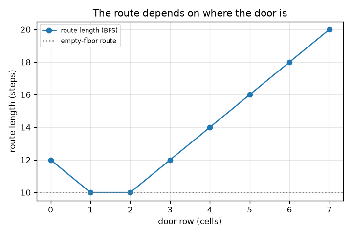
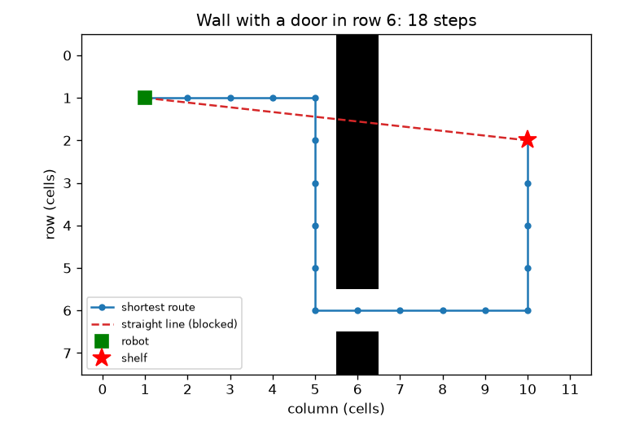

# സെഷൻ 1: ഏറ്റവും ചെറിയ വഴി നേർരേഖയല്ല

[Session 1 — हिन्दी](README.hi.md)

*തലം 1 (ആശയപരമായ സംവേദനാത്മക മാതൃക) · ഏകദേശം 60 മിനിറ്റ് · openpathplanner*

> ഇതൊരു ലളിതവൽക്കരിച്ച വിദ്യാഭ്യാസ മാതൃകയാണ്. ഇത് സാധൂകരിച്ച ഡിസൈൻ ഉപകരണമല്ല; യഥാർഥ നിർമിതികൾ, വൈദ്യുത ഇൻസ്റ്റലേഷനുകൾ, വാഹനങ്ങൾ, വ്യാവസായിക പ്രക്രിയകൾ, വൈദ്യശാസ്ത്ര തീരുമാനങ്ങൾ എന്നിവയ്ക്ക് ഇത് ഉപയോഗിക്കരുത്.

**മുൻവിജ്ഞാനം (Prerequisites)**

- എണ്ണൽ, ദൂരസൂത്രം (പൈതഗോറസ്).
- നിങ്ങൾ PRIMER.md വായിക്കുകയും `python start.py 1` ഒരു തവണ റൺ ചെയ്യുകയും ചെയ്തിരിക്കണം.

**പഠനലക്ഷ്യങ്ങൾ (Learning objectives).** ഈ സെഷനു ശേഷം നിങ്ങൾക്ക്:

- ഒരു ഗോഡൗൺ തറയെ ഒഴിഞ്ഞതും തടസ്സമുള്ളതുമായ കളങ്ങളുടെ ഗ്രിഡായി വിവരിക്കാം.
- മതിലിനു ചുറ്റുമുള്ള ഏറ്റവും നല്ല വഴി നേർരേഖയെക്കാൾ നീളമുള്ളതാകുന്നത് എന്തുകൊണ്ടെന്ന് വിശദീകരിക്കാം.
- ബ്രെഡ്ത്ത്-ഫസ്റ്റ് സെർച്ച് (breadth-first search, BFS) ഉപയോഗിച്ച് ഏറ്റവും ചെറിയ വഴി കണ്ടെത്തി അതിന്റെ നീളം ചുവടുകളിൽ വായിക്കാം.
- മതിലിലെ വാതിലിന്റെ സ്ഥാനത്തിനെതിരെ വഴിയുടെ നീളം കാണിക്കുന്ന ഗ്രാഫ് വായിക്കാം.

## A. യഥാർഥ ജീവിത പ്രശ്നം
തറയുടെ ഇടതുവശത്തുള്ള ഒരു ഗോഡൗൺ റോബോട്ടിന് വലതുവശത്തുള്ള ഒരു ഷെൽഫിലെത്തണം. അവയ്ക്കിടയിൽ ഒരു വാതിൽ മാത്രമുള്ള നീളമുള്ള ഒരു മതിൽ നിൽക്കുന്നു. റോബോട്ടിൽ നിന്ന് ഷെൽഫിലേക്കുള്ള നേർരേഖ മതിലിലൂടെ കടന്നുപോകുന്നു, അതിനാൽ റോബോട്ട് വാതിലിലേക്കു നടന്ന് തിരികെ വരണം. യഥാർഥ വഴിക്ക് എത്ര നീളമുണ്ട്, സാധ്യമായ എല്ലാ നടത്തവും പരീക്ഷിക്കാതെ ഒരു പ്രോഗ്രാമിന് അതെങ്ങനെ കണ്ടെത്താം? ഇതൊരു ലളിതവൽക്കരിച്ച അധ്യാപന മാതൃകയാണ്, യഥാർഥ റോബോട്ടിനെ നിയന്ത്രിക്കാനുള്ള സോഫ്റ്റ്‌വെയർ അല്ല.

## B. ആശയവും സിദ്ധാന്തവും
തറയെ ചതുരക്കളങ്ങളായി മുറിക്കുന്നു. ഓരോ കളവും ഒഴിഞ്ഞതോ തടസ്സമുള്ളതോ ആണ്. റോബോട്ട് ഒരു സമയം ഒരു കളം മുകളിലേക്കോ താഴേക്കോ ഇടത്തോട്ടോ വലത്തോട്ടോ നീങ്ങുന്നു, ഓരോ നീക്കത്തിനും ഒരു ചുവട് ചെലവാകും. ബ്രെഡ്ത്ത്-ഫസ്റ്റ് സെർച്ച് (BFS) തറയെ വലയങ്ങളായി പരിശോധിക്കുന്നു: ആദ്യം റോബോട്ടിൽ നിന്ന് ഒരു ചുവടകലെയുള്ള എല്ലാ കളങ്ങളും, പിന്നെ രണ്ടു ചുവടകലെയുള്ളവയും, അങ്ങനെ. ഒരു വലയം ആദ്യമായി ഷെൽഫിനെ തൊടുമ്പോൾ ആ വലയത്തിന്റെ നമ്പർ സാധ്യമായ ഏറ്റവും കുറഞ്ഞ ചുവടുകളാണ്. dx നിരകളും dy വരികളും അകലെയുള്ള കളങ്ങൾക്ക് നേർരേഖാ ദൂരം sqrt(dx^2 + dy^2) ആണ്, എന്നാൽ ഒഴിഞ്ഞ തറയിൽ 4-നീക്ക വഴിക്ക് dx + dy ചുവടുകൾ വേണം, ഏതു മതിലും വഴിയെ നീളം കൂട്ടാനേ ഇടയാക്കൂ, ഒരിക്കലും കുറയ്ക്കില്ല.

| ചിഹ്നം | അർഥം | യൂണിറ്റ് |
|---|---|---|
| dx, dy | റോബോട്ടിനും ഷെൽഫിനും ഇടയിലെ നിരകളും വരികളും | കളങ്ങൾ |
| steps | ഒരു വഴിയിലെ നീക്കങ്ങളുടെ എണ്ണം | ചുവടുകൾ (1 ചുവട് = 1 കളം) |
| d | മതിലിലെ വാതിലിന്റെ വരി | കളങ്ങൾ |
| s | ഷെൽഫിന്റെ വരി | കളങ്ങൾ |

**അനുമാനങ്ങൾ (Assumptions)**

- തറ പരന്നതാണ്; റോബോട്ട് ഒരു കളം മാത്രം നിറയ്ക്കുന്ന ഒരു ബിന്ദുവാണ്.
- നീക്കങ്ങൾ മുകളിലേക്കും താഴേക്കും ഇടത്തോട്ടും വലത്തോട്ടും മാത്രം, ഓരോന്നിനും 1 ചുവട്.
- മതിൽ നിര 6-ലാണ്, കൃത്യം ഒരു വാതിലുണ്ട്; റോബോട്ട് നിര 1, വരി 1-ൽ; ഷെൽഫ് നിര 10-ൽ.
- ഷെൽഫ് കളത്തിൽ നിൽക്കാൻ കഴിയും.

$$ \text{straight line}=\sqrt{dx^2+dy^2} $$

$$ \text{empty floor, 4 moves: } dx+dy $$

$$ \text{steps}=(10-1)+|1-d|+|d-s|=9+|1-d|+|d-s| $$

## C. ദൃശ്യ വിശദീകരണം
ആദ്യ ചിത്രം 12 x 8 തറ കാണിക്കുന്നു. ചാരനിറ കളങ്ങൾ മതിലാണ്, ചുവപ്പ് കുത്തുവര മതിൽ തടയുന്ന നേർരേഖയാണ്, നീല വര വരി 6-ലെ വാതിലിലൂടെയുള്ള ഏറ്റവും ചെറിയ വഴിയാണ്: 9.06 കളങ്ങളുള്ള നേർരേഖയ്ക്കു പകരം 18 ചുവടുകൾ. രണ്ടാമത്തെ ചിത്രം വഴിയുടെ നീളത്തെ വാതിലിന്റെ വരിക്കെതിരെ വരയ്ക്കുന്നു. ഏറ്റവും നല്ല വാതിലുകൾ വരി 1-ഉം 2-ഉം ആണ്, 10 ചുവടുകൾ, ഒഴിഞ്ഞ തറയിലേതിനു തുല്യം, കാരണം റോബോട്ടിന് ഒരിക്കലും വഴിയിൽ നിന്ന് മാറേണ്ടിവരുന്നില്ല. വരി 7-ലെ വാതിലിന് 20 ചുവടുകൾ ചെലവാകും.

*വഴിയുടെ നീളം വാതിൽ വരിക്കെതിരെ: വരി 1, 2-ൽ ഏറ്റവും നല്ലത് (10 ചുവടുകൾ), വരി 7-ൽ ഏറ്റവും മോശം (20 ചുവടുകൾ).*

*വരി 6-ൽ വാതിലുള്ള മതിൽ: ഏറ്റവും ചെറിയ വഴി 18 ചുവടുകൾ; നേർരേഖ തടയപ്പെട്ടിരിക്കുന്നു.*

## D. സംവേദനാത്മക സിമുലേഷൻ
പാഠം റൺ ചെയ്യുക (`python start.py 1`), എന്നിട്ട് ലൈവ് ആപ്പ് തുറക്കുക: [സെഷൻ 1: റോബോട്ട്, മതിൽ, വാതിൽ](https://krunalpanchal1995.github.io/pan-iit-oss/openpathplanner/session-01/) (അല്ലെങ്കിൽ ഈ ഫോൾഡറിലെ `app.html`). വാതിൽ സ്ലൈഡർ നീക്കി നീല വഴി നീളുന്നതും ചുരുങ്ങുന്നതും കാണുക, പിന്നെ ഗ്രാഫ് കാഴ്ചയിലേക്കു മാറുക. ഷെൽഫിന്റെ വരി നീക്കി ഏറ്റവും നല്ല വാതിൽ വരി അതിനെ പിന്തുടരുന്നത് കാണുക.

**വെല്ലുവിളി.** ഷെൽഫിലേക്കുള്ള വഴി പരമാവധി 11 ചുവടുകളാക്കുക.

## E. ഉദാഹരണവും പരീക്ഷണവും
**പ്രശ്നം.** വാതിൽ വരി 6-ലും ഷെൽഫ് വരി 2-ലുമാണ്. ചുവടുകളുടെ എണ്ണം, നേർരേഖാ ദൂരം, മതിൽ മൂലമുണ്ടാകുന്ന അധിക ചുവടുകൾ എന്നിവ കണ്ടെത്തുക.

1. റോബോട്ട് നിര 1, വരി 1-ൽ തുടങ്ങുന്നു. ഷെൽഫ് നിര 10, വരി 2-ലാണ്. റോബോട്ട് നിര 1-ൽ നിന്ന് നിര 10-ലേക്ക് കടക്കണം: വലത്തോട്ട് 9 ചുവടുകൾ.
2. മതിൽ കടക്കാൻ അത് വരി 6-ൽ നിൽക്കണം: വരി 1-ൽ നിന്ന് വരി 6-ലേക്ക് |1 - 6| = 5 ചുവടുകൾ.
3. വാതിലിനു ശേഷം അത് വരി 6-ൽ നിന്ന് ഷെൽഫിന്റെ വരി 2-ലേക്ക് പോകണം: |6 - 2| = 4 ചുവടുകൾ.
4. ആകെ = 9 + 5 + 4 = 18 ചുവടുകൾ. ചെക്ക്പോയിന്റിലെ BFS-ഉം 18 തന്നെ നൽകുന്നു.
5. നേർരേഖ = sqrt(9^2 + 1^2) = sqrt(82) = 9.06 കളങ്ങൾ. ഒഴിഞ്ഞ തറയിൽ വഴി 9 + 1 = 10 ചുവടുകളാകുമായിരുന്നു, അതിനാൽ മതിൽ 8 അധിക ചുവടുകൾ ചെലവാക്കുന്നു.

**ഉത്തരം.** വഴിക്ക് 18 ചുവടുകൾ; നേർരേഖ 9.06 കളങ്ങൾ; മതിൽ 8 ചുവടുകൾ കൂട്ടുന്നു.

**പരീക്ഷണം.** ചതുരക്കട്ടയിട്ട കടലാസിൽ തറ വരയ്ക്കുക, മതിൽ നിഴൽ ചെയ്യുക, റോബോട്ടിൽ നിന്ന് ഷെൽഫിലേക്ക് ഒരു നാണയം നീക്കി നീക്കങ്ങൾ എണ്ണുക. നിങ്ങൾക്ക് 18 കിട്ടണം. യഥാർഥ റോബോട്ടുകൾ മാതൃകയിൽ നിന്ന് വ്യത്യസ്തമാണ്: അവയ്ക്ക് വീതിയുണ്ട്, അതിനാൽ വാതിൽ റോബോട്ടിനെക്കാൾ വീതിയുള്ളതാകണം; അവയ്ക്ക് ചരിഞ്ഞും മുറിച്ചു പോകാം, അത് സെഷൻ 2 ചേർക്കുന്നു. ഗ്രിഡിന് മാതൃക കൃത്യമാണ്, പക്ഷേ ഗ്രിഡ് യഥാർഥ തറയുടെ ഏകദേശ രൂപം മാത്രമാണ്.

## F. മൂല്യനിർണയവും ഡിസൈൻ വെല്ലുവിളിയും
**ചോദ്യ തരം A: ആശയപരം.** ഷെൽഫിലേക്കുള്ള ഏറ്റവും ചെറിയ വഴി നേർരേഖയെക്കാൾ നീളമുള്ളതാകുന്നത് എന്തുകൊണ്ട്, ഷെൽഫിൽ എത്തിയ ഉടനെ BFS-ന് നിർത്താൻ കഴിയുന്നത് എന്തുകൊണ്ട്?

സൂചന

മതിൽ എന്താണ് തടയുന്നതെന്നും BFS കളങ്ങൾ സന്ദർശിക്കുന്ന ക്രമത്തെക്കുറിച്ചും ചിന്തിക്കുക.

ഘട്ടം ഘട്ടമായ പരിഹാരം

നേർരേഖ തടസ്സമുള്ള കളങ്ങളിലൂടെ കടന്നുപോകുന്നു, അതിനാൽ റോബോട്ടിന് അതു പിന്തുടരാനാവില്ല; അനുവദനീയമായ ഏതു വഴിയും വാതിലിലൂടെ വളയണം, അതിനാൽ അതിന് നീളം കൂടും. രണ്ടു ചുവടകലെയുള്ള ഏതു കളത്തിനും മുമ്പ് BFS ഒരു ചുവടകലെയുള്ള എല്ലാ കളങ്ങളും സന്ദർശിക്കുന്നു, അങ്ങനെ തുടരുന്നു, അതിനാൽ ആദ്യമായി ഷെൽഫിൽ എത്തുമ്പോൾ അത് സാധ്യമായ ഏറ്റവും കുറഞ്ഞ ചുവടുകളേ ഉപയോഗിച്ചിട്ടുള്ളൂ. പിന്നീടുള്ള ഒരു സന്ദർശനത്തിനും ഇതിലും ചെറുതാകാൻ കഴിയില്ല.

**ചോദ്യ തരം B: സംഖ്യാപരം.** വാതിൽ വരി 4-ലും ഷെൽഫ് വരി 2-ലുമാണ്. വഴിക്ക് എത്ര ചുവടുകൾ, നേർരേഖാ ദൂരം എത്ര? വഴി നേർരേഖയെക്കാൾ ചെറുതല്ലെന്ന് പരിശോധിക്കുക.

സൂചന

steps = 9 + |1 - d| + |d - s| ഉപയോഗിക്കുക.

ഘട്ടം ഘട്ടമായ പരിഹാരം

steps = 9 + |1 - 4| + |4 - 2| = 9 + 3 + 2 = 14 ചുവടുകൾ. നേർരേഖ = sqrt(82) = 9.06 കളങ്ങൾ. 14, 9.06-നെക്കാൾ വലുതാണ്, ആകേണ്ടതുപോലെ. യൂണിറ്റുകൾ: ഒരു കളത്തിന്റെ ചുവടുകൾ.

**ചോദ്യ തരം C: ഗ്രാഫും സിമുലേഷനും വ്യാഖ്യാനിക്കൽ.** വഴിയുടെ നീളം വാതിൽ വരിക്കെതിരെ (ഷെൽഫ് വരി 2-ൽ) കാണിക്കുന്ന ഗ്രാഫിൽ ഏതു വാതിൽ വരികൾ ഏറ്റവും ചെറിയ വഴി നൽകുന്നു, ആ നീളം എത്ര, അതിനെക്കാൾ ചെറുതാകാത്തത് എന്തുകൊണ്ട്?

സൂചന

ഏറ്റവും താഴ്ന്ന ബിന്ദുക്കൾ കണ്ടെത്തി ഒഴിഞ്ഞ തറയുടെ രേഖയുമായി താരതമ്യം ചെയ്യുക.

ഘട്ടം ഘട്ടമായ പരിഹാരം

വാതിൽ വരി 1-ഉം 2-ഉം 10 ചുവടുകൾ നൽകുന്നു. 10 = 9 + 1 ഒഴിഞ്ഞ തറയിലെ മൂല്യമാണ് (9 നിരകളും 1 വരിയും), അതിനാൽ ഒരു മതിൽ സ്ഥാനത്തിനും ഇതിലും മെച്ചപ്പെടാനാവില്ല: മതിലിന് ചുവടുകൾ കൂട്ടാനേ കഴിയൂ. വരി 0-ഉം 3-ഉം 12 ചുവടുകൾ നൽകുന്നു, വരി 7 20 നൽകുന്നു.

**ചോദ്യ തരം D: ഡിസൈൻ, ഒപ്റ്റിമൈസേഷൻ വെല്ലുവിളി.** ഡിസൈൻ: രണ്ടുതരം ഓർഡറുകൾ വരി 2-ലെയും വരി 6-ലെയും ഷെൽഫുകളിലേക്ക് ഒരേ ആവൃത്തിയിൽ വരുന്നു. ഓരോ ഷെൽഫിലേക്കും ഓരോ യാത്രയുടെ ആകെ ചുവടുകൾ ഏറ്റവും കുറയ്ക്കുന്ന വാതിൽ വരി തിരഞ്ഞെടുക്കുക. ആകെ എത്ര? നിങ്ങളുടെ തിരഞ്ഞെടുപ്പ് മാറ്റിയേക്കാവുന്ന ഏതു യഥാർഥ ഘടകത്തെ ഈ മാതൃക അവഗണിക്കുന്നു?

സൂചന

വാതിൽ വരി 0 മുതൽ 7 വരെ ഓരോന്നിനും രണ്ടു സൂത്രവാക്യങ്ങളും കൂട്ടി താരതമ്യം ചെയ്യുക.

ഘട്ടം ഘട്ടമായ പരിഹാരം

വാതിൽ വരി 0 മുതൽ 7 വരെയുള്ള ആകെത്തുകകൾ 28, 24, 24, 26, 28, 30, 32, 36 ആണ്. വരി 1-ഉം 2-ഉം 24 ചുവടുകളിൽ തുല്യം. മാതൃക തിരക്ക് അവഗണിക്കുന്നു: ഒരു വാതിൽ പല റോബോട്ടുകൾ ഉപയോഗിച്ചാൽ അവ വരി നിൽക്കും, അതിനാൽ യഥാർഥ ഡിസൈൻ രണ്ടാമതൊരു വാതിൽ ചേർത്തേക്കാം. വാതിലിന്റെ വീതിയും റോബോട്ടിന്റെ വലുപ്പവും കൂടി ഇത് അവഗണിക്കുന്നു.

[RUBRIC.md](../../RUBRIC.md) ഉപയോഗിച്ച് സ്വയം മാർക്കിടുക. കടലാസിൽ ചെയ്യാൻ [പ്രവർത്തന ഷീറ്റ്](activity_sheet.md) പ്രിന്റ് ചെയ്യുക.

## സാധാരണ തെറ്റിദ്ധാരണകൾ
| സാധാരണ തെറ്റിദ്ധാരണ | യഥാർഥത്തിൽ ശരിയായത് |
|---|---|
| ഏറ്റവും ചെറിയ വഴി നേർരേഖയാണ്. | നേർരേഖ ഒരു താഴ്ന്ന പരിധി മാത്രമാണ്. മതിലുകളുണ്ടെങ്കിൽ ഏറ്റവും ചെറിയ വഴി നീളമുള്ളതാണ്. |
| BFS സാധ്യമായ എല്ലാ വഴികളും പരീക്ഷിക്കുന്നു. | BFS ഓരോ കളവും ഒരു തവണ, തുല്യ അകലത്തിന്റെ വലയങ്ങളായി സന്ദർശിക്കുന്നു, അത് വളരെ കുറഞ്ഞ അധ്വാനമാണ്. |
| ഒരു മതിലിന് ചിലപ്പോൾ വഴി ചെറുതാക്കാൻ കഴിയും. | മതിൽ ഓപ്ഷനുകൾ ഇല്ലാതാക്കുക മാത്രം ചെയ്യുന്നു, അതിനാൽ വഴി അതേപടി നിൽക്കുകയോ നീളം കൂടുകയോ ചെയ്യാം, ഒരിക്കലും കുറയില്ല. |
| ഏറ്റവും ചെറിയ വഴി ഒന്നേ ഉള്ളൂ. | പലപ്പോഴും പല വഴികൾ തുല്യമാകും (ഉദാഹരണത്തിന് ആദ്യം വലത്തോട്ടോ ആദ്യം താഴേക്കോ പോകുന്നത്); BFS അവയിലൊന്ന് നൽകുന്നു. |

## പദാവലി (Glossary)
- **ഗ്രിഡ് (grid)**: ചതുരക്കളങ്ങളായി മുറിച്ച തറ, ഓരോ കളവും ഒഴിഞ്ഞതോ തടസ്സമുള്ളതോ
- **BFS**: ബ്രെഡ്ത്ത്-ഫസ്റ്റ് സെർച്ച്: തുല്യ ചുവടെണ്ണത്തിന്റെ വലയങ്ങളായി പരിശോധിക്കൽ
- **ചുവട് (step)**: അടുത്തുള്ള കളത്തിലേക്കുള്ള ഒരു നീക്കം
- **താഴ്ന്ന പരിധി (lower bound)**: യഥാർഥ ഉത്തരം ഒരിക്കലും താഴെയാകാത്ത മൂല്യം

## പൂർത്തിയാക്കൽ
1. [exercises.md](exercises.md)-ലെ മൂന്ന് കോഡിങ് ജോലികൾ ചെയ്യുക.
2. മാറ്റങ്ങൾക്കു ശേഷം `python start.py 1` വീണ്ടും റൺ ചെയ്യുക. അത് ചെക്ക്പോയിന്റോടെ അവസാനിക്കുന്നു; `PASS` എന്ന് പ്രിന്റ് ചെയ്താൽ നിങ്ങൾ പൂർത്തിയാക്കി. (ചെക്ക്പോയിന്റ് മാത്രം: `python start.py check 1`.)

അടുത്തത്: [സെഷൻ 2](../session-02/README.md)
