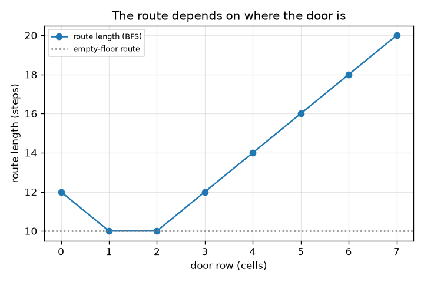
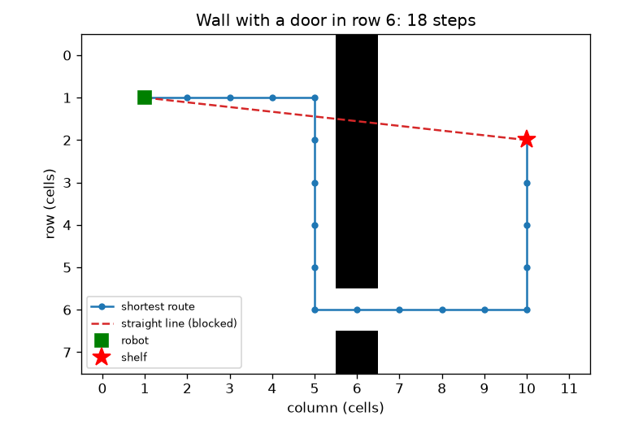

# அமர்வு 1: மிகக் குறுகிய பாதை நேர்க்கோடு அல்ல

[Session 1 — हिन्दी](README.hi.md)

*நிலை 1 (கருத்தியல் ஊடாடும் மாதிரி) · சுமார் 60 நிமிடங்கள் · openpathplanner*

> இது எளிமைப்படுத்தப்பட்ட கல்வி மாதிரி. இது சரிபார்க்கப்பட்ட வடிவமைப்புக் கருவி அல்ல; உண்மையான கட்டமைப்புகள், மின் நிறுவல்கள், வாகனங்கள், தொழில்துறை செயல்முறைகள் அல்லது மருத்துவ முடிவுகளுக்கு இதைப் பயன்படுத்தக் கூடாது.

**முன்தேவைகள் (Prerequisites)**

- எண்ணுதல் மற்றும் தூரச் சூத்திரம் (பித்தாகரஸ்).
- நீங்கள் PRIMER.md ஐப் படித்து, `python start.py 1` ஐ ஒருமுறை இயக்கியிருக்க வேண்டும்.

**கற்றல் நோக்கங்கள் (Learning objectives).** இந்த அமர்வுக்குப் பிறகு உங்களால்:

- ஒரு கிடங்குத் தரையை காலியான மற்றும் தடையுள்ள கட்டங்களின் வலைப்பின்னலாக (grid) விவரிக்க முடியும்.
- சுவரைச் சுற்றிச் செல்லும் சிறந்த பாதை நேர்க்கோட்டை விட நீளமாக இருப்பது ஏன் என்பதை விளக்க முடியும்.
- அகல-முதல் தேடல் (breadth-first search, BFS) மூலம் மிகக் குறுகிய பாதையைக் கண்டறிந்து அதன் நீளத்தை அடிகளில் படிக்க முடியும்.
- சுவரில் கதவின் இடத்துக்கு எதிரான பாதை நீளத்தின் வரைபடத்தைப் படிக்க முடியும்.

## A. நிஜ வாழ்க்கைப் பிரச்சினை
தரையின் இடப்புறத்தில் உள்ள ஒரு கிடங்கு ரோபோ வலப்புறத்தில் உள்ள ஒரு அலமாரியை அடைய வேண்டும். அவற்றுக்கு இடையே ஒரே ஒரு கதவு கொண்ட நீண்ட சுவர் நிற்கிறது. ரோபோவிலிருந்து அலமாரிக்கான நேர்க்கோடு சுவர் வழியாகச் செல்கிறது, எனவே ரோபோ கதவு வரை நடந்து திரும்ப வேண்டும். உண்மையான பாதை எவ்வளவு நீளம், சாத்தியமான எல்லா நடைகளையும் முயற்சிக்காமல் ஒரு நிரல் அதை எப்படிக் கண்டறியும்? இது எளிமைப்படுத்தப்பட்ட கற்பித்தல் மாதிரி, உண்மையான ரோபோவைக் கட்டுப்படுத்தும் மென்பொருள் அல்ல.

## B. கருத்தும் கோட்பாடும்
தரையைச் சதுரக் கட்டங்களாக வெட்டுகிறோம். ஒவ்வொரு கட்டமும் காலியாகவோ தடையாகவோ இருக்கும். ரோபோ ஒரு நேரத்தில் ஒரு கட்டம் மேலே, கீழே, இடது அல்லது வலது நகரும், ஒவ்வொரு நகர்வும் ஓர் அடி செலவாகும். அகல-முதல் தேடல் (BFS) தரையை வளையங்களாக ஆராய்கிறது: முதலில் ரோபோவிலிருந்து ஓர் அடி தொலைவில் உள்ள அனைத்துக் கட்டங்கள், பின் இரண்டு அடி தொலைவில் உள்ளவை, இப்படியே. ஒரு வளையம் முதன்முறையாக அலமாரியைத் தொடும்போது, அந்த வளையத்தின் எண் சாத்தியமான குறைந்தபட்ச அடிகள். dx நெடுவரிசைகளும் dy வரிசைகளும் இடைவெளியுள்ள கட்டங்களுக்கு நேர்க்கோட்டுத் தூரம் sqrt(dx^2 + dy^2), ஆனால் காலியான தரையில் 4-நகர்வுப் பாதைக்கு dx + dy அடிகள் தேவை, எந்தச் சுவரும் பாதையை நீளமாக்க மட்டுமே முடியும், ஒருபோதும் குறைக்க முடியாது.

| குறியீடு | பொருள் | அலகு |
|---|---|---|
| dx, dy | ரோபோவுக்கும் அலமாரிக்கும் இடையிலான நெடுவரிசைகள், வரிசைகள் | கட்டங்கள் |
| steps | ஒரு பாதையில் உள்ள நகர்வுகளின் எண்ணிக்கை | அடிகள் (1 அடி = 1 கட்டம்) |
| d | சுவரில் கதவின் வரிசை | கட்டங்கள் |
| s | அலமாரியின் வரிசை | கட்டங்கள் |

**அனுமானங்கள் (Assumptions)**

- தரை சமமானது; ரோபோ ஒரு கட்டத்தை மட்டும் நிரப்பும் புள்ளி.
- நகர்வுகள் மேல், கீழ், இடது, வலது மட்டுமே, ஒவ்வொன்றும் 1 அடி.
- சுவர் நெடுவரிசை 6 இல் உள்ளது, சரியாக ஒரு கதவு உண்டு; ரோபோ நெடுவரிசை 1, வரிசை 1 இல்; அலமாரி நெடுவரிசை 10 இல்.
- அலமாரிக் கட்டத்தில் நிற்க முடியும்.

$$ \text{straight line}=\sqrt{dx^2+dy^2} $$

$$ \text{empty floor, 4 moves: } dx+dy $$

$$ \text{steps}=(10-1)+|1-d|+|d-s|=9+|1-d|+|d-s| $$

## C. காட்சி விளக்கம்
முதல் படம் 12 x 8 தரையைக் காட்டுகிறது. சாம்பல் கட்டங்கள் சுவர், சிவப்பு புள்ளிக்கோடு சுவர் தடுக்கும் நேர்க்கோடு, நீலக்கோடு வரிசை 6 இல் உள்ள கதவு வழியாகச் செல்லும் மிகக் குறுகிய பாதை: 9.06 கட்டங்கள் நேர்க்கோட்டுக்கு எதிராக 18 அடிகள். இரண்டாவது படம் பாதை நீளத்தைக் கதவின் வரிசைக்கு எதிராக வரைகிறது. சிறந்த கதவுகள் வரிசை 1 மற்றும் 2, 10 அடிகள், காலியான தரைக்குச் சமம், ஏனெனில் ரோபோ தன் வழியை விட்டு விலகவே தேவையில்லை. வரிசை 7 இல் உள்ள கதவுக்கு 20 அடிகள் ஆகும்.

*கதவு வரிசைக்கு எதிரான பாதை நீளம்: வரிசை 1, 2 இல் சிறந்தது (10 அடிகள்), வரிசை 7 இல் மோசமானது (20 அடிகள்).*

*வரிசை 6 இல் கதவுடன் சுவர்: மிகக் குறுகிய பாதை 18 அடிகள்; நேர்க்கோடு தடுக்கப்பட்டுள்ளது.*

## D. ஊடாடும் உருவகப்படுத்தல்
பாடத்தை இயக்குங்கள் (`python start.py 1`), பின் நேரடி பயன்பாட்டைத் திறக்கவும்: [அமர்வு 1: ரோபோ, சுவர் மற்றும் கதவு](https://krunalpanchal1995.github.io/pan-iit-oss/openpathplanner/session-01/) (அல்லது இந்தக் கோப்புறையில் உள்ள `app.html`). கதவு ஸ்லைடரை நகர்த்தி நீலப் பாதை நீள்வதையும் சுருங்குவதையும் பாருங்கள், பின் வரைபடக் காட்சிக்கு மாறுங்கள். அலமாரியின் வரிசையை நகர்த்தி சிறந்த கதவு வரிசை அதைப் பின்தொடர்வதைப் பாருங்கள்.

**சவால்.** அலமாரிக்கான பாதையை அதிகபட்சம் 11 அடிகளாக ஆக்குங்கள்.

## E. தீர்க்கப்பட்ட எடுத்துக்காட்டும் சோதனையும்
**சிக்கல்.** கதவு வரிசை 6 இலும் அலமாரி வரிசை 2 இலும் உள்ளது. அடிகளின் எண்ணிக்கை, நேர்க்கோட்டுத் தூரம், சுவரால் ஏற்படும் கூடுதல் அடிகள் ஆகியவற்றைக் காண்க.

1. ரோபோ நெடுவரிசை 1, வரிசை 1 இல் தொடங்குகிறது. அலமாரி நெடுவரிசை 10, வரிசை 2 இல் உள்ளது. ரோபோ நெடுவரிசை 1 இலிருந்து 10 க்குக் கடக்க வேண்டும்: வலப்புறம் 9 அடிகள்.
2. சுவரைக் கடக்க அது வரிசை 6 இல் நிற்க வேண்டும்: வரிசை 1 இலிருந்து வரிசை 6 க்கு |1 - 6| = 5 அடிகள்.
3. கதவுக்குப் பிறகு அது வரிசை 6 இலிருந்து அலமாரியின் வரிசை 2 க்குச் செல்ல வேண்டும்: |6 - 2| = 4 அடிகள்.
4. மொத்தம் = 9 + 5 + 4 = 18 அடிகள். சோதனைச்சாவடியில் உள்ள BFS உம் 18 ஐத் தருகிறது.
5. நேர்க்கோடு = sqrt(9^2 + 1^2) = sqrt(82) = 9.06 கட்டங்கள். காலியான தரையில் பாதை 9 + 1 = 10 அடிகளாக இருந்திருக்கும், எனவே சுவர் 8 கூடுதல் அடிகளைச் செலவாக்குகிறது.

**விடை.** பாதைக்கு 18 அடிகள்; நேர்க்கோடு 9.06 கட்டங்கள்; சுவர் 8 அடிகளைக் கூட்டுகிறது.

**சோதனை.** கட்டம் போட்ட தாளில் தரையை வரைந்து, சுவருக்கு நிழலிட்டு, ரோபோவிலிருந்து அலமாரிக்கு ஒரு நாணயத்தை நகர்த்தி நகர்வுகளை எண்ணுங்கள். உங்களுக்கு 18 கிடைக்க வேண்டும். உண்மையான ரோபோக்கள் மாதிரியிலிருந்து வேறுபடுகின்றன: அவற்றுக்கு அகலம் உண்டு, எனவே கதவு ரோபோவை விட அகலமாக இருக்க வேண்டும்; அவை குறுக்காகவும் வெட்டிச் செல்ல முடியும், அதை அமர்வு 2 சேர்க்கிறது. வலைப்பின்னலுக்கு மாதிரி துல்லியமானது, ஆனால் வலைப்பின்னல் உண்மையான தரையின் தோராயம் மட்டுமே.

## F. மதிப்பீடும் வடிவமைப்புச் சவாலும்
**கேள்வி வகை A: கருத்தியல்.** அலமாரிக்கான மிகக் குறுகிய பாதை நேர்க்கோட்டை விட நீளமாக இருப்பது ஏன், BFS அலமாரியை அடைந்தவுடனே நிறுத்த முடிவது ஏன்?

குறிப்பு

சுவர் எதைத் தடுக்கிறது என்பதையும், BFS கட்டங்களைச் சந்திக்கும் வரிசையையும் சிந்தியுங்கள்.

படிப்படியான தீர்வு

நேர்க்கோடு தடையுள்ள கட்டங்கள் வழியாகச் செல்கிறது, எனவே ரோபோவால் அதைப் பின்பற்ற முடியாது; அனுமதிக்கப்பட்ட எந்தப் பாதையும் கதவு வழியாக வளைய வேண்டும், எனவே அது நீளமானது. BFS இரண்டு அடி தொலைவில் உள்ள எந்தக் கட்டத்துக்கும் முன் ஓர் அடி தொலைவில் உள்ள அனைத்துக் கட்டங்களையும் சந்திக்கிறது, இப்படியே, எனவே அலமாரியை முதன்முறையாக அடையும்போது அது சாத்தியமான குறைந்தபட்ச அடிகளையே பயன்படுத்தியிருக்கும். பின்னர் வரும் எந்தச் சந்திப்பும் இதை விடக் குறைவாக இருக்க முடியாது.

**கேள்வி வகை B: எண்சார்ந்த.** கதவு வரிசை 4 இலும் அலமாரி வரிசை 2 இலும் உள்ளது. பாதைக்கு எத்தனை அடிகள், நேர்க்கோட்டுத் தூரம் என்ன? பாதை நேர்க்கோட்டை விடக் குறுகியதல்ல என்பதைச் சரிபாருங்கள்.

குறிப்பு

steps = 9 + |1 - d| + |d - s| ஐப் பயன்படுத்துங்கள்.

படிப்படியான தீர்வு

steps = 9 + |1 - 4| + |4 - 2| = 9 + 3 + 2 = 14 அடிகள். நேர்க்கோடு = sqrt(82) = 9.06 கட்டங்கள். 14, 9.06 ஐ விடப் பெரியது, இருக்க வேண்டியபடியே. அலகுகள்: ஒரு கட்டத்தின் அடிகள்.

**கேள்வி வகை C: வரைபடம் மற்றும் உருவகப்படுத்தல் விளக்கம்.** பாதை நீளம் மற்றும் கதவு வரிசையின் வரைபடத்தில் (அலமாரி வரிசை 2) எந்தக் கதவு வரிசைகள் மிகக் குறுகிய பாதையைத் தருகின்றன, அந்த நீளம் என்ன, அது இதை விடச் சிறியதாக இல்லாதது ஏன்?

குறிப்பு

மிகக் குறைந்த புள்ளிகளைக் கண்டு காலியான தரைக் கோட்டுடன் ஒப்பிடுங்கள்.

படிப்படியான தீர்வு

கதவு வரிசை 1 மற்றும் 2 இல் 10 அடிகள். 10 = 9 + 1 என்பது காலியான தரையின் மதிப்பு (9 நெடுவரிசைகள், 1 வரிசை), எனவே எந்தச் சுவர் நிலையும் இதை விட மேம்பட முடியாது: சுவர் அடிகளைக் கூட்ட மட்டுமே முடியும். வரிசை 0 மற்றும் 3 இல் 12 அடிகள், வரிசை 7 இல் 20.

**கேள்வி வகை D: வடிவமைப்பு மற்றும் மேம்படுத்தல் சவால்.** வடிவமைப்பு: இரு வகை ஆர்டர்கள் வரிசை 2 மற்றும் வரிசை 6 இல் உள்ள அலமாரிகளுக்கு சம அடிக்கடி வருகின்றன. ஒவ்வொரு அலமாரிக்கும் ஒரு பயணத்தின் மொத்த அடிகளைக் குறைக்கும் கதவு வரிசையைத் தேர்ந்தெடுங்கள். மொத்தம் என்ன? உங்கள் தேர்வை மாற்றக்கூடிய எந்த நிஜ உலகக் காரணியை இந்த மாதிரி புறக்கணிக்கிறது?

குறிப்பு

கதவு வரிசை 0 முதல் 7 வரை ஒவ்வொன்றுக்கும் இரு சூத்திரங்களையும் கூட்டி ஒப்பிடுங்கள்.

படிப்படியான தீர்வு

கதவு வரிசை 0 முதல் 7 வரையிலான மொத்தங்கள் 28, 24, 24, 26, 28, 30, 32, 36. வரிசை 1 மற்றும் 2 ஆகியவை 24 அடிகளில் சமம். மாதிரி நெரிசலைப் புறக்கணிக்கிறது: பல ரோபோக்கள் ஒரு கதவைப் பயன்படுத்தினால் அவை வரிசையில் நிற்கும், எனவே உண்மையான வடிவமைப்பு இரண்டாவது கதவைச் சேர்க்கலாம். கதவின் அகலம், ரோபோவின் அளவு ஆகியவற்றையும் இது புறக்கணிக்கிறது.

[RUBRIC.md](../../RUBRIC.md) மூலம் உங்களை நீங்களே மதிப்பிடுங்கள். தாளில் வேலை செய்ய [செயல்பாட்டுத் தாளை](activity_sheet.md) அச்சிடுங்கள்.

## பொதுவான தவறான புரிதல்கள்
| பொதுவான தவறான புரிதல் | உண்மையில் சரியானது |
|---|---|
| மிகக் குறுகிய பாதை நேர்க்கோடுதான். | நேர்க்கோடு ஒரு கீழ் எல்லை மட்டுமே. சுவர்கள் இருந்தால் மிகக் குறுகிய பாதை நீளமானது. |
| BFS சாத்தியமான எல்லாப் பாதைகளையும் முயற்சிக்கிறது. | BFS ஒவ்வொரு கட்டத்தையும் ஒருமுறை, சம தூர வளையங்களில் சந்திக்கிறது, இது மிகக் குறைந்த வேலை. |
| ஒரு சுவர் சில சமயம் பாதையைக் குறுகியதாக்க முடியும். | சுவர் தேர்வுகளை நீக்க மட்டுமே செய்கிறது, எனவே பாதை அப்படியே இருக்கலாம் அல்லது நீளமாகலாம், ஒருபோதும் குறையாது. |
| மிகக் குறுகிய பாதை ஒன்றே ஒன்றுதான். | பெரும்பாலும் பல பாதைகள் சமமாகும் (எ.கா. முதலில் வலப்புறம் அல்லது முதலில் கீழே செல்வது); BFS அவற்றில் ஒன்றைத் தருகிறது. |

## சொற்களஞ்சியம் (Glossary)
- **வலைப்பின்னல் (grid)**: சதுரக் கட்டங்களாக வெட்டப்பட்ட தரை, ஒவ்வொன்றும் காலியாகவோ தடையாகவோ
- **BFS**: அகல-முதல் தேடல்: சம அடி எண்ணிக்கை வளையங்களில் ஆராய்தல்
- **அடி (step)**: அடுத்துள்ள கட்டத்துக்கு ஒரு நகர்வு
- **கீழ் எல்லை (lower bound)**: உண்மையான விடை ஒருபோதும் அதற்குக் கீழே இருக்க முடியாத மதிப்பு

## முடிவு
1. [exercises.md](exercises.md) இல் உள்ள மூன்று நிரலாக்கப் பணிகளைச் செய்யுங்கள்.
2. உங்கள் மாற்றங்களுக்குப் பிறகு `python start.py 1` ஐ மீண்டும் இயக்குங்கள். அது சோதனைச்சாவடியுடன் முடிகிறது; அது `PASS` என அச்சிட்டால், நீங்கள் முடித்துவிட்டீர்கள். (சோதனைச்சாவடி மட்டும்: `python start.py check 1`.)

அடுத்தது: [அமர்வு 2](../session-02/README.md)
