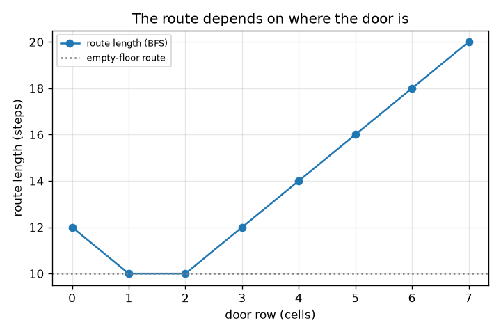
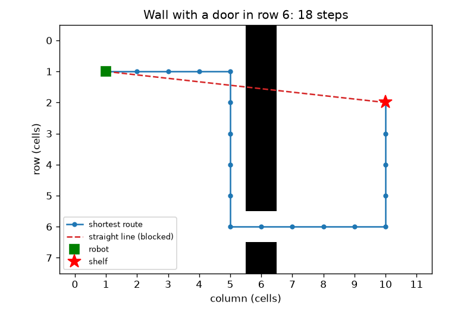

# సెషన్ 1: అతి తక్కువ దారి నేరుగా గీసిన గీత కాదు

[Session 1 — हिन्दी](README.hi.md)

*స్థాయి 1 (భావనాత్మక ఇంటరాక్టివ్ మోడల్) · సుమారు 60 నిమిషాలు · openpathplanner*

> ఇది సరళీకరించిన విద్యా మోడల్. ఇది ధృవీకరించబడిన డిజైన్ సాధనం కాదు; నిజమైన నిర్మాణాలు, విద్యుత్ ఇన్‌స్టాలేషన్‌లు, వాహనాలు, పారిశ్రామిక ప్రక్రియలు లేదా వైద్య నిర్ణయాల కోసం దీనిని ఉపయోగించకూడదు.

**ముందస్తు అవసరాలు (Prerequisites)**

- లెక్కించడం మరియు దూర సూత్రం (పైథాగరస్).
- మీరు PRIMER.md చదివి, `python start.py 1` ను ఒకసారి రన్ చేసి ఉండాలి.

**అభ్యాస లక్ష్యాలు (Learning objectives).** ఈ సెషన్ తర్వాత మీరు:

- ఒక గోదాము నేలను ఖాళీ మరియు అడ్డంకి ఉన్న గడుల గ్రిడ్‌గా వర్ణించగలరు.
- గోడ చుట్టూ ఉన్న ఉత్తమ దారి నేరుగా గీసిన గీత కంటే పొడవుగా ఎందుకు ఉంటుందో వివరించగలరు.
- బ్రెడ్త్-ఫస్ట్ సెర్చ్ (breadth-first search, BFS) ద్వారా అతి తక్కువ దారిని కనుగొని దాని పొడవును అడుగుల్లో చదవగలరు.
- గోడలో తలుపు స్థానానికి వ్యతిరేకంగా దారి పొడవును చూపే గ్రాఫ్‌ను చదవగలరు.

## A. నిజ జీవిత సమస్య
నేలకు ఎడమవైపు ఉన్న గోదాము రోబోట్ కుడివైపు ఉన్న ఒక అరను చేరాలి. వాటి మధ్య ఒకే తలుపు ఉన్న పొడవైన గోడ ఉంది. రోబోట్ నుండి అరకు నేరుగా గీసిన గీత గోడ గుండా పోతుంది, కాబట్టి రోబోట్ తలుపు వరకు నడిచి వెనక్కి రావాలి. నిజమైన దారి ఎంత పొడవు, సాధ్యమైన ప్రతి నడకనూ ప్రయత్నించకుండా ఒక ప్రోగ్రామ్ దానిని ఎలా కనుగొనగలదు? ఇది సరళీకరించిన బోధన మోడల్, నిజమైన రోబోట్‌ను నియంత్రించే సాఫ్ట్‌వేర్ కాదు.

## B. భావన మరియు సిద్ధాంతం
నేలను చతురస్ర గడులుగా కోస్తాము. ప్రతి గడి ఖాళీగా లేదా అడ్డంకిగా ఉంటుంది. రోబోట్ ఒకసారి ఒక గడి పైకి, కిందికి, ఎడమకు లేదా కుడికి కదులుతుంది, ప్రతి కదలికకు ఒక అడుగు ఖర్చు. బ్రెడ్త్-ఫస్ట్ సెర్చ్ (BFS) నేలను వలయాలుగా అన్వేషిస్తుంది: మొదట రోబోట్ నుండి ఒక అడుగు దూరంలోని అన్ని గడులు, తర్వాత రెండు అడుగుల దూరంలోనివి, ఇలా. ఒక వలయం మొదటిసారి అరను తాకినప్పుడు, ఆ వలయం సంఖ్యే సాధ్యమైన కనీస అడుగులు. dx నిలువు వరుసలు, dy అడ్డు వరుసల తేడా ఉన్న గడులకు నేరు దూరం sqrt(dx^2 + dy^2), కానీ ఖాళీ నేలపై 4-కదలికల దారికి dx + dy అడుగులు కావాలి, ఏ గోడ అయినా దారిని పొడవు చేయగలదు తప్ప ఎప్పుడూ తగ్గించలేదు.

| చిహ్నం | అర్థం | యూనిట్ |
|---|---|---|
| dx, dy | రోబోట్‌కు అరకు మధ్య నిలువు వరుసలు, అడ్డు వరుసలు | గడులు |
| steps | ఒక దారిలోని కదలికల సంఖ్య | అడుగులు (1 అడుగు = 1 గడి) |
| d | గోడలో తలుపు ఉన్న అడ్డు వరుస | గడులు |
| s | అర ఉన్న అడ్డు వరుస | గడులు |

**ఊహలు (Assumptions)**

- నేల సమతలం; రోబోట్ ఒక గడిని మాత్రమే నింపే బిందువు.
- కదలికలు పైకి, కిందికి, ఎడమకు, కుడికి మాత్రమే, ప్రతిదానికి 1 అడుగు.
- గోడ నిలువు వరుస 6 లో ఉంది మరియు సరిగ్గా ఒక తలుపు ఉంది; రోబోట్ నిలువు వరుస 1, అడ్డు వరుస 1 లో; అర నిలువు వరుస 10 లో.
- అర గడిలో నిలబడవచ్చు.

$$ \text{straight line}=\sqrt{dx^2+dy^2} $$

$$ \text{empty floor, 4 moves: } dx+dy $$

$$ \text{steps}=(10-1)+|1-d|+|d-s|=9+|1-d|+|d-s| $$

## C. దృశ్య వివరణ
మొదటి చిత్రం 12 x 8 నేలను చూపుతుంది. బూడిద గడులు గోడ, ఎరుపు చుక్కల గీత గోడ అడ్డుకునే నేరు గీత, నీలి గీత అడ్డు వరుస 6 లోని తలుపు గుండా అతి తక్కువ దారి: 9.06 గడుల నేరు గీతకు బదులు 18 అడుగులు. రెండవ చిత్రం దారి పొడవును తలుపు ఉన్న అడ్డు వరుసకు వ్యతిరేకంగా గీస్తుంది. ఉత్తమ తలుపులు అడ్డు వరుసలు 1, 2, 10 అడుగులతో, ఖాళీ నేలతో సమానం, ఎందుకంటే రోబోట్ తన దారి నుండి మళ్ళాల్సిన అవసరం లేదు. అడ్డు వరుస 7 లోని తలుపుకు 20 అడుగులు ఖర్చవుతుంది.

*తలుపు అడ్డు వరుసకు వ్యతిరేకంగా దారి పొడవు: అడ్డు వరుసలు 1, 2 వద్ద ఉత్తమం (10 అడుగులు), అడ్డు వరుస 7 వద్ద చెత్త (20 అడుగులు).*

*అడ్డు వరుస 6 లో తలుపు ఉన్న గోడ: అతి తక్కువ దారి 18 అడుగులు; నేరు గీత అడ్డగించబడింది.*

## D. ఇంటరాక్టివ్ సిమ్యులేషన్
పాఠాన్ని రన్ చేయండి (`python start.py 1`), తర్వాత లైవ్ యాప్‌ను తెరవండి: [సెషన్ 1: రోబోట్, గోడ మరియు తలుపు](https://krunalpanchal1995.github.io/pan-iit-oss/openpathplanner/session-01/) (లేదా ఈ ఫోల్డర్‌లోని `app.html`). తలుపు స్లైడర్‌ను జరిపి నీలి దారి సాగడం, కుంచించుకోవడం చూడండి, తర్వాత గ్రాఫ్ వీక్షణకు మారండి. అర ఉన్న అడ్డు వరుసను జరిపి ఉత్తమ తలుపు వరుస దానిని ఎలా అనుసరిస్తుందో చూడండి.

**సవాలు.** అరకు వెళ్ళే దారిని గరిష్ఠంగా 11 అడుగులు చేయండి.

## E. సాధించిన ఉదాహరణ మరియు ప్రయోగం
**సమస్య.** తలుపు అడ్డు వరుస 6 లో, అర అడ్డు వరుస 2 లో ఉంది. అడుగుల సంఖ్య, నేరు దూరం, గోడ వల్ల అదనపు అడుగులు కనుగొనండి.

1. రోబోట్ నిలువు వరుస 1, అడ్డు వరుస 1 వద్ద మొదలవుతుంది. అర నిలువు వరుస 10, అడ్డు వరుస 2 వద్ద ఉంది. రోబోట్ నిలువు వరుస 1 నుండి 10 కు దాటాలి: కుడివైపు 9 అడుగులు.
2. గోడను దాటడానికి అది అడ్డు వరుస 6 లో నిలబడాలి: అడ్డు వరుస 1 నుండి 6 కు |1 - 6| = 5 అడుగులు.
3. తలుపు తర్వాత అది అడ్డు వరుస 6 నుండి అర ఉన్న అడ్డు వరుస 2 కు వెళ్ళాలి: |6 - 2| = 4 అడుగులు.
4. మొత్తం = 9 + 5 + 4 = 18 అడుగులు. చెక్‌పాయింట్‌లోని BFS కూడా 18 ఇస్తుంది.
5. నేరు గీత = sqrt(9^2 + 1^2) = sqrt(82) = 9.06 గడులు. ఖాళీ నేలపై దారి 9 + 1 = 10 అడుగులు అయ్యేది, కాబట్టి గోడ 8 అదనపు అడుగులు ఖర్చు చేస్తుంది.

**సమాధానం.** దారికి 18 అడుగులు; నేరు గీత 9.06 గడులు; గోడ 8 అడుగులు కలుపుతుంది.

**ప్రయోగం.** చతురస్రాల కాగితంపై నేలను గీయండి, గోడకు నీడ వేయండి, రోబోట్ నుండి అరకు ఒక నాణెం కదిలించి కదలికలను లెక్కించండి. మీకు 18 రావాలి. నిజమైన రోబోట్లు మోడల్ కంటే భిన్నంగా ఉంటాయి: వాటికి వెడల్పు ఉంది, కాబట్టి తలుపు రోబోట్ కంటే వెడల్పుగా ఉండాలి; అవి వికర్ణంగా కూడా కోసుకుని వెళ్ళగలవు, దానిని సెషన్ 2 చేరుస్తుంది. గ్రిడ్‌కు మోడల్ ఖచ్చితమైనది, కానీ గ్రిడ్ నిజమైన నేలకు ఉజ్జాయింపు మాత్రమే.

## F. మూల్యాంకనం మరియు డిజైన్ సవాలు
**ప్రశ్న రకం A: భావనాత్మక.** అరకు అతి తక్కువ దారి నేరు గీత కంటే పొడవుగా ఉండేది ఎందుకు, BFS అరను చేరిన వెంటనే ఆగగలిగేది ఎందుకు?

సూచన

గోడ ఏమి అడ్డుకుంటుందో, BFS గడులను సందర్శించే క్రమం గురించి ఆలోచించండి.

దశలవారీ పరిష్కారం

నేరు గీత అడ్డంకి గడుల గుండా వెళ్తుంది, కాబట్టి రోబోట్ దానిని అనుసరించలేదు; అనుమతించిన ఏ దారి అయినా తలుపు గుండా వంగాలి, కాబట్టి అది పొడవు. రెండు అడుగుల దూరంలోని ఏ గడికైనా ముందు BFS ఒక అడుగు దూరంలోని అన్ని గడులను సందర్శిస్తుంది, అలాగే కొనసాగుతుంది, కాబట్టి అరను మొదటిసారి చేరినప్పుడు అది సాధ్యమైన కనీస అడుగులే వాడింది. తర్వాతి ఏ సందర్శనా దీని కంటే చిన్నది కాలేదు.

**ప్రశ్న రకం B: సంఖ్యాత్మక.** తలుపు అడ్డు వరుస 4 లో, అర అడ్డు వరుస 2 లో ఉంది. దారికి ఎన్ని అడుగులు, నేరు దూరం ఎంత? దారి నేరు గీత కంటే చిన్నది కాదని సరిచూడండి.

సూచన

steps = 9 + |1 - d| + |d - s| ఉపయోగించండి.

దశలవారీ పరిష్కారం

steps = 9 + |1 - 4| + |4 - 2| = 9 + 3 + 2 = 14 అడుగులు. నేరు గీత = sqrt(82) = 9.06 గడులు. 14, 9.06 కంటే పెద్దది, ఉండాల్సినట్లే. యూనిట్లు: ఒక గడి అడుగులు.

**ప్రశ్న రకం C: గ్రాఫ్ మరియు సిమ్యులేషన్ వ్యాఖ్యానం.** దారి పొడవు, తలుపు అడ్డు వరుస గ్రాఫ్‌లో (అర అడ్డు వరుస 2) ఏ తలుపు వరుసలు అతి తక్కువ దారిని ఇస్తాయి, ఆ పొడవు ఎంత, అది ఇంతకంటే చిన్నది కాకపోవడానికి కారణం ఏమిటి?

సూచన

అతి తక్కువ బిందువులను కనుగొని ఖాళీ నేల గీతతో పోల్చండి.

దశలవారీ పరిష్కారం

తలుపు వరుసలు 1, 2 10 అడుగులు ఇస్తాయి. 10 = 9 + 1 ఖాళీ నేల విలువ (9 నిలువు వరుసలు, 1 అడ్డు వరుస), కాబట్టి ఏ గోడ స్థానమూ దీని కంటే మెరుగ్గా చేయలేదు: గోడ అడుగులను కలపగలదు తప్ప తగ్గించలేదు. వరుసలు 0, 3 12 అడుగులు ఇస్తాయి, వరుస 7 20 ఇస్తుంది.

**ప్రశ్న రకం D: డిజైన్ మరియు ఆప్టిమైజేషన్ సవాలు.** డిజైన్: రెండు రకాల ఆర్డర్లు అడ్డు వరుస 2, అడ్డు వరుస 6 లోని అరలకు సమాన తరచుదనంతో వస్తాయి. ప్రతి అరకు ఒక్కో ప్రయాణం మొత్తం అడుగులను తగ్గించే తలుపు వరుసను ఎంచుకోండి. మొత్తం ఎంత? మీ ఎంపికను మార్చగల ఏ నిజ ప్రపంచ అంశాన్ని ఈ మోడల్ విస్మరిస్తుంది?

సూచన

తలుపు వరుస 0 నుండి 7 వరకు ప్రతిదానికి రెండు సూత్రాలను కూడి పోల్చండి.

దశలవారీ పరిష్కారం

తలుపు వరుస 0 నుండి 7 కు మొత్తాలు 28, 24, 24, 26, 28, 30, 32, 36. వరుసలు 1, 2 24 అడుగులతో సమానం. మోడల్ రద్దీని విస్మరిస్తుంది: చాలా రోబోట్లు ఒకే తలుపు వాడితే అవి క్యూలో నిలుస్తాయి, కాబట్టి నిజమైన డిజైన్ రెండవ తలుపును చేర్చవచ్చు. తలుపు వెడల్పు, రోబోట్ పరిమాణాన్ని కూడా ఇది విస్మరిస్తుంది.

[RUBRIC.md](../../RUBRIC.md) తో మిమ్మల్ని మీరు స్కోర్ చేసుకోండి. కాగితంపై పని చేయడానికి [కార్యాచరణ షీట్](activity_sheet.md) ప్రింట్ చేయండి.

## సాధారణ అపోహలు
| సాధారణ అపోహ | వాస్తవంగా నిజమైనది |
|---|---|
| అతి తక్కువ దారి నేరు గీతే. | నేరు గీత కేవలం కింది పరిమితి. గోడలు ఉంటే అతి తక్కువ దారి పొడవుగా ఉంటుంది. |
| BFS సాధ్యమైన ప్రతి దారినీ ప్రయత్నిస్తుంది. | BFS ప్రతి గడిని ఒకసారి, సమాన దూరపు వలయాల్లో సందర్శిస్తుంది, ఇది చాలా తక్కువ పని. |
| ఒక గోడ కొన్నిసార్లు దారిని చిన్నదిగా చేయగలదు. | గోడ ఎంపికలను తొలగిస్తుంది తప్ప, కాబట్టి దారి అలాగే ఉండవచ్చు లేదా పొడవు పెరగవచ్చు, ఎప్పుడూ తగ్గదు. |
| అతి తక్కువ దారి ఒక్కటే ఉంటుంది. | తరచుగా చాలా దారులు సమానమవుతాయి (ఉదా. మొదట కుడికి లేదా మొదట కిందికి వెళ్ళడం); BFS వాటిలో ఒకదాన్ని ఇస్తుంది. |

## పదకోశం (Glossary)
- **గ్రిడ్ (grid)**: చతురస్ర గడులుగా కోసిన నేల, ప్రతి గడి ఖాళీగా లేదా అడ్డంకిగా
- **BFS**: బ్రెడ్త్-ఫస్ట్ సెర్చ్: సమాన అడుగుల సంఖ్య వలయాల్లో అన్వేషించడం
- **అడుగు (step)**: పక్కనున్న గడికి ఒక కదలిక
- **కింది పరిమితి (lower bound)**: నిజమైన సమాధానం ఎప్పుడూ దాని కంటే కింద ఉండలేని విలువ

## ముగింపు
1. [exercises.md](exercises.md) లోని మూడు కోడింగ్ పనులు చేయండి.
2. మీ మార్పుల తర్వాత `python start.py 1` ను మళ్ళీ రన్ చేయండి. అది చెక్‌పాయింట్‌తో ముగుస్తుంది; అది `PASS` అని ప్రింట్ చేసినప్పుడు, మీరు పూర్తి చేసినట్లు. (చెక్‌పాయింట్ మాత్రమే: `python start.py check 1`.)

తదుపరి: [సెషన్ 2](../session-02/README.md)
