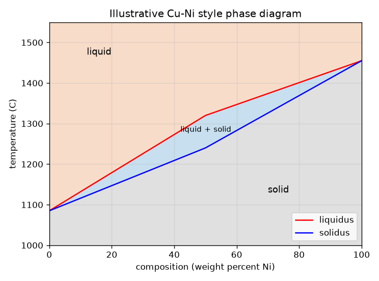
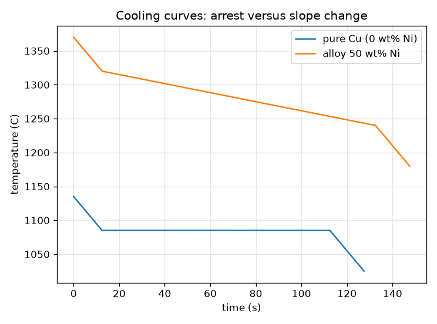

# सत्र 1: शुद्ध धातु एक बिंदु पर पिघलती है, मिश्रधातु एक परास में

*स्तर 1 (वैचारिक इंटरैक्टिव मॉडल) · लगभग 60 मिनट · openphasediagram*

> यह एक सरलीकृत शैक्षिक मॉडल (simplified educational model) है। यह कोई सत्यापित डिज़ाइन टूल नहीं है और इसका उपयोग वास्तविक संरचनाओं, बिजली की स्थापनाओं, वाहनों, औद्योगिक प्रक्रियाओं या चिकित्सा निर्णयों के लिए नहीं किया जाना चाहिए।

**पूर्व-आवश्यकताएँ (Prerequisites)**

- एक अक्ष पर तापमान वाला ग्राफ़ पढ़ना।
- आपने PRIMER.md पढ़ लिया है और `python start.py 1` एक बार चला लिया है।

**सीखने के उद्देश्य (Learning objectives).** इस सत्र के बाद आप:

- समझा सकेंगे कि शुद्ध धातु एक ही तापमान पर और मिश्रधातु (alloy) एक परास (range) में क्यों पिघलती है।
- दो-धातु वाले सरल प्रावस्था आरेख (phase diagram) के द्रव, द्रव + ठोस और ठोस क्षेत्र पढ़ सकेंगे।
- शीतलन वक्र (cooling curve) पढ़ सकेंगे: शुद्ध धातु के लिए सपाट ठहराव (arrest), मिश्रधातु के लिए मोड़।
- आरेख का उपयोग करके ऐसी मिश्रधातु चुन सकेंगे जो एक तापमान पर द्रव हो और दूसरे पर ठोस।

## A. वास्तविक दुनिया की समस्या
शुद्ध ताँबे की छड़ एक निश्चित तापमान तक कठोर रहती है और फिर पिघल जाती है। प्लंबर की किट का सोल्डर पहले नरम और लेई जैसा होता है और बाद में ही पानी की तरह बहता है। प्रावस्था आरेख वह मानचित्र है जो बताता है कि हर तापमान और संघटन (composition) पर मिश्रधातु किस अवस्था में है। हम इसे कैसे पढ़ें, और पिघली धातु के ठंडा होने पर यह कैसे दिखता है?

## B. अवधारणा और सिद्धांत
प्रावस्था (phase) पदार्थ का एक समान क्षेत्र है, यहाँ द्रव या ठोस। आरेख क्षैतिज अक्ष पर संघटन (निकल, यानी धातु B, का भार प्रतिशत) और ऊर्ध्वाधर अक्ष पर तापमान दिखाता है। द्रवरेखा (liquidus) वह रेखा है जिसके ऊपर मिश्रधातु पूरी तरह द्रव है; ठोसरेखा (solidus) वह रेखा है जिसके नीचे वह पूरी तरह ठोस है। इनके बीच एक द्वि-प्रावस्था पट्टी है जहाँ द्रव और ठोस साथ-साथ रहते हैं, जिसे लेई क्षेत्र (mushy zone) कहते हैं। शुद्ध धातुएँ दोनों बाहरी किनारों (0 wt% और 100 wt% Ni) पर हैं जहाँ द्रवरेखा और ठोसरेखा मिलती हैं, इसीलिए शुद्ध धातुएँ एक ही निश्चित तापमान पर पिघलती हैं। जब पिघली धातु से स्थिर दर से ऊष्मा निकाली जाती है, तो द्रव में तापमान स्थिर रूप से गिरता है; जमते समय धातु गुप्त ऊष्मा (latent heat, जमने के दौरान निकलने वाली ऊष्मा) छोड़ती है, इसलिए शीतलन वक्र सपाट हो जाता है। शुद्ध धातु एक सपाट तापीय ठहराव दिखाती है; मिश्रधातु केवल मुड़ती है। यहाँ प्रति ग्राम ऊष्मा सामग्री H = c T + L (1 - f) है, जहाँ f जमा हुआ अंश है, और समय = निकाली गई ऊष्मा भाग ऊष्मा निष्कासन दर।

| प्रतीक | अर्थ | इकाई |
|---|---|---|
| x | संघटन: Ni का भार प्रतिशत | wt% |
| T | तापमान | °C |
| T_L, T_S | द्रवरेखा और ठोसरेखा तापमान | °C |
| c | विशिष्ट ऊष्मा (specific heat; यहाँ 0.5, उदाहरण के लिए) | J/(g K) |
| L | जमने की गुप्त ऊष्मा (यहाँ 200, उदाहरण के लिए) | J/g |
| Q | प्रति ग्राम ऊष्मा निष्कासन दर (यहाँ 2) | W/g |
| f | जमा हुआ अंश (इस सत्र में द्रवरेखा और ठोसरेखा के बीच रैखिक) | कोई इकाई नहीं |

**मान्यताएँ (Assumptions)**

- आरेख एक उदाहरण है: Cu 1085 C और Ni 1455 C के बीच सीधी-रेखा के टुकड़े, मापा गया Cu-Ni आरेख नहीं।
- सभी प्रावस्थाओं और संघटनों के लिए c और L का एक ही मान।
- ऊष्मा स्थिर दर से निकाली जाती है और पूरे टुकड़े का एक ही तापमान है (lumped)।
- शुद्ध धातुएँ 1085 C (Cu) और 1455 C (Ni) पर पिघलती हैं।

$$ T_S(x)\le T\le T_L(x)\ \Rightarrow\ \text{liquid}+\text{solid};\quad T>T_L\Rightarrow\text{liquid};\quad T<T_S\Rightarrow\text{solid} $$

$$ \Delta T_{\text{range}}=T_L(x)-T_S(x)\quad(=0\ \text{for a pure metal}) $$

$$ H(T)=c\,T+L\,\bigl(1-f(T)\bigr),\qquad t=\dfrac{H_{\text{start}}-H(T)}{Q} $$

$$ \text{arrest of a pure metal}=\dfrac{L}{Q} $$

## C. दृश्य व्याख्या
पहला चित्र सरलीकृत आरेख है: ऊपर नारंगी द्रव, द्रव + ठोस की एक नीली पट्टी और नीचे धूसर ठोस, जहाँ द्रवरेखा और ठोसरेखा दोनों शुद्ध धातुओं पर मिलती हैं। दूसरा चित्र समान ऊष्मा हानि के लिए दो शीतलन वक्र दिखाता है। शुद्ध ताँबा गिरता है, जमते समय 100 s तक 1085 C पर सपाट रहता है, फिर से गिरता है। 50 wt% Ni मिश्रधातु 1320 C पर जमना शुरू करती है और 1240 C पर समाप्त करती है, और बीच में वह धीरे ठंडी होती है (4 K/s के बजाय लगभग 0.67 K/s), बिना किसी सपाट भाग के।

*उदाहरणात्मक Cu-Ni शैली का आरेख: द्रव, एक द्वि-प्रावस्था पट्टी और ठोस।*

*शुद्ध ताँबा एक सपाट ठहराव रखता है; 50 wt% Ni मिश्रधातु केवल मुड़ती है।*

## D. इंटरैक्टिव सिमुलेशन
पाठ चलाइए (`python start.py 1`), फिर लाइव ऐप खोलिए: [सत्र 1: मिश्रधातु कहाँ है, और वह कैसे ठंडी होती है?](https://krunalpanchal1995.github.io/pan-iit-oss/openphasediagram/session-01/) (या इस फ़ोल्डर में `app.html`)। संघटन और तापमान स्लाइडर खिसकाइए और देखिए कि बिंदु किस क्षेत्र में पड़ता है। फिर शीतलन-वक्र दृश्य खोलिए और शुद्ध धातु (0 wt% Ni) की 50 wt% मिश्रधातु से तुलना कीजिए।

**चुनौती (Challenge).** 50 wt% Ni मिश्रधातु को ऐसे तापमान पर रखिए जहाँ वह आंशिक रूप से द्रव और आंशिक रूप से ठोस हो।

## E. हल किया गया उदाहरण और प्रयोग
**समस्या.** 50 wt% Ni मिश्रधातु के लिए पिघलने की परास निकालिए, बताइए कि 1280 C पर वह किस प्रावस्था क्षेत्र में है, और तुलना कीजिए कि शुद्ध ताँबे का ठहराव कितनी देर चलता है (L = 200 J/g, Q = 2 W/g)।

1. आरेख को 50 wt% Ni पर पढ़िए: द्रवरेखा 1320 C, ठोसरेखा 1240 C।
2. पिघलने की परास = 1320 - 1240 = 80 K।
3. 1280 C पर 1240 < 1280 < 1320 है, इसलिए मिश्रधातु द्रव + ठोस है।
4. शुद्ध ताँबा: गुप्त ऊष्मा L = 200 J/g, Q = 2 W/g पर निकलती है, इसलिए ठहराव 200 / 2 = 100 s चलता है।
5. मिश्रधातु अपनी परास को (0.5 * 80 + 200) / 2 = 120 s में पार करती है, यानी 80 / 120 = 0.67 K/s की औसत दर, जबकि द्रव में 2 / 0.5 = 4 K/s।

**उत्तर.** पिघलने की परास 80 K है, 1280 C पर मिश्रधातु द्रव + ठोस है, शुद्ध ताँबा 100 s का ठहराव रखता है, और मिश्रधातु अपनी परास में 0.67 K/s से ठंडी होती है।

**प्रयोग (Experiment).** किसी वयस्क के साथ, हॉट प्लेट पर एक छोटे स्टील के कप में थोड़ा शुद्ध टिन और, अलग से, एक गैर-यूटेक्टिक (non-eutectic) प्लंबिंग सोल्डर पिघलाइए (हवादार जगह, दस्ताने, बच्चों के लिए सीसा नहीं), एक थर्मामीटर डालिए, हर एक को ठंडा होने दीजिए और हर 10 s पर तापमान दर्ज कीजिए। शुद्ध टिन एक सपाट भाग दिखाता है; सोल्डर केवल मुड़ता है। वास्तविक वक्रों के कोने गोल होते हैं और पहले जमने के बिंदु से नीचे गिर सकते हैं (अतिशीतलन / undercooling), क्योंकि मॉडल में नमूने के भीतर ऊष्मा प्रवाह नहीं है। गरम सतह से जुड़ी सावधानियाँ बरतिए।

## F. मूल्यांकन और डिज़ाइन चुनौती
**प्रश्न प्रकार A: वैचारिक (Conceptual).** शुद्ध धातु अपने शीतलन वक्र पर सपाट भाग क्यों दिखाती है जबकि मिश्रधातु केवल मुड़ती है?

संकेत

द्रवरेखा और ठोसरेखा कहाँ मिलती हैं, और गुप्त ऊष्मा को क्या करना होता है?

चरण-दर-चरण हल

शुद्ध धातु में द्रवरेखा = ठोसरेखा, इसलिए सारी गुप्त ऊष्मा एक ही तापमान पर निकलती है; जब तक सब जम न जाए, तापमान गिर नहीं सकता, जिससे सपाट ठहराव मिलता है। मिश्रधातु एक परास में जमती है: प्रति डिग्री थोड़ी ही गुप्त ऊष्मा निकलती है, इसलिए शीतलन धीमा होता है (वक्र कम ढलान की ओर मुड़ता है) पर कभी रुकता नहीं।

**प्रश्न प्रकार B: संख्यात्मक (Numerical).** c = 0.5 J/(g K) और L = 200 J/g के साथ Q = 2 W/g पर 50 wt% Ni मिश्रधातु को 1320 C से 1240 C तक ठंडा होने में कितना समय लगता है? वहाँ औसत शीतलन दर क्या है?

संकेत

निकालने वाली ऊष्मा = c गुणा तापमान गिरावट जमा गुप्त ऊष्मा L, फिर Q से भाग दीजिए।

चरण-दर-चरण हल

ऊष्मा = 0.5 * 80 + 200 = 240 J/g। समय = 240 / 2 = 120 s। औसत दर = 80 K / 120 s = 0.67 K/s। तर्कसंगतता जाँच (sanity check): यह द्रव की दर Q/c = 4 K/s से धीमी है, क्योंकि गुप्त ऊष्मा निकल रही है।

**प्रश्न प्रकार C: ग्राफ़ और सिमुलेशन की व्याख्या.** शीतलन-वक्र दृश्य पर, 50 wt% Ni का वक्र कहाँ ढलान बदलता है, और किन तापमानों पर?

संकेत

वक्र के दो कोने ढूँढिए।

चरण-दर-चरण हल

यह 1320 C पर मुड़ता है (द्रवरेखा: पहले क्रिस्टल, गुप्त ऊष्मा निकलना शुरू होती है, वक्र सपाट होता है) और 1240 C पर (ठोसरेखा: जमना पूरा होता है, वक्र फिर से ठोस की शीतलन दर पर तीव्र हो जाता है)। दोनों कोनों के बीच यह धीरे पर लगातार गिरता है, शुद्ध ताँबे के विपरीत जिसका वक्र 1085 C पर सपाट है।

**प्रश्न प्रकार D: डिज़ाइन और अनुकूलन (optimisation) चुनौती.** डिज़ाइन: एक ब्रेज़िंग (brazing) भराव धातु 1350 C पर पूरी तरह द्रव और 1200 C पर पूरी तरह ठोस होनी चाहिए। इस आरेख का उपयोग करके, कौन-सी Ni मात्राएँ (पूर्ण संख्याएँ) काम करती हैं? क्या शुद्ध Cu या शुद्ध Ni संभव हैं?

संकेत

द्रवरेखा <= 1350 और ठोसरेखा >= 1200 चाहिए। सीधी-रेखा के टुकड़ों से हर एक को हल कीजिए।

चरण-दर-चरण हल

ठोसरेखा कम से कम 1200 C होनी चाहिए: 1085 + 3.1 x >= 1200 से x >= 37.1 मिलता है, इसलिए x >= 38। द्रवरेखा अधिकतम 1350 C होनी चाहिए: 1320 + 2.7 (x - 50) <= 1350 से x <= 61.1 मिलता है, इसलिए x <= 61। 38 से 61 wt% Ni वाली मिश्रधातुएँ काम करती हैं। शुद्ध Cu 1200 C पर पहले से द्रव है, शुद्ध Ni 1350 C पर अब भी ठोस है, इसलिए कोई भी काम नहीं करता। समझौता (trade-off): खिड़की के बीच (लगभग 50 wt%) में दोनों सीमाओं से सबसे अधिक मार्जिन है। मान्यता: आरेख केवल उदाहरणात्मक है।

[RUBRIC.md](../../RUBRIC.md) से स्वयं को अंक दीजिए। कागज़ पर काम करने के लिए [गतिविधि पत्रक](activity_sheet.md) प्रिंट कीजिए।

## सामान्य भ्रांतियाँ
| सामान्य भ्रांति (misconception) | वास्तव में क्या सच है |
|---|---|
| हर पदार्थ का एक गलनांक होता है। | शुद्ध धातुओं का होता है; मिश्रधातुएँ ठोसरेखा और द्रवरेखा के बीच एक परास में पिघलती हैं। |
| धातु के जमते समय तापमान हमेशा गिरता है। | जमते समय निकलने वाली गुप्त ऊष्मा गिरावट को धीमा या बंद कर देती है; शुद्ध धातु सपाट रहती है। |
| द्वि-प्रावस्था पट्टी उसी पदार्थ का आधा पिघला हुआ ढेला है। | यह अलग-अलग संघटन वाली दो प्रावस्थाओं का मिश्रण है; सत्र 2 दिखाता है कि दोनों को कैसे पढ़ें। |
| इस रिपॉज़िटरी का आरेख वास्तविक Cu-Ni आरेख है। | यह सीधी-रेखा के टुकड़ों वाला सरलीकृत उदाहरण है; वास्तविक सीमाएँ वक्र होती हैं और मापी जाती हैं। |

## शब्दावली
- **प्रावस्था (phase)**: पदार्थ का एक समान क्षेत्र, जैसे द्रव या कोई ठोस
- **द्रवरेखा (liquidus)**: वह रेखा जिसके ऊपर मिश्रधातु पूरी तरह द्रव है
- **ठोसरेखा (solidus)**: वह रेखा जिसके नीचे मिश्रधातु पूरी तरह ठोस है
- **गुप्त ऊष्मा (latent heat)**: तापमान बदले बिना द्रव के जमने पर निकलने वाली ऊष्मा
- **ठहराव (arrest)**: शुद्ध धातु के जमते समय शीतलन वक्र का सपाट भाग
- **मिश्रधातु (alloy)**: धातुओं को (या किसी धातु को अन्य तत्वों के साथ) मिलाकर बनी धातु

## समापन
1. [exercises.md](exercises.md) में दिए तीन कोडिंग कार्य कीजिए।
2. अपने बदलावों के बाद `python start.py 1` फिर से चलाइए। यह चेकपॉइंट (checkpoint) के साथ समाप्त होता है; जब यह `PASS` छापे, तो आपका काम पूरा है। (केवल चेकपॉइंट: `python start.py check 1`।)

आगे: [सत्र 2](../session-02/README.md)
