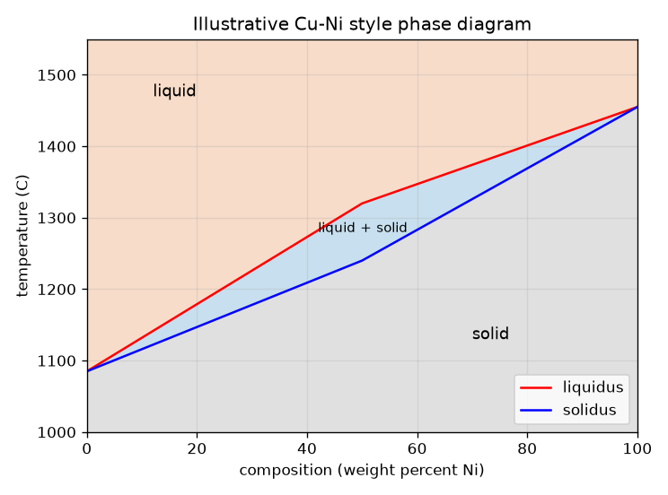
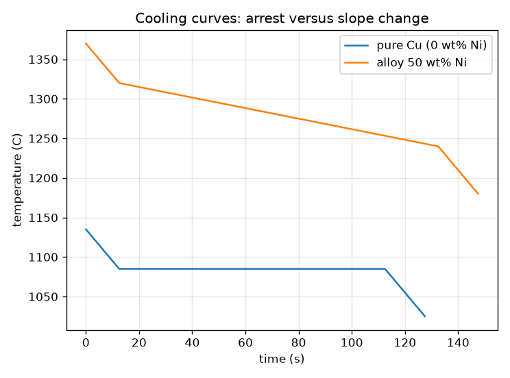

# സെഷൻ 1: ശുദ്ധ ലോഹം ഒരു ബിന്ദുവിൽ ഉരുകുന്നു, ഒരു ലോഹസങ്കരം (alloy) ഒരു പരിധിയിൽ

[Session 1 — हिन्दी](README.hi.md) · [Session 1 — മലയാളം](README.ml.md)

*ലെവൽ 1 (ആശയപരമായ ഇന്ററാക്ടീവ് മോഡൽ) · ഏകദേശം 60 മിനിറ്റ് · openphasediagram*

> ഇത് ലളിതമാക്കിയ ഒരു വിദ്യാഭ്യാസ മോഡലാണ്. ഇത് സാധൂകരിക്കപ്പെട്ട (validated) ഒരു ഡിസൈൻ ഉപകരണമല്ല; യഥാർത്ഥ നിർമ്മിതികൾ, ഇലക്ട്രിക്കൽ ഇൻസ്റ്റലേഷനുകൾ, വാഹനങ്ങൾ, വ്യാവസായിക പ്രക്രിയകൾ അല്ലെങ്കിൽ മെഡിക്കൽ തീരുമാനങ്ങൾ എന്നിവയ്ക്ക് ഇത് ഉപയോഗിക്കരുത്.

**മുൻ‌വ്യവസ്ഥകൾ (Prerequisites)**

- ഒരു അക്ഷത്തിൽ താപനിലയുള്ള ഗ്രാഫ് വായിക്കൽ.
- നിങ്ങൾ PRIMER.md വായിക്കുകയും `python start.py 1` ഒരിക്കൽ റൺ ചെയ്യുകയും ചെയ്തിട്ടുണ്ട്.

**പഠന ലക്ഷ്യങ്ങൾ (Learning objectives).** ഈ സെഷനു ശേഷം നിങ്ങൾക്ക് കഴിയും:

- ഒരു ശുദ്ധ ലോഹം ഒരു താപനിലയിലും ഒരു ലോഹസങ്കരം ഒരു പരിധിയിലും ഉരുകുന്നത് എന്തുകൊണ്ടെന്ന് വിശദീകരിക്കാൻ.
- ലളിതമായ ഒരു ദ്വിലോഹ ഫേസ് ഡയഗ്രത്തിലെ (phase diagram) ദ്രാവകം, ദ്രാവകം + ഖരം, ഖരം മേഖലകൾ വായിക്കാൻ.
- ഒരു ശീതീകരണ വക്രം (cooling curve) വായിക്കാൻ: ശുദ്ധ ലോഹത്തിന് പരന്ന നിർത്തം (arrest), ലോഹസങ്കരത്തിന് വളവുകൾ.
- ഒരു താപനിലയിൽ ദ്രാവകവും മറ്റൊന്നിൽ ഖരവുമായ ഒരു ലോഹസങ്കരം തിരഞ്ഞെടുക്കാൻ ഡയഗ്രം ഉപയോഗിക്കാൻ.

## A. യഥാർത്ഥ ലോക പ്രശ്നം
ശുദ്ധ ചെമ്പിന്റെ ഒരു ദണ്ഡ് ഒരു കൃത്യമായ താപനില വരെ കടുപ്പമായി നിൽക്കുകയും പിന്നീട് ഉരുകുകയും ചെയ്യുന്നു. ഒരു പ്ലംബറുടെ കിറ്റിലെ സോൾഡർ ആദ്യം മൃദുവും കുഴമ്പുമായി മാറുകയും പിന്നീട് മാത്രം വെള്ളം പോലെ ഒഴുകുകയും ചെയ്യുന്നു. ഓരോ താപനിലയിലും ഘടനയിലും ഒരു ലോഹസങ്കരം ഏത് അവസ്ഥയിലാണെന്ന് പറയുന്ന ഭൂപടമാണ് ഫേസ് ഡയഗ്രം. നാം അത് എങ്ങനെ വായിക്കും, ഒരു ഉരുകിയ ലോഹം തണുക്കുമ്പോൾ അത് എങ്ങനെ പ്രത്യക്ഷപ്പെടുന്നു?

## B. ആശയവും സിദ്ധാന്തവും
ഒരു ഫേസ് (phase) എന്നത് പദാർത്ഥത്തിന്റെ ഏകരൂപ മേഖലയാണ്, ഇവിടെ ദ്രാവകമോ ഖരമോ. ഡയഗ്രം തിരശ്ചീന അക്ഷത്തിൽ ഘടനയും (നിക്കലിന്റെ, ലോഹം B, ഭാരശതമാനം) ലംബ അക്ഷത്തിൽ താപനിലയും പ്ലോട്ട് ചെയ്യുന്നു. ലിക്വിഡസ് (liquidus) എന്നത് അതിനു മുകളിൽ ലോഹസങ്കരം പൂർണ്ണമായും ദ്രാവകമായ രേഖയാണ്; സോളിഡസ് (solidus) എന്നത് അതിനു താഴെ പൂർണ്ണമായും ഖരമായ രേഖയും. അവയ്ക്കിടയിൽ ദ്രാവകവും ഖരവും ഒരുമിച്ചുള്ള ദ്വിഫേസ് ബാൻഡ് ഉണ്ട്, മഷി മേഖല (mushy zone) എന്നറിയപ്പെടുന്നു. ശുദ്ധ ലോഹങ്ങൾ ലിക്വിഡസും സോളിഡസും കൂടിച്ചേരുന്ന രണ്ട് പുറം അരികുകളിൽ (0 wt%, 100 wt% Ni) ഇരിക്കുന്നു, അതുകൊണ്ടാണ് ശുദ്ധ ലോഹങ്ങൾ ഒരൊറ്റ സ്ഥിര താപനിലയിൽ ഉരുകുന്നത്. ഒരു ഉരുകിയ ലോഹത്തിൽ നിന്ന് സ്ഥിര നിരക്കിൽ താപം നീക്കുമ്പോൾ ദ്രാവകത്തിൽ താപനില സ്ഥിരമായി താഴുന്നു; ലോഹം ഉറയുമ്പോൾ അത് ലീനതാപം (latent heat - ഉറയുമ്പോൾ പുറത്തുവിടുന്ന താപം) നൽകുന്നു, അതിനാൽ ശീതീകരണ വക്രം പരന്നുപോകുന്നു. ശുദ്ധ ലോഹം പരന്ന താപ നിർത്തം കാണിക്കുന്നു; ലോഹസങ്കരം വളയുക മാത്രം ചെയ്യുന്നു. ഇവിടെ ഒരു ഗ്രാമിനുള്ള താപ ഉള്ളടക്കം H = c T + L (1 - f) ആണ്, f എന്നത് ഉറഞ്ഞ അംശം, സമയം = നീക്കിയ താപം ഹരണം താപ നീക്കം ചെയ്യൽ നിരക്ക്.

| ചിഹ്നം | അർത്ഥം | യൂണിറ്റ് |
|---|---|---|
| x | ഘടന: ഭാര ശതമാനം Ni | wt% |
| T | താപനില | °C |
| T_L, T_S | ലിക്വിഡസ്, സോളിഡസ് താപനിലകൾ | °C |
| c | വിശിഷ്ട താപം (ഇവിടെ 0.5, ഉദാഹരണത്തിനുള്ളത്) | J/(g K) |
| L | ഉറയലിന്റെ ലീനതാപം (ഇവിടെ 200, ഉദാഹരണത്തിനുള്ളത്) | J/g |
| Q | ഒരു ഗ്രാമിനുള്ള താപ നീക്കം ചെയ്യൽ നിരക്ക് (ഇവിടെ 2) | W/g |
| f | ഉറഞ്ഞ അംശം (ഈ സെഷനിൽ ലിക്വിഡസിനും സോളിഡസിനും ഇടയിൽ രേഖീയം) | യൂണിറ്റ് ഇല്ല |

**അനുമാനങ്ങൾ (Assumptions)**

- ഡയഗ്രം ഒരു ചിത്രീകരണമാണ്: Cu 1085 C-നും Ni 1455 C-നും ഇടയിലെ നേർരേഖാ ഭാഗങ്ങൾ, അളന്ന Cu-Ni ഡയഗ്രമല്ല.
- എല്ലാ ഫേസുകൾക്കും ഘടനകൾക്കും ഒരേ c, L മൂല്യം.
- താപം സ്ഥിര നിരക്കിൽ നീക്കുന്നു, മുഴുവൻ കഷണത്തിനും ഒരു താപനിലയുണ്ട് (lumped).
- ശുദ്ധ ലോഹങ്ങൾ 1085 C (Cu), 1455 C (Ni) എന്നിവയിൽ ഉരുകുന്നു.

$$ T_S(x)\le T\le T_L(x)\ \Rightarrow\ \text{liquid}+\text{solid};\quad T>T_L\Rightarrow\text{liquid};\quad T<T_S\Rightarrow\text{solid} $$

$$ \Delta T_{\text{range}}=T_L(x)-T_S(x)\quad(=0\ \text{for a pure metal}) $$

$$ H(T)=c\,T+L\,\bigl(1-f(T)\bigr),\qquad t=\dfrac{H_{\text{start}}-H(T)}{Q} $$

$$ \text{arrest of a pure metal}=\dfrac{L}{Q} $$

## C. ദൃശ്യ വിശദീകരണം
ആദ്യ ചിത്രം ലളിതമാക്കിയ ഡയഗ്രമാണ്: മുകളിൽ ഓറഞ്ച് ദ്രാവകം, ദ്രാവകം + ഖരത്തിന്റെ നീല ബാൻഡ്, താഴെ ചാരനിറ ഖരം, രണ്ട് ശുദ്ധ ലോഹങ്ങളിൽ ലിക്വിഡസും സോളിഡസും കൂടിച്ചേരുന്നു. രണ്ടാമത്തെ ചിത്രം ഒരേ താപനഷ്ടത്തിന് രണ്ട് ശീതീകരണ വക്രങ്ങൾ കാണിക്കുന്നു. ശുദ്ധ ചെമ്പ് താഴുന്നു, ഉറയുമ്പോൾ 100 s നേരം 1085 C-ൽ പരന്നു നിൽക്കുന്നു, പിന്നെ വീണ്ടും താഴുന്നു. 50 wt% Ni ലോഹസങ്കരം 1320 C-ൽ ഉറയാൻ തുടങ്ങുകയും 1240 C-ൽ അവസാനിക്കുകയും ചെയ്യുന്നു, ഇടയിൽ അത് പരന്ന ഭാഗമില്ലാതെ കൂടുതൽ പതുക്കെ (4 K/s-ന് പകരം ഏകദേശം 0.67 K/s) തണുക്കുന്നു.

*ചിത്രീകരണ Cu-Ni മാതൃക ഡയഗ്രം: ദ്രാവകം, ഒരു ദ്വിഫേസ് ബാൻഡ്, ഖരം.*

*ശുദ്ധ ചെമ്പ് പരന്ന നിർത്തം നിലനിർത്തുന്നു; 50 wt% Ni ലോഹസങ്കരം വളയുക മാത്രം ചെയ്യുന്നു.*

## D. ഇന്ററാക്ടീവ് സിമുലേഷൻ
പാഠം റൺ ചെയ്യുക (`python start.py 1`), തുടർന്ന് ലൈവ് ആപ്പ് തുറക്കുക: [സെഷൻ 1: ലോഹസങ്കരം എവിടെയാണ്, അത് എങ്ങനെ തണുക്കുന്നു?](https://krunalpanchal1995.github.io/pan-iit-oss/openphasediagram/session-01/) (അല്ലെങ്കിൽ ഈ ഫോൾഡറിലെ `app.html`). ഘടന, താപനില സ്ലൈഡറുകൾ നീക്കി ബിന്ദു ഏത് മേഖലയിൽ വീഴുന്നുവെന്ന് നിരീക്ഷിക്കുക. പിന്നെ ശീതീകരണ-വക്ര വ്യൂ തുറന്ന് ഒരു ശുദ്ധ ലോഹത്തെ (0 wt% Ni) 50 wt% ലോഹസങ്കരവുമായി താരതമ്യം ചെയ്യുക.

**വെല്ലുവിളി (Challenge).** ഒരു 50 wt% Ni ലോഹസങ്കരത്തെ ഭാഗികമായി ദ്രാവകവും ഭാഗികമായി ഖരവുമായ താപനിലയിൽ വയ്ക്കുക.

## E. പരിഹരിച്ച ഉദാഹരണവും പരീക്ഷണവും
**പ്രശ്നം.** 50 wt% Ni ലോഹസങ്കരത്തിന് ഉരുകൽ പരിധി കണ്ടെത്തുക, 1280 C-ൽ അത് ഏത് ഫേസ് മേഖലയിലാണെന്ന് പറയുക, ശുദ്ധ ചെമ്പിന്റെ നിർത്തം എത്ര നേരം നീളുന്നുവെന്ന് താരതമ്യം ചെയ്യുക (L = 200 J/g, Q = 2 W/g).

1. 50 wt% Ni-ൽ ഡയഗ്രം വായിക്കുക: ലിക്വിഡസ് 1320 C, സോളിഡസ് 1240 C.
2. ഉരുകൽ പരിധി = 1320 - 1240 = 80 K.
3. 1280 C-ൽ 1240 < 1280 < 1320, അതിനാൽ ലോഹസങ്കരം ദ്രാവകം + ഖരം ആണ്.
4. ശുദ്ധ ചെമ്പ്: ലീനതാപം L = 200 J/g Q = 2 W/g നിരക്കിൽ പുറത്തുപോകുന്നു, അതിനാൽ നിർത്തം 200 / 2 = 100 s നീളുന്നു.
5. ലോഹസങ്കരം അതിന്റെ പരിധി കടക്കുന്നത് (0.5 * 80 + 200) / 2 = 120 s-ൽ, ശരാശരി നിരക്ക് 80 / 120 = 0.67 K/s, ദ്രാവകത്തിലെ 2 / 0.5 = 4 K/s-നെതിരെ.

**ഉത്തരം.** ഉരുകൽ പരിധി 80 K ആണ്, 1280 C-ൽ ലോഹസങ്കരം ദ്രാവകം + ഖരം ആണ്, ശുദ്ധ ചെമ്പ് 100 s നിർത്തം നിലനിർത്തുന്നു, ലോഹസങ്കരം അതിന്റെ പരിധിയിലൂടെ 0.67 K/s നിരക്കിൽ തണുക്കുന്നു.

**പരീക്ഷണം.** ഒരു മുതിർന്നയാളോടൊപ്പം, ഒരു ചെറിയ സ്റ്റീൽ കപ്പിൽ ഒരു ഹോട്ട് പ്ലേറ്റിൽ അല്പം ശുദ്ധ ടിന്നും വെവ്വേറെ ഒരു നോൺ-യൂട്ടെക്ടിക് പ്ലംബിംഗ് സോൾഡറും ഉരുക്കുക (വായുസഞ്ചാരം, കൈയുറകൾ, കുട്ടികൾക്ക് ലെഡ് പാടില്ല), ഒരു തെർമോമീറ്റർ ഇടുക, ഓരോന്നും തണുക്കാൻ അനുവദിച്ച് ഓരോ 10 s-ലും താപനില രേഖപ്പെടുത്തുക. ശുദ്ധ ടിൻ പരന്ന ഭാഗം കാണിക്കുന്നു; സോൾഡർ വളയുക മാത്രം ചെയ്യുന്നു. യഥാർത്ഥ വക്രങ്ങൾ മൂലകൾ വൃത്താകൃതിയിലാക്കുകയും ആദ്യം ഉറയൽ ബിന്ദുവിന് താഴേക്ക് പോകുകയും ചെയ്തേക്കാം (undercooling), കാരണം മോഡലിന് സാമ്പിളിനുള്ളിൽ താപ പ്രവാഹമില്ല. ചൂടുള്ള പ്രതലത്തിനുള്ള മുൻകരുതലുകൾ എടുക്കുക.

## F. വിലയിരുത്തലും ഡിസൈൻ വെല്ലുവിളിയും
**ചോദ്യ തരം A: ആശയപരം.** ഒരു ശുദ്ധ ലോഹം അതിന്റെ ശീതീകരണ വക്രത്തിൽ പരന്ന ഭാഗം കാണിക്കുമ്പോൾ ഒരു ലോഹസങ്കരം വളയുക മാത്രം ചെയ്യുന്നത് എന്തുകൊണ്ട്?

സൂചന

ലിക്വിഡസും സോളിഡസും എവിടെ കൂടിച്ചേരുന്നു, ലീനതാപം എന്ത് ചെയ്യണം?

ഘട്ടം ഘട്ടമായുള്ള പരിഹാരം

ഒരു ശുദ്ധ ലോഹത്തിന് ലിക്വിഡസ് = സോളിഡസ് ആണ്, അതിനാൽ ലീനതാപം മുഴുവൻ ഒരൊറ്റ താപനിലയിൽ പുറത്തുവരുന്നു; എല്ലാം ഉറയുന്നതുവരെ താപനില താഴാൻ കഴിയില്ല, ഇത് പരന്ന നിർത്തം നൽകുന്നു. ഒരു ലോഹസങ്കരം ഒരു പരിധിയിൽ ഉറയുന്നു: ഓരോ ഡിഗ്രിക്കും അല്പം ലീനതാപം മാത്രമേ പുറത്തുവരുന്നുള്ളൂ, അതിനാൽ ശീതീകരണം മന്ദഗതിയിലാകുന്നു (വക്രം താഴ്ന്ന ചരിവിലേക്ക് വളയുന്നു) പക്ഷേ ഒരിക്കലും നിൽക്കുന്നില്ല.

**ചോദ്യ തരം B: സംഖ്യാപരം.** c = 0.5 J/(g K), L = 200 J/g, Q = 2 W/g എന്നിവയോടെ 50 wt% Ni ലോഹസങ്കരം 1320 C-ൽ നിന്ന് 1240 C-ലേക്ക് തണുക്കാൻ എത്ര സമയമെടുക്കും? അവിടത്തെ ശരാശരി ശീതീകരണ നിരക്ക് എത്ര?

സൂചന

നീക്കേണ്ട താപം = c ഗുണം താപനില കുറവ് കൂടാതെ ലീനതാപം L, പിന്നെ Q കൊണ്ട് ഹരിക്കുക.

ഘട്ടം ഘട്ടമായുള്ള പരിഹാരം

താപം = 0.5 * 80 + 200 = 240 J/g. സമയം = 240 / 2 = 120 s. ശരാശരി നിരക്ക് = 80 K / 120 s = 0.67 K/s. യുക്തിപരിശോധന (sanity check): ലീനതാപം പുറത്തുവരുന്നതിനാൽ ഇത് ദ്രാവക നിരക്കായ Q/c = 4 K/s-നേക്കാൾ പതുക്കെയാണ്.

**ചോദ്യ തരം C: ഗ്രാഫ്, സിമുലേഷൻ വ്യാഖ്യാനം.** ശീതീകരണ-വക്ര വ്യൂവിൽ, 50 wt% Ni-ന്റെ വക്രം ഏത് താപനിലകളിൽ ചരിവ് മാറ്റുന്നു?

സൂചന

വക്രത്തിന്റെ രണ്ട് മൂലകൾ നോക്കുക.

ഘട്ടം ഘട്ടമായുള്ള പരിഹാരം

അത് 1320 C-ൽ (ലിക്വിഡസ്: ആദ്യ പരലുകൾ, ലീനതാപം പുറത്തുവരാൻ തുടങ്ങുന്നു, വക്രം പരക്കുന്നു) വളയുന്നു, 1240 C-ൽ (സോളിഡസ്: ഉറയൽ പൂർത്തിയായി, വക്രം വീണ്ടും ഖര ശീതീകരണ നിരക്കിലേക്ക് കുത്തനെയാകുന്നു). രണ്ട് മൂലകൾക്കിടയിൽ അത് പതുക്കെ എന്നാൽ തുടർച്ചയായി താഴുന്നു, 1085 C-ൽ പരന്നിരിക്കുന്ന ശുദ്ധ ചെമ്പിന്റെ വക്രത്തിൽ നിന്ന് വ്യത്യസ്തമായി.

**ചോദ്യ തരം D: ഡിസൈൻ, ഒപ്റ്റിമൈസേഷൻ വെല്ലുവിളി.** ഡിസൈൻ: ഒരു ബ്രേസിംഗ് ഫില്ലർ 1350 C-ൽ പൂർണ്ണമായും ദ്രാവകവും 1200 C-ൽ പൂർണ്ണമായും ഖരവുമായിരിക്കണം. ഈ ഡയഗ്രം ഉപയോഗിച്ച്, ഏത് Ni ഉള്ളടക്കങ്ങൾ (പൂർണ്ണസംഖ്യകൾ) പ്രവർത്തിക്കും? ശുദ്ധ Cu അല്ലെങ്കിൽ ശുദ്ധ Ni സാധ്യമാണോ?

സൂചന

ലിക്വിഡസ് <= 1350, സോളിഡസ് >= 1200 വേണം. നേർരേഖാ ഭാഗങ്ങൾ ഉപയോഗിച്ച് ഓരോന്നും നിർധാരണം ചെയ്യുക.

ഘട്ടം ഘട്ടമായുള്ള പരിഹാരം

സോളിഡസ് കുറഞ്ഞത് 1200 C ആയിരിക്കണം: 1085 + 3.1 x >= 1200 ൽ നിന്ന് x >= 37.1, അതിനാൽ x >= 38. ലിക്വിഡസ് പരമാവധി 1350 C ആയിരിക്കണം: 1320 + 2.7 (x - 50) <= 1350 ൽ നിന്ന് x <= 61.1, അതിനാൽ x <= 61. 38 മുതൽ 61 wt% Ni വരെയുള്ള ലോഹസങ്കരങ്ങൾ പ്രവർത്തിക്കുന്നു. ശുദ്ധ Cu 1200 C-ൽ തന്നെ ദ്രാവകമാണ്, ശുദ്ധ Ni 1350 C-ൽ ഇപ്പോഴും ഖരമാണ്, അതിനാൽ രണ്ടും പ്രവർത്തിക്കില്ല. വിട്ടുവീഴ്ച (trade-off): ജാലകത്തിന്റെ മധ്യഭാഗത്തിന് (ഏകദേശം 50 wt%) രണ്ട് പരിധികളിലും ഏറ്റവും കൂടുതൽ മാർജിൻ ഉണ്ട്. അനുമാനം: ഡയഗ്രം ഒരു ചിത്രീകരണം മാത്രമാണ്.

[RUBRIC.md](../../RUBRIC.md) ഉപയോഗിച്ച് സ്വയം സ്കോർ ചെയ്യുക. കടലാസിൽ പ്രവർത്തിക്കാൻ [ആക്ടിവിറ്റി ഷീറ്റ്](activity_sheet.md) പ്രിന്റ് ചെയ്യുക.

## സാധാരണ തെറ്റിദ്ധാരണകൾ
| സാധാരണ തെറ്റിദ്ധാരണ | യഥാർത്ഥത്തിൽ സത്യം എന്താണ് |
|---|---|
| ഓരോ പദാർത്ഥത്തിനും ഒരു ഉരുകൽ ബിന്ദുവുണ്ട്. | ശുദ്ധ ലോഹങ്ങൾക്കുണ്ട്; ലോഹസങ്കരങ്ങൾ സോളിഡസിനും ലിക്വിഡസിനും ഇടയിലെ ഒരു പരിധിയിൽ ഉരുകുന്നു. |
| ഒരു ലോഹം ഉറയുമ്പോൾ താപനില എപ്പോഴും താഴുന്നു. | ഉറയുമ്പോൾ, പുറത്തുവരുന്ന ലീനതാപം താഴ്ച മന്ദഗതിയിലാക്കുകയോ നിർത്തുകയോ ചെയ്യുന്നു; ശുദ്ധ ലോഹം പരന്നു നിൽക്കുന്നു. |
| ദ്വിഫേസ് ബാൻഡ് അതേ വസ്തുവിന്റെ പാതി ഉരുകിയ കട്ടയാണ്. | ഇത് വ്യത്യസ്ത ഘടനകളുള്ള രണ്ട് ഫേസുകളുടെ മിശ്രിതമാണ്; രണ്ടും എങ്ങനെ വായിക്കാമെന്ന് സെഷൻ 2 കാണിക്കുന്നു. |
| ഈ റിപ്പോസിറ്ററിയിലെ ഡയഗ്രം യഥാർത്ഥ Cu-Ni ഡയഗ്രമാണ്. | ഇത് നേർരേഖാ ഭാഗങ്ങളുള്ള ലളിതമാക്കിയ ചിത്രീകരണമാണ്; യഥാർത്ഥ അതിരുകൾ വളഞ്ഞതും അളന്നതുമാണ്. |

## പദാവലി (Glossary)
- **ഫേസ് (phase)**: പദാർത്ഥത്തിന്റെ ഏകരൂപ മേഖല, ഉദാഹരണത്തിന് ദ്രാവകം അല്ലെങ്കിൽ ഒരു ഖരം
- **ലിക്വിഡസ് (liquidus)**: അതിനു മുകളിൽ ഒരു ലോഹസങ്കരം പൂർണ്ണമായും ദ്രാവകമായ രേഖ
- **സോളിഡസ് (solidus)**: അതിനു താഴെ ഒരു ലോഹസങ്കരം പൂർണ്ണമായും ഖരമായ രേഖ
- **ലീനതാപം (latent heat)**: താപനില മാറാതെ ഒരു ദ്രാവകം ഉറയുമ്പോൾ പുറത്തുവിടുന്ന താപം
- **നിർത്തം (arrest)**: ഒരു ശുദ്ധ ലോഹം ഉറയുമ്പോൾ ശീതീകരണ വക്രത്തിലെ പരന്ന ഭാഗം
- **ലോഹസങ്കരം (alloy)**: ലോഹങ്ങൾ (അല്ലെങ്കിൽ ലോഹവും മറ്റ് മൂലകങ്ങളും) കലർത്തി ഉണ്ടാക്കിയ ലോഹം

## പൂർത്തിയാക്കുക
1. [exercises.md](exercises.md)-ലെ മൂന്ന് കോഡിംഗ് ടാസ്കുകൾ ചെയ്യുക.
2. നിങ്ങളുടെ മാറ്റങ്ങൾക്കു ശേഷം `python start.py 1` വീണ്ടും റൺ ചെയ്യുക. അത് ചെക്ക്‌പോയിന്റോടെ അവസാനിക്കുന്നു; അത് `PASS` പ്രിന്റ് ചെയ്യുമ്പോൾ, നിങ്ങൾ പൂർത്തിയാക്കി. (ചെക്ക്‌പോയിന്റ് മാത്രം: `python start.py check 1`.)

അടുത്തത്: [സെഷൻ 2](../session-02/README.md)
