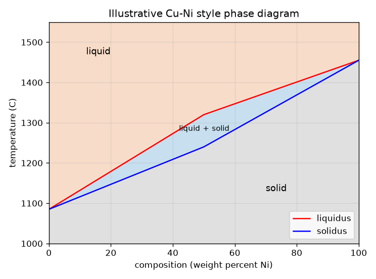
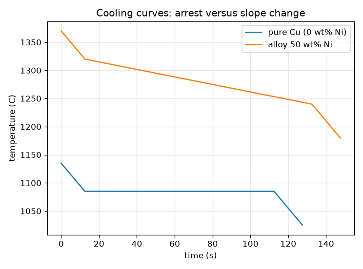

# அமர்வு 1: தூய உலோகம் ஒரு புள்ளியில் உருகுகிறது, கலப்புலோகம் (alloy) ஒரு வீச்சில்

[Session 1 — हिन्दी](README.hi.md) · [Session 1 — മലയാളം](README.ml.md) · [Session 1 — தமிழ்](README.ta.md)

*நிலை 1 (கருத்துசார் ஊடாடும் மாதிரி) · சுமார் 60 நிமிடங்கள் · openphasediagram*

> இது எளிமைப்படுத்தப்பட்ட ஒரு கல்வி மாதிரி. இது சரிபார்க்கப்பட்ட (validated) வடிவமைப்புக் கருவி அல்ல; உண்மையான கட்டமைப்புகள், மின் நிறுவல்கள், வாகனங்கள், தொழில் செயல்முறைகள் அல்லது மருத்துவ முடிவுகளுக்கு இதைப் பயன்படுத்த வேண்டாம்.

**முன்தேவைகள் (Prerequisites)**

- ஒரு அச்சில் வெப்பநிலை உள்ள வரைபடத்தைப் படித்தல்.
- நீங்கள் PRIMER.md-ஐப் படித்து `python start.py 1` ஐ ஒருமுறை இயக்கியிருக்க வேண்டும்.

**கற்றல் நோக்கங்கள் (Learning objectives).** இந்த அமர்வுக்குப் பிறகு உங்களால் முடியும்:

- தூய உலோகம் ஒரு வெப்பநிலையிலும் கலப்புலோகம் ஒரு வீச்சிலும் ஏன் உருகுகிறது என்று விளக்க.
- எளிய இருகூறு நிலை வரைபடத்தில் (phase diagram) திரவம், திரவம் + திண்மம், திண்மம் பகுதிகளைப் படிக்க.
- குளிர்வு வளைவைப் (cooling curve) படிக்க: தூய உலோகத்துக்குத் தட்டையான நிறுத்தம் (arrest), கலப்புலோகத்துக்கு வளைவுகள்.
- ஒரு வெப்பநிலையில் திரவமாகவும் மற்றொன்றில் திண்மமாகவும் இருக்கும் கலப்புலோகத்தைத் தேர்ந்தெடுக்க வரைபடத்தைப் பயன்படுத்த.

## A. நிஜ உலகப் பிரச்சினை
தூய தாமிரக் கம்பி ஒரு துல்லியமான வெப்பநிலை வரை உறுதியாக இருந்து பின்னர் உருகுகிறது. குழாய்ப் பணியாளரின் பெட்டியில் உள்ள சாலிடர் முதலில் மென்மையாகவும் குழைவாகவும் ஆகி, அதன் பிறகே நீர் போல ஓடுகிறது. ஒவ்வொரு வெப்பநிலையிலும் கலவையிலும் கலப்புலோகம் எந்த நிலையில் இருக்கிறது என்பதைக் காட்டும் வரைபடமே நிலை வரைபடம். அதை எப்படிப் படிப்பது, உருகிய உலோகம் குளிரும்போது அது எப்படித் தெரிகிறது?

## B. கருத்தும் கோட்பாடும்
நிலை (phase) என்பது பொருளின் ஒரே மாதிரியான பகுதி, இங்கே திரவம் அல்லது திண்மம். வரைபடம் கிடைமட்ட அச்சில் கலவையையும் (நிக்கலின், உலோகம் B, எடை சதவீதம்) செங்குத்து அச்சில் வெப்பநிலையையும் வரைகிறது. லிக்விடஸ் (liquidus) என்பது அதற்கு மேல் கலப்புலோகம் முழுவதும் திரவமாக இருக்கும் கோடு; சாலிடஸ் (solidus) என்பது அதற்குக் கீழ் முழுவதும் திண்மமாக இருக்கும் கோடு. இவற்றுக்கு இடையே திரவமும் திண்மமும் ஒன்றாக இருக்கும் இருநிலைப் பட்டை உள்ளது, இது குழைவுப் பகுதி (mushy zone) எனப்படும். தூய உலோகங்கள் லிக்விடஸும் சாலிடஸும் சந்திக்கும் இரு வெளி ஓரங்களில் (0 wt%, 100 wt% Ni) இருப்பதால், தூய உலோகங்கள் ஒரே நிலையான வெப்பநிலையில் உருகுகின்றன. உருகிய உலோகத்திலிருந்து நிலையான வீதத்தில் வெப்பத்தை நீக்கும்போது திரவத்தில் வெப்பநிலை சீராகக் குறைகிறது; உலோகம் உறையும்போது உள்ளுறை வெப்பத்தை (latent heat - உறையும்போது வெளிவிடும் வெப்பம்) வெளியிடுகிறது, எனவே குளிர்வு வளைவு தட்டையாகிறது. தூய உலோகம் தட்டையான வெப்ப நிறுத்தத்தைக் காட்டுகிறது; கலப்புலோகம் வளைவு மட்டுமே காட்டுகிறது. இங்கு ஒரு கிராமுக்கான வெப்ப உள்ளடக்கம் H = c T + L (1 - f), f என்பது உறைந்த பின்னம், நேரம் = நீக்கிய வெப்பம் வகுத்தல் வெப்ப நீக்க வீதம்.

| குறியீடு | பொருள் | அலகு |
|---|---|---|
| x | கலவை: எடை சதவீத Ni | wt% |
| T | வெப்பநிலை | °C |
| T_L, T_S | லிக்விடஸ், சாலிடஸ் வெப்பநிலைகள் | °C |
| c | தன்வெப்ப ஏற்புத்திறன் (இங்கு 0.5, எடுத்துக்காட்டுக்காக) | J/(g K) |
| L | உறைதலின் உள்ளுறை வெப்பம் (இங்கு 200, எடுத்துக்காட்டுக்காக) | J/g |
| Q | ஒரு கிராமுக்கான வெப்ப நீக்க வீதம் (இங்கு 2) | W/g |
| f | உறைந்த பின்னம் (இந்த அமர்வில் லிக்விடஸுக்கும் சாலிடஸுக்கும் இடையே நேர்கோட்டு) | அலகு இல்லை |

**அனுமானங்கள் (Assumptions)**

- வரைபடம் ஒரு விளக்கப்படம்: Cu 1085 C-க்கும் Ni 1455 C-க்கும் இடையே நேர்கோட்டுத் துண்டுகள், அளக்கப்பட்ட Cu-Ni வரைபடம் அல்ல.
- அனைத்து நிலைகளுக்கும் கலவைகளுக்கும் ஒரே c, L மதிப்பு.
- வெப்பம் நிலையான வீதத்தில் நீக்கப்படுகிறது, முழுத் துண்டுக்கும் ஒரே வெப்பநிலை (lumped).
- தூய உலோகங்கள் 1085 C (Cu), 1455 C (Ni) இல் உருகுகின்றன.

$$ T_S(x)\le T\le T_L(x)\ \Rightarrow\ \text{liquid}+\text{solid};\quad T>T_L\Rightarrow\text{liquid};\quad T<T_S\Rightarrow\text{solid} $$

$$ \Delta T_{\text{range}}=T_L(x)-T_S(x)\quad(=0\ \text{for a pure metal}) $$

$$ H(T)=c\,T+L\,\bigl(1-f(T)\bigr),\qquad t=\dfrac{H_{\text{start}}-H(T)}{Q} $$

$$ \text{arrest of a pure metal}=\dfrac{L}{Q} $$

## C. காட்சி விளக்கம்
முதல் படம் எளிமைப்படுத்தப்பட்ட வரைபடம்: மேலே ஆரஞ்சு திரவம், திரவம் + திண்மத்தின் நீலப் பட்டை, கீழே சாம்பல் திண்மம், இரு தூய உலோகங்களில் லிக்விடஸும் சாலிடஸும் சந்திக்கின்றன. இரண்டாவது படம் ஒரே வெப்ப இழப்புக்கு இரு குளிர்வு வளைவுகளைக் காட்டுகிறது. தூய தாமிரம் குறைந்து, உறையும்போது 100 s வரை 1085 C-இல் தட்டையாக நின்று, பின்னர் மீண்டும் குறைகிறது. 50 wt% Ni கலப்புலோகம் 1320 C-இல் உறையத் தொடங்கி 1240 C-இல் முடிகிறது, இடையில் தட்டையான பகுதி இல்லாமல் மெதுவாக (4 K/s-க்குப் பதிலாக சுமார் 0.67 K/s) குளிர்கிறது.

*எடுத்துக்காட்டு Cu-Ni மாதிரி வரைபடம்: திரவம், இருநிலைப் பட்டை, திண்மம்.*

*தூய தாமிரம் தட்டையான நிறுத்தத்தை வைத்திருக்கிறது; 50 wt% Ni கலப்புலோகம் வளைவு மட்டுமே காட்டுகிறது.*

## D. ஊடாடும் உருவகப்படுத்துதல்
பாடத்தை இயக்கவும் (`python start.py 1`), பின்னர் நேரடி செயலியைத் திறக்கவும்: [அமர்வு 1: கலப்புலோகம் எங்கே இருக்கிறது, எப்படிக் குளிர்கிறது?](https://krunalpanchal1995.github.io/pan-iit-oss/openphasediagram/session-01/) (அல்லது இந்தக் கோப்புறையில் உள்ள `app.html`). கலவை, வெப்பநிலை ஸ்லைடர்களை நகர்த்தி புள்ளி எந்தப் பகுதியில் விழுகிறது என்று கவனியுங்கள். பின்னர் குளிர்வு-வளைவுக் காட்சியைத் திறந்து தூய உலோகத்தை (0 wt% Ni) 50 wt% கலப்புலோகத்துடன் ஒப்பிடுங்கள்.

**சவால் (Challenge).** 50 wt% Ni கலப்புலோகத்தை ஓரளவு திரவமாகவும் ஓரளவு திண்மமாகவும் இருக்கும் வெப்பநிலையில் வையுங்கள்.

## E. தீர்க்கப்பட்ட எடுத்துக்காட்டும் சோதனையும்
**சிக்கல்.** 50 wt% Ni கலப்புலோகத்தின் உருகல் வீச்சைக் கண்டறியுங்கள், 1280 C-இல் அது எந்த நிலைப் பகுதியில் உள்ளது என்று சொல்லுங்கள், தூய தாமிரத்தின் நிறுத்தம் எவ்வளவு நேரம் நீடிக்கிறது என்று ஒப்பிடுங்கள் (L = 200 J/g, Q = 2 W/g).

1. 50 wt% Ni-இல் வரைபடத்தைப் படியுங்கள்: லிக்விடஸ் 1320 C, சாலிடஸ் 1240 C.
2. உருகல் வீச்சு = 1320 - 1240 = 80 K.
3. 1280 C-இல் 1240 < 1280 < 1320, எனவே கலப்புலோகம் திரவம் + திண்மம்.
4. தூய தாமிரம்: உள்ளுறை வெப்பம் L = 200 J/g Q = 2 W/g வீதத்தில் வெளியேறுகிறது, எனவே நிறுத்தம் 200 / 2 = 100 s நீடிக்கிறது.
5. கலப்புலோகம் தன் வீச்சைக் கடக்க (0.5 * 80 + 200) / 2 = 120 s ஆகிறது, சராசரி வீதம் 80 / 120 = 0.67 K/s, திரவத்தில் 2 / 0.5 = 4 K/s உடன் ஒப்பிடும்போது.

**விடை.** உருகல் வீச்சு 80 K, 1280 C-இல் கலப்புலோகம் திரவம் + திண்மம், தூய தாமிரம் 100 s நிறுத்தத்தை வைத்திருக்கிறது, கலப்புலோகம் தன் வீச்சின் வழியே 0.67 K/s வீதத்தில் குளிர்கிறது.

**சோதனை.** ஒரு பெரியவருடன் சேர்ந்து, ஒரு சிறிய எஃகுக் கோப்பையில் சூடான தட்டில் சிறிது தூய தகரத்தையும் (tin) தனியாக ஒரு யூட்டெக்டிக் அல்லாத குழாய் சாலிடரையும் உருக்குங்கள் (காற்றோட்டம், கையுறைகள், குழந்தைகளுக்கு ஈயம் (lead) பயன்படுத்தக்கூடாது), வெப்பமானியை வைத்து, ஒவ்வொன்றும் குளிரும்போது ஒவ்வொரு 10 s-க்கும் வெப்பநிலையைப் பதியுங்கள். தூய தகரம் தட்டையான பகுதியைக் காட்டும்; சாலிடர் வளைவு மட்டுமே காட்டும். உண்மையான வளைவுகள் மூலைகளை வட்டமாக்கி, முதலில் உறைநிலைக்குக் கீழே செல்லக்கூடும் (undercooling), ஏனெனில் மாதிரியில் மாதிரிக்குள் வெப்பப் பாய்வு இல்லை. சூடான மேற்பரப்புக்கான முன்னெச்சரிக்கைகளை எடுங்கள்.

## F. மதிப்பீடும் வடிவமைப்புச் சவாலும்
**கேள்வி வகை A: கருத்துசார்.** தூய உலோகம் குளிர்வு வளைவில் தட்டையான பகுதியைக் காட்டும்போது கலப்புலோகம் வளைவு மட்டும் காட்டுவது ஏன்?

குறிப்பு

லிக்விடஸும் சாலிடஸும் எங்கே சந்திக்கின்றன, உள்ளுறை வெப்பம் என்ன செய்ய வேண்டும்?

படிப்படியான தீர்வு

தூய உலோகத்துக்கு லிக்விடஸ் = சாலிடஸ், எனவே உள்ளுறை வெப்பம் முழுவதும் ஒரே வெப்பநிலையில் வெளிவருகிறது; அனைத்தும் உறையும் வரை வெப்பநிலை குறைய முடியாது, இது தட்டையான நிறுத்தத்தைத் தருகிறது. கலப்புலோகம் ஒரு வீச்சில் உறைகிறது: ஒவ்வொரு டிகிரிக்கும் சிறிதளவு உள்ளுறை வெப்பமே வெளிவருகிறது, எனவே குளிர்வு மெதுவாகிறது (வளைவு குறைந்த சரிவுக்கு வளைகிறது) ஆனால் ஒருபோதும் நிற்பதில்லை.

**கேள்வி வகை B: எண்சார்.** c = 0.5 J/(g K), L = 200 J/g, Q = 2 W/g உடன் 50 wt% Ni கலப்புலோகம் 1320 C-இலிருந்து 1240 C-க்குக் குளிர எவ்வளவு நேரமாகும்? அங்கு சராசரிக் குளிர்வு வீதம் என்ன?

குறிப்பு

நீக்க வேண்டிய வெப்பம் = c பெருக்கல் வெப்பநிலை வீழ்ச்சி கூட்டல் உள்ளுறை வெப்பம் L, பின்னர் Q-ஆல் வகுக்கவும்.

படிப்படியான தீர்வு

வெப்பம் = 0.5 * 80 + 200 = 240 J/g. நேரம் = 240 / 2 = 120 s. சராசரி வீதம் = 80 K / 120 s = 0.67 K/s. நியாயச் சரிபார்ப்பு (sanity check): உள்ளுறை வெப்பம் வெளிவருவதால் இது திரவ வீதம் Q/c = 4 K/s-ஐ விட மெதுவாக உள்ளது.

**கேள்வி வகை C: வரைபடம், உருவகப்படுத்துதல் விளக்கம்.** குளிர்வு-வளைவுக் காட்சியில் 50 wt% Ni-இன் வளைவு எந்த வெப்பநிலைகளில் சரிவை மாற்றுகிறது?

குறிப்பு

வளைவின் இரு மூலைகளைப் பாருங்கள்.

படிப்படியான தீர்வு

அது 1320 C-இல் (லிக்விடஸ்: முதல் படிகங்கள், உள்ளுறை வெப்பம் வெளிவரத் தொடங்குகிறது, வளைவு தட்டையாகிறது) வளைகிறது, 1240 C-இல் (சாலிடஸ்: உறைதல் முடிந்தது, வளைவு மீண்டும் திண்மக் குளிர்வு வீதத்துக்குச் செங்குத்தாகிறது). இரு மூலைகளுக்கு இடையே அது மெதுவாக ஆனால் தொடர்ந்து குறைகிறது, 1085 C-இல் தட்டையாக இருக்கும் தூய தாமிரத்தின் வளைவிலிருந்து வேறுபட்டு.

**கேள்வி வகை D: வடிவமைப்பு, உகப்பாக்கச் சவால்.** வடிவமைப்பு: ஒரு பிரேசிங் நிரப்பி 1350 C-இல் முழுவதும் திரவமாகவும் 1200 C-இல் முழுவதும் திண்மமாகவும் இருக்க வேண்டும். இந்த வரைபடத்தைப் பயன்படுத்தி, எந்த Ni உள்ளடக்கங்கள் (முழு எண்கள்) வேலை செய்யும்? தூய Cu அல்லது தூய Ni சாத்தியமா?

குறிப்பு

லிக்விடஸ் <= 1350, சாலிடஸ் >= 1200 வேண்டும். நேர்கோட்டுத் துண்டுகளைப் பயன்படுத்தி ஒவ்வொன்றையும் தீர்க்கவும்.

படிப்படியான தீர்வு

சாலிடஸ் குறைந்தது 1200 C இருக்க வேண்டும்: 1085 + 3.1 x >= 1200 இலிருந்து x >= 37.1, எனவே x >= 38. லிக்விடஸ் அதிகபட்சம் 1350 C இருக்க வேண்டும்: 1320 + 2.7 (x - 50) <= 1350 இலிருந்து x <= 61.1, எனவே x <= 61. 38 முதல் 61 wt% Ni வரையிலான கலப்புலோகங்கள் வேலை செய்கின்றன. தூய Cu 1200 C-இலேயே திரவம், தூய Ni 1350 C-இல் இன்னும் திண்மம், எனவே இரண்டும் வேலை செய்யாது. சமரசம் (trade-off): சாளரத்தின் நடுப்பகுதிக்கு (சுமார் 50 wt%) இரு வரம்புகளிலும் அதிக விளிம்பு உள்ளது. அனுமானம்: வரைபடம் ஒரு விளக்கப்படம் மட்டுமே.

[RUBRIC.md](../../RUBRIC.md) ஐப் பயன்படுத்தி நீங்களே மதிப்பெண் இடுங்கள். காகிதத்தில் வேலை செய்ய [செயல்பாட்டுத் தாள்](activity_sheet.md) ஐ அச்சிடுங்கள்.

## பொதுவான தவறான புரிதல்கள்
| பொதுவான தவறான புரிதல் | உண்மையில் என்ன |
|---|---|
| ஒவ்வொரு பொருளுக்கும் ஒரு உருகுநிலை உண்டு. | தூய உலோகங்களுக்கு உண்டு; கலப்புலோகங்கள் சாலிடஸுக்கும் லிக்விடஸுக்கும் இடையிலான வீச்சில் உருகுகின்றன. |
| உலோகம் உறையும்போது வெப்பநிலை எப்போதும் குறைகிறது. | உறையும்போது, வெளிவரும் உள்ளுறை வெப்பம் வீழ்ச்சியை மெதுவாக்குகிறது அல்லது நிறுத்துகிறது; தூய உலோகம் தட்டையாக நிற்கிறது. |
| இருநிலைப் பட்டை என்பது ஒரே பொருளின் பாதி உருகிய கட்டி. | இது வெவ்வேறு கலவைகளுடன் கூடிய இரு நிலைகளின் கலவை; இரண்டையும் எப்படிப் படிப்பது என்பதை அமர்வு 2 காட்டும். |
| இந்தக் களஞ்சியத்தில் உள்ள வரைபடம் உண்மையான Cu-Ni வரைபடம். | இது நேர்கோட்டுத் துண்டுகளுடன் கூடிய எளிமைப்படுத்தப்பட்ட விளக்கப்படம்; உண்மையான எல்லைகள் வளைந்தவை, அளக்கப்பட்டவை. |

## சொற்பட்டியல் (Glossary)
- **நிலை (phase)**: பொருளின் ஒரே மாதிரியான பகுதி, எ.கா. திரவம் அல்லது ஒரு திண்மம்
- **லிக்விடஸ் (liquidus)**: அதற்கு மேல் கலப்புலோகம் முழுவதும் திரவமாக இருக்கும் கோடு
- **சாலிடஸ் (solidus)**: அதற்குக் கீழ் கலப்புலோகம் முழுவதும் திண்மமாக இருக்கும் கோடு
- **உள்ளுறை வெப்பம் (latent heat)**: வெப்பநிலை மாறாமல் திரவம் உறையும்போது வெளிவிடப்படும் வெப்பம்
- **நிறுத்தம் (arrest)**: தூய உலோகம் உறையும்போது குளிர்வு வளைவில் உள்ள தட்டையான பகுதி
- **கலப்புலோகம் (alloy)**: உலோகங்களை (அல்லது உலோகத்தையும் பிற தனிமங்களையும்) கலந்து உருவாக்கிய உலோகம்

## முடிக்கவும்
1. [exercises.md](exercises.md) இல் உள்ள மூன்று நிரலாக்கப் பணிகளைச் செய்யுங்கள்.
2. உங்கள் மாற்றங்களுக்குப் பிறகு `python start.py 1` ஐ மீண்டும் இயக்கவும். அது சோதனைச்சாவடியுடன் முடிகிறது; அது `PASS` என்று அச்சிடும்போது, நீங்கள் முடித்துவிட்டீர்கள். (சோதனைச்சாவடி மட்டும்: `python start.py check 1`.)

அடுத்தது: [அமர்வு 2](../session-02/README.md)
