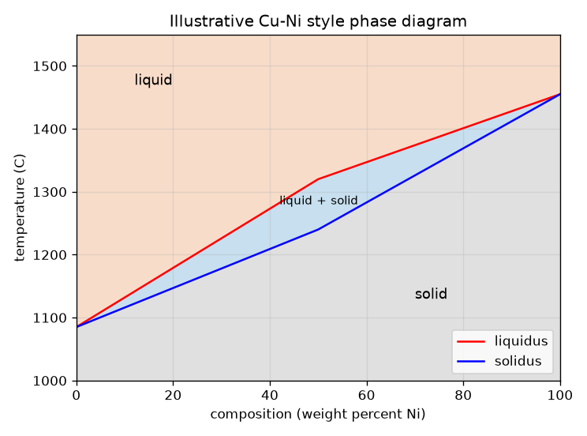
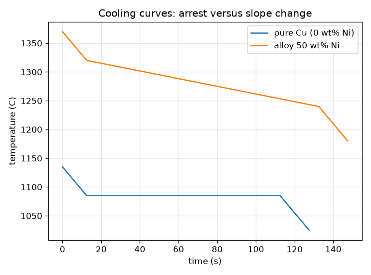

# సెషన్ 1: స్వచ్ఛ లోహం ఒక బిందువు వద్ద కరుగుతుంది, మిశ్రమలోహం (alloy) ఒక శ్రేణిలో

[Session 1 — हिन्दी](README.hi.md) · [Session 1 — മലയാളം](README.ml.md) · [Session 1 — தமிழ்](README.ta.md) · [Session 1 — తెలుగు](README.te.md)

*స్థాయి 1 (భావనాత్మక ఇంటరాక్టివ్ నమూనా) · సుమారు 60 నిమిషాలు · openphasediagram*

> ఇది సరళీకృత విద్యా నమూనా. ఇది ధ్రువీకరించిన (validated) డిజైన్ సాధనం కాదు; నిజమైన నిర్మాణాలు, విద్యుత్ ఏర్పాట్లు, వాహనాలు, పారిశ్రామిక ప్రక్రియలు లేదా వైద్య నిర్ణయాలకు దీనిని ఉపయోగించవద్దు.

**ముందస్తు అవసరాలు (Prerequisites)**

- ఒక అక్షంపై ఉష్ణోగ్రత ఉన్న గ్రాఫ్‌ను చదవడం.
- మీరు PRIMER.md చదివి `python start.py 1` ను ఒకసారి నడిపి ఉండాలి.

**అభ్యాస లక్ష్యాలు (Learning objectives).** ఈ సెషన్ తర్వాత మీరు చేయగలరు:

- స్వచ్ఛ లోహం ఒక ఉష్ణోగ్రత వద్ద, మిశ్రమలోహం ఒక శ్రేణిలో ఎందుకు కరుగుతాయో వివరించడం.
- సరళమైన ద్విలోహ ప్రావస్థా పటంలో (phase diagram) ద్రవం, ద్రవం + ఘనం, ఘనం ప్రాంతాలను చదవడం.
- శీతలీకరణ వక్రాన్ని (cooling curve) చదవడం: స్వచ్ఛ లోహానికి చదునైన నిలుపుదల (arrest), మిశ్రమలోహానికి వంపులు.
- ఒక ఉష్ణోగ్రత వద్ద ద్రవంగా, మరొక దాని వద్ద ఘనంగా ఉండే మిశ్రమలోహాన్ని ఎంచుకోవడానికి పటాన్ని ఉపయోగించడం.

## A. వాస్తవ ప్రపంచ సమస్య
స్వచ్ఛ రాగి కడ్డీ ఒక ఖచ్చితమైన ఉష్ణోగ్రత వరకు గట్టిగా ఉండి, ఆ తర్వాత కరుగుతుంది. ప్లంబర్ కిట్‌లోని సోల్డర్ మొదట మెత్తగా, ముద్దగా మారి, ఆ తర్వాతే నీటిలా ప్రవహిస్తుంది. ప్రతి ఉష్ణోగ్రత వద్ద, ప్రతి సంఘటనం వద్ద మిశ్రమలోహం ఏ స్థితిలో ఉందో చెప్పే పటమే ప్రావస్థా పటం. దానిని ఎలా చదువుతాం, కరిగిన లోహం చల్లబడేటప్పుడు అది ఎలా కనిపిస్తుంది?

## B. భావన మరియు సిద్ధాంతం
ప్రావస్థ (phase) అంటే పదార్థపు ఏకరూప ప్రాంతం, ఇక్కడ ద్రవం లేదా ఘనం. పటం క్షితిజ సమాంతర అక్షంపై సంఘటనాన్ని (నికెల్ యొక్క, లోహం B, బరువు శాతం), లంబ అక్షంపై ఉష్ణోగ్రతను చూపుతుంది. లిక్విడస్ (liquidus) అంటే దాని పైన మిశ్రమలోహం పూర్తిగా ద్రవంగా ఉండే రేఖ; సాలిడస్ (solidus) అంటే దాని కింద పూర్తిగా ఘనంగా ఉండే రేఖ. వాటి మధ్య ద్రవం, ఘనం కలిసి ఉండే ద్విప్రావస్థా పట్టీ ఉంది, దీనిని మెత్తటి ప్రాంతం (mushy zone) అంటారు. స్వచ్ఛ లోహాలు లిక్విడస్, సాలిడస్ కలిసే రెండు బయటి అంచుల వద్ద (0 wt%, 100 wt% Ni) ఉంటాయి, అందుకే స్వచ్ఛ లోహాలు ఒకే స్థిర ఉష్ణోగ్రత వద్ద కరుగుతాయి. కరిగిన లోహం నుండి స్థిర రేటుతో ఉష్ణాన్ని తొలగించినప్పుడు ద్రవంలో ఉష్ణోగ్రత క్రమంగా తగ్గుతుంది; లోహం గడ్డకట్టేటప్పుడు గుప్త ఉష్ణాన్ని (latent heat - గడ్డకట్టేటప్పుడు విడుదలయ్యే ఉష్ణం) విడుదల చేస్తుంది, కాబట్టి శీతలీకరణ వక్రం చదునవుతుంది. స్వచ్ఛ లోహం చదునైన ఉష్ణ నిలుపుదలను చూపుతుంది; మిశ్రమలోహం వంపు మాత్రమే చూపుతుంది. ఇక్కడ ఒక గ్రాముకు ఉష్ణ విలువ H = c T + L (1 - f), f అంటే గడ్డకట్టిన భాగం, సమయం = తొలగించిన ఉష్ణం భాగించు ఉష్ణ తొలగింపు రేటు.

| గుర్తు | అర్థం | ప్రమాణం |
|---|---|---|
| x | సంఘటనం: బరువు శాతం Ni | wt% |
| T | ఉష్ణోగ్రత | °C |
| T_L, T_S | లిక్విడస్, సాలిడస్ ఉష్ణోగ్రతలు | °C |
| c | విశిష్టోష్ణం (ఇక్కడ 0.5, ఉదాహరణ కోసం) | J/(g K) |
| L | గడ్డకట్టడంలో గుప్త ఉష్ణం (ఇక్కడ 200, ఉదాహరణ కోసం) | J/g |
| Q | ఒక గ్రాముకు ఉష్ణ తొలగింపు రేటు (ఇక్కడ 2) | W/g |
| f | గడ్డకట్టిన భాగం (ఈ సెషన్‌లో లిక్విడస్, సాలిడస్ మధ్య రేఖీయం) | ప్రమాణం లేదు |

**ఊహలు (Assumptions)**

- పటం ఒక దృష్టాంతం: Cu 1085 C, Ni 1455 C మధ్య సరళరేఖా ఖండాలు, కొలిచిన Cu-Ni పటం కాదు.
- అన్ని ప్రావస్థలకు, సంఘటనాలకు ఒకే c, L విలువ.
- ఉష్ణం స్థిర రేటుతో తొలగించబడుతుంది, మొత్తం ముక్కకు ఒకే ఉష్ణోగ్రత (lumped).
- స్వచ్ఛ లోహాలు 1085 C (Cu), 1455 C (Ni) వద్ద కరుగుతాయి.

$$ T_S(x)\le T\le T_L(x)\ \Rightarrow\ \text{liquid}+\text{solid};\quad T>T_L\Rightarrow\text{liquid};\quad T<T_S\Rightarrow\text{solid} $$

$$ \Delta T_{\text{range}}=T_L(x)-T_S(x)\quad(=0\ \text{for a pure metal}) $$

$$ H(T)=c\,T+L\,\bigl(1-f(T)\bigr),\qquad t=\dfrac{H_{\text{start}}-H(T)}{Q} $$

$$ \text{arrest of a pure metal}=\dfrac{L}{Q} $$

## C. దృశ్య వివరణ
మొదటి చిత్రం సరళీకృత పటం: పైన నారింజ ద్రవం, ద్రవం + ఘనం యొక్క నీలి పట్టీ, కింద బూడిద ఘనం, రెండు స్వచ్ఛ లోహాల వద్ద లిక్విడస్, సాలిడస్ కలుస్తాయి. రెండవ చిత్రం ఒకే ఉష్ణ నష్టానికి రెండు శీతలీకరణ వక్రాలను చూపుతుంది. స్వచ్ఛ రాగి తగ్గి, గడ్డకట్టేటప్పుడు 100 s పాటు 1085 C వద్ద చదునుగా ఉండి, మళ్ళీ తగ్గుతుంది. 50 wt% Ni మిశ్రమలోహం 1320 C వద్ద గడ్డకట్టడం మొదలుపెట్టి 1240 C వద్ద ముగిస్తుంది, మధ్యలో చదునైన భాగం లేకుండా నెమ్మదిగా (4 K/s బదులు సుమారు 0.67 K/s) చల్లబడుతుంది.

*దృష్టాంత Cu-Ni నమూనా పటం: ద్రవం, ద్విప్రావస్థా పట్టీ, ఘనం.*

*స్వచ్ఛ రాగి చదునైన నిలుపుదలను నిలుపుకుంటుంది; 50 wt% Ni మిశ్రమలోహం వంపు మాత్రమే చూపుతుంది.*

## D. ఇంటరాక్టివ్ అనుకరణ
పాఠాన్ని నడపండి (`python start.py 1`), ఆ తర్వాత లైవ్ యాప్‌ను తెరవండి: [సెషన్ 1: మిశ్రమలోహం ఎక్కడ ఉంది, ఎలా చల్లబడుతుంది?](https://krunalpanchal1995.github.io/pan-iit-oss/openphasediagram/session-01/) (లేదా ఈ ఫోల్డర్‌లోని `app.html`). సంఘటనం, ఉష్ణోగ్రత స్లైడర్లను కదిపి బిందువు ఏ ప్రాంతంలో పడుతుందో గమనించండి. ఆ తర్వాత శీతలీకరణ-వక్ర వీక్షణను తెరిచి స్వచ్ఛ లోహాన్ని (0 wt% Ni) 50 wt% మిశ్రమలోహంతో పోల్చండి.

**సవాలు (Challenge).** 50 wt% Ni మిశ్రమలోహాన్ని పాక్షికంగా ద్రవంగా, పాక్షికంగా ఘనంగా ఉండే ఉష్ణోగ్రత వద్ద ఉంచండి.

## E. సాధించిన ఉదాహరణ మరియు ప్రయోగం
**సమస్య.** 50 wt% Ni మిశ్రమలోహపు కరిగే శ్రేణిని కనుగొనండి, 1280 C వద్ద అది ఏ ప్రావస్థా ప్రాంతంలో ఉందో చెప్పండి, స్వచ్ఛ రాగి నిలుపుదల ఎంతసేపు ఉంటుందో పోల్చండి (L = 200 J/g, Q = 2 W/g).

1. 50 wt% Ni వద్ద పటాన్ని చదవండి: లిక్విడస్ 1320 C, సాలిడస్ 1240 C.
2. కరిగే శ్రేణి = 1320 - 1240 = 80 K.
3. 1280 C వద్ద 1240 < 1280 < 1320, కాబట్టి మిశ్రమలోహం ద్రవం + ఘనం.
4. స్వచ్ఛ రాగి: గుప్త ఉష్ణం L = 200 J/g Q = 2 W/g రేటుతో బయటకు పోతుంది, కాబట్టి నిలుపుదల 200 / 2 = 100 s ఉంటుంది.
5. మిశ్రమలోహం తన శ్రేణిని దాటడానికి (0.5 * 80 + 200) / 2 = 120 s పడుతుంది, సగటు రేటు 80 / 120 = 0.67 K/s, ద్రవంలో 2 / 0.5 = 4 K/s తో పోలిస్తే.

**జవాబు.** కరిగే శ్రేణి 80 K, 1280 C వద్ద మిశ్రమలోహం ద్రవం + ఘనం, స్వచ్ఛ రాగి 100 s నిలుపుదలను నిలుపుకుంటుంది, మిశ్రమలోహం తన శ్రేణి గుండా 0.67 K/s రేటుతో చల్లబడుతుంది.

**ప్రయోగం.** పెద్దవారితో కలిసి, చిన్న ఉక్కు కప్పులో వేడి ప్లేట్‌పై కొద్దిగా స్వచ్ఛ తగరాన్ని (tin), విడిగా యూటెక్టిక్ కాని ప్లంబింగ్ సోల్డర్‌ను కరిగించండి (గాలి ప్రసరణ, చేతి తొడుగులు, పిల్లలకు సీసం (lead) వాడకూడదు), థర్మామీటర్ ఉంచి, ప్రతి ఒక్కటీ చల్లబడుతున్నప్పుడు ప్రతి 10 s కు ఉష్ణోగ్రతను నమోదు చేయండి. స్వచ్ఛ తగరం చదునైన భాగాన్ని చూపుతుంది; సోల్డర్ వంపు మాత్రమే చూపుతుంది. నిజమైన వక్రాలు మూలలను గుండ్రంగా చేసి, మొదట గడ్డకట్టే బిందువు కంటే కిందకు పోవచ్చు (undercooling), ఎందుకంటే నమూనాకు నమూనా లోపల ఉష్ణ ప్రవాహం లేదు. వేడి ఉపరితలానికి జాగ్రత్తలు తీసుకోండి.

## F. మూల్యాంకనం మరియు డిజైన్ సవాలు
**ప్రశ్న రకం A: భావనాత్మక.** స్వచ్ఛ లోహం శీతలీకరణ వక్రంలో చదునైన భాగాన్ని చూపితే మిశ్రమలోహం వంపు మాత్రమే ఎందుకు చూపుతుంది?

సూచన

లిక్విడస్, సాలిడస్ ఎక్కడ కలుస్తాయి, గుప్త ఉష్ణం ఏం చేయాలి?

దశలవారీ పరిష్కారం

స్వచ్ఛ లోహానికి లిక్విడస్ = సాలిడస్, కాబట్టి గుప్త ఉష్ణం మొత్తం ఒకే ఉష్ణోగ్రత వద్ద విడుదలవుతుంది; అంతా గడ్డకట్టే వరకు ఉష్ణోగ్రత తగ్గదు, ఇది చదునైన నిలుపుదలను ఇస్తుంది. మిశ్రమలోహం ఒక శ్రేణిలో గడ్డకడుతుంది: ప్రతి డిగ్రీకి కొద్ది గుప్త ఉష్ణమే విడుదలవుతుంది, కాబట్టి శీతలీకరణ నెమ్మదిస్తుంది (వక్రం తక్కువ వాలుకు వంగుతుంది) కానీ ఎప్పుడూ ఆగదు.

**ప్రశ్న రకం B: సంఖ్యాత్మక.** c = 0.5 J/(g K), L = 200 J/g, Q = 2 W/g తో 50 wt% Ni మిశ్రమలోహం 1320 C నుండి 1240 C కు చల్లబడటానికి ఎంత సమయం పడుతుంది? అక్కడ సగటు శీతలీకరణ రేటు ఎంత?

సూచన

తొలగించాల్సిన ఉష్ణం = c రెట్లు ఉష్ణోగ్రత తగ్గుదల కూడా గుప్త ఉష్ణం L, తర్వాత Q తో భాగించండి.

దశలవారీ పరిష్కారం

ఉష్ణం = 0.5 * 80 + 200 = 240 J/g. సమయం = 240 / 2 = 120 s. సగటు రేటు = 80 K / 120 s = 0.67 K/s. తార్కిక తనిఖీ (sanity check): గుప్త ఉష్ణం విడుదలవుతున్నందున ఇది ద్రవ రేటు Q/c = 4 K/s కంటే నెమ్మదిగా ఉంది.

**ప్రశ్న రకం C: గ్రాఫ్, అనుకరణ వివరణ.** శీతలీకరణ-వక్ర వీక్షణలో 50 wt% Ni వక్రం ఏ ఉష్ణోగ్రతల వద్ద వాలును మారుస్తుంది?

సూచన

వక్రం యొక్క రెండు మూలలను చూడండి.

దశలవారీ పరిష్కారం

అది 1320 C వద్ద (లిక్విడస్: మొదటి స్ఫటికాలు, గుప్త ఉష్ణం విడుదల మొదలవుతుంది, వక్రం చదునవుతుంది) వంగుతుంది, 1240 C వద్ద (సాలిడస్: గడ్డకట్టడం పూర్తి, వక్రం మళ్ళీ ఘన శీతలీకరణ రేటుకు నిటారుగా అవుతుంది). రెండు మూలల మధ్య అది నెమ్మదిగా కానీ నిరంతరం తగ్గుతుంది, 1085 C వద్ద చదునుగా ఉండే స్వచ్ఛ రాగి వక్రానికి భిన్నంగా.

**ప్రశ్న రకం D: డిజైన్, ఆప్టిమైజేషన్ సవాలు.** డిజైన్: ఒక బ్రేజింగ్ ఫిల్లర్ 1350 C వద్ద పూర్తిగా ద్రవంగా, 1200 C వద్ద పూర్తిగా ఘనంగా ఉండాలి. ఈ పటాన్ని ఉపయోగించి, ఏ Ni విలువలు (పూర్ణాంకాలు) పనిచేస్తాయి? స్వచ్ఛ Cu లేదా స్వచ్ఛ Ni సాధ్యమేనా?

సూచన

లిక్విడస్ <= 1350, సాలిడస్ >= 1200 కావాలి. సరళరేఖా ఖండాలను ఉపయోగించి ప్రతిదాన్ని సాధించండి.

దశలవారీ పరిష్కారం

సాలిడస్ కనీసం 1200 C ఉండాలి: 1085 + 3.1 x >= 1200 నుండి x >= 37.1, కాబట్టి x >= 38. లిక్విడస్ గరిష్ఠంగా 1350 C ఉండాలి: 1320 + 2.7 (x - 50) <= 1350 నుండి x <= 61.1, కాబట్టి x <= 61. 38 నుండి 61 wt% Ni వరకు ఉన్న మిశ్రమలోహాలు పనిచేస్తాయి. స్వచ్ఛ Cu 1200 C వద్దే ద్రవం, స్వచ్ఛ Ni 1350 C వద్ద ఇంకా ఘనం, కాబట్టి రెండూ పనిచేయవు. రాజీ (trade-off): విండో మధ్యభాగం (సుమారు 50 wt%) రెండు పరిమితులకూ ఎక్కువ మార్జిన్ ఇస్తుంది. ఊహ: పటం ఒక దృష్టాంతం మాత్రమే.

[RUBRIC.md](../../RUBRIC.md) ఉపయోగించి మీరే స్కోర్ చేసుకోండి. కాగితంపై పని చేయడానికి [కార్యకలాప పత్రం](activity_sheet.md) ను ప్రింట్ చేయండి.

## సాధారణ అపోహలు
| సాధారణ అపోహ | వాస్తవం ఏమిటి |
|---|---|
| ప్రతి పదార్థానికి ఒక ద్రవీభవన బిందువు ఉంటుంది. | స్వచ్ఛ లోహాలకు ఉంటుంది; మిశ్రమలోహాలు సాలిడస్, లిక్విడస్ మధ్య శ్రేణిలో కరుగుతాయి. |
| లోహం గడ్డకట్టేటప్పుడు ఉష్ణోగ్రత ఎప్పుడూ తగ్గుతూనే ఉంటుంది. | గడ్డకట్టేటప్పుడు, విడుదలయ్యే గుప్త ఉష్ణం తగ్గుదలను నెమ్మదింపజేస్తుంది లేదా ఆపుతుంది; స్వచ్ఛ లోహం చదునుగా ఉంటుంది. |
| ద్విప్రావస్థా పట్టీ అంటే అదే పదార్థపు సగం కరిగిన ముద్ద. | ఇది వేర్వేరు సంఘటనాలతో ఉన్న రెండు ప్రావస్థల మిశ్రమం; రెండింటినీ ఎలా చదవాలో సెషన్ 2 చూపుతుంది. |
| ఈ రిపాజిటరీలోని పటం నిజమైన Cu-Ni పటం. | ఇది సరళరేఖా ఖండాలతో సరళీకృత దృష్టాంతం; నిజమైన సరిహద్దులు వంకరగా, కొలిచినవి. |

## పదకోశం (Glossary)
- **ప్రావస్థ (phase)**: పదార్థపు ఏకరూప ప్రాంతం, ఉదాహరణకు ద్రవం లేదా ఒక ఘనం
- **లిక్విడస్ (liquidus)**: దాని పైన మిశ్రమలోహం పూర్తిగా ద్రవంగా ఉండే రేఖ
- **సాలిడస్ (solidus)**: దాని కింద మిశ్రమలోహం పూర్తిగా ఘనంగా ఉండే రేఖ
- **గుప్త ఉష్ణం (latent heat)**: ఉష్ణోగ్రత మారకుండా ద్రవం గడ్డకట్టేటప్పుడు విడుదలయ్యే ఉష్ణం
- **నిలుపుదల (arrest)**: స్వచ్ఛ లోహం గడ్డకట్టేటప్పుడు శీతలీకరణ వక్రంలోని చదునైన భాగం
- **మిశ్రమలోహం (alloy)**: లోహాలను (లేదా లోహం, ఇతర మూలకాలను) కలిపి చేసిన లోహం

## పూర్తి చేయండి
1. [exercises.md](exercises.md) లోని మూడు కోడింగ్ పనులు చేయండి.
2. మీ మార్పుల తర్వాత `python start.py 1` ను మళ్ళీ నడపండి. అది చెక్‌పాయింట్‌తో ముగుస్తుంది; అది `PASS` అని ప్రింట్ చేస్తే, మీరు పూర్తి చేసినట్లే. (చెక్‌పాయింట్ మాత్రమే: `python start.py check 1`.)

తదుపరిది: [సెషన్ 2](../session-02/README.md)
