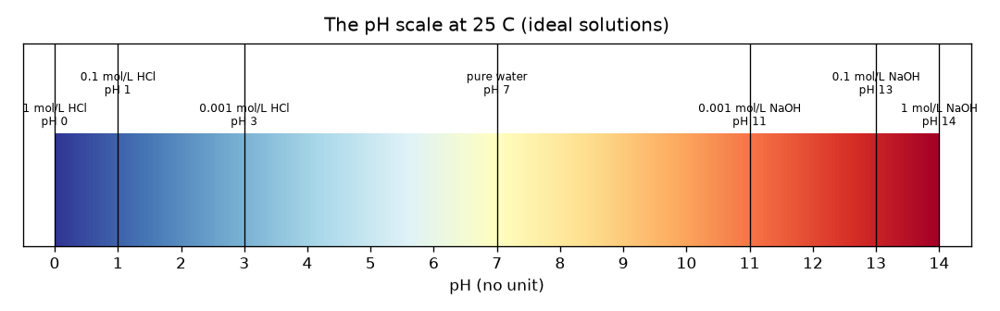
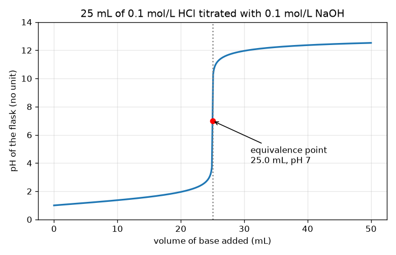

# सत्र 1: अम्ल, क्षार और अनुमापन वक्र का आकार

*स्तर 1 (वैचारिक इंटरैक्टिव मॉडल) · लगभग 60 मिनट · openphtitration*

> यह एक सरलीकृत शैक्षिक मॉडल है। यह कोई प्रमाणित डिज़ाइन उपकरण नहीं है और इसका उपयोग वास्तविक संरचनाओं, विद्युत संस्थापनों, वाहनों, औद्योगिक प्रक्रियाओं या चिकित्सा निर्णयों के लिए नहीं किया जाना चाहिए।

**पूर्व-आवश्यकताएँ (Prerequisites)**

- अनुपात और 10 की घातें।
- आपने PRIMER.md पढ़ लिया है और एक बार `python start.py 1` चला लिया है।

**सीखने के उद्देश्य (Learning objectives)।** इस सत्र के बाद आप:

- बता सकेंगे कि pH क्या मापता है और 0 से 14 तक का पैमाना पढ़ सकेंगे, जिसमें pH 7 उदासीन (neutral) है।
- किसी प्रबल अम्ल (strong acid) या प्रबल क्षार (strong base) का pH उसकी सांद्रता (concentration) से निकाल सकेंगे।
- समझा सकेंगे कि अम्ल में क्षार मिलाने पर pH पहले धीरे और फिर अचानक क्यों बढ़ता है।
- अनुमापन वक्र (titration curve) पर और मोल संतुलन से तुल्यता बिंदु (equivalence point) ज्ञात कर सकेंगे।

## A. वास्तविक जीवन की समस्या
एक प्रयोगशाला के पास अम्ल की एक बोतल है और उसे जानना है कि वह कितना प्रबल है। वे उसे चख नहीं सकते और लेबल ग़ायब है। इसलिए वे ज्ञात सामर्थ्य का एक क्षार काँच की नली (ब्यूरेट (burette)) से थोड़ा-थोड़ा मिलाते हैं, और फ़्लास्क में द्रव को देखते हैं। पहले लगभग कुछ भी होता नहीं दिखता; फिर, एक और बूँद के साथ, सब कुछ बदल जाता है। वह अचानक बदलाव अम्ल की सामर्थ्य को कैसे प्रकट करता है? यह एक सिमुलेशन के बारे में सामान्य शिक्षा है: वास्तविक अम्लों और क्षारों को केवल शिक्षक के साथ, चश्मे (goggles) पहनकर और सही उपकरणों के साथ ही संभालना चाहिए।

## B. अवधारणा और सिद्धांत
पानी में हमेशा कुछ हाइड्रोजन आयन (H+) होते हैं। अम्ल उनमें और जोड़ता है, क्षार उन्हें हटाता है। pH वह संख्या है जो इसे मापती है: pH = -log10[H+], जहाँ [H+] mol/L में हाइड्रोजन आयनों की सांद्रता है। लघुगणक के कारण, pH में 1 की कमी का अर्थ है दस गुना अधिक H+। 7 से कम pH वाला विलयन अम्लीय है, 7 उदासीन है (25 C पर शुद्ध पानी) और 7 से ऊपर क्षारीय है। हाइड्रोक्लोरिक अम्ल (HCl) जैसा प्रबल अम्ल पूरी तरह टूट जाता है, इसलिए 0.1 mol/L HCl में [H+] = 0.1 और pH 1 है। अनुमापन में हम सांद्रता Ca वाले Va mL अम्ल में ब्यूरेट से ज्ञात सांद्रता Cb का क्षार मिलाते हैं। अम्ल और क्षार मोल-दर-मोल एक-दूसरे को निरस्त करते हैं। जब तक अम्ल बचा रहता है, pH कम रहता है। ठीक तब जब मिलाए गए क्षार के मोल अम्ल के मोल के बराबर होते हैं, हम तुल्यता बिंदु पर होते हैं; उसके ठीक बाद क्षार बच जाता है और pH ऊँचा होता है। बचे हुए को कुल आयतन से भाग दिया जाता है, इसलिए जब तक बहुत अम्ल है pH धीरे बदलता है और जब बचा हुआ बहुत कम हो तो बहुत तेज़।

| प्रतीक | अर्थ | इकाई |
|---|---|---|
| pH | अम्लता का माप, -log10[H+] | कोई इकाई नहीं |
| [H+] | हाइड्रोजन आयनों की सांद्रता | mol/L |
| Ca, Va | फ़्लास्क में अम्ल की सांद्रता और आयतन | mol/L, mL |
| Cb, Vb | मिलाए गए क्षार की सांद्रता और आयतन | mol/L, mL |
| Ve | तुल्यता आयतन: सारे अम्ल को निरस्त करने के लिए आवश्यक क्षार | mL |

**मान्यताएँ (Assumptions)**

- प्रबल अम्ल और प्रबल क्षार: दोनों पूरी तरह टूटते हैं।
- 25 C, इसलिए शुद्ध पानी का pH 7 है।
- आदर्श विलयन: सरल सांद्रताओं का उपयोग किया गया है (1 mol/L या अधिक के वास्तविक प्रबल विलयन विचलित होते हैं)।
- आयतन सीधे जुड़ते हैं।

$$ \mathrm{pH}=-\log_{10}[\mathrm{H}^+] $$

$$ x=\frac{C_aV_a-C_bV_b}{V_a+V_b}\quad(\text{leftover acid if }x>0,\ \text{leftover base if }x<0) $$

$$ C_aV_a=C_bV_e\quad\Rightarrow\quad V_e=\frac{C_aV_a}{C_b} $$

## C. दृश्य व्याख्या
पहला चित्र 0 से 14 तक pH पैमाने को एक रंग पट्टी के रूप में दिखाता है जिस पर परिचित विलयन रखे गए हैं: 0 पर 1 mol/L HCl, 7 पर शुद्ध पानी, 14 पर 1 mol/L NaOH। दूसरा चित्र 0.1 mol/L NaOH के साथ 25 mL 0.1 mol/L HCl का अनुमापन वक्र है। वक्र पहले 24.9 mL में pH 1 से pH 3.7 तक धीरे चढ़ता है, फिर अगले 0.2 mL में 3.7 से 10.3 तक छलाँग लगाता है, और pH 12 के पास फिर से सपाट हो जाता है। 25 mL, pH 7 पर लाल बिंदु तुल्यता बिंदु है।

*0 से 14 तक pH पैमाना, जिस पर प्रबल अम्ल और क्षार विलयन रखे गए हैं।*

*0.1 mol/L NaOH से अनुमापित 25 mL 0.1 mol/L HCl: धीमी चढ़ाई, अचानक छलाँग, सपाट होना; लाल बिंदु तुल्यता बिंदु है।*

## D. इंटरैक्टिव सिमुलेशन
पाठ चलाएँ (`python start.py 1`), फिर लाइव ऐप खोलें: [सत्र 1: अम्ल में क्षार मिलाएँ](https://krunalpanchal1995.github.io/pan-iit-oss/openphtitration/session-01/) (या इसी फ़ोल्डर में `app.html`)। क्षार का आयतन खींचें और ब्यूरेट का स्तर गिरते तथा फ़्लास्क का रंग लाल (अम्ल) से हरे (उदासीन) होते हुए बैंगनी (क्षार) में बदलते देखें। फिर वक्र दृश्य खोलें और देखें कि खड़ी छलाँग कहाँ है। अम्ल और क्षार की सांद्रताएँ बदलें और देखें कि छलाँग कैसे खिसकती है।

**चुनौती।** अम्ल को ठीक-ठीक उदासीन करें: क्षार का आयतन और सांद्रताएँ ऐसे सेट करें कि क्षार के मोल अम्ल के मोल के बराबर हों (Cb x Vb = Ca x 25, 0.01 mmol के भीतर) और फ़्लास्क pH 7 दिखाए।

## E. हल किया गया उदाहरण और प्रयोग
**समस्या।** 25 mL 0.1 mol/L HCl को 0.1 mol/L NaOH से अनुमापित किया जाता है। 10 mL क्षार के बाद pH, और तुल्यता आयतन ज्ञात करें।

1. शुरुआत में अम्ल के मोल: 0.1 mol/L x 25 mL = 2.5 mmol।
2. मिलाए गए क्षार के मोल: 0.1 mol/L x 10 mL = 1.0 mmol। वे एक-एक करके निरस्त होते हैं, इसलिए 2.5 - 1.0 = 1.5 mmol अम्ल बचता है।
3. कुल आयतन = 25 + 10 = 35 mL, इसलिए [H+] = 1.5 / 35 = 0.04286 mol/L।
4. pH = -log10(0.04286) = 1.368।
5. तुल्यता: Ca Va = Cb Ve से Ve = 0.1 x 25 / 0.1 = 25 mL मिलता है, जहाँ केवल पानी और लवण बचते हैं और pH = 7।

**उत्तर।** 10 mL के बाद pH 1.368 है; तुल्यता आयतन 25 mL है (pH 7)।

**प्रयोग।** एक स्कूल प्रयोगशाला में (निगरानी में) शिक्षक pH मीटर का उपयोग करके तनु हाइड्रोक्लोरिक अम्ल को तनु सोडियम हाइड्रॉक्साइड से अनुमापित करेंगे और इस वक्र से तुलना करेंगे। वास्तविक वक्र कोने पर थोड़ा अधिक चिकना होता है और 0 mL पर pH ठीक 1 नहीं होता क्योंकि वास्तविक विलयन आदर्श नहीं होते और मीटर में लगभग 0.02 से 0.05 pH की अनिश्चितता होती है। मॉडल एक साफ़ आदर्शीकरण है; प्रयोगशाला मापन शोर और गैर-आदर्श व्यवहार जोड़ती है।

## F. मूल्यांकन और डिज़ाइन चुनौती
**प्रश्न प्रकार A: वैचारिक।** क्षार के पहले 20 mL में pH मुश्किल से क्यों बदलता है और फिर 25 mL के पास एक मिलीलीटर के अंश में ही क्यों छलाँग लगाता है?

संकेत

सोचें कि अम्ल के कितने मोल अभी भी बचे हैं, और जब आप बहुत छोटे बचे हुए को आयतन से भाग देते हैं तो क्या होता है।

चरण-दर-चरण हल

pH लघुगणकीय पैमाने पर बचे हुए H+ की सांद्रता पर निर्भर करता है। शुरुआत में बहुत अम्ल बचा होता है, इसलिए थोड़ा और हटाने से सांद्रता केवल एक छोटे गुणांक से बदलती है (20 mL में pH 1.0 से 1.95)। तुल्यता बिंदु के पास बचा हुआ बहुत कम है, इसलिए और 0.1 mL उसे बड़े गुणांक से बदल देता है, और उसके बाद बचा हुआ क्षार बन जाता है। केवल कुछ बूँदें फ़्लास्क को H+ की 1e-4 mol/L सांद्रता से OH- की 1e-4 mol/L तक ले जाती हैं, जो 6.6 pH इकाइयों का बदलाव है।

**प्रश्न प्रकार B: संख्यात्मक।** 25 mL 0.1 mol/L HCl में 20 mL 0.1 mol/L NaOH मिलाने के बाद pH क्या है? इकाइयाँ दिखाएँ और जाँचें कि उत्तर समझदारी भरा है।

संकेत

अम्ल और क्षार के मिलीमोल गिनें, घटाएँ, और कुल आयतन से भाग दें।

चरण-दर-चरण हल

अम्ल 2.5 mmol, क्षार 2.0 mmol, 45 mL में 0.5 mmol बचा, इसलिए [H+] = 0.01111 mol/L और pH = 1.954। जाँच (sanity check): यह प्रारंभिक pH 1 से ऊपर है (कुछ अम्ल जा चुका है) पर अभी भी अम्लीय और 7 से काफ़ी नीचे है, जैसा तुल्यता बिंदु से पहले अपेक्षित है।

**प्रश्न प्रकार C: ग्राफ़ और सिमुलेशन की व्याख्या।** अनुमापन वक्र पर, 24.9 mL और 25.1 mL के बीच pH कितना बदलता है, और अंत के पास ब्यूरेट पढ़ने के बारे में यह आपको क्या बताता है?

संकेत

lesson.py के आउटपुट से 24.9 mL और 25.1 mL पर pH पढ़ें।

चरण-दर-चरण हल

pH 3.698 से 10.300 तक जाता है, केवल 0.2 mL में 6.6 इकाइयों का बदलाव। तुल्यता बिंदु के पास ब्यूरेट पढ़ने में 0.05 mL की त्रुटि pH को कई इकाइयों से बदल देती है, इसलिए तुल्यता आयतन बहुत सटीकता से पता लगाया जा सकता है, पर अंत के पास क्षार बूँद-बूँद करके मिलाना चाहिए।

**प्रश्न प्रकार D: डिज़ाइन और अनुकूलन (optimisation) चुनौती।** डिज़ाइन: आपके पास 25 mL 0.1 mol/L अम्ल है और 0.1 mol/L या 0.2 mol/L क्षार का विकल्प है। आप कौन-सा चुनेंगे और क्यों? हर एक के लिए तुल्यता आयतन और समझौता (trade-off) बताएँ।

संकेत

हर एक के लिए Ve निकालें, और 0.05 mL की ब्यूरेट पठन त्रुटि की तुलना हर आयतन से करें।

चरण-दर-चरण हल

0.1 mol/L क्षार के साथ Ve = 25 mL और 0.2 mol/L क्षार के साथ 12.5 mL। 0.05 mL की पठन त्रुटि 25 mL का 0.2 प्रतिशत है पर 12.5 mL का 0.4 प्रतिशत, इसलिए कमज़ोर क्षार छोटी सापेक्ष त्रुटि देता है, पर उसे बड़ा ब्यूरेट आयतन और लंबा अनुमापन चाहिए। प्रबल क्षार समय और द्रव बचाता है पर सापेक्ष पठन त्रुटि को दोगुना कर देता है। मान्यता: दोनों स्थितियों में पठन त्रुटि एक जैसी है।

[RUBRIC.md](../../RUBRIC.md) से स्वयं को अंक दें। काग़ज़ पर काम करने के लिए [गतिविधि पत्रक (activity sheet)](activity_sheet.md) प्रिंट करें।

## सामान्य भ्रांतियाँ (Common misconceptions)
| सामान्य भ्रांति | वास्तव में क्या सच है |
|---|---|
| pH 7 वाले विलयन में कोई आयन नहीं होते। | 25 C पर शुद्ध पानी में 1e-7 mol/L H+ और उतना ही OH- होता है; उदासीन का अर्थ है बराबर मात्रा, शून्य नहीं। |
| pH 2, pH 3 से बस थोड़ा अधिक अम्लीय है। | इसमें दस गुना अधिक H+ है। पैमाना लघुगणकीय है। |
| क्षार मिलाने पर pH लगातार बढ़ता है। | यह धीरे बढ़ता है, फिर तुल्यता बिंदु पर छलाँग लगाता है, फिर से सपाट हो जाता है। |
| तुल्यता बिंदु वहीं है जहाँ सूचक (indicator) रंग बदलता है। | तुल्यता बिंदु वह है जहाँ क्षार के मोल अम्ल के मोल के बराबर होते हैं; सूचक का रंग परिवर्तन (अंत बिंदु (endpoint)) उसके जितना हो सके उतना क़रीब चुना जाना चाहिए। |

## शब्दावली (Glossary)
- **pH**: अम्लता का माप: हाइड्रोजन-आयन सांद्रता के आधार-10 लघुगणक का ऋण
- **अम्ल (acid)**: ऐसा पदार्थ जो पानी की हाइड्रोजन-आयन सांद्रता बढ़ाता है
- **क्षार (base)**: ऐसा पदार्थ जो इसे घटाता है (यह हाइड्रॉक्साइड आयन जोड़ता है)
- **अनुमापन (titration)**: ज्ञात सांद्रता का एक विलयन दूसरे में तब तक मिलाना जब तक वे ठीक-ठीक निरस्त न हो जाएँ
- **ब्यूरेट (burette)**: नल वाली एक अंशांकित काँच की नली, जिसका उपयोग छोटी मापी गई मात्राओं में द्रव मिलाने के लिए होता है
- **तुल्यता बिंदु (equivalence point)**: वह क्षण जब मिलाए गए क्षार के मोल मूल रूप से उपस्थित अम्ल के मोल के बराबर होते हैं

## समापन
1. [exercises.md](exercises.md) में दिए गए तीन कोडिंग कार्य करें।
2. अपने बदलावों के बाद `python start.py 1` फिर से चलाएँ। यह चेकपॉइंट के साथ समाप्त होता है; जब यह `PASS` छापे, तो आपका काम पूरा हो गया। (केवल चेकपॉइंट: `python start.py check 1`।)

आगे: [सत्र 2](../session-02/README.md)
