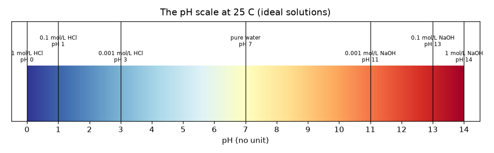
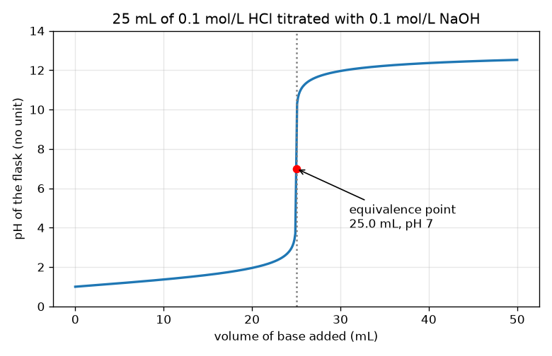

# സെഷൻ 1: അമ്ലങ്ങൾ, ക്ഷാരങ്ങൾ, ഒരു ടൈട്രേഷൻ വക്രത്തിന്റെ ആകൃതി

[Session 1 — हिन्दी](README.hi.md) · [Session 1 — മലയാളം](README.ml.md)

*ലെവൽ 1 (ആശയപരമായ ഇന്ററാക്ടീവ് മോഡൽ) · ഏകദേശം 60 മിനിറ്റ് · openphtitration*

> ഇത് ലളിതമാക്കിയ ഒരു വിദ്യാഭ്യാസ മോഡലാണ്. ഇത് സാധൂകരിക്കപ്പെട്ട (validated) ഡിസൈൻ ഉപകരണമല്ല; യഥാർത്ഥ ഘടനകൾ, വൈദ്യുത സംവിധാനങ്ങൾ, വാഹനങ്ങൾ, വ്യാവസായിക പ്രക്രിയകൾ അല്ലെങ്കിൽ വൈദ്യശാസ്ത്ര തീരുമാനങ്ങൾ എന്നിവയ്ക്ക് ഇത് ഉപയോഗിക്കരുത്.

**മുൻ‌അറിവ് (Prerequisites)**

- അനുപാതങ്ങളും 10-ന്റെ ഘാതങ്ങളും.
- നിങ്ങൾ PRIMER.md വായിക്കുകയും `python start.py 1` ഒരിക്കൽ പ്രവർത്തിപ്പിക്കുകയും ചെയ്തിട്ടുണ്ട്.

**പഠന ലക്ഷ്യങ്ങൾ (Learning objectives).** ഈ സെഷനു ശേഷം നിങ്ങൾക്ക് കഴിയും:

- pH എന്താണ് അളക്കുന്നതെന്ന് പറയാനും 0 മുതൽ 14 വരെയുള്ള സ്കെയിൽ വായിക്കാനും, pH 7 നിർവീര്യം.
- ഒരു ശക്തമായ അമ്ലത്തിന്റെയോ ശക്തമായ ക്ഷാരത്തിന്റെയോ pH അതിന്റെ സാന്ദ്രതയിൽ നിന്ന് കണക്കാക്കാൻ.
- അമ്ലത്തിൽ ക്ഷാരം ചേർക്കുമ്പോൾ pH ആദ്യം പതുക്കെയും പിന്നെ പെട്ടെന്നും ഉയരുന്നത് എന്തുകൊണ്ടെന്ന് വിശദീകരിക്കാൻ.
- ടൈട്രേഷൻ വക്രത്തിലും മോൾ ബാലൻസിൽ നിന്നും തുല്യതാ ബിന്ദു (equivalence point) കണ്ടെത്താൻ.

## A. യഥാർത്ഥ ലോക പ്രശ്നം
ഒരു ലബോറട്ടറിയിൽ ഒരു കുപ്പി അമ്ലമുണ്ട്, അത് എത്ര ശക്തമാണെന്ന് അറിയണം. അവർക്ക് അത് രുചിച്ചുനോക്കാൻ കഴിയില്ല, ലേബൽ നഷ്ടപ്പെട്ടിരിക്കുന്നു. അതിനാൽ അവർ ഒരു ഗ്ലാസ് ട്യൂബിൽ (ബ്യൂററ്റ്) നിന്ന് അറിയപ്പെടുന്ന ശക്തിയുള്ള ക്ഷാരം അല്പം അല്പമായി ചേർക്കുകയും ഫ്ലാസ്കിലെ ദ്രാവകം നിരീക്ഷിക്കുകയും ചെയ്യുന്നു. ആദ്യം ഏതാണ്ട് ഒന്നും സംഭവിക്കുന്നതായി തോന്നുന്നില്ല; പിന്നെ ഒരു തുള്ളി കൂടി ചേർക്കുമ്പോൾ എല്ലാം മാറുന്നു. ആ പെട്ടെന്നുള്ള മാറ്റം അമ്ലത്തിന്റെ ശക്തി എങ്ങനെ വെളിപ്പെടുത്തുന്നു? ഇത് ഒരു സിമുലേഷനെക്കുറിച്ചുള്ള പൊതു വിദ്യാഭ്യാസമാണ്: യഥാർത്ഥ അമ്ലങ്ങളും ക്ഷാരങ്ങളും ഒരു അധ്യാപകൻ, കണ്ണടകൾ, ശരിയായ ഉപകരണങ്ങൾ എന്നിവയോടെ മാത്രമേ കൈകാര്യം ചെയ്യാവൂ.

## B. ആശയവും സിദ്ധാന്തവും
ജലത്തിൽ എല്ലായ്പ്പോഴും ഏതാനും ഹൈഡ്രജൻ അയോണുകൾ (H+) അടങ്ങിയിരിക്കുന്നു. അമ്ലം അവയെ കൂടുതൽ ചേർക്കുന്നു, ക്ഷാരം അവയെ നീക്കം ചെയ്യുന്നു. ഇത് അളക്കുന്ന സംഖ്യയാണ് pH: pH = -log10[H+], ഇവിടെ [H+] എന്നത് mol/L-ലെ ഹൈഡ്രജൻ അയോണുകളുടെ സാന്ദ്രതയാണ്. ലോഗരിതം കാരണം, pH-ലെ 1 കുറവ് എന്നാൽ പത്തിരട്ടി H+ എന്നാണ്. pH 7-ന് താഴെയുള്ള ലായനി അമ്ലീയമാണ്, 7 നിർവീര്യം (25 C-ലെ ശുദ്ധജലം), 7-ന് മുകളിൽ ക്ഷാരീയം. ഹൈഡ്രോക്ലോറിക് അമ്ലം (HCl) പോലുള്ള ശക്തമായ അമ്ലം പൂർണ്ണമായും വിഘടിക്കുന്നു, അതിനാൽ 0.1 mol/L HCl-ന് [H+] = 0.1 ഉം pH 1 ഉം ആണ്. ഒരു ടൈട്രേഷനിൽ ബ്യൂററ്റിൽ നിന്ന് അറിയപ്പെടുന്ന സാന്ദ്രത Cb ഉള്ള ക്ഷാരം, സാന്ദ്രത Ca ഉള്ള Va mL അമ്ലത്തിൽ ചേർക്കുന്നു. അമ്ലവും ക്ഷാരവും മോളിന് മോൾ എന്ന കണക്കിൽ ഇല്ലാതാകുന്നു. അമ്ലം ബാക്കിയുള്ളിടത്തോളം pH കുറവാണ്. ചേർത്ത ക്ഷാരത്തിന്റെ മോളുകൾ അമ്ലത്തിന്റെ മോളുകൾക്ക് തുല്യമാകുന്ന കൃത്യമായ നിമിഷം നാം തുല്യതാ ബിന്ദുവിലാണ്; അതിനു തൊട്ടുപിന്നാലെ ക്ഷാരം ബാക്കിയാകുന്നു, pH ഉയർന്നതാണ്. ബാക്കിയുള്ളതിനെ ആകെ വ്യാപ്തം കൊണ്ട് ഹരിക്കുന്നു, അതിനാൽ ധാരാളം അമ്ലം ഉള്ളപ്പോൾ pH പതുക്കെയും ബാക്കിയുള്ളത് നിസ്സാരമാകുമ്പോൾ വളരെ വേഗത്തിലും മാറുന്നു.

| ചിഹ്നം | അർത്ഥം | യൂണിറ്റ് |
|---|---|---|
| pH | അമ്ലതയുടെ അളവ്, -log10[H+] | യൂണിറ്റില്ല |
| [H+] | ഹൈഡ്രജൻ അയോണുകളുടെ സാന്ദ്രത | mol/L |
| Ca, Va | ഫ്ലാസ്കിലെ അമ്ലത്തിന്റെ സാന്ദ്രതയും വ്യാപ്തവും | mol/L, mL |
| Cb, Vb | ചേർത്ത ക്ഷാരത്തിന്റെ സാന്ദ്രതയും വ്യാപ്തവും | mol/L, mL |
| Ve | തുല്യതാ വ്യാപ്തം: എല്ലാ അമ്ലത്തെയും ഇല്ലാതാക്കാൻ വേണ്ട ക്ഷാരം | mL |

**അനുമാനങ്ങൾ (Assumptions)**

- ശക്തമായ അമ്ലവും ശക്തമായ ക്ഷാരവും: രണ്ടും പൂർണ്ണമായി വിഘടിക്കുന്നു.
- 25 C, അതിനാൽ ശുദ്ധജലത്തിന് pH 7.
- ആദർശ ലായനികൾ: ലളിതമായ സാന്ദ്രതകൾ ഉപയോഗിക്കുന്നു (1 mol/L-ഓ അതിൽ കൂടുതലോ ഉള്ള യഥാർത്ഥ ശക്തമായ ലായനികൾ വ്യതിചലിക്കുന്നു).
- വ്യാപ്തങ്ങൾ ലളിതമായി കൂടുന്നു.

$$ \mathrm{pH}=-\log_{10}[\mathrm{H}^+] $$

$$ x=\frac{C_aV_a-C_bV_b}{V_a+V_b}\quad(\text{leftover acid if }x>0,\ \text{leftover base if }x<0) $$

$$ C_aV_a=C_bV_e\quad\Rightarrow\quad V_e=\frac{C_aV_a}{C_b} $$

## C. ദൃശ്യ വിശദീകരണം
ആദ്യ ചിത്രം 0 മുതൽ 14 വരെയുള്ള ഒരു വർണ്ണ ബാർ ആയി pH സ്കെയിൽ ആണ്, പരിചിത ലായനികൾ അതിൽ വച്ചിരിക്കുന്നു: 0-ൽ 1 mol/L HCl, 7-ൽ ശുദ്ധജലം, 14-ൽ 1 mol/L NaOH. രണ്ടാമത്തെ ചിത്രം 0.1 mol/L NaOH ഉപയോഗിച്ച് 25 mL 0.1 mol/L HCl-ന്റെ ടൈട്രേഷൻ വക്രമാണ്. ആദ്യ 24.9 mL-ൽ വക്രം pH 1-ൽ നിന്ന് pH 3.7-ലേക്ക് പതുക്കെ കയറുന്നു, തുടർന്ന് അടുത്ത 0.2 mL-ൽ 3.7-ൽ നിന്ന് 10.3-ലേക്ക് കുതിക്കുന്നു, pH 12-ന് അടുത്ത് വീണ്ടും പരക്കുന്നു. 25 mL, pH 7-ലെ ചുവന്ന ബിന്ദു തുല്യതാ ബിന്ദുവാണ്.

*0 മുതൽ 14 വരെയുള്ള pH സ്കെയിൽ, ശക്തമായ അമ്ല, ക്ഷാര ലായനികൾ അതിൽ വച്ചിരിക്കുന്നു.*

*0.1 mol/L NaOH ഉപയോഗിച്ച് 25 mL 0.1 mol/L HCl ടൈട്രേറ്റ് ചെയ്യുന്നു: പതുക്കെയുള്ള ഉയർച്ച, പെട്ടെന്നുള്ള കുതിപ്പ്, പരക്കൽ; ചുവന്ന ബിന്ദു തുല്യതാ ബിന്ദുവാണ്.*

## D. ഇന്ററാക്ടീവ് സിമുലേഷൻ
പാഠം പ്രവർത്തിപ്പിക്കുക (`python start.py 1`), തുടർന്ന് ലൈവ് ആപ്പ് തുറക്കുക: [സെഷൻ 1: അമ്ലത്തിൽ ക്ഷാരം ചേർക്കുക](https://krunalpanchal1995.github.io/pan-iit-oss/openphtitration/session-01/) (അല്ലെങ്കിൽ ഈ ഫോൾഡറിലെ `app.html`). ക്ഷാര വ്യാപ്തം വലിച്ച് ബ്യൂററ്റ് നില താഴുന്നതും ഫ്ലാസ്കിന്റെ നിറം ചുവപ്പിൽ നിന്ന് (അമ്ലം) പച്ചയിലൂടെ (നിർവീര്യം) വയലറ്റിലേക്ക് (ക്ഷാരം) മാറുന്നതും നിരീക്ഷിക്കുക. തുടർന്ന് വക്ര കാഴ്ച തുറന്ന് കുത്തനെയുള്ള കുതിപ്പ് എവിടെയാണെന്ന് കാണുക. അമ്ല, ക്ഷാര സാന്ദ്രതകൾ മാറ്റി കുതിപ്പ് എങ്ങനെ നീങ്ങുന്നു എന്ന് കാണുക.

**വെല്ലുവിളി.** അമ്ലത്തെ കൃത്യമായി നിർവീര്യമാക്കുക: ക്ഷാരത്തിന്റെ മോളുകൾ അമ്ലത്തിന്റെ മോളുകൾക്ക് തുല്യമാകുന്ന വിധത്തിൽ (Cb x Vb = Ca x 25, 0.01 mmol-നുള്ളിൽ) ക്ഷാര വ്യാപ്തവും സാന്ദ്രതകളും സജ്ജമാക്കുക, ഫ്ലാസ്ക് pH 7 കാണിക്കണം.

## E. ഉദാഹരണ പ്രശ്നവും പരീക്ഷണവും
**പ്രശ്നം.** 25 mL 0.1 mol/L HCl, 0.1 mol/L NaOH ഉപയോഗിച്ച് ടൈട്രേറ്റ് ചെയ്യുന്നു. 10 mL ക്ഷാരത്തിനു ശേഷമുള്ള pH-ഉം തുല്യതാ വ്യാപ്തവും കണ്ടെത്തുക.

1. തുടക്കത്തിലെ അമ്ലത്തിന്റെ മോളുകൾ: 0.1 mol/L x 25 mL = 2.5 mmol.
2. ചേർത്ത ക്ഷാരത്തിന്റെ മോളുകൾ: 0.1 mol/L x 10 mL = 1.0 mmol. അവ ഒന്നിന് ഒന്ന് എന്ന കണക്കിൽ ഇല്ലാതാകുന്നു, അതിനാൽ 2.5 - 1.0 = 1.5 mmol അമ്ലം ബാക്കിയുണ്ട്.
3. ആകെ വ്യാപ്തം = 25 + 10 = 35 mL, അതിനാൽ [H+] = 1.5 / 35 = 0.04286 mol/L.
4. pH = -log10(0.04286) = 1.368.
5. തുല്യത: Ca Va = Cb Ve നൽകുന്നത് Ve = 0.1 x 25 / 0.1 = 25 mL, അവിടെ ജലവും ലവണവും മാത്രം ബാക്കിയാകുന്നു, pH = 7.

**ഉത്തരം.** 10 mL-ന് ശേഷം pH 1.368 ആണ്; തുല്യതാ വ്യാപ്തം 25 mL (pH 7) ആണ്.

**പരീക്ഷണം.** ഒരു സ്കൂൾ ലബോറട്ടറിയിൽ (മേൽനോട്ടത്തോടെ) ഒരു അധ്യാപകൻ നേർപ്പിച്ച ഹൈഡ്രോക്ലോറിക് അമ്ലം നേർപ്പിച്ച സോഡിയം ഹൈഡ്രോക്സൈഡ് ഉപയോഗിച്ച് ഒരു pH മീറ്റർ കൊണ്ട് ടൈട്രേറ്റ് ചെയ്ത് ഈ വക്രവുമായി താരതമ്യം ചെയ്യും. യഥാർത്ഥ വക്രം മൂലയിൽ അല്പം മിനുസമാർന്നതാണ്, 0 mL-ലെ pH കൃത്യമായി 1 അല്ല, കാരണം യഥാർത്ഥ ലായനികൾ ആദർശമല്ല, മീറ്ററിന് ഏകദേശം 0.02 മുതൽ 0.05 വരെ pH അനിശ്ചിതത്വമുണ്ട്. മോഡൽ ഒരു ശുദ്ധമായ ആദർശവൽക്കരണമാണ്; ലാബ് അളവെടുപ്പ് നോയിസും ആദർശമല്ലാത്ത പെരുമാറ്റവും ചേർക്കുന്നു.

## F. മൂല്യനിർണ്ണയവും ഡിസൈൻ വെല്ലുവിളിയും
**ചോദ്യ തരം A: ആശയപരം.** ക്ഷാരത്തിന്റെ ആദ്യ 20 mL-ന് pH ഏതാണ്ട് മാറാതിരിക്കുകയും തുടർന്ന് 25 mL-ന് അടുത്ത് ഒരു മില്ലിലിറ്ററിന്റെ അംശത്തിനുള്ളിൽ കുതിക്കുകയും ചെയ്യുന്നത് എന്തുകൊണ്ട്?

സൂചന

എത്ര മോൾ അമ്ലം ഇപ്പോഴും ബാക്കിയുണ്ടെന്നും, ഒരു നിസ്സാര ബാക്കിയെ വ്യാപ്തം കൊണ്ട് ഹരിക്കുമ്പോൾ എന്തു സംഭവിക്കുമെന്നും ചിന്തിക്കുക.

ഘട്ടം ഘട്ടമായുള്ള പരിഹാരം

pH ലോഗരിതമിക് സ്കെയിലിൽ ബാക്കിയുള്ള H+ സാന്ദ്രതയെ ആശ്രയിക്കുന്നു. തുടക്കത്തിൽ ധാരാളം അമ്ലം ബാക്കിയുണ്ട്, അതിനാൽ കുറച്ചുകൂടി നീക്കം ചെയ്യുന്നത് സാന്ദ്രതയെ ഒരു ചെറിയ ഘടകം കൊണ്ട് മാത്രം മാറ്റുന്നു (20 mL-ൽ pH 1.0 മുതൽ 1.95 വരെ). തുല്യതാ ബിന്ദുവിന് സമീപം ബാക്കിയുള്ളത് നിസ്സാരമാണ്, അതിനാൽ ഒരു 0.1 mL കൂടി അതിനെ വലിയ ഘടകം കൊണ്ട് മാറ്റുന്നു, അതിനപ്പുറം ബാക്കിയുള്ളത് ക്ഷാരമാകുന്നു. ഏതാനും തുള്ളികൾ മാത്രം ഫ്ലാസ്കിനെ 1e-4 mol/L H+ സാന്ദ്രതയിൽ നിന്ന് 1e-4 mol/L OH- സാന്ദ്രതയിലേക്ക് കൊണ്ടുപോകുന്നു, ഇത് 6.6 pH യൂണിറ്റിന്റെ മാറ്റമാണ്.

**ചോദ്യ തരം B: സംഖ്യാപരം.** 25 mL 0.1 mol/L HCl-ൽ 20 mL 0.1 mol/L NaOH ചേർത്ത ശേഷം pH എത്ര? യൂണിറ്റുകൾ കാണിച്ച് ഉത്തരം യുക്തിസഹമാണോ എന്ന് പരിശോധിക്കുക.

സൂചന

അമ്ലത്തിന്റെയും ക്ഷാരത്തിന്റെയും മില്ലിമോളുകൾ എണ്ണുക, കുറയ്ക്കുക, ആകെ വ്യാപ്തം കൊണ്ട് ഹരിക്കുക.

ഘട്ടം ഘട്ടമായുള്ള പരിഹാരം

അമ്ലം 2.5 mmol, ക്ഷാരം 2.0 mmol, 45 mL-ൽ 0.5 mmol ബാക്കി, അതിനാൽ [H+] = 0.01111 mol/L, pH = 1.954. യുക്തിപരിശോധന (sanity check): ഇത് തുടക്ക pH 1-ന് മുകളിലാണ് (കുറച്ച് അമ്ലം പോയി) എങ്കിലും ഇപ്പോഴും അമ്ലീയമാണ്, 7-ന് വളരെ താഴെ, തുല്യതാ ബിന്ദുവിന് മുമ്പ് പ്രതീക്ഷിക്കുന്നതുപോലെ.

**ചോദ്യ തരം C: ഗ്രാഫ്, സിമുലേഷൻ വ്യാഖ്യാനം.** ടൈട്രേഷൻ വക്രത്തിൽ, 24.9 mL-നും 25.1 mL-നും ഇടയിൽ pH എത്ര മാറുന്നു, അവസാനത്തോടടുത്ത് ബ്യൂററ്റ് വായിക്കുന്നതിനെക്കുറിച്ച് അത് എന്തു പറയുന്നു?

സൂചന

lesson.py-യുടെ ഔട്ട്പുട്ടിൽ നിന്ന് 24.9 mL-ലെയും 25.1 mL-ലെയും pH വായിക്കുക.

ഘട്ടം ഘട്ടമായുള്ള പരിഹാരം

pH 3.698-ൽ നിന്ന് 10.300-ലേക്ക് പോകുന്നു, വെറും 0.2 mL-ൽ 6.6 യൂണിറ്റ് മാറ്റം. തുല്യതാ ബിന്ദുവിന് സമീപം 0.05 mL ബ്യൂററ്റ് വായനാ പിശക് pH-നെ പല യൂണിറ്റുകൾ മാറ്റുന്നു, അതിനാൽ തുല്യതാ വ്യാപ്തം വളരെ കൃത്യമായി കണ്ടെത്താം, പക്ഷേ അവസാനത്തോടടുത്ത് ക്ഷാരം തുള്ളി തുള്ളിയായി ചേർക്കണം.

**ചോദ്യ തരം D: ഡിസൈൻ, ഒപ്റ്റിമൈസേഷൻ വെല്ലുവിളി.** ഡിസൈൻ: നിങ്ങളുടെ പക്കൽ 25 mL 0.1 mol/L അമ്ലമുണ്ട്, 0.1 mol/L അല്ലെങ്കിൽ 0.2 mol/L ക്ഷാരം തിരഞ്ഞെടുക്കാം. ഏതാണ് തിരഞ്ഞെടുക്കുന്നത്, എന്തുകൊണ്ട്? ഓരോന്നിനും തുല്യതാ വ്യാപ്തവും വിട്ടുവീഴ്ചയും (trade-off) പറയുക.

സൂചന

ഓരോന്നിനും Ve കണക്കാക്കുക, 0.05 mL ബ്യൂററ്റ് വായനാ പിശകിനെ ഓരോ വ്യാപ്തവുമായി താരതമ്യം ചെയ്യുക.

ഘട്ടം ഘട്ടമായുള്ള പരിഹാരം

0.1 mol/L ക്ഷാരത്തിൽ Ve = 25 mL, 0.2 mol/L ക്ഷാരത്തിൽ 12.5 mL. 0.05 mL വായനാ പിശക് 25 mL-ന്റെ 0.2 ശതമാനമാണ്, പക്ഷേ 12.5 mL-ന്റെ 0.4 ശതമാനം, അതിനാൽ ദുർബല ക്ഷാരം ചെറിയ ആപേക്ഷിക പിശക് നൽകുന്നു, പക്ഷേ അതിന് വലിയ ബ്യൂററ്റ് വ്യാപ്തവും നീണ്ട ടൈട്രേഷനും വേണം. ശക്തമായ ക്ഷാരം സമയവും ദ്രാവകവും ലാഭിക്കുന്നു, പക്ഷേ ആപേക്ഷിക വായനാ പിശക് ഇരട്ടിയാക്കുന്നു. അനുമാനം: രണ്ട് സന്ദർഭങ്ങളിലും ഒരേ വായനാ പിശക്.

[RUBRIC.md](../../RUBRIC.md) ഉപയോഗിച്ച് സ്വയം സ്കോർ ചെയ്യുക. പേപ്പറിൽ ചെയ്യാൻ [പ്രവർത്തന ഷീറ്റ്](activity_sheet.md) പ്രിന്റ് ചെയ്യുക.

## സാധാരണ തെറ്റിദ്ധാരണകൾ
| സാധാരണ തെറ്റിദ്ധാരണ | യഥാർത്ഥത്തിൽ ശരിയായത് |
|---|---|
| pH 7 ഉള്ള ലായനിയിൽ അയോണുകൾ ഇല്ല. | 25 C-ലെ ശുദ്ധജലത്തിൽ 1e-7 mol/L H+ ഉം അതേ അളവ് OH- ഉം ഉണ്ട്; നിർവീര്യം എന്നാൽ തുല്യ അളവ്, ഒന്നുമില്ലെന്നല്ല. |
| pH 2, pH 3-നേക്കാൾ അല്പം മാത്രം കൂടുതൽ അമ്ലീയമാണ്. | അത് പത്തിരട്ടി H+ ആണ്. സ്കെയിൽ ലോഗരിതമിക് ആണ്. |
| ക്ഷാരം ചേർക്കുമ്പോൾ pH സ്ഥിരമായി ഉയരുന്നു. | അത് പതുക്കെ ഉയരുന്നു, പിന്നെ തുല്യതാ ബിന്ദുവിൽ കുതിക്കുന്നു, പിന്നെ വീണ്ടും പരക്കുന്നു. |
| സൂചകം (indicator) നിറം മാറുന്നിടത്താണ് തുല്യതാ ബിന്ദു. | ക്ഷാരത്തിന്റെ മോളുകൾ അമ്ലത്തിന്റെ മോളുകൾക്ക് തുല്യമാകുന്നിടത്താണ് തുല്യതാ ബിന്ദു; സൂചക നിറമാറ്റം (അന്ത്യബിന്ദു, endpoint) അതിനോട് കഴിയുന്നത്ര അടുത്ത് വരാൻ തിരഞ്ഞെടുക്കണം. |

## പദാവലി (Glossary)
- **pH**: അമ്ലതയുടെ അളവ്: ഹൈഡ്രജൻ-അയോൺ സാന്ദ്രതയുടെ 10 ആധാരമായ ലോഗരിതത്തിന്റെ നെഗറ്റീവ്
- **അമ്ലം (acid)**: ജലത്തിന്റെ ഹൈഡ്രജൻ-അയോൺ സാന്ദ്രത ഉയർത്തുന്ന പദാർത്ഥം
- **ക്ഷാരം (base)**: അതിനെ താഴ്ത്തുന്ന പദാർത്ഥം (അത് ഹൈഡ്രോക്സൈഡ് അയോണുകൾ ചേർക്കുന്നു)
- **ടൈട്രേഷൻ (titration)**: അറിയപ്പെടുന്ന സാന്ദ്രതയുള്ള ഒരു ലായനി മറ്റൊന്നിൽ അവ കൃത്യമായി ഇല്ലാതാകുന്നതുവരെ ചേർക്കൽ
- **ബ്യൂററ്റ് (burette)**: ചെറിയ അളന്ന അളവുകളിൽ ദ്രാവകം ചേർക്കാൻ ഉപയോഗിക്കുന്ന, ടാപ്പുള്ള, അടയാളപ്പെടുത്തിയ ഗ്ലാസ് ട്യൂബ്
- **തുല്യതാ ബിന്ദു (equivalence point)**: ചേർത്ത ക്ഷാരത്തിന്റെ മോളുകൾ ആദ്യമുണ്ടായിരുന്ന അമ്ലത്തിന്റെ മോളുകൾക്ക് തുല്യമാകുന്ന നിമിഷം

## പൂർത്തിയാക്കുക
1. [exercises.md](exercises.md)-ലെ മൂന്ന് കോഡിംഗ് ടാസ്കുകൾ ചെയ്യുക.
2. നിങ്ങളുടെ മാറ്റങ്ങൾക്ക് ശേഷം `python start.py 1` വീണ്ടും പ്രവർത്തിപ്പിക്കുക. അത് ചെക്ക്പോയിന്റോടെ അവസാനിക്കുന്നു; അത് `PASS` പ്രിന്റ് ചെയ്യുമ്പോൾ നിങ്ങൾ പൂർത്തിയാക്കി. (ചെക്ക്പോയിന്റ് മാത്രം: `python start.py check 1`.)

അടുത്തത്: [സെഷൻ 2](../session-02/README.md)
