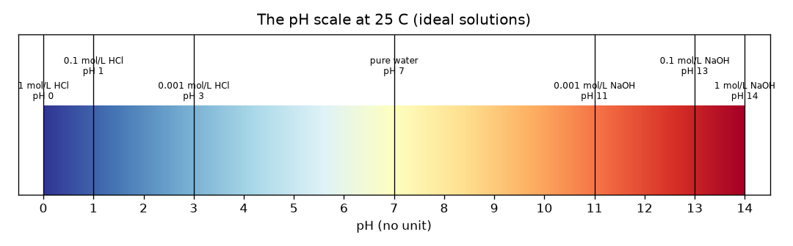
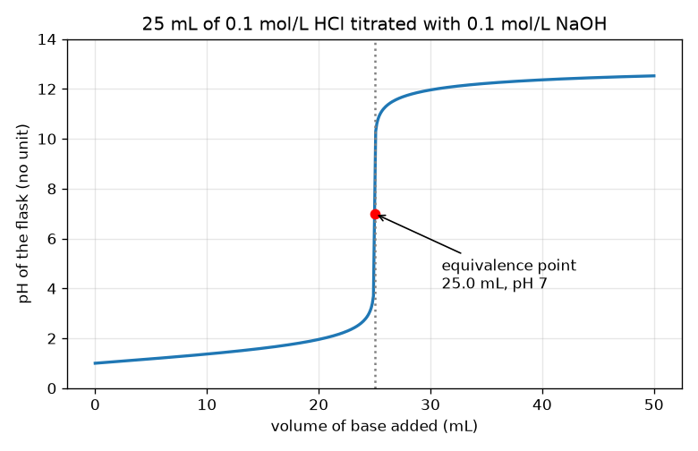

# அமர்வு 1: அமிலங்கள், காரங்கள், மற்றும் ஒரு டைட்ரேஷன் வளைவின் வடிவம்

[Session 1 — हिन्दी](README.hi.md) · [Session 1 — മലയാളം](README.ml.md) · [Session 1 — தமிழ்](README.ta.md)

*நிலை 1 (கருத்தியல் ஊடாடும் மாதிரி) · சுமார் 60 நிமிடங்கள் · openphtitration*

> இது எளிமைப்படுத்தப்பட்ட ஒரு கல்வி மாதிரி. இது சரிபார்க்கப்பட்ட (validated) வடிவமைப்புக் கருவி அல்ல; உண்மையான கட்டமைப்புகள், மின் அமைப்புகள், வாகனங்கள், தொழில்துறை செயல்முறைகள் அல்லது மருத்துவ முடிவுகளுக்கு இதைப் பயன்படுத்த வேண்டாம்.

**முன்தேவைகள் (Prerequisites)**

- விகிதங்களும் 10-இன் அடுக்குகளும்.
- நீங்கள் PRIMER.md-ஐப் படித்து `python start.py 1` ஐ ஒருமுறை இயக்கியுள்ளீர்கள்.

**கற்றல் நோக்கங்கள் (Learning objectives).** இந்த அமர்வுக்குப் பிறகு உங்களால் முடியும்:

- pH எதை அளக்கிறது என்று கூறவும், 0 முதல் 14 வரையிலான அளவை வாசிக்கவும், pH 7 நடுநிலை.
- ஒரு வலிமையான அமிலம் அல்லது வலிமையான காரத்தின் pH-ஐ அதன் செறிவிலிருந்து கணக்கிட.
- அமிலத்தில் காரம் சேர்க்கும்போது pH முதலில் மெதுவாகவும் பிறகு திடீரெனவும் ஏன் உயர்கிறது என்று விளக்க.
- டைட்ரேஷன் வளைவிலும் மோல் சமநிலையிலிருந்தும் சமநிலைப் புள்ளியை (equivalence point) கண்டறிய.

## A. நிஜ உலகப் பிரச்சினை
ஒரு ஆய்வகத்தில் ஒரு புட்டி அமிலம் உள்ளது, அது எவ்வளவு வலிமையானது என்று அறிய வேண்டும். அவர்களால் அதைச் சுவைத்துப் பார்க்க முடியாது, லேபிள் தொலைந்துவிட்டது. எனவே அவர்கள் ஒரு கண்ணாடிக் குழாயிலிருந்து (பியூரெட்) தெரிந்த வலிமை கொண்ட காரத்தைச் சிறிது சிறிதாகச் சேர்த்து குடுவையில் உள்ள திரவத்தைக் கவனிக்கிறார்கள். முதலில் கிட்டத்தட்ட எதுவும் நடப்பதாகத் தெரியவில்லை; பிறகு இன்னும் ஒரு துளி சேர்க்கும்போது எல்லாம் மாறுகிறது. அந்தத் திடீர் மாற்றம் அமிலத்தின் வலிமையை எப்படி வெளிப்படுத்துகிறது? இது ஒரு உருவகப்படுத்துதல் பற்றிய பொதுக் கல்வி: உண்மையான அமிலங்களையும் காரங்களையும் ஆசிரியர், கண்ணாடி, சரியான உபகரணங்களுடன் மட்டுமே கையாள வேண்டும்.

## B. கருத்தும் கோட்பாடும்
நீரில் எப்போதும் சில ஹைட்ரஜன் அயனிகள் (H+) உள்ளன. அமிலம் அவற்றை அதிகம் சேர்க்கிறது, காரம் அவற்றை நீக்குகிறது. இதை அளவிடும் எண் pH: pH = -log10[H+], இங்கு [H+] என்பது mol/L-இல் ஹைட்ரஜன் அயனிகளின் செறிவு. மடக்கை காரணமாக, pH-இல் 1 குறைவு என்றால் பத்து மடங்கு H+ என்று பொருள். pH 7-க்குக் கீழ் உள்ள கரைசல் அமிலத் தன்மையுடையது, 7 நடுநிலை (25 C-இல் தூய நீர்), 7-க்கு மேல் காரத் தன்மை. ஹைட்ரோகுளோரிக் அமிலம் (HCl) போன்ற வலிமையான அமிலம் முழுமையாகப் பிரிகிறது, எனவே 0.1 mol/L HCl-க்கு [H+] = 0.1 மற்றும் pH 1. ஒரு டைட்ரேஷனில் பியூரெட்டிலிருந்து தெரிந்த செறிவு Cb கொண்ட காரம், செறிவு Ca கொண்ட Va mL அமிலத்தில் சேர்க்கப்படுகிறது. அமிலமும் காரமும் மோலுக்கு மோல் என்ற அளவில் ஒன்றையொன்று நீக்குகின்றன. அமிலம் மீதமிருக்கும்வரை pH குறைவாக இருக்கும். சேர்த்த காரத்தின் மோல்கள் அமிலத்தின் மோல்களுக்குச் சமமாகும் துல்லியமான தருணத்தில் நாம் சமநிலைப் புள்ளியில் இருக்கிறோம்; அதன் உடனேயே காரம் மீதமாகிறது, pH அதிகம். மீதமுள்ளது மொத்தக் கொள்ளளவால் வகுக்கப்படுகிறது, எனவே நிறைய அமிலம் இருக்கும்போது pH மெதுவாகவும், மீதம் மிகச் சிறியதாகும்போது மிக வேகமாகவும் மாறுகிறது.

| குறியீடு | பொருள் | அலகு |
|---|---|---|
| pH | அமிலத்தன்மையின் அளவு, -log10[H+] | அலகு இல்லை |
| [H+] | ஹைட்ரஜன் அயனிகளின் செறிவு | mol/L |
| Ca, Va | குடுவையில் உள்ள அமிலத்தின் செறிவும் கொள்ளளவும் | mol/L, mL |
| Cb, Vb | சேர்த்த காரத்தின் செறிவும் கொள்ளளவும் | mol/L, mL |
| Ve | சமநிலைக் கொள்ளளவு: எல்லா அமிலத்தையும் நீக்கத் தேவையான காரம் | mL |

**அனுமானங்கள் (Assumptions)**

- வலிமையான அமிலமும் வலிமையான காரமும்: இரண்டும் முழுமையாகப் பிரிகின்றன.
- 25 C, எனவே தூய நீருக்கு pH 7.
- இலட்சியக் கரைசல்கள்: எளிய செறிவுகள் பயன்படுத்தப்படுகின்றன (1 mol/L அல்லது அதற்கு மேற்பட்ட உண்மையான வலிமையான கரைசல்கள் விலகுகின்றன).
- கொள்ளளவுகள் எளிமையாகக் கூடுகின்றன.

$$ \mathrm{pH}=-\log_{10}[\mathrm{H}^+] $$

$$ x=\frac{C_aV_a-C_bV_b}{V_a+V_b}\quad(\text{leftover acid if }x>0,\ \text{leftover base if }x<0) $$

$$ C_aV_a=C_bV_e\quad\Rightarrow\quad V_e=\frac{C_aV_a}{C_b} $$

## C. காட்சி விளக்கம்
முதல் படம் 0 முதல் 14 வரையிலான வண்ணப் பட்டையாக pH அளவு, பழகிய கரைசல்கள் அதில் வைக்கப்பட்டுள்ளன: 0-இல் 1 mol/L HCl, 7-இல் தூய நீர், 14-இல் 1 mol/L NaOH. இரண்டாவது படம் 0.1 mol/L NaOH கொண்டு 25 mL 0.1 mol/L HCl-இன் டைட்ரேஷன் வளைவு. முதல் 24.9 mL-இல் வளைவு pH 1-இலிருந்து pH 3.7-க்கு மெதுவாக ஏறுகிறது, பிறகு அடுத்த 0.2 mL-இல் 3.7-இலிருந்து 10.3-க்குத் தாவுகிறது, pH 12-ஐ நெருங்கி மீண்டும் தட்டையாகிறது. 25 mL, pH 7-இல் உள்ள சிவப்புப் புள்ளி சமநிலைப் புள்ளி.

*0 முதல் 14 வரையிலான pH அளவு, வலிமையான அமிலக் காரக் கரைசல்கள் அதில் வைக்கப்பட்டுள்ளன.*

*0.1 mol/L NaOH கொண்டு 25 mL 0.1 mol/L HCl டைட்ரேட் செய்யப்படுகிறது: மெதுவான ஏற்றம், திடீர்த் தாவல், தட்டையாதல்; சிவப்புப் புள்ளி சமநிலைப் புள்ளி.*

## D. ஊடாடும் உருவகப்படுத்துதல்
பாடத்தை இயக்கவும் (`python start.py 1`), பிறகு நேரலை செயலியைத் திறக்கவும்: [அமர்வு 1: அமிலத்தில் காரம் சேர்த்தல்](https://krunalpanchal1995.github.io/pan-iit-oss/openphtitration/session-01/) (அல்லது இந்தக் கோப்புறையில் உள்ள `app.html`). காரக் கொள்ளளவை இழுத்து பியூரெட் மட்டம் இறங்குவதையும், குடுவையின் நிறம் சிவப்பிலிருந்து (அமிலம்) பச்சை வழியாக (நடுநிலை) ஊதாவுக்கு (காரம்) மாறுவதையும் கவனியுங்கள். பிறகு வளைவுக் காட்சியைத் திறந்து செங்குத்துத் தாவல் எங்கே என்று பாருங்கள். அமில, கார செறிவுகளை மாற்றி தாவல் எப்படி நகர்கிறது என்று பாருங்கள்.

**சவால்.** அமிலத்தைத் துல்லியமாக நடுநிலையாக்குங்கள்: காரத்தின் மோல்கள் அமிலத்தின் மோல்களுக்குச் சமமாகும்படி (Cb x Vb = Ca x 25, 0.01 mmol-க்குள்) காரக் கொள்ளளவையும் செறிவுகளையும் அமைக்கவும், குடுவை pH 7 காட்ட வேண்டும்.

## E. எடுத்துக்காட்டுக் கணக்கும் சோதனையும்
**கணக்கு.** 25 mL 0.1 mol/L HCl, 0.1 mol/L NaOH கொண்டு டைட்ரேட் செய்யப்படுகிறது. 10 mL காரத்துக்குப் பிறகான pH-ஐயும் சமநிலைக் கொள்ளளவையும் காண்க.

1. தொடக்க அமிலத்தின் மோல்கள்: 0.1 mol/L x 25 mL = 2.5 mmol.
2. சேர்த்த காரத்தின் மோல்கள்: 0.1 mol/L x 10 mL = 1.0 mmol. அவை ஒன்றுக்கு ஒன்று என்ற விகிதத்தில் நீக்கப்படுகின்றன, எனவே 2.5 - 1.0 = 1.5 mmol அமிலம் மீதம் உள்ளது.
3. மொத்தக் கொள்ளளவு = 25 + 10 = 35 mL, எனவே [H+] = 1.5 / 35 = 0.04286 mol/L.
4. pH = -log10(0.04286) = 1.368.
5. சமநிலை: Ca Va = Cb Ve தருவது Ve = 0.1 x 25 / 0.1 = 25 mL, அங்கே நீரும் உப்பும் மட்டுமே மீதமிருக்கும், pH = 7.

**விடை.** 10 mL-க்குப் பிறகு pH 1.368; சமநிலைக் கொள்ளளவு 25 mL (pH 7).

**சோதனை.** ஒரு பள்ளி ஆய்வகத்தில் (மேற்பார்வையுடன்) ஆசிரியர் நீர்த்த ஹைட்ரோகுளோரிக் அமிலத்தை நீர்த்த சோடியம் ஹைட்ராக்சைடு கொண்டு pH மீட்டர் மூலம் டைட்ரேட் செய்து இந்த வளைவுடன் ஒப்பிடுவார். உண்மையான வளைவு மூலையில் சற்று மென்மையாக இருக்கும், 0 mL-இல் pH சரியாக 1 அல்ல, ஏனெனில் உண்மையான கரைசல்கள் இலட்சியமானவை அல்ல, மீட்டருக்கு சுமார் 0.02 முதல் 0.05 வரை pH நிச்சயமற்ற தன்மை உண்டு. மாதிரி ஒரு தூய இலட்சியப்படுத்தல்; ஆய்வக அளவீடு இரைச்சலையும் இலட்சியமற்ற நடத்தையையும் சேர்க்கிறது.

## F. மதிப்பீடும் வடிவமைப்புச் சவாலும்
**கேள்வி வகை A: கருத்தியல்.** காரத்தின் முதல் 20 mL-க்கு pH கிட்டத்தட்ட மாறாமல் இருந்து, பிறகு 25 mL-ஐ நெருங்கி ஒரு மில்லிலிட்டரின் பகுதிக்குள் தாவுவது ஏன்?

குறிப்பு

இன்னும் எத்தனை மோல் அமிலம் மீதமுள்ளது என்றும், ஒரு மிகச் சிறிய மீதத்தை கொள்ளளவால் வகுத்தால் என்ன நடக்கும் என்றும் சிந்தியுங்கள்.

படிப்படியான தீர்வு

pH மடக்கை அளவில் மீதமுள்ள H+ செறிவைச் சார்ந்தது. தொடக்கத்தில் நிறைய அமிலம் மீதமுள்ளது, எனவே இன்னும் கொஞ்சம் நீக்குவது செறிவை ஒரு சிறிய காரணியால் மட்டுமே மாற்றுகிறது (20 mL-இல் pH 1.0 முதல் 1.95 வரை). சமநிலைப் புள்ளிக்கு அருகில் மீதம் மிகச் சிறியது, எனவே இன்னும் 0.1 mL அதை பெரிய காரணியால் மாற்றுகிறது, அதைத் தாண்டி மீதமுள்ளது காரம் ஆகிறது. சில துளிகளே குடுவையை 1e-4 mol/L H+ செறிவிலிருந்து 1e-4 mol/L OH- செறிவுக்கு கொண்டு செல்கின்றன, இது 6.6 pH அலகு மாற்றம்.

**கேள்வி வகை B: எண்ணியல்.** 25 mL 0.1 mol/L HCl-இல் 20 mL 0.1 mol/L NaOH சேர்த்த பிறகு pH என்ன? அலகுகளைக் காட்டி, விடை பொருத்தமானதா என்று சரிபார்க்கவும்.

குறிப்பு

அமிலம், காரத்தின் மில்லிமோல்களை எண்ணி, கழித்து, மொத்தக் கொள்ளளவால் வகுக்கவும்.

படிப்படியான தீர்வு

அமிலம் 2.5 mmol, காரம் 2.0 mmol, 45 mL-இல் 0.5 mmol மீதம், எனவே [H+] = 0.01111 mol/L, pH = 1.954. நியாயச் சோதனை (sanity check): இது தொடக்க pH 1-ஐ விட அதிகம் (சிறிது அமிலம் போய்விட்டது) ஆனால் இன்னும் அமிலத் தன்மையுடையது, 7-க்கு மிகக் கீழே, சமநிலைப் புள்ளிக்கு முன் எதிர்பார்ப்பது போலவே.

**கேள்வி வகை C: வரைபடம், உருவகப்படுத்துதல் விளக்கம்.** டைட்ரேஷன் வளைவில், 24.9 mL-க்கும் 25.1 mL-க்கும் இடையில் pH எவ்வளவு மாறுகிறது, முடிவை நெருங்கும்போது பியூரெட்டை வாசிப்பது பற்றி அது என்ன சொல்கிறது?

குறிப்பு

lesson.py-இன் வெளியீட்டிலிருந்து 24.9 mL மற்றும் 25.1 mL-இல் pH-ஐ வாசியுங்கள்.

படிப்படியான தீர்வு

pH 3.698-இலிருந்து 10.300-க்குச் செல்கிறது, வெறும் 0.2 mL-இல் 6.6 அலகு மாற்றம். சமநிலைப் புள்ளிக்கு அருகில் 0.05 mL பியூரெட் வாசிப்புப் பிழை pH-ஐ பல அலகுகள் மாற்றுகிறது, எனவே சமநிலைக் கொள்ளளவை மிகத் துல்லியமாகக் கண்டறியலாம், ஆனால் முடிவை நெருங்கும்போது காரத்தைத் துளித் துளியாகச் சேர்க்க வேண்டும்.

**கேள்வி வகை D: வடிவமைப்பு, உகப்பாக்கச் சவால்.** வடிவமைப்பு: உங்களிடம் 25 mL 0.1 mol/L அமிலம் உள்ளது, 0.1 mol/L அல்லது 0.2 mol/L காரத்தைத் தேர்வு செய்யலாம். எதைத் தேர்ந்தெடுப்பீர்கள், ஏன்? ஒவ்வொன்றுக்கும் சமநிலைக் கொள்ளளவையும் சமரசத்தையும் (trade-off) கூறுங்கள்.

குறிப்பு

ஒவ்வொன்றுக்கும் Ve-ஐக் கணக்கிட்டு, 0.05 mL பியூரெட் வாசிப்புப் பிழையை ஒவ்வொரு கொள்ளளவுடனும் ஒப்பிடுங்கள்.

படிப்படியான தீர்வு

0.1 mol/L காரத்தில் Ve = 25 mL, 0.2 mol/L காரத்தில் 12.5 mL. 0.05 mL வாசிப்புப் பிழை 25 mL-இன் 0.2 சதவீதம், ஆனால் 12.5 mL-இன் 0.4 சதவீதம், எனவே நீர்த்த காரம் சிறிய ஒப்பீட்டுப் பிழை தருகிறது, ஆனால் அதற்கு பெரிய பியூரெட் கொள்ளளவும் நீண்ட டைட்ரேஷனும் தேவை. செறிவான காரம் நேரத்தையும் திரவத்தையும் மிச்சப்படுத்துகிறது, ஆனால் ஒப்பீட்டு வாசிப்புப் பிழையை இரட்டிப்பாக்குகிறது. அனுமானம்: இரண்டு நிலைகளிலும் ஒரே வாசிப்புப் பிழை.

[RUBRIC.md](../../RUBRIC.md) கொண்டு சுய மதிப்பெண் இடுங்கள். காகிதத்தில் செய்ய [செயல்பாட்டுத் தாளை](activity_sheet.md) அச்சிடுங்கள்.

## பொதுவான தவறான புரிதல்கள்
| பொதுவான தவறான புரிதல் | உண்மையில் சரியானது |
|---|---|
| pH 7 உள்ள கரைசலில் அயனிகள் இல்லை. | 25 C-இல் தூய நீரில் 1e-7 mol/L H+ உம் அதே அளவு OH- உம் உள்ளன; நடுநிலை என்றால் சம அளவு, எதுவும் இல்லை என்பதல்ல. |
| pH 2, pH 3-ஐ விட சற்று மட்டுமே அதிக அமிலத் தன்மை உடையது. | அது பத்து மடங்கு H+. அளவு மடக்கை அடிப்படையிலானது. |
| காரம் சேர்க்கும்போது pH சீராக உயர்கிறது. | அது மெதுவாக உயர்ந்து, சமநிலைப் புள்ளியில் தாவி, மீண்டும் தட்டையாகிறது. |
| காட்டி (indicator) நிறம் மாறும் இடத்தில் சமநிலைப் புள்ளி உள்ளது. | காரத்தின் மோல்கள் அமிலத்தின் மோல்களுக்குச் சமமாகும் இடத்தில் சமநிலைப் புள்ளி உள்ளது; காட்டி நிற மாற்றம் (முடிவுப் புள்ளி, endpoint) அதற்கு முடிந்தவரை அருகில் வரும்படி தேர்ந்தெடுக்கப்பட வேண்டும். |

## சொற்களஞ்சியம் (Glossary)
- **pH**: அமிலத்தன்மையின் அளவு: ஹைட்ரஜன்-அயனி செறிவின் 10 அடிப்படை மடக்கையின் எதிர்மறை
- **அமிலம் (acid)**: நீரின் ஹைட்ரஜன்-அயனி செறிவை உயர்த்தும் பொருள்
- **காரம் (base)**: அதைக் குறைக்கும் பொருள் (அது ஹைட்ராக்சைடு அயனிகளைச் சேர்க்கிறது)
- **டைட்ரேஷன் (titration)**: தெரிந்த செறிவுள்ள ஒரு கரைசலை மற்றொன்றில் அவை சரியாக நீங்கும்வரை சேர்த்தல்
- **பியூரெட் (burette)**: சிறிய அளவிடப்பட்ட அளவுகளில் திரவத்தைச் சேர்க்கப் பயன்படும், குழாயுடன் கூடிய குறியிடப்பட்ட கண்ணாடிக் குழாய்
- **சமநிலைப் புள்ளி (equivalence point)**: சேர்த்த காரத்தின் மோல்கள் தொடக்க அமிலத்தின் மோல்களுக்குச் சமமாகும் தருணம்

## முடித்தல்
1. [exercises.md](exercises.md)-இல் உள்ள மூன்று நிரலாக்கப் பணிகளைச் செய்யுங்கள்.
2. உங்கள் மாற்றங்களுக்குப் பிறகு `python start.py 1` ஐ மீண்டும் இயக்குங்கள். அது சோதனைச் சாவடியுடன் முடிகிறது; அது `PASS` அச்சிடும்போது நீங்கள் முடித்துவிட்டீர்கள். (சோதனைச் சாவடி மட்டும்: `python start.py check 1`.)

அடுத்தது: [அமர்வு 2](../session-02/README.md)
