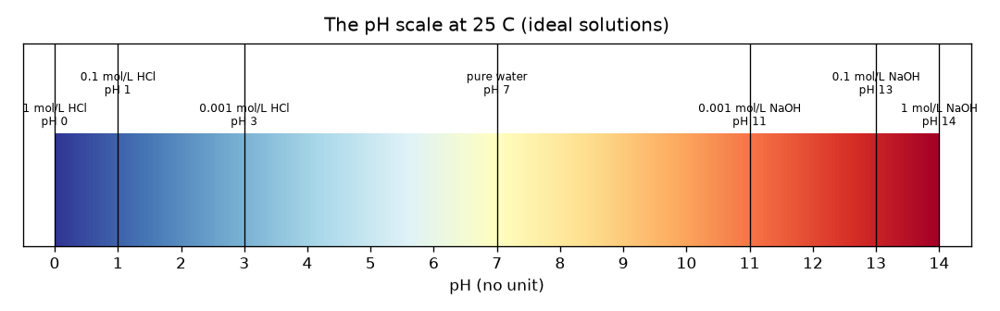
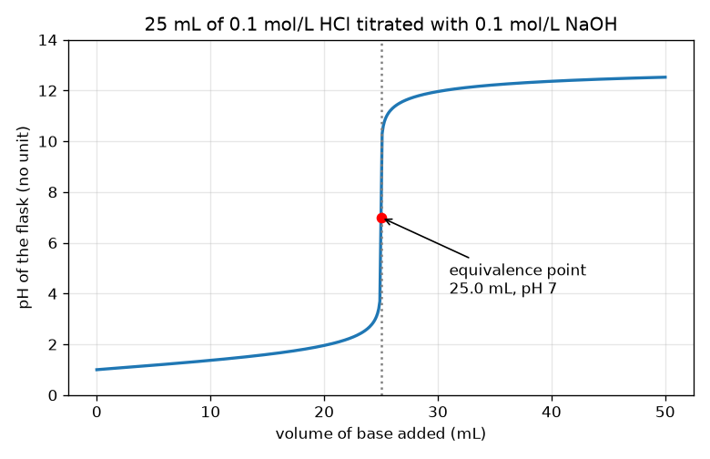

# సెషన్ 1: ఆమ్లాలు, క్షారాలు, మరియు టైట్రేషన్ వక్రం ఆకారం

[Session 1 — हिन्दी](README.hi.md) · [Session 1 — മലയാളം](README.ml.md) · [Session 1 — தமிழ்](README.ta.md) · [Session 1 — తెలుగు](README.te.md)

*స్థాయి 1 (భావనాత్మక ఇంటరాక్టివ్ మోడల్) · సుమారు 60 నిమిషాలు · openphtitration*

> ఇది సరళీకృత విద్యా నమూనా. ఇది ధృవీకరించబడిన (validated) డిజైన్ సాధనం కాదు; నిజమైన నిర్మాణాలు, విద్యుత్ వ్యవస్థలు, వాహనాలు, పారిశ్రామిక ప్రక్రియలు లేదా వైద్య నిర్ణయాల కోసం దీన్ని ఉపయోగించవద్దు.

**ముందస్తు అవసరాలు (Prerequisites)**

- నిష్పత్తులు మరియు 10 యొక్క ఘాతాలు.
- మీరు PRIMER.md చదివి `python start.py 1` ను ఒకసారి నడిపారు.

**అభ్యాస లక్ష్యాలు (Learning objectives).** ఈ సెషన్ తర్వాత మీరు వీటిని చేయగలరు:

- pH దేన్ని కొలుస్తుందో చెప్పి, 0 నుండి 14 వరకు స్కేల్‌ను చదవడం, pH 7 తటస్థం.
- బలమైన ఆమ్లం లేదా బలమైన క్షారం యొక్క pH ను దాని గాఢత నుండి లెక్కించడం.
- ఆమ్లానికి క్షారం కలిపినప్పుడు pH మొదట నెమ్మదిగా, తర్వాత హఠాత్తుగా ఎందుకు పెరుగుతుందో వివరించడం.
- టైట్రేషన్ వక్రంలో, మోల్ సమతుల్యత నుండి సమతుల్య బిందువు (equivalence point) ను కనుగొనడం.

## A. నిజ ప్రపంచ సమస్య
ఒక ప్రయోగశాలలో ఒక సీసా ఆమ్లం ఉంది, అది ఎంత బలమైనదో తెలుసుకోవాలి. వారు దాన్ని రుచి చూడలేరు, లేబుల్ పోయింది. కాబట్టి వారు గాజు గొట్టం (బ్యూరెట్) నుండి తెలిసిన బలం గల క్షారాన్ని కొద్ది కొద్దిగా కలిపి ఫ్లాస్క్‌లోని ద్రవాన్ని గమనిస్తారు. మొదట దాదాపు ఏమీ జరగనట్టు కనిపిస్తుంది; ఆ తర్వాత మరో చుక్క కలిపితే అంతా మారిపోతుంది. ఆ హఠాత్తు మార్పు ఆమ్లం బలాన్ని ఎలా బయటపెడుతుంది? ఇది అనుకరణ గురించిన సాధారణ విద్య: నిజమైన ఆమ్లాలు, క్షారాలను ఉపాధ్యాయుడు, కళ్ళద్దాలు, సరైన పరికరాలతో మాత్రమే నిర్వహించాలి.

## B. భావన మరియు సిద్ధాంతం
నీటిలో ఎల్లప్పుడూ కొన్ని హైడ్రోజన్ అయాన్లు (H+) ఉంటాయి. ఆమ్లం వాటిని ఎక్కువ చేర్చుతుంది, క్షారం వాటిని తొలగిస్తుంది. దీన్ని కొలిచే సంఖ్య pH: pH = -log10[H+], ఇక్కడ [H+] అంటే mol/L లో హైడ్రోజన్ అయాన్ల గాఢత. లాగరిథమ్ వల్ల, pH లో 1 తగ్గడం అంటే పది రెట్లు H+ అని అర్థం. pH 7 కంటే తక్కువ ద్రావణం ఆమ్లీయం, 7 తటస్థం (25 C వద్ద స్వచ్ఛమైన నీరు), 7 కంటే ఎక్కువ క్షారీయం. హైడ్రోక్లోరిక్ ఆమ్లం (HCl) వంటి బలమైన ఆమ్లం పూర్తిగా విడిపోతుంది, కాబట్టి 0.1 mol/L HCl కి [H+] = 0.1 మరియు pH 1. టైట్రేషన్‌లో బ్యూరెట్ నుండి తెలిసిన గాఢత Cb గల క్షారం, గాఢత Ca గల Va mL ఆమ్లంలో కలుపబడుతుంది. ఆమ్లం, క్షారం మోల్‌కు మోల్ చొప్పున ఒకదాన్ని ఒకటి రద్దు చేసుకుంటాయి. ఆమ్లం మిగిలి ఉన్నంతవరకు pH తక్కువగా ఉంటుంది. కలిపిన క్షారం మోల్‌లు ఆమ్లం మోల్‌లకు సమానమయ్యే ఖచ్చితమైన క్షణంలో మనం సమతుల్య బిందువు వద్ద ఉంటాం; దాని వెంటనే క్షారం మిగులుతుంది, pH ఎక్కువ. మిగిలినది మొత్తం ఘనపరిమాణంతో భాగించబడుతుంది, కాబట్టి చాలా ఆమ్లం ఉన్నప్పుడు pH నెమ్మదిగా, మిగులు చాలా చిన్నదైనప్పుడు చాలా వేగంగా మారుతుంది.

| గుర్తు | అర్థం | యూనిట్ |
|---|---|---|
| pH | ఆమ్లత్వ కొలత, -log10[H+] | యూనిట్ లేదు |
| [H+] | హైడ్రోజన్ అయాన్ల గాఢత | mol/L |
| Ca, Va | ఫ్లాస్క్‌లోని ఆమ్లం గాఢత మరియు ఘనపరిమాణం | mol/L, mL |
| Cb, Vb | కలిపిన క్షారం గాఢత మరియు ఘనపరిమాణం | mol/L, mL |
| Ve | సమతుల్య ఘనపరిమాణం: ఆమ్లమంతటినీ రద్దు చేయడానికి కావలసిన క్షారం | mL |

**ఊహలు (Assumptions)**

- బలమైన ఆమ్లం మరియు బలమైన క్షారం: రెండూ పూర్తిగా విడిపోతాయి.
- 25 C, కాబట్టి స్వచ్ఛమైన నీటికి pH 7.
- ఆదర్శ ద్రావణాలు: సరళ గాఢతలు వాడబడతాయి (1 mol/L లేదా అంతకంటే ఎక్కువ ఉన్న నిజమైన బలమైన ద్రావణాలు విచలనం చెందుతాయి).
- ఘనపరిమాణాలు సరళంగా కూడుతాయి.

$$ \mathrm{pH}=-\log_{10}[\mathrm{H}^+] $$

$$ x=\frac{C_aV_a-C_bV_b}{V_a+V_b}\quad(\text{leftover acid if }x>0,\ \text{leftover base if }x<0) $$

$$ C_aV_a=C_bV_e\quad\Rightarrow\quad V_e=\frac{C_aV_a}{C_b} $$

## C. దృశ్య వివరణ
మొదటి చిత్రం 0 నుండి 14 వరకు రంగుల బార్‌గా pH స్కేల్, తెలిసిన ద్రావణాలు దానిపై ఉంచబడ్డాయి: 0 వద్ద 1 mol/L HCl, 7 వద్ద స్వచ్ఛమైన నీరు, 14 వద్ద 1 mol/L NaOH. రెండవ చిత్రం 0.1 mol/L NaOH తో 25 mL 0.1 mol/L HCl టైట్రేషన్ వక్రం. మొదటి 24.9 mL లో వక్రం pH 1 నుండి pH 3.7 కి నెమ్మదిగా ఎక్కుతుంది, తర్వాత తదుపరి 0.2 mL లో 3.7 నుండి 10.3 కి దూకుతుంది, pH 12 దగ్గర మళ్ళీ సమతలమవుతుంది. 25 mL, pH 7 వద్ద ఉన్న ఎరుపు బిందువు సమతుల్య బిందువు.

*0 నుండి 14 వరకు pH స్కేల్, బలమైన ఆమ్ల, క్షార ద్రావణాలు దానిపై ఉంచబడ్డాయి.*

*0.1 mol/L NaOH తో 25 mL 0.1 mol/L HCl టైట్రేట్ చేయడం: నెమ్మదిగా పెరుగుదల, హఠాత్తు దూకుడు, సమతలమవడం; ఎరుపు బిందువు సమతుల్య బిందువు.*

## D. ఇంటరాక్టివ్ అనుకరణ
పాఠాన్ని నడపండి (`python start.py 1`), తర్వాత లైవ్ యాప్‌ను తెరవండి: [సెషన్ 1: ఆమ్లానికి క్షారం కలపడం](https://krunalpanchal1995.github.io/pan-iit-oss/openphtitration/session-01/) (లేదా ఈ ఫోల్డర్‌లోని `app.html`). క్షార ఘనపరిమాణాన్ని లాగి బ్యూరెట్ స్థాయి తగ్గడం, ఫ్లాస్క్ రంగు ఎరుపు (ఆమ్లం) నుండి ఆకుపచ్చ (తటస్థం) ద్వారా ఊదా (క్షారం) కి మారడం గమనించండి. తర్వాత వక్ర వీక్షణను తెరిచి నిటారు దూకుడు ఎక్కడ ఉందో చూడండి. ఆమ్ల, క్షార గాఢతలను మార్చి దూకుడు ఎలా కదులుతుందో చూడండి.

**సవాలు.** ఆమ్లాన్ని ఖచ్చితంగా తటస్థీకరించండి: క్షారం మోల్‌లు ఆమ్లం మోల్‌లకు సమానమయ్యేలా (Cb x Vb = Ca x 25, 0.01 mmol లోపు) క్షార ఘనపరిమాణం మరియు గాఢతలను అమర్చండి, ఫ్లాస్క్ pH 7 చూపాలి.

## E. ఉదాహరణ సమస్య మరియు ప్రయోగం
**సమస్య.** 25 mL 0.1 mol/L HCl ను 0.1 mol/L NaOH తో టైట్రేట్ చేస్తారు. 10 mL క్షారం తర్వాత pH మరియు సమతుల్య ఘనపరిమాణం కనుగొనండి.

1. ప్రారంభ ఆమ్లం మోల్‌లు: 0.1 mol/L x 25 mL = 2.5 mmol.
2. కలిపిన క్షారం మోల్‌లు: 0.1 mol/L x 10 mL = 1.0 mmol. అవి ఒకటికి ఒకటి చొప్పున రద్దవుతాయి, కాబట్టి 2.5 - 1.0 = 1.5 mmol ఆమ్లం మిగిలి ఉంది.
3. మొత్తం ఘనపరిమాణం = 25 + 10 = 35 mL, కాబట్టి [H+] = 1.5 / 35 = 0.04286 mol/L.
4. pH = -log10(0.04286) = 1.368.
5. సమతుల్యత: Ca Va = Cb Ve ఇచ్చేది Ve = 0.1 x 25 / 0.1 = 25 mL, అక్కడ నీరు, లవణం మాత్రమే మిగులుతాయి, pH = 7.

**జవాబు.** 10 mL తర్వాత pH 1.368; సమతుల్య ఘనపరిమాణం 25 mL (pH 7).

**ప్రయోగం.** పాఠశాల ప్రయోగశాలలో (పర్యవేక్షణతో) ఉపాధ్యాయుడు పలుచని హైడ్రోక్లోరిక్ ఆమ్లాన్ని పలుచని సోడియం హైడ్రాక్సైడ్‌తో pH మీటర్ ద్వారా టైట్రేట్ చేసి ఈ వక్రంతో పోలుస్తారు. నిజమైన వక్రం మూలలో కొంచెం మృదువుగా ఉంటుంది, 0 mL వద్ద pH ఖచ్చితంగా 1 కాదు, ఎందుకంటే నిజమైన ద్రావణాలు ఆదర్శమైనవి కావు, మీటర్‌కు సుమారు 0.02 నుండి 0.05 pH అనిశ్చితి ఉంటుంది. నమూనా ఒక శుద్ధ ఆదర్శీకరణ; ప్రయోగశాల కొలత శబ్దాన్ని మరియు ఆదర్శం కాని ప్రవర్తనను జోడిస్తుంది.

## F. మూల్యాంకనం మరియు డిజైన్ సవాలు
**ప్రశ్న రకం A: భావనాత్మక.** క్షారం మొదటి 20 mL కి pH దాదాపు మారకుండా ఉండి, తర్వాత 25 mL దగ్గర ఒక మిల్లీలీటర్ భిన్నంలో దూకడం ఎందుకు?

సూచన

ఇంకా ఎన్ని మోల్‌ల ఆమ్లం మిగిలి ఉందో, చాలా చిన్న మిగులును ఘనపరిమాణంతో భాగిస్తే ఏమవుతుందో ఆలోచించండి.

దశలవారీ పరిష్కారం

pH లాగరిథమిక్ స్కేల్‌లో మిగిలిన H+ గాఢతపై ఆధారపడుతుంది. ప్రారంభంలో చాలా ఆమ్లం మిగిలి ఉంది, కాబట్టి ఇంకొంచెం తొలగిస్తే గాఢత చిన్న కారకం మాత్రమే మారుతుంది (20 mL వద్ద pH 1.0 నుండి 1.95 వరకు). సమతుల్య బిందువు దగ్గర మిగులు చాలా చిన్నది, కాబట్టి మరో 0.1 mL దాన్ని పెద్ద కారకంతో మారుస్తుంది, దానికి మించి మిగిలేది క్షారం అవుతుంది. కొన్ని చుక్కలే ఫ్లాస్క్‌ను 1e-4 mol/L H+ గాఢత నుండి 1e-4 mol/L OH- గాఢతకు తీసుకెళ్తాయి, ఇది 6.6 pH యూనిట్ల మార్పు.

**ప్రశ్న రకం B: సంఖ్యాత్మక.** 25 mL 0.1 mol/L HCl లో 20 mL 0.1 mol/L NaOH కలిపిన తర్వాత pH ఎంత? యూనిట్లు చూపి, జవాబు సహేతుకమేనా అని తనిఖీ చేయండి.

సూచన

ఆమ్లం, క్షారం మిల్లీమోల్‌లు లెక్కించి, తీసివేసి, మొత్తం ఘనపరిమాణంతో భాగించండి.

దశలవారీ పరిష్కారం

ఆమ్లం 2.5 mmol, క్షారం 2.0 mmol, 45 mL లో 0.5 mmol మిగులు, కాబట్టి [H+] = 0.01111 mol/L, pH = 1.954. సహేతుకత తనిఖీ (sanity check): ఇది ప్రారంభ pH 1 కంటే ఎక్కువ (కొంత ఆమ్లం పోయింది) కానీ ఇంకా ఆమ్లీయమే, 7 కంటే చాలా తక్కువ, సమతుల్య బిందువుకు ముందు ఆశించినట్లే.

**ప్రశ్న రకం C: గ్రాఫ్, అనుకరణ వివరణ.** టైట్రేషన్ వక్రంలో, 24.9 mL మరియు 25.1 mL మధ్య pH ఎంత మారుతుంది, చివరికి చేరుతున్నప్పుడు బ్యూరెట్ చదవడం గురించి అది ఏమి చెబుతుంది?

సూచన

lesson.py అవుట్‌పుట్ నుండి 24.9 mL మరియు 25.1 mL వద్ద pH చదవండి.

దశలవారీ పరిష్కారం

pH 3.698 నుండి 10.300 కి వెళ్తుంది, కేవలం 0.2 mL లో 6.6 యూనిట్ల మార్పు. సమతుల్య బిందువు దగ్గర 0.05 mL బ్యూరెట్ చదువు లోపం pH ను అనేక యూనిట్లు మారుస్తుంది, కాబట్టి సమతుల్య ఘనపరిమాణాన్ని చాలా ఖచ్చితంగా కనుగొనవచ్చు, కానీ చివరికి చేరుతున్నప్పుడు క్షారాన్ని చుక్క చుక్కగా కలపాలి.

**ప్రశ్న రకం D: డిజైన్, ఆప్టిమైజేషన్ సవాలు.** డిజైన్: మీ వద్ద 25 mL 0.1 mol/L ఆమ్లం ఉంది, 0.1 mol/L లేదా 0.2 mol/L క్షారాన్ని ఎంచుకోవచ్చు. ఏది ఎంచుకుంటారు, ఎందుకు? ప్రతిదానికి సమతుల్య ఘనపరిమాణం మరియు రాజీ (trade-off) చెప్పండి.

సూచన

ప్రతిదానికి Ve లెక్కించి, 0.05 mL బ్యూరెట్ చదువు లోపాన్ని ప్రతి ఘనపరిమాణంతో పోల్చండి.

దశలవారీ పరిష్కారం

0.1 mol/L క్షారంతో Ve = 25 mL, 0.2 mol/L క్షారంతో 12.5 mL. 0.05 mL చదువు లోపం 25 mL లో 0.2 శాతం, కానీ 12.5 mL లో 0.4 శాతం, కాబట్టి పలుచని క్షారం చిన్న సాపేక్ష లోపం ఇస్తుంది, కానీ దానికి పెద్ద బ్యూరెట్ ఘనపరిమాణం, ఎక్కువ సేపు టైట్రేషన్ కావాలి. గాఢమైన క్షారం సమయాన్ని, ద్రవాన్ని ఆదా చేస్తుంది, కానీ సాపేక్ష చదువు లోపాన్ని రెట్టింపు చేస్తుంది. ఊహ: రెండు సందర్భాల్లోనూ ఒకే చదువు లోపం.

[RUBRIC.md](../../RUBRIC.md) తో స్వయంగా స్కోర్ చేసుకోండి. కాగితంపై చేయడానికి [కార్యాచరణ షీట్](activity_sheet.md) ప్రింట్ చేయండి.

## సాధారణ అపోహలు
| సాధారణ అపోహ | వాస్తవంగా సరైనది |
|---|---|
| pH 7 ఉన్న ద్రావణంలో అయాన్లు లేవు. | 25 C వద్ద స్వచ్ఛమైన నీటిలో 1e-7 mol/L H+ మరియు అంతే OH- ఉన్నాయి; తటస్థం అంటే సమాన మొత్తాలు, ఏమీ లేవని కాదు. |
| pH 2, pH 3 కంటే కొంచెం మాత్రమే ఎక్కువ ఆమ్లీయం. | అది పది రెట్లు H+. స్కేల్ లాగరిథమిక్. |
| క్షారం కలిపినప్పుడు pH స్థిరంగా పెరుగుతుంది. | అది నెమ్మదిగా పెరిగి, సమతుల్య బిందువు వద్ద దూకి, మళ్ళీ సమతలమవుతుంది. |
| సూచిక (indicator) రంగు మారే చోటే సమతుల్య బిందువు. | క్షారం మోల్‌లు ఆమ్లం మోల్‌లకు సమానమయ్యే చోటే సమతుల్య బిందువు; సూచిక రంగు మార్పు (అంత్య బిందువు, endpoint) దానికి వీలైనంత దగ్గరగా వచ్చేలా ఎంచుకోవాలి. |

## పదకోశం (Glossary)
- **pH**: ఆమ్లత్వ కొలత: హైడ్రోజన్-అయాన్ గాఢత యొక్క 10 ఆధార లాగరిథమ్ యొక్క రుణాత్మకం
- **ఆమ్లం (acid)**: నీటి హైడ్రోజన్-అయాన్ గాఢతను పెంచే పదార్థం
- **క్షారం (base)**: దాన్ని తగ్గించే పదార్థం (అది హైడ్రాక్సైడ్ అయాన్లను చేర్చుతుంది)
- **టైట్రేషన్ (titration)**: తెలిసిన గాఢత గల ద్రావణాన్ని మరొకదానిలో అవి సరిగ్గా రద్దయ్యే వరకు కలపడం
- **బ్యూరెట్ (burette)**: చిన్న కొలిచిన పరిమాణాలలో ద్రవాన్ని కలపడానికి ఉపయోగించే, కుళాయి ఉన్న, గుర్తులు వేసిన గాజు గొట్టం
- **సమతుల్య బిందువు (equivalence point)**: కలిపిన క్షారం మోల్‌లు ప్రారంభ ఆమ్లం మోల్‌లకు సమానమయ్యే క్షణం

## ముగించండి
1. [exercises.md](exercises.md) లోని మూడు కోడింగ్ పనులు చేయండి.
2. మీ మార్పుల తర్వాత `python start.py 1` ను మళ్ళీ నడపండి. అది చెక్‌పాయింట్‌తో ముగుస్తుంది; అది `PASS` ముద్రించినప్పుడు మీరు పూర్తి చేశారు. (చెక్‌పాయింట్ మాత్రమే: `python start.py check 1`.)

తదుపరి: [సెషన్ 2](../session-02/README.md)
