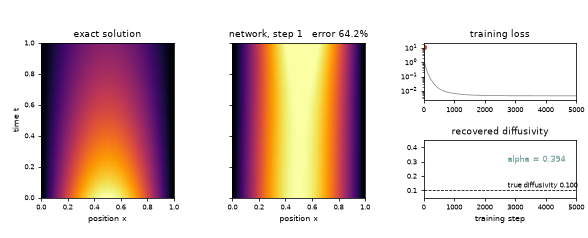
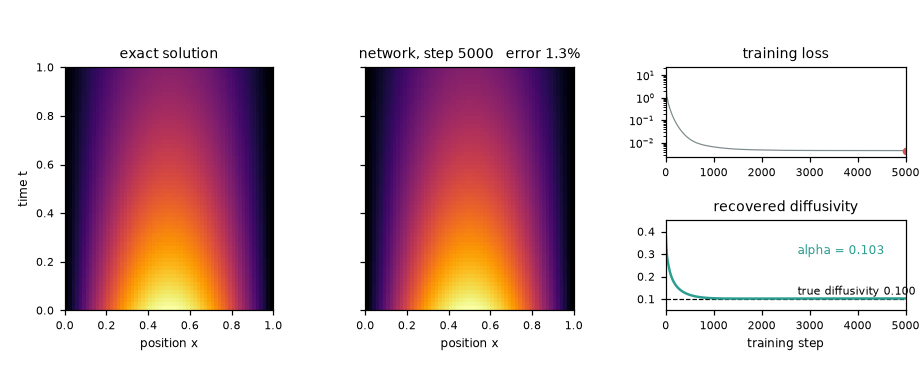
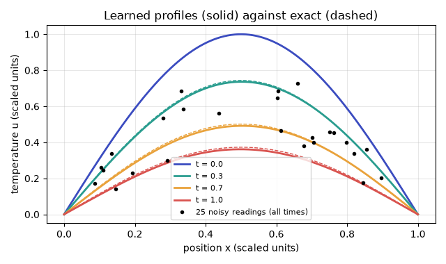
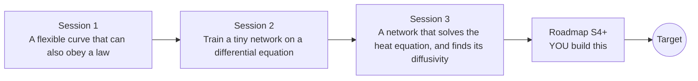

# openpinn

[](https://github.com/KrunalPanchal1995/pan-iit-oss/actions/workflows/tests.yml)   [](https://colab.research.google.com/github/KrunalPanchal1995/pan-iit-oss/blob/main/openpinn/sessions/session-01/lesson.ipynb) [](https://krunalpanchal1995.github.io/pan-iit-oss/openpinn/)

**Teach a network the heat equation, then make it find the physics, in three sessions.**

openpinn teaches physics-informed neural networks from scratch: a tiny network trained in plain numpy to obey a differential equation, checked against the exact answer and a classical solver, and used backwards to recover an unknown diffusivity.

- **Start from a curve.** Session 1 needs only school algebra: a network is a weighted sum of smooth bumps, and a law is extra rows in a fit.
- **See the maths, not a black box.** The network, its derivatives and its gradients are written by hand in numpy and checked against finite differences.
- **Know when it is worth it.** Every result is compared with the exact answer and a classical solver, including where the network loses.
- **Build the missing half.** The repo stops at Session 3 on purpose; the roadmap shows the path to the Target.

[Target](#the-target) · [Who is this for](#who-is-this-for) · [Quick start](#quick-start) · [Sessions](#sessions) · [Roadmap](#roadmap) · [Contribute](#contribute) · [Explainer PDF](docs/explainer.pdf)

> **This repo is incomplete on purpose.** Sessions 1 to 3 are here and fully working. The finished Target below is a preview of what the community can build next. We show you the path, not the code. Sessions 4 and up are yours.

## The Target

A heat-map of the temperature u(x, t) in a rod appears out of nothing as a physics-informed network trains: on the left the exact solution, next to it the network's version sharpening step by step. On the right the loss falls and the diffusivity, which starts at a wrong guess, settles on the true value, found only from 25 sparse noisy readings plus the heat equation. Your goal over the coming sessions: build that yourself, with the end temperatures enforced exactly.



*Target: a physics-informed network learns the heat-map and the diffusivity (animation)*



*Target, final frame: exact solution, network, loss and recovered diffusivity*



*Target: profiles of the network against the exact solution, with the noisy readings*

Try it live:

- [Math Visual Studio: partial differential equations (Atlas S18)](https://krunalpanchal1995.github.io/studio/#atlas?ch=S18&ex=1)
- [Math Visual Studio: open the Studio](https://krunalpanchal1995.github.io/studio/)

How the Target was made is shown only as a path in [promo/roadmap.md](promo/roadmap.md).

## Who is this for
**higher secondary to advanced undergraduate (levels 4-6).** Topic area: Artificial Intelligence, Data Science and Robotics.

Prerequisites:

- School algebra and the idea of a derivative (slope) in the first session; second derivatives are explained when needed.
- Python 3.10 or newer; if `python --version` works, you are ready. PRIMER.md explains the rest.
- No prior machine learning, GitHub or PDE experience is needed.

New to Python? Read [PRIMER.md](PRIMER.md) first (10 minutes).

## Quick start

No installation knowledge needed. You need [Git](https://git-scm.com/downloads) and [Python 3.10+](https://www.python.org/downloads/) (Windows: tick "Add Python to PATH"). On Mac and Linux type `python3` wherever this page says `python`.

```bash
git clone https://github.com/KrunalPanchal1995/pan-iit-oss.git
cd pan-iit-oss/openpinn
python start.py 1
```

`start.py` creates a private environment, installs what is needed and runs Session 1 with its checkpoint. Next: `python start.py 2`, `python start.py 3`, or `python start.py test` to check everything. Only a checkpoint: `python start.py check 1`.

<!-- friendly-help -->
<details>
<summary><b>Not working? Common fixes (no Git, "python not found", no internet)</b></summary>

- **No Git?** You do not need it. On the main page of this collection click the green **Code** button, then **Download ZIP**, unzip it, open a terminal inside the folder `pan-iit-oss-main/openpinn` and run `python start.py 1`. The ZIP holds every project, so it is large; the live apps need no download at all.
- **"python is not recognized" or "command not found".** On Windows try `py start.py 1`. On Mac and Linux try `python3 start.py 1`. If neither works, install Python from [python.org](https://www.python.org/downloads/) and tick "Add Python to PATH".
- **Needs internet once.** The first run downloads NumPy and Matplotlib into a private folder (`.venv`); after that it works offline.
- **Rather not install anything?** Open the [live apps](https://krunalpanchal1995.github.io/pan-iit-oss/openpinn/) in your browser, or use the Colab badge at the top of this page.
- **Still stuck?** [Open an issue](https://github.com/KrunalPanchal1995/pan-iit-oss/issues/new?title=%5Bopenpinn%5D%20) with your operating system and the message you see. Questions from beginners are welcome.

</details>

Four lines show the exact heat-equation answer that every network in this repo is judged against (they work as they are): Save it as `try.py` and run it with `python start.py run try.py` (this uses the private environment, where NumPy is installed):

```python
import numpy as np
x = np.linspace(0, 1, 5)                       # five places along the rod
t, alpha = 1.0, 0.1                            # time and diffusivity (scaled units)
u = np.sin(np.pi * x) * np.exp(-alpha * np.pi**2 * t)
print(np.round(u, 3))                          # -> [0.    0.264 0.373 0.264 0.   ]
```

Every session also opens in your browser with sliders (no install): [live apps](https://krunalpanchal1995.github.io/pan-iit-oss/openpinn/). Or use the Colab badge above for the notebook.

## Sessions

| # | Session | Model level | Time | Live app |
|---|---|---|---|---|
| 1 | [A flexible curve that can also obey a law](sessions/session-01/README.md) | Level 1: conceptual interactive model | 60 min | [open](https://krunalpanchal1995.github.io/pan-iit-oss/openpinn/session-01/) |
| 2 | [Train a tiny network on a differential equation](sessions/session-02/README.md) | Level 2: mathematical engineering model | 75 min | [open](https://krunalpanchal1995.github.io/pan-iit-oss/openpinn/session-02/) |
| 3 | [A network that solves the heat equation, and finds its diffusivity](sessions/session-03/README.md) | Level 3: simulation and validation | 90 min | [open](https://krunalpanchal1995.github.io/pan-iit-oss/openpinn/session-03/) |

Each session follows the same six steps: A real-world problem, B concept and theory, C visual explanation, D interactive simulation, E worked example and experiment, F assessment and design challenge. Each ends with `checkpoint.py`, which prints `PASS` or `FAIL` against reference numbers. Session 3 also contains the real-world mini-project: **Recover the diffusivity of a rod from noisy temperature readings**.

## Architecture



| Folder or file | What is inside |
|---|---|
| `sessions/` | three sessions: README (A-F), `lesson.py`, notebook, live app, exercises, activity sheet, checkpoint |
| `promo/` | the Target: media, live links, and the roadmap (path only) |
| `docs/` | `explainer.tex` and the built `explainer.pdf` |
| `tests/` | runs every lesson and checkpoint headless |
| `start.py` | one command to set up and run anything |
| `QUALITY.md`, `RUBRIC.md` | the quality checklist and the scoring rubric |
| `.github/` | CI, PDF build, Pages deploy, issue and PR templates |

## Roadmap

| Milestone | What you will build | Difficulty |
|---|---|---|
| Session 4: Fourier features for fast-varying solutions | The heat-equation network with sine and cosine features of x added to its input. | intermediate |
| Session 5: Exact boundary and initial conditions | An ansatz such as u = sin(pi x) + t x (1 - x) N(x, t) with derivatives worked out by hand. | intermediate |
| Session 6: A trustworthy inverse estimate | An inverse run with a stopping rule and an error bar from several seeds. | advanced |
| Session 7: Two space dimensions | A network u(x, y, t) with a second derivative in each direction, checked against finite differences. | advanced |

Full detail with a checkpoint per milestone: [promo/roadmap.md](promo/roadmap.md).

## Contribute
New to GitHub? Read [CONTRIBUTING.md](CONTRIBUTING.md); it starts from zero. Pick an issue labelled `good first issue`. Translations into Hindi, Telugu, Tamil and Malayalam are welcome.

<details>
<summary>Development</summary>

```bash
python start.py test        # runs every lesson and checkpoint
```
Lessons use `# %%` cell markers so they open as notebooks in VS Code. See [QUALITY.md](QUALITY.md) for the standard every session meets.
</details>

## License
MIT. See [LICENSE](LICENSE). Media in `promo/media` is (c) Krunal Panchal, CC BY 4.0.

## Acknowledgments
Part of the [PAN IIT OSS](https://hellofoss.tech-iitb.org/projects) open-source teaching collection, modelled on the structure of [openspline](https://github.com/openspline/openspline). Built on ideas from the Math Visual Studio at https://krunalpanchal1995.github.io/studio/.
