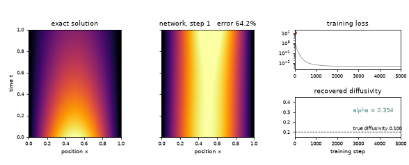
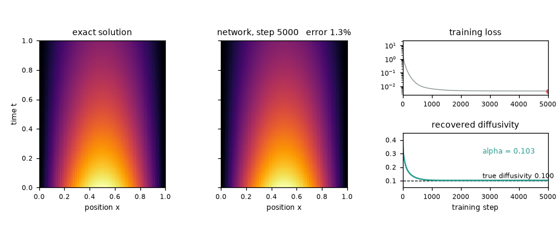
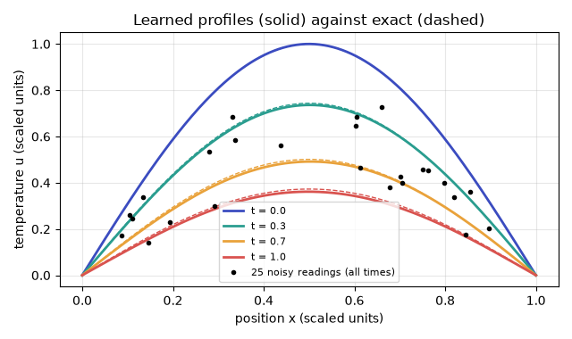

# What you are building toward

A heat-map of the temperature u(x, t) in a rod appears out of nothing as a physics-informed network trains: on the left the exact solution, next to it the network's version sharpening step by step. On the right the loss falls and the diffusivity, which starts at a wrong guess, settles on the true value, found only from 25 sparse noisy readings plus the heat equation. Your goal over the coming sessions: build that yourself, with the end temperatures enforced exactly.

*Target: a physics-informed network learns the heat-map and the diffusivity (animation)*

*Target, final frame: exact solution, network, loss and recovered diffusivity*

*Target: profiles of the network against the exact solution, with the noisy readings*

These results come from a private reference build. The code is not published; the roadmap shows the path so you can build your own.

Live links:

- [Math Visual Studio: partial differential equations (Atlas S18)](https://krunalpanchal1995.github.io/studio/#atlas?ch=S18&ex=1)
- [Math Visual Studio: open the Studio](https://krunalpanchal1995.github.io/studio/)
