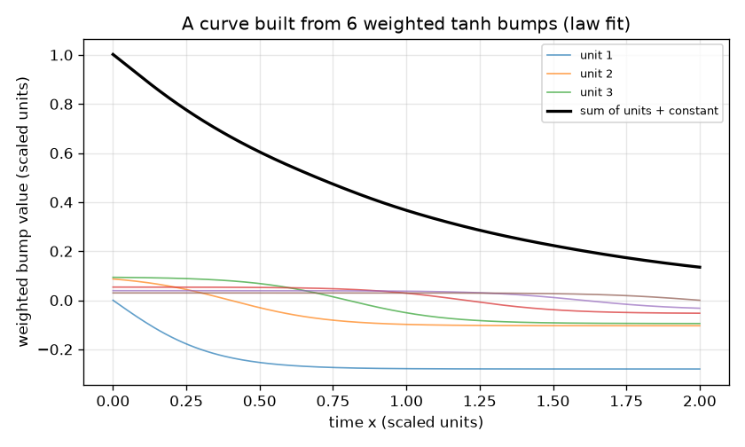
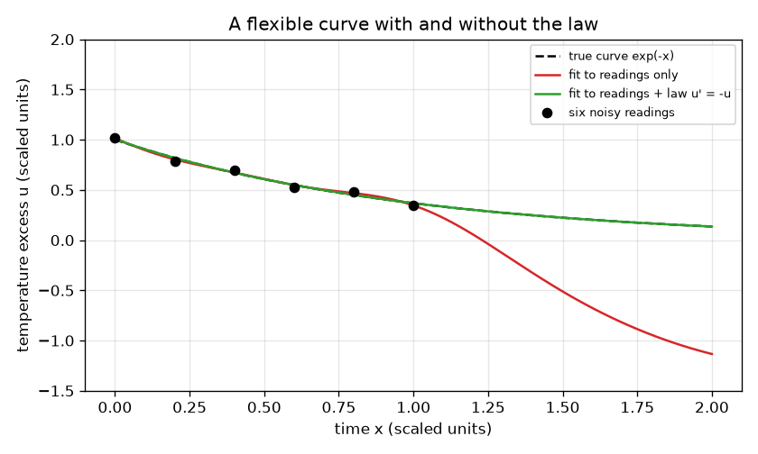

# सत्र 1: एक लचीला वक्र जो एक नियम का पालन भी कर सकता है

*स्तर 1 (वैचारिक इंटरैक्टिव मॉडल) · लगभग 60 मिनट · openpinn*

> यह एक सरलीकृत शैक्षिक मॉडल है। यह कोई प्रमाणित डिज़ाइन उपकरण नहीं है और इसका उपयोग वास्तविक संरचनाओं, बिजली की स्थापनाओं, वाहनों, औद्योगिक प्रक्रियाओं या चिकित्सा निर्णयों के लिए नहीं किया जाना चाहिए।

**पूर्वापेक्षाएँ (Prerequisites)**

- स्कूल का बीजगणित: फलन और ग्राफ़।
- ढाल (slope) (अवकलज, derivative) का विचार; कलन (calculus) की किसी तकनीक की ज़रूरत नहीं।
- आपने PRIMER.md पढ़ लिया है और `python start.py 1` एक बार चला लिया है।

**सीखने के उद्देश्य।** इस सत्र के बाद आप:

- समझा सकेंगे कि नेटवर्क का आउटपुट चिकने उभारों (bumps) का भारित योग (weighted sum) कैसे है, और अधिक उभार वक्र को अधिक लचीला क्यों बनाते हैं।
- उस वक्र को न्यूनतम वर्ग (least squares) विधि से छह शोरयुक्त पाठ्यांकों पर फ़िट कर सकेंगे और देख सकेंगे कि पाठ्यांकों के बीच और उनसे परे वह कहाँ ग़लत होता है।
- एक भौतिकी नियम को उसी फ़िट में अतिरिक्त पंक्तियों के रूप में जोड़ सकेंगे और पूरी सीमा पर सुधार माप सकेंगे।
- नियम की शक्ति और उभारों की संख्या में समझौते (trade-off) का वर्णन कर सकेंगे।

## A. वास्तविक दुनिया की समस्या
एक कप चाय को उसके पहले मिनट में छह बार मापा जाता है और पाठ्यांक शोरयुक्त हैं। आपको अगले पूरे मिनट के लिए भी कमरे के तापमान से ऊपर के तापमान आधिक्य (excess) का पूर्वानुमान लगाना है। एक लचीला वक्र सभी छह पाठ्यांकों के पास से गुज़र सकता है और फिर भी जहाँ पाठ्यांक नहीं हैं वहाँ बुरी तरह झूल सकता है। पर आप एक नियम भी जानते हैं: आधिक्य स्वयं के समानुपाती दर से घटता है। मापित (scaled) इकाइयों में नियम u' = -u है, जहाँ u' वक्र की ढाल है। यही भौतिकी-सूचित नेटवर्कों (physics-informed networks) के पीछे का विचार है: वक्र को आँकड़े भी मोड़ते हैं और नियम भी। (केवल सामान्य शिक्षा: यह एक खिलौना मॉडल है, डिज़ाइन उपकरण नहीं।)

## B. अवधारणा और सिद्धांत
एक तंत्रिका-जाल (neural network) इकाई एक चिकना चरण (step) tanh(s) है, जो बहुत बाईं ओर -1, बहुत दाईं ओर +1 और s = 0 पर 0 है। इसे x - m से खिसकाने और एक तीक्ष्णता (steepness) से तेज़ करने पर एक उभार मिलता है। H उभारों से बना वक्र u(x) = c_1 tanh(3 (x - m_1)) + ... + c_H tanh(3 (x - m_H)) + c_0 है। इस सत्र में केंद्र m_j स्थिर हैं, 0 से 2 पर समान रूप से फैले हुए, और केवल भार (weights) c चुने जाते हैं। न्यूनतम वर्ग वे भार चुनता है जो (वक्र - पाठ्यांक)^2 के योग को सबसे छोटा बनाते हैं; भारों के आकार पर एक बहुत छोटा दंड (penalty) योगों को समझदार रखता है। वक्र की ढाल फिर से एक भारित योग है, क्योंकि tanh(s) की ढाल 1 - tanh(s)^2 है। इसलिए कथन 'चुने हुए बिंदुओं पर ढाल + मान = 0' भी भारों में रैखिक समीकरणों का एक समुच्चय है। हम उन्हें शक्ति lam के साथ फ़िट में जोड़ते हैं: यह एक भौतिकी-सूचित फ़िट है।

| प्रतीक | अर्थ | इकाई |
|---|---|---|
| x | समय (मापित) | विमाहीन |
| u(x) | तापमान आधिक्य (मापित) | विमाहीन |
| H | tanh उभारों (इकाइयों) की संख्या | गिनती |
| c_j | उभार j का भार | विमाहीन |
| m_j | उभार j का केंद्र | x जैसी ही इकाई |
| lam | आँकड़ों की तुलना में नियम की शक्ति | विमाहीन |

**मान्यताएँ (Assumptions)**

- वास्तविक नियम u' = -u है और u मापित इकाइयों में मापा जाता है (वास्तविक शीतलन दर और तापमान मापन में समाहित हैं)।
- छह पाठ्यांकों में 0.03 या उससे कम का छोटा शोर है, जो एक बार के लिए स्थिर है।
- उभारों के केंद्र और तीक्ष्णता (3) स्थिर हैं; केवल भार फ़िट किए जाते हैं (यह सरलीकृत मॉडल है)।

$$ u(x)=c_0+\sum_{j=1}^{H} c_j\tanh\!\big(3\,(x-m_j)\big) $$

$$ u'(x)=\sum_{j=1}^{H} 3\,c_j\left(1-\tanh^2\!\big(3\,(x-m_j)\big)\right) $$

$$ \min_c\ \sum_{i=1}^{6}\big(u(x_i)-y_i\big)^2+\lambda\sum_{k=1}^{21}\big(u'(s_k)+u(s_k)\big)^2 $$

## C. दृश्य व्याख्या
पहला चित्र 0 से 2 की सीमा पर छह शोरयुक्त पाठ्यांक (बिंदु), वास्तविक वक्र exp(-x) (डैश वाला) और दो फ़िट किए गए वक्र दिखाता है। लाल वक्र केवल पाठ्यांकों का उपयोग करता है: यह सभी छह पाठ्यांकों के पास से गुज़रता है पर उनसे परे सत्य से बहुत दूर झूल जाता है। हरा वक्र नियम का पालन भी करता है और वास्तविक वक्र के ठीक ऊपर रहता है। दूसरा चित्र दिखाता है कि छह भारित उभार मिलकर एक वक्र कैसे बनाते हैं।

*एक वक्र भारित tanh उभारों और एक स्थिरांक का योग है।*

*वही बारह उभार छह शोरयुक्त पाठ्यांकों पर फ़िट किए गए: केवल पाठ्यांक (लाल) दूर झूल जाता है, नियम के साथ (हरा) सत्य का अनुसरण करता है।*

## D. इंटरैक्टिव सिमुलेशन
पाठ चलाइए (`python start.py 1`), फिर लाइव ऐप खोलिए: [सत्र 1: नियम के साथ और बिना एक वक्र](https://krunalpanchal1995.github.io/pan-iit-oss/openpinn/session-01/) (या इसी फ़ोल्डर में `app.html`)। दोनों दृश्यों के बीच बदलिए। वक्र दृश्य में नियम भार को 0 से बढ़ाइए और हरे वक्र को धूसर वक्र पर चिपकते देखिए जबकि लाल वक्र नहीं हिलता। फिर इकाइयों की संख्या घटाकर 3 कीजिए और देखिए कि बहुत कम उभारों के साथ नियम का पालन नहीं हो सकता।

**चुनौती।** हरे वक्र को वास्तविक वक्र से rms त्रुटि 0.01 के भीतर लाइए: कम से कम 6 इकाइयाँ और 0.5 से 5 के बीच नियम भार उपयोग कीजिए।

## E. हल किया गया उदाहरण और प्रयोग
**समस्या।** छह पाठ्यांकों पर 12 उभार फ़िट कीजिए, पहले केवल आँकड़ों के साथ और फिर नियम के साथ (lam = 1)। x के 0 से 2 तक exp(-x) के सापेक्ष rms त्रुटि, और |u' + u| के सबसे बड़े मान की तुलना कीजिए।

1. पाठ्यांक x = 0, 0.2, ..., 1.0 पर y = exp(-x) + शोर हैं। उदाहरण के लिए x = 0.4 पर पाठ्यांक exp(-0.4) + 0.025 = 0.6703 + 0.025 = 0.695 है।
2. केवल आँकड़े: 13 भारों (12 उभार और स्थिरांक) को 6 संख्याओं पर फ़िट होना है, इसलिए बहुत-से वक्र समान रूप से अच्छे फ़िट होते हैं; फ़िट हर पाठ्यांक के 0.05 के भीतर से गुज़रता है पर 0 से 2 पर exp(-x) के सापेक्ष उसकी rms त्रुटि 0.5 से ऊपर है।
3. नियम के साथ (0 से 2 पर 21 नियम पंक्तियाँ, lam = 1): rms त्रुटि 0.001 से नीचे गिर जाती है।
4. नियम के बिना सबसे बड़ा |u' + u| 2 से ऊपर है और उसके साथ 0.03 से नीचे: नियम-फ़िट वक्र लगभग हर जगह समीकरण का पालन करता है, केवल बिंदुओं पर नहीं।

**उत्तर।** केवल पाठ्यांक: rms त्रुटि 0.5 से ऊपर। पाठ्यांक और नियम: rms त्रुटि 0.001 से नीचे, और सबसे बड़ा |u' + u| 2 से ऊपर से गिरकर 0.03 से नीचे आता है।

**प्रयोग।** वास्तविक शीतलन आँकड़े लीजिए: एक कप में गर्म पानी डालिए, तीन मिनट तक हर 15 सेकंड पर थर्मामीटर पढ़िए और कमरे के तापमान से ऊपर के आधिक्य का आलेख बनाइए। नियम u' = -k u के साथ और बिना फ़िट कीजिए। असली कप नियम का केवल मोटे तौर पर पालन करते हैं (वाष्पन, स्वयं कप, हवा के झोंके), इसलिए नियम-फ़िट वक्र में एक छोटी व्यवस्थित त्रुटि (systematic error) होती है, जबकि यहाँ के मॉडल में कोई नहीं क्योंकि आँकड़े नियम और शोर से ही आए। मॉडल बनाम वास्तविकता: वक्र पर ज़बरदस्ती थोपा गया ग़लत नियम, कोई नियम न होने से बुरा है।

## F. मूल्यांकन और डिज़ाइन चुनौती
**प्रश्न प्रकार A: वैचारिक।** जो वक्र सभी छह पाठ्यांकों के 0.05 के भीतर से गुज़रता है, वह फिर भी दूसरे मिनट के लिए ख़राब पूर्वानुमान क्यों हो सकता है?

संकेत

अज्ञात भारों और पाठ्यांकों को गिनिए, और पूछिए कि जहाँ पाठ्यांक नहीं हैं वहाँ वक्र से क्या करने को कहा गया है।

चरण-दर-चरण हल

12 उभारों के साथ 13 भार हैं पर केवल 6 पाठ्यांक, इसलिए बहुत-से अलग-अलग वक्र पाठ्यांकों पर समान रूप से अच्छे फ़िट होते हैं, और फ़िट उनमें से एक को बिना किसी कारण के चुन लेता है कि समझदार वाले को प्राथमिकता दे। पाठ्यांकों के बाहर उसे कुछ भी नहीं बाँधता, इसलिए वह बुरी तरह झूल सकता है (यहाँ rms त्रुटि 0.5 से ऊपर)। नियम उन बिंदुओं पर अतिरिक्त समीकरण देता है जहाँ पाठ्यांक नहीं हैं, जिससे वह स्वतंत्रता हट जाती है।

**प्रश्न प्रकार B: संख्यात्मक।** एक उम्मीदवार वक्र u = exp(-0.9 x) है। x = 1 पर नियम अवशेष (residual) u' + u की गणना कीजिए। क्या उम्मीदवार u' = -u का हल है?

संकेत

exp(-0.9 x) की ढाल -0.9 exp(-0.9 x) है।

चरण-दर-चरण हल

u' + u = -0.9 exp(-0.9) + exp(-0.9) = 0.1 exp(-0.9) = 0.1 * 0.4066 = 0.0407 (मापित इकाइयाँ), शून्य नहीं, इसलिए उम्मीदवार क़रीब है पर हल नहीं। अवशेष वह राशि है जिसे भौतिकी-सूचित हानि (loss) वर्ग करके औसत निकालती है।

**प्रश्न प्रकार C: ग्राफ़ और सिमुलेशन की व्याख्या।** ऐप में, 6 इकाइयों के साथ, x = 2 पर लाल और हरे वक्रों की तुलना कीजिए। अंतर आपको क्या बताता है, और नियम चालू होने पर त्रुटि क्या है?

संकेत

नियम भार 0 और फिर 1 के साथ वक्र दृश्य खोलिए।

चरण-दर-चरण हल

नियम भार 0 पर x = 2 पर लाल वक्र धूसर से बहुत दूर है, क्योंकि वहाँ कोई पाठ्यांक पास नहीं है। भार 1 पर हरा वक्र धूसर के ठीक ऊपर है: 6 इकाइयों और नियम भार 1 के साथ rms त्रुटि नियम के बिना वाली से कहीं कम है (10 से अधिक का गुणक)। नियम पाठ्यांकों से परे की जानकारी ले जाता है।

**प्रश्न प्रकार D: डिज़ाइन और अनुकूलन (optimisation) चुनौती।** डिज़ाइन: आप अधिकतम 6 इकाइयाँ ले सकते हैं और rms त्रुटि 0.01 से नीचे चाहते हैं। नियम भार चुनिए, और बताइए कि यदि यह बहुत बड़ा हो या आप केवल 3 इकाइयाँ उपयोग करें तो क्या होता है।

संकेत

ऐप में 6 इकाइयों के साथ भार 0.5, 1, 2, 5 और 10 आज़माइए, फिर 3 इकाइयों के साथ।

चरण-दर-चरण हल

6 इकाइयों के साथ, 0.5 से 5 तक कोई भी नियम भार 0.01 से नीचे rms त्रुटि देता है, इसलिए लगभग 1 चुनिए। बहुत बड़ा भार (50) फ़िट को छह पाठ्यांकों से अधिक नियम की परवाह करवाता है, और त्रुटि फिर बढ़ जाती है (यह भार 1 से बड़ी है)। केवल 3 इकाइयों के साथ वक्र नियम का पालन करने लायक मुड़ नहीं सकता: भार 1 के साथ त्रुटि 0.05 से ऊपर रहती है। समझौता: नियम आकार तय करता है पर पाठ्यांक पैमाना, और वक्र को दोनों करने लायक लचीला होना चाहिए।

[RUBRIC.md](../../RUBRIC.md) से स्वयं को अंक दीजिए। काग़ज़ पर काम करने के लिए [गतिविधि पत्रक](activity_sheet.md) प्रिंट कीजिए।

## सामान्य भ्रांतियाँ
| सामान्य भ्रांति | वास्तव में क्या सच है |
|---|---|
| जो नेटवर्क सभी आँकड़ा बिंदुओं पर ठीक-ठीक फ़िट होता है, वह सही ही होगा। | बहुत-से वक्र उन्हीं बिंदुओं पर फ़िट होते हैं। जहाँ बिंदु नहीं हैं वहाँ वक्र कुछ भी करने को स्वतंत्र है, जब तक कोई नियम उसे न बाँधे। |
| भौतिकी जोड़ना हमेशा मदद करता है, जितना अधिक उतना बेहतर। | आँकड़ों की तुलना में बहुत शक्तिशाली नियम, या उसका पालन करने के लिए बहुत छोटा नेटवर्क, फ़िट को बदतर बनाता है; भार एक समझौता है। |
| तंत्रिका-जाल जादू है। | यहाँ यह tanh उभारों का भारित योग है; 'सीखना' न्यूनतम वर्ग है। |

## शब्दावली
- **इकाई (unit) (न्यूरॉन, neuron)**: नेटवर्क में एक चिकना उभार tanh(a x + d)
- **भार (weight)**: एक संख्या जो आउटपुट में किसी इकाई के योगदान को मापित करती है
- **न्यूनतम वर्ग (least squares)**: ऐसी संख्याएँ चुनना जो अंतरों के वर्गों का योग सबसे छोटा बनाएँ
- **अवशेष (residual)**: कोई वक्र किसी समीकरण का पालन करने से कितना दूर है; यहाँ u' + u
- **भौतिकी-सूचित (physics-informed)**: आँकड़ों के साथ-साथ एक समीकरण को संतुष्ट करने के लिए प्रशिक्षित

## समापन
1. [exercises.md](exercises.md) में दिए तीन कोडिंग कार्य कीजिए।
2. अपने बदलावों के बाद `python start.py 1` फिर से चलाइए। यह चेकपॉइंट (checkpoint) पर समाप्त होता है; जब यह `PASS` छापे, तो आपका काम पूरा है। (केवल चेकपॉइंट: `python start.py check 1`।)

अगला: [सत्र 2](../session-02/README.md)
