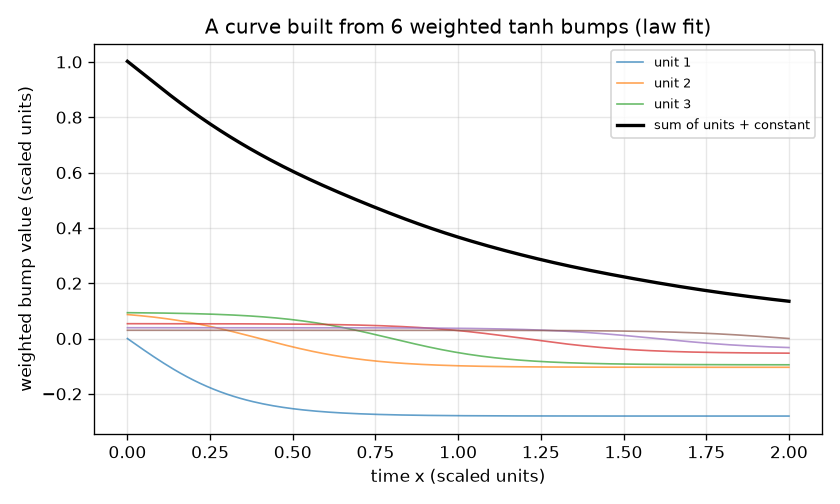
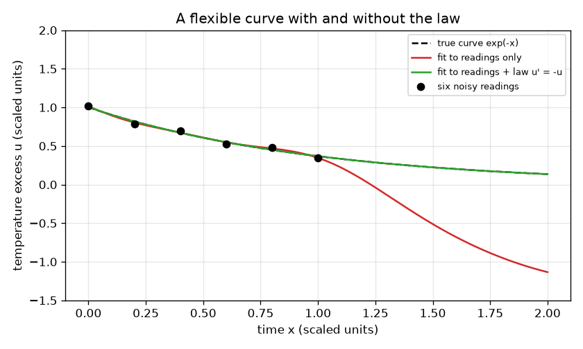

# Session 1: A flexible curve that can also obey a law

[Session 1 — हिन्दी](README.hi.md) · [Session 1 — മലയാളം](README.ml.md) · [Session 1 — தமிழ்](README.ta.md) · [Session 1 — తెలుగు](README.te.md)

*Level 1 (conceptual interactive model) · about 60 minutes · openpinn*

> This is a simplified educational model. It is not a validated design tool and must not be used for real structures, electrical installations, vehicles, industrial processes or medical decisions.

**Prerequisites**

- School algebra: functions and graphs.
- The idea of slope (derivative); no calculus technique is needed.
- You have read PRIMER.md and run `python start.py 1` once.

**Learning objectives.** After this session you can:

- Explain how a network output is a weighted sum of smooth bumps, and why more bumps make the curve more flexible.
- Fit that curve to six noisy readings by least squares and see where it goes wrong between and beyond the readings.
- Add a physics law as extra rows in the same fit and measure the improvement over the whole range.
- Describe the trade-off in the strength of the law and in the number of bumps.

## A. Real-world problem
A cup of tea is measured six times in its first minute and the readings are noisy. You must predict the temperature excess over room temperature for the whole next minute too. A flexible curve can pass near all six readings and still swing wildly where there are no readings. But you also know a law: the excess falls at a rate proportional to itself. In scaled units the law reads u' = -u, where u' is the slope of the curve. This is the idea behind physics-informed networks: the curve is bent by the data and also by the law. (General education only: this is a toy model, not a design tool.)

## B. Concept and theory
A neural-network unit is a smooth step, tanh(s), which is -1 far to the left, +1 far to the right and 0 at s = 0. Moving it with x - m and sharpening it with a steepness gives a bump. A curve built from H bumps is u(x) = c_1 tanh(3 (x - m_1)) + ... + c_H tanh(3 (x - m_H)) + c_0. In this session the centres m_j are fixed, evenly spread over 0 to 2, and only the weights c are chosen. Least squares chooses the weights that make the sum of (curve - reading)^2 smallest; a tiny penalty on the size of the weights keeps the sums sensible. The slope of the curve is again a weighted sum, since the slope of tanh(s) is 1 - tanh(s)^2. So the statement 'slope + value = 0 at chosen points' is also a set of linear equations in the weights. We add them to the fit with a strength lam: this is a physics-informed fit.

| Symbol | Meaning | Unit |
|---|---|---|
| x | time (scaled) | dimensionless |
| u(x) | temperature excess (scaled) | dimensionless |
| H | number of tanh bumps (units) | count |
| c_j | weight of bump j | dimensionless |
| m_j | centre of bump j | same unit as x |
| lam | strength of the law compared with the data | dimensionless |

**Assumptions**

- The true law is u' = -u and u is measured in scaled units (the real cooling rate and temperatures are absorbed into the scaling).
- The six readings have small noise of 0.03 or less, fixed once and for all.
- Bump centres and steepness (3) are fixed; only the weights are fitted (this is the simplified model).

$$ u(x)=c_0+\sum_{j=1}^{H} c_j\tanh\!\big(3\,(x-m_j)\big) $$

$$ u'(x)=\sum_{j=1}^{H} 3\,c_j\left(1-\tanh^2\!\big(3\,(x-m_j)\big)\right) $$

$$ \min_c\ \sum_{i=1}^{6}\big(u(x_i)-y_i\big)^2+\lambda\sum_{k=1}^{21}\big(u'(s_k)+u(s_k)\big)^2 $$

## C. Visual explanation
The first figure draws the six noisy readings (dots), the true curve exp(-x) (dashed) and two fitted curves on the range 0 to 2. The red curve uses the readings only: it passes close to all six readings but swings far from the truth beyond them. The green curve also obeys the law and lies on top of the true curve. The second figure shows how six weighted bumps add up to one curve.

*A curve is a sum of weighted tanh bumps plus a constant.*

*The same twelve bumps fitted to six noisy readings: readings only (red) swings away, with the law (green) follows the truth.*

## D. Interactive simulation
Run the lesson (`python start.py 1`), then open the live app: [Session 1: a curve with and without the law](https://krunalpanchal1995.github.io/pan-iit-oss/openpinn/session-01/) (or `app.html` in this folder). Switch between the two views. In the curve view, raise the law weight from 0 and watch the green curve snap onto the grey one while the red curve does not move. Then lower the number of units to 3 and see that a law with too few bumps cannot be obeyed.

**Challenge.** Get the green curve within rms error 0.01 of the true curve: use at least 6 units and a law weight between 0.5 and 5.

## E. Worked example and experiment
**Problem.** Fit 12 bumps to the six readings, first with the data only and then with the law (lam = 1). Compare the rms error against exp(-x) over x from 0 to 2, and the largest value of |u' + u|.

1. The readings are y = exp(-x) + noise at x = 0, 0.2, ..., 1.0. For example at x = 0.4 the reading is exp(-0.4) + 0.025 = 0.6703 + 0.025 = 0.695.
2. Data only: 13 weights (12 bumps and the constant) must fit 6 numbers, so many curves fit equally well; the fit passes within 0.05 of every reading but its rms error against exp(-x) over 0 to 2 is above 0.5.
3. With the law (21 law rows on 0 to 2, lam = 1): the rms error drops below 0.001.
4. The largest |u' + u| is above 2 without the law and below 0.03 with it: the law-fit curve nearly obeys the equation everywhere, not only at the dots.

**Answer.** Readings only: rms error above 0.5. Readings plus law: rms error below 0.001, and the largest |u' + u| falls from above 2 to below 0.03.

**Experiment.** Take real cooling data: pour warm water into a cup, read a thermometer every 15 seconds for three minutes and plot the excess over room temperature. Fit with and without the law u' = -k u. Real cups follow the law only roughly (evaporation, the cup itself, drafts), so the law-fitted curve has a small systematic error, whereas the model here has none because the data came from the law plus noise. Model versus reality: a wrong law, forced onto the curve, is worse than no law.

## F. Assessment and design challenge
**Question type A: Conceptual.** Why can a curve that passes within 0.05 of all six readings still be a poor prediction for the second minute?

Hint

Count the unknown weights and the readings, and ask what the curve is asked to do where there are no readings.

Step-by-step solution

With 12 bumps there are 13 weights but only 6 readings, so very many different curves fit the readings equally well, and the fit picks one without any reason to prefer the sensible one. Outside the readings nothing constrains it, so it can swing wildly (rms error above 0.5 here). The law supplies extra equations at points where there are no readings, which removes that freedom.

**Question type B: Numerical.** A candidate curve is u = exp(-0.9 x). Compute the law residual u' + u at x = 1. Is the candidate a solution of u' = -u?

Hint

The slope of exp(-0.9 x) is -0.9 exp(-0.9 x).

Step-by-step solution

u' + u = -0.9 exp(-0.9) + exp(-0.9) = 0.1 exp(-0.9) = 0.1 * 0.4066 = 0.0407 (scaled units), not zero, so the candidate is close but not a solution. The residual is the quantity that a physics-informed loss squares and averages.

**Question type C: Graph and simulation interpretation.** In the app, with 6 units, compare the red and green curves at x = 2. What does the difference tell you, and what is the error with the law on?

Hint

Open the curve view with the law weight 0 and then 1.

Step-by-step solution

With the law weight 0 the red curve is far from the grey one at x = 2, because no reading is near there. With weight 1 the green curve is on top of the grey curve: with 6 units and a law weight of 1 the rms error is far below that without the law (a factor of more than 10). The law carries information beyond the readings.

**Question type D: Design and optimisation challenge.** Design: you can afford 6 units at most and want the rms error below 0.01. Choose the law weight, and say what happens if it is too large or if you use only 3 units.

Hint

Try weights 0.5, 1, 2, 5 and 10 in the app with 6 units, then 3 units.

Step-by-step solution

With 6 units, any law weight from 0.5 to 5 gives an rms error below 0.01, so choose about 1. A much larger weight (50) makes the fit care more about the law than the six readings, and the error rises again (it is larger than at weight 1). With only 3 units the curve cannot bend enough to obey the law: with weight 1 the error stays above 0.05. Trade-off: the law fixes the shape but the readings fix the scale, and the curve must be flexible enough to do both.

Score yourself with [RUBRIC.md](../../RUBRIC.md). Print the [activity sheet](activity_sheet.md) to work on paper.

## Common misconceptions
| Common misconception | What is actually true |
|---|---|
| A network that fits all the data points exactly must be right. | Many curves fit the same points. Where there are no points the curve is free to do anything, unless a law constrains it. |
| Adding the physics always helps, the more the better. | A law that is too strong compared with the data, or a network too small to obey it, makes the fit worse; the weight is a trade-off. |
| A neural network is magic. | Here it is a weighted sum of tanh bumps; the 'learning' is least squares. |

## Glossary
- **unit (neuron)**: one smooth bump tanh(a x + d) in a network
- **weight**: a number that scales a unit's contribution to the output
- **least squares**: choosing numbers that make the sum of squared differences smallest
- **residual**: how far a curve is from obeying an equation; here u' + u
- **physics-informed**: trained to satisfy an equation as well as data

## Finish
1. Do the three coding tasks in [exercises.md](exercises.md).
2. Run `python start.py 1` again after your changes. It ends with the checkpoint; when it prints `PASS`, you are done. (Checkpoint only: `python start.py check 1`.)

Next: [Session 2](../session-02/README.md)
