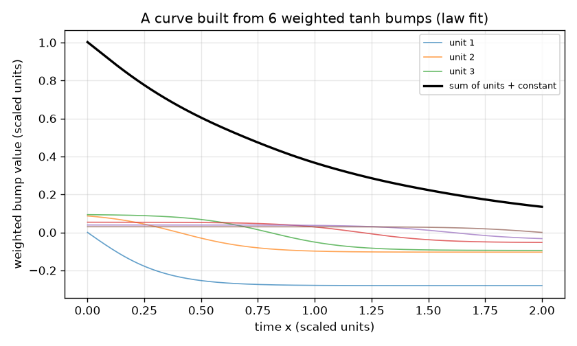
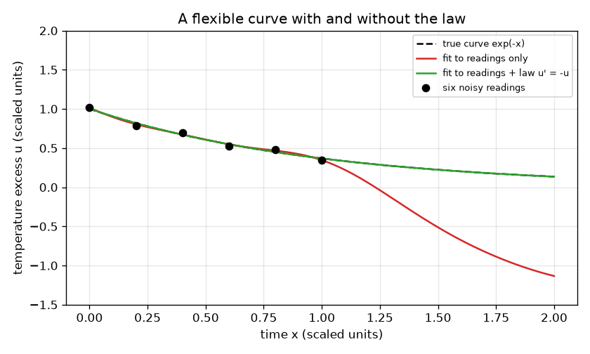

# സെഷൻ 1: ഒരു നിയമം അനുസരിക്കാനും കഴിയുന്ന വഴക്കമുള്ള വക്രം

[Session 1 — हिन्दी](README.hi.md)

*ലെവൽ 1 (ആശയപരമായ ഇന്ററാക്ടീവ് മോഡൽ) · ഏകദേശം 60 മിനിറ്റ് · openpinn*

> ഇത് ലളിതമാക്കിയ ഒരു വിദ്യാഭ്യാസ മോഡൽ ആണ്. ഇത് സാധൂകരിച്ച (validated) ഡിസൈൻ ഉപകരണമല്ല; യഥാർത്ഥ നിർമിതികൾ, വൈദ്യുത ഇൻസ്റ്റലേഷനുകൾ, വാഹനങ്ങൾ, വ്യാവസായിക പ്രക്രിയകൾ അല്ലെങ്കിൽ വൈദ്യശാസ്ത്ര തീരുമാനങ്ങൾ എന്നിവയ്ക്ക് ഇത് ഉപയോഗിക്കരുത്.

**മുൻകൂട്ടി അറിയേണ്ടവ (Prerequisites)**

- സ്കൂൾ ബീജഗണിതം: ഫംഗ്ഷനുകളും ഗ്രാഫുകളും.
- ചരിവിന്റെ (slope; അവകലജം) ആശയം; കലനത്തിന്റെ സാങ്കേതികതകളൊന്നും ആവശ്യമില്ല.
- നിങ്ങൾ PRIMER.md വായിച്ചിട്ടുണ്ട്, `python start.py 1` ഒരിക്കൽ റൺ ചെയ്തിട്ടുണ്ട്.

**പഠന ലക്ഷ്യങ്ങൾ (Learning objectives).** ഈ സെഷനു ശേഷം നിങ്ങൾക്ക്:

- ഒരു നെറ്റ്‌വർക്ക് ഔട്ട്പുട്ട് സുഗമമായ ബമ്പുകളുടെ (bumps) ഭാരിത തുകയാണെന്നും കൂടുതൽ ബമ്പുകൾ വക്രത്തെ കൂടുതൽ വഴക്കമുള്ളതാക്കുന്നത് എന്തുകൊണ്ടെന്നും വിശദീകരിക്കാം.
- ആ വക്രത്തെ ശബ്ദമുള്ള ആറ് റീഡിംഗുകളിലേക്ക് ലീസ്റ്റ് സ്ക്വയേഴ്സ് (least squares) ഉപയോഗിച്ച് ഫിറ്റ് ചെയ്ത്, റീഡിംഗുകൾക്കിടയിലും അതിനപ്പുറവും അത് എവിടെ തെറ്റുന്നു എന്ന് കാണാം.
- അതേ ഫിറ്റിൽ ഒരു ഭൗതിക നിയമം അധിക വരികളായി ചേർത്ത് മുഴുവൻ പരിധിയിലും മെച്ചം അളക്കാം.
- നിയമത്തിന്റെ ശക്തിയിലും ബമ്പുകളുടെ എണ്ണത്തിലുമുള്ള വിട്ടുവീഴ്ച (trade-off) വിവരിക്കാം.

## A. യഥാർത്ഥ ലോക പ്രശ്നം
ഒരു കപ്പ് ചായയുടെ ആദ്യ മിനിറ്റിൽ ആറ് തവണ താപനില അളക്കുന്നു, റീഡിംഗുകൾ ശബ്ദമുള്ളതാണ്. അടുത്ത മിനിറ്റ് മുഴുവനുമുള്ള മുറിയുടെ താപനിലയ്ക്ക് മുകളിലുള്ള താപനില വർദ്ധനവും നിങ്ങൾ പ്രവചിക്കണം. ഒരു വഴക്കമുള്ള വക്രത്തിന് ആറ് റീഡിംഗുകൾക്കടുത്തും കടന്നുപോകാനും റീഡിംഗുകളില്ലാത്തിടത്ത് വന്യമായി ആടാനും കഴിയും. എന്നാൽ നിങ്ങൾക്ക് ഒരു നിയമവും അറിയാം: വർദ്ധനവ് അതിന് തന്നെ ആനുപാതികമായ നിരക്കിൽ കുറയുന്നു. സ്കെയിൽ ചെയ്ത യൂണിറ്റുകളിൽ നിയമം u' = -u എന്ന് വായിക്കുന്നു, ഇവിടെ u' വക്രത്തിന്റെ ചരിവാണ്. ഇതാണ് ഫിസിക്സ്-ഇൻഫോംഡ് നെറ്റ്‌വർക്കുകളുടെ (physics-informed networks) ആശയം: വക്രത്തെ ഡാറ്റയും നിയമവും ഒരുമിച്ച് വളയ്ക്കുന്നു. (പൊതു വിദ്യാഭ്യാസം മാത്രം: ഇതൊരു കളിപ്പാട്ട മോഡൽ ആണ്, ഡിസൈൻ ഉപകരണമല്ല.)

## B. ആശയവും സിദ്ധാന്തവും
ഒരു ന്യൂറൽ-നെറ്റ്‌വർക്ക് യൂണിറ്റ് ഒരു സുഗമമായ പടിയാണ്, tanh(s), അത് വളരെ ഇടതുവശത്ത് -1, വളരെ വലതുവശത്ത് +1, s = 0-ൽ 0 ആണ്. അതിനെ x - m കൊണ്ട് നീക്കുകയും ഒരു കുത്തനെ പാരാമീറ്റർ (steepness) കൊണ്ട് മൂർച്ച കൂട്ടുകയും ചെയ്യുമ്പോൾ ഒരു ബമ്പ് ലഭിക്കുന്നു. H ബമ്പുകൾ കൊണ്ട് നിർമ്മിച്ച ഒരു വക്രം u(x) = c_1 tanh(3 (x - m_1)) + ... + c_H tanh(3 (x - m_H)) + c_0 ആണ്. ഈ സെഷനിൽ കേന്ദ്രങ്ങൾ m_j സ്ഥിരമാണ്, 0 മുതൽ 2 വരെ തുല്യമായി പരത്തിയിരിക്കുന്നു, ഭാരങ്ങൾ c മാത്രം തിരഞ്ഞെടുക്കുന്നു. (വക്രം - റീഡിംഗ്)^2 ന്റെ തുക ഏറ്റവും ചെറുതാക്കുന്ന ഭാരങ്ങൾ ലീസ്റ്റ് സ്ക്വയേഴ്സ് തിരഞ്ഞെടുക്കുന്നു; ഭാരങ്ങളുടെ വലിപ്പത്തിന്മേലുള്ള ഒരു ചെറിയ പിഴ തുകകളെ യുക്തിസഹമായി നിലനിർത്തുന്നു. വക്രത്തിന്റെ ചരിവും വീണ്ടും ഒരു ഭാരിത തുകയാണ്, കാരണം tanh(s)-ന്റെ ചരിവ് 1 - tanh(s)^2 ആണ്. അതിനാൽ 'തിരഞ്ഞെടുത്ത പോയിന്റുകളിൽ ചരിവ് + മൂല്യം = 0' എന്ന പ്രസ്താവനയും ഭാരങ്ങളിലെ രേഖീയ സമവാക്യങ്ങളുടെ ഒരു ഗണമാണ്. നാം ഇവയെ lam എന്ന ശക്തിയോടെ ഫിറ്റിലേക്ക് ചേർക്കുന്നു: ഇതാണ് ഫിസിക്സ്-ഇൻഫോംഡ് ഫിറ്റ്.

| ചിഹ്നം | അർത്ഥം | യൂണിറ്റ് |
|---|---|---|
| x | സമയം (സ്കെയിൽ ചെയ്തത്) | അളവില്ലാത്തത് |
| u(x) | താപനില വർദ്ധനവ് (സ്കെയിൽ ചെയ്തത്) | അളവില്ലാത്തത് |
| H | tanh ബമ്പുകളുടെ (യൂണിറ്റുകൾ) എണ്ണം | എണ്ണം |
| c_j | ബമ്പ് j-യുടെ ഭാരം | അളവില്ലാത്തത് |
| m_j | ബമ്പ് j-യുടെ കേന്ദ്രം | x-ന്റെ അതേ യൂണിറ്റ് |
| lam | ഡാറ്റയുമായി താരതമ്യം ചെയ്യുമ്പോൾ നിയമത്തിന്റെ ശക്തി | അളവില്ലാത്തത് |

**അനുമാനങ്ങൾ (Assumptions)**

- യഥാർത്ഥ നിയമം u' = -u ആണ്, u സ്കെയിൽ ചെയ്ത യൂണിറ്റുകളിൽ അളക്കുന്നു (യഥാർത്ഥ തണുപ്പ് നിരക്കും താപനിലകളും സ്കെയിലിംഗിൽ ഉൾപ്പെടുത്തിയിരിക്കുന്നു).
- ആറ് റീഡിംഗുകൾക്ക് 0.03 അല്ലെങ്കിൽ അതിൽ കുറവുള്ള ചെറിയ ശബ്ദമുണ്ട്, ഒരിക്കൽ എന്നെന്നേക്കുമായി നിശ്ചയിച്ചത്.
- ബമ്പ് കേന്ദ്രങ്ങളും കുത്തനെ പാരാമീറ്ററും (3) സ്ഥിരമാണ്; ഭാരങ്ങൾ മാത്രം ഫിറ്റ് ചെയ്യുന്നു (ഇതാണ് ലളിതമാക്കിയ മോഡൽ).

$$ u(x)=c_0+\sum_{j=1}^{H} c_j\tanh\!\big(3\,(x-m_j)\big) $$

$$ u'(x)=\sum_{j=1}^{H} 3\,c_j\left(1-\tanh^2\!\big(3\,(x-m_j)\big)\right) $$

$$ \min_c\ \sum_{i=1}^{6}\big(u(x_i)-y_i\big)^2+\lambda\sum_{k=1}^{21}\big(u'(s_k)+u(s_k)\big)^2 $$

## C. ദൃശ്യ വിശദീകരണം
ആദ്യ ചിത്രം ആറ് ശബ്ദമുള്ള റീഡിംഗുകൾ (കുത്തുകൾ), യഥാർത്ഥ വക്രം exp(-x) (ഡാഷ്), 0 മുതൽ 2 വരെയുള്ള പരിധിയിൽ രണ്ട് ഫിറ്റ് ചെയ്ത വക്രങ്ങൾ എന്നിവ വരയ്ക്കുന്നു. ചുവന്ന വക്രം റീഡിംഗുകൾ മാത്രം ഉപയോഗിക്കുന്നു: അത് ആറ് റീഡിംഗുകൾക്കും അടുത്തുകൂടി കടന്നുപോകുന്നു, എന്നാൽ അവയ്ക്കപ്പുറം സത്യത്തിൽ നിന്ന് വളരെ അകലേക്ക് ആടുന്നു. പച്ച വക്രം നിയമത്തെയും അനുസരിക്കുകയും യഥാർത്ഥ വക്രത്തിന് മുകളിൽ കിടക്കുകയും ചെയ്യുന്നു. രണ്ടാമത്തെ ചിത്രം ആറ് ഭാരിത ബമ്പുകൾ കൂടി ഒരു വക്രമായി മാറുന്നത് കാണിക്കുന്നു.

*ഒരു വക്രം ഭാരിത tanh ബമ്പുകളുടെയും ഒരു സ്ഥിരാങ്കത്തിന്റെയും തുകയാണ്.*

*അതേ പന്ത്രണ്ട് ബമ്പുകൾ ശബ്ദമുള്ള ആറ് റീഡിംഗുകളിലേക്ക് ഫിറ്റ് ചെയ്തത്: റീഡിംഗുകൾ മാത്രം (ചുവപ്പ്) അകന്നുപോകുന്നു, നിയമത്തോടൊപ്പം (പച്ച) സത്യത്തെ പിന്തുടരുന്നു.*

## D. ഇന്ററാക്ടീവ് സിമുലേഷൻ
പാഠം റൺ ചെയ്യുക (`python start.py 1`), തുടർന്ന് ലൈവ് ആപ്പ് തുറക്കുക: [സെഷൻ 1: നിയമത്തോടെയും അല്ലാതെയുമുള്ള ഒരു വക്രം](https://krunalpanchal1995.github.io/pan-iit-oss/openpinn/session-01/) (അല്ലെങ്കിൽ ഈ ഫോൾഡറിലെ `app.html`). രണ്ട് കാഴ്ചകൾക്കിടയിൽ മാറുക. വക്ര കാഴ്ചയിൽ നിയമ ഭാരം 0-ൽ നിന്ന് ഉയർത്തി ചുവന്ന വക്രം അനങ്ങാത്തപ്പോൾ പച്ച വക്രം ചാര വക്രത്തിലേക്ക് ചേർന്നുവരുന്നത് നിരീക്ഷിക്കുക. തുടർന്ന് യൂണിറ്റുകളുടെ എണ്ണം 3 ആക്കി, വളരെ കുറച്ച് ബമ്പുകളുള്ള ഒരു നിയമം അനുസരിക്കാൻ കഴിയില്ലെന്ന് കാണുക.

**വെല്ലുവിളി.** പച്ച വക്രത്തെ യഥാർത്ഥ വക്രത്തിന്റെ 0.01 rms പിശകിനുള്ളിൽ എത്തിക്കുക: കുറഞ്ഞത് 6 യൂണിറ്റുകളും 0.5 നും 5 നും ഇടയിലുള്ള നിയമ ഭാരവും ഉപയോഗിക്കുക.

## E. ഉദാഹരണവും പരീക്ഷണവും
**പ്രശ്നം.** 12 ബമ്പുകൾ ആറ് റീഡിംഗുകളിലേക്ക് ഫിറ്റ് ചെയ്യുക, ആദ്യം ഡാറ്റ മാത്രം ഉപയോഗിച്ചും പിന്നെ നിയമത്തോടെയും (lam = 1). x 0 മുതൽ 2 വരെ exp(-x)-നെതിരായ rms പിശകും |u' + u|-ന്റെ ഏറ്റവും വലിയ മൂല്യവും താരതമ്യം ചെയ്യുക.

1. റീഡിംഗുകൾ x = 0, 0.2, ..., 1.0-ൽ y = exp(-x) + ശബ്ദം ആണ്. ഉദാഹരണത്തിന് x = 0.4-ൽ റീഡിംഗ് exp(-0.4) + 0.025 = 0.6703 + 0.025 = 0.695 ആണ്.
2. ഡാറ്റ മാത്രം: 13 ഭാരങ്ങൾ (12 ബമ്പുകളും സ്ഥിരാങ്കവും) 6 സംഖ്യകളിലേക്ക് ഫിറ്റ് ചെയ്യണം, അതിനാൽ പല വക്രങ്ങളും ഒരുപോലെ നന്നായി ഫിറ്റ് ചെയ്യുന്നു; ഫിറ്റ് ഓരോ റീഡിംഗിന്റെയും 0.05-നുള്ളിൽ കടന്നുപോകുന്നു, എന്നാൽ 0 മുതൽ 2 വരെ exp(-x)-നെതിരായ അതിന്റെ rms പിശക് 0.5-ന് മുകളിലാണ്.
3. നിയമത്തോടെ (0 മുതൽ 2 വരെ 21 നിയമ വരികൾ, lam = 1): rms പിശക് 0.001-ന് താഴെയായി കുറയുന്നു.
4. ഏറ്റവും വലിയ |u' + u| നിയമമില്ലാതെ 2-ന് മുകളിലും നിയമത്തോടെ 0.03-ന് താഴെയുമാണ്: നിയമ-ഫിറ്റ് വക്രം കുത്തുകളിൽ മാത്രമല്ല, എല്ലായിടത്തും സമവാക്യത്തെ ഏതാണ്ട് അനുസരിക്കുന്നു.

**ഉത്തരം.** റീഡിംഗുകൾ മാത്രം: rms പിശക് 0.5-ന് മുകളിൽ. റീഡിംഗുകളും നിയമവും: rms പിശക് 0.001-ന് താഴെ, ഏറ്റവും വലിയ |u' + u| 2-ന് മുകളിൽ നിന്ന് 0.03-ന് താഴേക്ക് വീഴുന്നു.

**പരീക്ഷണം.** യഥാർത്ഥ തണുപ്പ് ഡാറ്റ എടുക്കുക: ഒരു കപ്പിൽ ചൂടുവെള്ളം ഒഴിച്ച്, മൂന്ന് മിനിറ്റ് ഓരോ 15 സെക്കൻഡിലും തെർമോമീറ്റർ വായിച്ച് മുറിയുടെ താപനിലയ്ക്ക് മുകളിലുള്ള വർദ്ധനവ് വരയ്ക്കുക. നിയമം u' = -k u ഉപയോഗിച്ചും ഇല്ലാതെയും ഫിറ്റ് ചെയ്യുക. യഥാർത്ഥ കപ്പുകൾ നിയമത്തെ ഏകദേശമായി മാത്രം പിന്തുടരുന്നു (ബാഷ്പീകരണം, കപ്പ് തന്നെ, കാറ്റ്), അതിനാൽ നിയമ-ഫിറ്റ് വക്രത്തിന് ഒരു ചെറിയ വ്യവസ്ഥാപിത പിശകുണ്ട്, എന്നാൽ ഇവിടത്തെ മോഡലിന് അതില്ല, കാരണം ഡാറ്റ നിയമത്തിൽ നിന്നും ശബ്ദത്തിൽ നിന്നും വന്നതാണ്. മോഡലും യാഥാർത്ഥ്യവും: വക്രത്തിന്മേൽ അടിച്ചേൽപ്പിക്കുന്ന തെറ്റായ നിയമം നിയമമില്ലാത്തതിനേക്കാൾ മോശമാണ്.

## F. വിലയിരുത്തലും ഡിസൈൻ വെല്ലുവിളിയും
**ചോദ്യ തരം A: ആശയപരം.** ആറ് റീഡിംഗുകളുടെയും 0.05-നുള്ളിൽ കടന്നുപോകുന്ന ഒരു വക്രം രണ്ടാം മിനിറ്റിന് ഒരു മോശം പ്രവചനമാകുന്നത് എന്തുകൊണ്ട്?

സൂചന

അജ്ഞാത ഭാരങ്ങളും റീഡിംഗുകളും എണ്ണുക, റീഡിംഗുകളില്ലാത്തിടത്ത് വക്രത്തോട് എന്താണ് ആവശ്യപ്പെടുന്നത് എന്ന് ചോദിക്കുക.

ഘട്ടം ഘട്ടമായുള്ള പരിഹാരം

12 ബമ്പുകൾക്ക് 13 ഭാരങ്ങളുണ്ട്, എന്നാൽ 6 റീഡിംഗുകൾ മാത്രം, അതിനാൽ വളരെയധികം വ്യത്യസ്ത വക്രങ്ങൾ റീഡിംഗുകളിലേക്ക് ഒരുപോലെ നന്നായി ഫിറ്റ് ചെയ്യുന്നു, യുക്തിസഹമായതിനെ ഇഷ്ടപ്പെടാൻ ഒരു കാരണവുമില്ലാതെ ഫിറ്റ് ഒന്നിനെ തിരഞ്ഞെടുക്കുന്നു. റീഡിംഗുകൾക്ക് പുറത്ത് ഒന്നും അതിനെ നിയന്ത്രിക്കുന്നില്ല, അതിനാൽ അത് വന്യമായി ആടാം (ഇവിടെ rms പിശക് 0.5-ന് മുകളിൽ). നിയമം റീഡിംഗുകളില്ലാത്ത പോയിന്റുകളിൽ അധിക സമവാക്യങ്ങൾ നൽകുന്നു, അത് ആ സ്വാതന്ത്ര്യം ഇല്ലാതാക്കുന്നു.

**ചോദ്യ തരം B: സംഖ്യാപരം.** ഒരു സ്ഥാനാർത്ഥി വക്രം u = exp(-0.9 x) ആണ്. x = 1-ൽ നിയമ ശേഷിപ്പ് (residual) u' + u കണക്കാക്കുക. സ്ഥാനാർത്ഥി u' = -u-ന്റെ ഒരു നിർധാരണമാണോ?

സൂചന

exp(-0.9 x)-ന്റെ ചരിവ് -0.9 exp(-0.9 x) ആണ്.

ഘട്ടം ഘട്ടമായുള്ള പരിഹാരം

u' + u = -0.9 exp(-0.9) + exp(-0.9) = 0.1 exp(-0.9) = 0.1 * 0.4066 = 0.0407 (സ്കെയിൽ ചെയ്ത യൂണിറ്റുകൾ), പൂജ്യമല്ല, അതിനാൽ സ്ഥാനാർത്ഥി അടുത്താണ് എന്നാൽ ഒരു നിർധാരണമല്ല. ഫിസിക്സ്-ഇൻഫോംഡ് ലോസ് വർഗ്ഗമാക്കി ശരാശരിയെടുക്കുന്ന അളവാണ് ശേഷിപ്പ്.

**ചോദ്യ തരം C: ഗ്രാഫും സിമുലേഷനും വ്യാഖ്യാനിക്കൽ.** ആപ്പിൽ, 6 യൂണിറ്റുകളോടെ, x = 2-ൽ ചുവപ്പും പച്ചയും വക്രങ്ങൾ താരതമ്യം ചെയ്യുക. വ്യത്യാസം എന്ത് പറയുന്നു, നിയമം ഓണായിരിക്കുമ്പോൾ പിശക് എത്രയാണ്?

സൂചന

നിയമ ഭാരം 0-ലും പിന്നെ 1-ലും വക്ര കാഴ്ച തുറക്കുക.

ഘട്ടം ഘട്ടമായുള്ള പരിഹാരം

നിയമ ഭാരം 0 ആയിരിക്കുമ്പോൾ ചുവന്ന വക്രം x = 2-ൽ ചാര വക്രത്തിൽ നിന്ന് വളരെ അകലെയാണ്, കാരണം അവിടെ അടുത്ത് റീഡിംഗുകളില്ല. ഭാരം 1 ആകുമ്പോൾ പച്ച വക്രം ചാര വക്രത്തിന് മുകളിലാണ്: 6 യൂണിറ്റുകളും 1 എന്ന നിയമ ഭാരവും ഉള്ളപ്പോൾ rms പിശക് നിയമമില്ലാതെയുള്ളതിനേക്കാൾ വളരെ കുറവാണ് (10 മടങ്ങിലധികം). നിയമം റീഡിംഗുകൾക്കപ്പുറമുള്ള വിവരം വഹിക്കുന്നു.

**ചോദ്യ തരം D: ഡിസൈനും ഒപ്റ്റിമൈസേഷനും വെല്ലുവിളി.** ഡിസൈൻ: നിങ്ങൾക്ക് പരമാവധി 6 യൂണിറ്റുകൾ താങ്ങാനാകും, rms പിശക് 0.01-ന് താഴെ വേണം. നിയമ ഭാരം തിരഞ്ഞെടുക്കുക, അത് വളരെ വലുതാണെങ്കിലോ 3 യൂണിറ്റുകൾ മാത്രം ഉപയോഗിച്ചാലോ എന്ത് സംഭവിക്കുമെന്ന് പറയുക.

സൂചന

ആപ്പിൽ 6 യൂണിറ്റുകളോടെ ഭാരങ്ങൾ 0.5, 1, 2, 5, 10 പരീക്ഷിക്കുക, പിന്നെ 3 യൂണിറ്റുകൾ.

ഘട്ടം ഘട്ടമായുള്ള പരിഹാരം

6 യൂണിറ്റുകളോടെ, 0.5 മുതൽ 5 വരെയുള്ള ഏത് നിയമ ഭാരവും 0.01-ന് താഴെ rms പിശക് നൽകുന്നു, അതിനാൽ ഏകദേശം 1 തിരഞ്ഞെടുക്കുക. വളരെ വലിയ ഭാരം (50) ഫിറ്റിനെ ആറ് റീഡിംഗുകളേക്കാൾ നിയമത്തെ കൂടുതൽ ശ്രദ്ധിക്കുന്നതാക്കുന്നു, പിശക് വീണ്ടും ഉയരുന്നു (ഭാരം 1-ലേതിനേക്കാൾ വലുതാണ്). 3 യൂണിറ്റുകൾ മാത്രമുള്ളപ്പോൾ വക്രത്തിന് നിയമം അനുസരിക്കാൻ മതിയായി വളയാനാകില്ല: ഭാരം 1-ൽ പിശക് 0.05-ന് മുകളിൽ തുടരുന്നു. വിട്ടുവീഴ്ച (trade-off): നിയമം ആകൃതി നിശ്ചയിക്കുന്നു, റീഡിംഗുകൾ സ്കെയിൽ നിശ്ചയിക്കുന്നു, ഇവ രണ്ടും ചെയ്യാൻ വക്രം മതിയായ വഴക്കമുള്ളതായിരിക്കണം.

[RUBRIC.md](../../RUBRIC.md) ഉപയോഗിച്ച് സ്വയം സ്കോർ ചെയ്യുക. പേപ്പറിൽ ചെയ്യാൻ [ആക്ടിവിറ്റി ഷീറ്റ്](activity_sheet.md) പ്രിന്റ് ചെയ്യുക.

## സാധാരണ തെറ്റിദ്ധാരണകൾ
| സാധാരണ തെറ്റിദ്ധാരണ | യഥാർത്ഥത്തിൽ ശരിയായത് |
|---|---|
| എല്ലാ ഡാറ്റ പോയിന്റുകളിലും കൃത്യമായി ഫിറ്റ് ചെയ്യുന്ന ഒരു നെറ്റ്‌വർക്ക് ശരിയായിരിക്കണം. | പല വക്രങ്ങളും ഒരേ പോയിന്റുകളിലേക്ക് ഫിറ്റ് ചെയ്യുന്നു. പോയിന്റുകളില്ലാത്തിടത്ത് ഒരു നിയമം നിയന്ത്രിക്കുന്നില്ലെങ്കിൽ വക്രത്തിന് എന്തും ചെയ്യാൻ സ്വാതന്ത്ര്യമുണ്ട്. |
| ഭൗതികശാസ്ത്രം ചേർക്കുന്നത് എപ്പോഴും സഹായിക്കുന്നു, കൂടുന്തോറും നല്ലത്. | ഡാറ്റയെ അപേക്ഷിച്ച് വളരെ ശക്തമായ നിയമമോ അത് അനുസരിക്കാൻ കഴിയാത്തത്ര ചെറിയ നെറ്റ്‌വർക്കോ ഫിറ്റിനെ മോശമാക്കുന്നു; ഭാരം ഒരു വിട്ടുവീഴ്ചയാണ്. |
| ഒരു ന്യൂറൽ നെറ്റ്‌വർക്ക് മാന്ത്രികമാണ്. | ഇവിടെ അത് tanh ബമ്പുകളുടെ ഭാരിത തുകയാണ്; 'പഠനം' ലീസ്റ്റ് സ്ക്വയേഴ്സ് ആണ്. |

## പദാവലി (Glossary)
- **യൂണിറ്റ് (ന്യൂറോൺ, unit/neuron)**: ഒരു നെറ്റ്‌വർക്കിലെ ഒരു സുഗമമായ ബമ്പ് tanh(a x + d)
- **ഭാരം (weight)**: ഒരു യൂണിറ്റിന്റെ ഔട്ട്പുട്ടിലേക്കുള്ള സംഭാവനയെ സ്കെയിൽ ചെയ്യുന്ന സംഖ്യ
- **ലീസ്റ്റ് സ്ക്വയേഴ്സ് (least squares)**: വർഗ്ഗ വ്യത്യാസങ്ങളുടെ തുക ഏറ്റവും ചെറുതാക്കുന്ന സംഖ്യകൾ തിരഞ്ഞെടുക്കൽ
- **ശേഷിപ്പ് (residual)**: ഒരു വക്രം ഒരു സമവാക്യം അനുസരിക്കുന്നതിൽ നിന്ന് എത്ര അകലെയാണ്; ഇവിടെ u' + u
- **ഫിസിക്സ്-ഇൻഫോംഡ് (physics-informed)**: ഡാറ്റയ്‌ക്കൊപ്പം ഒരു സമവാക്യവും തൃപ്തിപ്പെടുത്താൻ പരിശീലിപ്പിച്ചത്

## പൂർത്തിയാക്കുക
1. [exercises.md](exercises.md)-ലെ മൂന്ന് കോഡിംഗ് ടാസ്കുകൾ ചെയ്യുക.
2. നിങ്ങളുടെ മാറ്റങ്ങൾക്ക് ശേഷം `python start.py 1` വീണ്ടും റൺ ചെയ്യുക. അത് ചെക്ക്‌പോയിന്റോടെ അവസാനിക്കുന്നു; അത് `PASS` പ്രിന്റ് ചെയ്യുമ്പോൾ നിങ്ങൾ പൂർത്തിയാക്കി. (ചെക്ക്‌പോയിന്റ് മാത്രം: `python start.py check 1`.)

അടുത്തത്: [സെഷൻ 2](../session-02/README.md)
