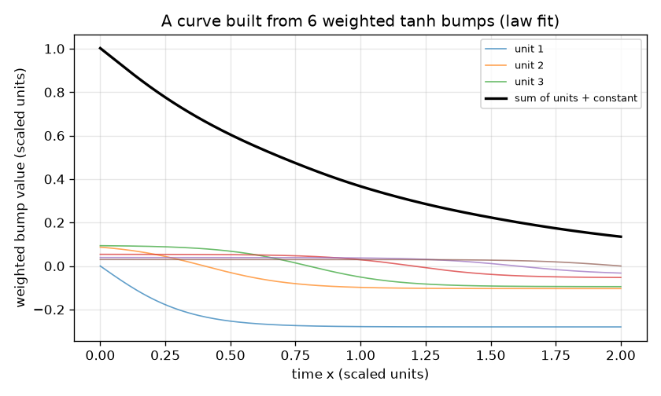
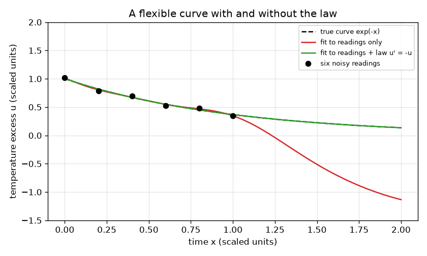

# அமர்வு 1: ஒரு விதியையும் பின்பற்றக்கூடிய நெகிழ்வான வளைவு

[Session 1 — हिन्दी](README.hi.md)

*நிலை 1 (கருத்தியல் ஊடாடும் மாதிரி) · சுமார் 60 நிமிடங்கள் · openpinn*

> இது எளிமைப்படுத்தப்பட்ட ஒரு கல்வி மாதிரி. இது சரிபார்க்கப்பட்ட (validated) வடிவமைப்புக் கருவி அல்ல; உண்மையான கட்டமைப்புகள், மின் நிறுவல்கள், வாகனங்கள், தொழிற்சாலை செயல்முறைகள் அல்லது மருத்துவ முடிவுகளுக்கு இதைப் பயன்படுத்தக் கூடாது.

**முன்தேவைகள் (Prerequisites)**

- பள்ளி இயற்கணிதம்: சார்புகளும் வரைபடங்களும்.
- சரிவின் (slope; வகைக்கெழு) கருத்து; எந்தக் கணிதப் பகுப்பாய்வு நுட்பமும் தேவையில்லை.
- நீங்கள் PRIMER.md படித்து, `python start.py 1` ஒருமுறை இயக்கியுள்ளீர்கள்.

**கற்றல் நோக்கங்கள் (Learning objectives).** இந்த அமர்வுக்குப் பிறகு நீங்கள்:

- ஒரு வலையமைப்பு வெளியீடு சீரான மேடுகளின் (bumps) எடையிட்ட கூட்டுத்தொகை என்றும், அதிக மேடுகள் வளைவை ஏன் அதிக நெகிழ்வாக்குகின்றன என்றும் விளக்கலாம்.
- அந்த வளைவை இரைச்சலுள்ள ஆறு அளவீடுகளுக்கு மீச்சிறு வர்க்கங்களால் (least squares) பொருத்தி, அளவீடுகளுக்கு இடையிலும் அப்பாலும் அது எங்கே தவறுகிறது என்று காணலாம்.
- அதே பொருத்தத்தில் ஓர் இயற்பியல் விதியை கூடுதல் வரிசைகளாகச் சேர்த்து, முழு வரம்பிலும் முன்னேற்றத்தை அளக்கலாம்.
- விதியின் வலிமையிலும் மேடுகளின் எண்ணிக்கையிலும் உள்ள சமரசத்தை (trade-off) விவரிக்கலாம்.

## A. நிஜ உலகப் பிரச்சினை
ஒரு கோப்பைத் தேநீர் அதன் முதல் நிமிடத்தில் ஆறு முறை அளக்கப்படுகிறது, அளவீடுகளில் இரைச்சல் உள்ளது. அடுத்த நிமிடம் முழுவதற்கும் அறை வெப்பநிலைக்கு மேலான வெப்பநிலை மிகையையும் நீங்கள் முன்கணிக்க வேண்டும். ஒரு நெகிழ்வான வளைவு ஆறு அளவீடுகளுக்கும் அருகில் சென்றாலும் அளவீடுகள் இல்லாத இடத்தில் கட்டுக்கடங்காமல் ஊசலாடலாம். ஆனால் உங்களுக்கு ஒரு விதியும் தெரியும்: மிகை தனக்கே விகிதசமமான வீதத்தில் குறைகிறது. அளவிடப்பட்ட அலகுகளில் விதி u' = -u என்று படிக்கப்படுகிறது, இங்கே u' வளைவின் சரிவு. இதுவே இயற்பியல்-தகவலறிந்த வலையமைப்புகளின் (physics-informed networks) கருத்து: வளைவு தரவாலும் விதியாலும் வளைக்கப்படுகிறது. (பொதுக் கல்வி மட்டும்: இது ஒரு பொம்மை மாதிரி, வடிவமைப்புக் கருவி அல்ல.)

## B. கருத்தும் கோட்பாடும்
ஒரு நரம்பியல்-வலையமைப்பு அலகு ஒரு சீரான படி, tanh(s), அது வெகு இடப்பக்கம் -1, வெகு வலப்பக்கம் +1, s = 0 இல் 0. அதை x - m ஆல் நகர்த்தி, செங்குத்துத்தன்மையால் (steepness) கூர்மைப்படுத்தினால் ஒரு மேடு கிடைக்கிறது. H மேடுகளால் கட்டப்பட்ட ஒரு வளைவு u(x) = c_1 tanh(3 (x - m_1)) + ... + c_H tanh(3 (x - m_H)) + c_0. இந்த அமர்வில் மையங்கள் m_j நிலையானவை, 0 முதல் 2 வரை சமமாகப் பரப்பப்பட்டவை, எடைகள் c மட்டுமே தேர்ந்தெடுக்கப்படுகின்றன. (வளைவு - அளவீடு)^2 இன் கூட்டுத்தொகையை மிகச் சிறியதாக்கும் எடைகளை மீச்சிறு வர்க்கங்கள் தேர்ந்தெடுக்கிறது; எடைகளின் அளவின் மீதான சிறிய தண்டனை கூட்டுத்தொகைகளை நியாயமாக வைக்கிறது. வளைவின் சரிவும் மீண்டும் ஓர் எடையிட்ட கூட்டுத்தொகை, ஏனெனில் tanh(s) இன் சரிவு 1 - tanh(s)^2. எனவே 'தேர்ந்தெடுத்த புள்ளிகளில் சரிவு + மதிப்பு = 0' என்ற கூற்றும் எடைகளில் நேரியல் சமன்பாடுகளின் தொகுப்பு. இவற்றை lam என்ற வலிமையுடன் பொருத்தத்தில் சேர்க்கிறோம்: இதுவே இயற்பியல்-தகவலறிந்த பொருத்தம்.

| குறியீடு | பொருள் | அலகு |
|---|---|---|
| x | நேரம் (அளவிடப்பட்டது) | பரிமாணமற்றது |
| u(x) | வெப்பநிலை மிகை (அளவிடப்பட்டது) | பரிமாணமற்றது |
| H | tanh மேடுகளின் (அலகுகளின்) எண்ணிக்கை | எண்ணிக்கை |
| c_j | மேடு j இன் எடை | பரிமாணமற்றது |
| m_j | மேடு j இன் மையம் | x இன் அதே அலகு |
| lam | தரவுடன் ஒப்பிடும்போது விதியின் வலிமை | பரிமாணமற்றது |

**அனுமானங்கள் (Assumptions)**

- உண்மை விதி u' = -u, u அளவிடப்பட்ட அலகுகளில் அளக்கப்படுகிறது (உண்மைக் குளிர்வு வீதமும் வெப்பநிலைகளும் அளவீட்டில் உள்ளடக்கப்பட்டுள்ளன).
- ஆறு அளவீடுகளுக்கு 0.03 அல்லது அதற்குக் குறைவான சிறிய இரைச்சல் உண்டு, ஒருமுறை என்றென்றைக்கும் நிர்ணயிக்கப்பட்டது.
- மேடு மையங்களும் செங்குத்துத்தன்மையும் (3) நிலையானவை; எடைகள் மட்டுமே பொருத்தப்படுகின்றன (இதுவே எளிமைப்படுத்தப்பட்ட மாதிரி).

$$ u(x)=c_0+\sum_{j=1}^{H} c_j\tanh\!\big(3\,(x-m_j)\big) $$

$$ u'(x)=\sum_{j=1}^{H} 3\,c_j\left(1-\tanh^2\!\big(3\,(x-m_j)\big)\right) $$

$$ \min_c\ \sum_{i=1}^{6}\big(u(x_i)-y_i\big)^2+\lambda\sum_{k=1}^{21}\big(u'(s_k)+u(s_k)\big)^2 $$

## C. காட்சி விளக்கம்
முதல் படம் ஆறு இரைச்சல் அளவீடுகள் (புள்ளிகள்), உண்மை வளைவு exp(-x) (கோடிட்டது), 0 முதல் 2 வரையிலான வரம்பில் இரண்டு பொருத்திய வளைவுகளை வரைகிறது. சிவப்பு வளைவு அளவீடுகளை மட்டுமே பயன்படுத்துகிறது: அது ஆறு அளவீடுகளுக்கும் அருகில் செல்கிறது, ஆனால் அவற்றுக்கு அப்பால் உண்மையிலிருந்து வெகு தொலைவில் ஊசலாடுகிறது. பச்சை வளைவு விதியையும் பின்பற்றி உண்மை வளைவின் மேல் அமர்கிறது. இரண்டாவது படம் ஆறு எடையிட்ட மேடுகள் ஒரு வளைவாகக் கூடுவதைக் காட்டுகிறது.

*ஒரு வளைவு என்பது எடையிட்ட tanh மேடுகளும் ஒரு மாறிலியும் சேர்ந்த கூட்டுத்தொகை.*

*அதே பன்னிரண்டு மேடுகள் இரைச்சலுள்ள ஆறு அளவீடுகளுக்குப் பொருத்தப்பட்டது: அளவீடுகள் மட்டும் (சிவப்பு) விலகிப் போகிறது, விதியுடன் (பச்சை) உண்மையைப் பின்பற்றுகிறது.*

## D. ஊடாடும் உருவகப்படுத்தல் (Interactive simulation)
பாடத்தை இயக்கவும் (`python start.py 1`), பின்னர் நேரடிச் செயலியைத் திறக்கவும்: [அமர்வு 1: விதியுடனும் இல்லாமலும் ஒரு வளைவு](https://krunalpanchal1995.github.io/pan-iit-oss/openpinn/session-01/) (அல்லது இந்தக் கோப்புறையிலுள்ள `app.html`). இரண்டு காட்சிகளுக்கு இடையே மாறவும். வளைவுக் காட்சியில் விதி எடையை 0 இலிருந்து உயர்த்தி, சிவப்பு வளைவு நகராதபோது பச்சை வளைவு சாம்பல் வளைவின் மேல் பொருந்துவதைக் கவனிக்கவும். பின்னர் அலகுகளின் எண்ணிக்கையை 3 ஆகக் குறைத்து, மிகக் குறைந்த மேடுகள் கொண்டு ஒரு விதியைப் பின்பற்ற முடியாது என்று பாருங்கள்.

**சவால்.** பச்சை வளைவை உண்மை வளைவின் 0.01 rms பிழைக்குள் கொண்டுவரவும்: குறைந்தது 6 அலகுகளையும் 0.5 முதல் 5 வரையிலான விதி எடையையும் பயன்படுத்தவும்.

## E. தீர்க்கப்பட்ட எடுத்துக்காட்டும் சோதனையும்
**பிரச்சினை.** 12 மேடுகளை ஆறு அளவீடுகளுக்குப் பொருத்தவும், முதலில் தரவு மட்டும், பின்னர் விதியுடன் (lam = 1). x 0 முதல் 2 வரை exp(-x) க்கு எதிரான rms பிழையையும் |u' + u| இன் மிகப் பெரிய மதிப்பையும் ஒப்பிடவும்.

1. அளவீடுகள் x = 0, 0.2, ..., 1.0 இல் y = exp(-x) + இரைச்சல். உதாரணமாக x = 0.4 இல் அளவீடு exp(-0.4) + 0.025 = 0.6703 + 0.025 = 0.695.
2. தரவு மட்டும்: 13 எடைகள் (12 மேடுகளும் மாறிலியும்) 6 எண்களுக்குப் பொருந்த வேண்டும், எனவே பல வளைவுகள் சமமாகப் பொருந்துகின்றன; பொருத்தம் ஒவ்வொரு அளவீட்டின் 0.05 க்குள் செல்கிறது, ஆனால் 0 முதல் 2 வரை exp(-x) க்கு எதிரான அதன் rms பிழை 0.5 க்கு மேல்.
3. விதியுடன் (0 முதல் 2 வரை 21 விதி வரிசைகள், lam = 1): rms பிழை 0.001 க்குக் கீழே குறைகிறது.
4. மிகப் பெரிய |u' + u| விதி இல்லாமல் 2 க்கு மேலும், விதியுடன் 0.03 க்குக் கீழும் உள்ளது: விதி-பொருத்த வளைவு புள்ளிகளில் மட்டுமல்ல, எங்கும் சமன்பாட்டைக் கிட்டத்தட்ட பின்பற்றுகிறது.

**விடை.** அளவீடுகள் மட்டும்: rms பிழை 0.5 க்கு மேல். அளவீடுகளும் விதியும்: rms பிழை 0.001 க்குக் கீழே, மிகப் பெரிய |u' + u| 2 க்கு மேலிருந்து 0.03 க்குக் கீழே விழுகிறது.

**சோதனை.** உண்மைக் குளிர்வுத் தரவை எடுக்கவும்: ஒரு கோப்பையில் வெதுவெதுப்பான நீரை ஊற்றி, மூன்று நிமிடங்கள் ஒவ்வொரு 15 நொடிக்கும் வெப்பமானியைப் படித்து அறை வெப்பநிலைக்கு மேலான மிகையை வரையவும். விதி u' = -k u உடனும் இல்லாமலும் பொருத்தவும். உண்மைக் கோப்பைகள் விதியைத் தோராயமாக மட்டுமே பின்பற்றுகின்றன (ஆவியாதல், கோப்பையே, காற்று), எனவே விதி-பொருத்த வளைவுக்குச் சிறிய முறையான பிழை உண்டு, ஆனால் இங்குள்ள மாதிரிக்கு அது இல்லை, ஏனெனில் தரவு விதியிலிருந்தும் இரைச்சலிலிருந்தும் வந்தது. மாதிரியும் நிஜமும்: வளைவின் மேல் திணிக்கப்பட்ட தவறான விதி, விதி இல்லாததை விட மோசம்.

## F. மதிப்பீடும் வடிவமைப்புச் சவாலும்
**கேள்வி வகை A: கருத்தியல்.** ஆறு அளவீடுகளின் 0.05 க்குள் செல்லும் ஒரு வளைவு இரண்டாவது நிமிடத்திற்கு ஏன் மோசமான முன்கணிப்பாக இருக்க முடியும்?

குறிப்பு

அறியப்படாத எடைகளையும் அளவீடுகளையும் எண்ணி, அளவீடுகள் இல்லாத இடத்தில் வளைவுக்கு என்ன கேட்கப்படுகிறது என்று கேளுங்கள்.

படிப்படியான தீர்வு

12 மேடுகளுடன் 13 எடைகள் உள்ளன ஆனால் 6 அளவீடுகள் மட்டுமே, எனவே மிக அதிகமான வெவ்வேறு வளைவுகள் அளவீடுகளுக்குச் சமமாகப் பொருந்துகின்றன, நியாயமானதை விரும்ப எந்தக் காரணமும் இல்லாமல் பொருத்தம் ஒன்றைத் தேர்ந்தெடுக்கிறது. அளவீடுகளுக்கு வெளியே எதுவும் அதைக் கட்டுப்படுத்தவில்லை, எனவே அது கட்டுக்கடங்காமல் ஊசலாடலாம் (இங்கே rms பிழை 0.5 க்கு மேல்). விதி அளவீடுகள் இல்லாத புள்ளிகளில் கூடுதல் சமன்பாடுகளைத் தருகிறது, அது அந்தச் சுதந்திரத்தை நீக்குகிறது.

**கேள்வி வகை B: எண்ணியல்.** ஒரு வேட்பாளர் வளைவு u = exp(-0.9 x). x = 1 இல் விதி எச்சம் (residual) u' + u ஐக் கணக்கிடுக. வேட்பாளர் u' = -u இன் தீர்வா?

குறிப்பு

exp(-0.9 x) இன் சரிவு -0.9 exp(-0.9 x).

படிப்படியான தீர்வு

u' + u = -0.9 exp(-0.9) + exp(-0.9) = 0.1 exp(-0.9) = 0.1 * 0.4066 = 0.0407 (அளவிடப்பட்ட அலகுகள்), பூஜ்ஜியம் அல்ல, எனவே வேட்பாளர் அருகில் உள்ளது ஆனால் தீர்வு அல்ல. இயற்பியல்-தகவலறிந்த இழப்பு வர்க்கமாக்கிச் சராசரி எடுக்கும் அளவே எச்சம்.

**கேள்வி வகை C: வரைபடம் மற்றும் உருவகப்படுத்தல் விளக்கம்.** செயலியில், 6 அலகுகளுடன், x = 2 இல் சிவப்பு மற்றும் பச்சை வளைவுகளை ஒப்பிடுக. வேறுபாடு என்ன சொல்கிறது, விதி இயக்கத்தில் இருக்கும்போது பிழை என்ன?

குறிப்பு

விதி எடை 0 இலும் பின்னர் 1 இலும் வளைவுக் காட்சியைத் திறக்கவும்.

படிப்படியான தீர்வு

விதி எடை 0 ஆக இருக்கும்போது சிவப்பு வளைவு x = 2 இல் சாம்பல் வளைவிலிருந்து வெகு தொலைவில் உள்ளது, ஏனெனில் அங்கு அருகில் அளவீடுகள் இல்லை. எடை 1 ஆக இருக்கும்போது பச்சை வளைவு சாம்பல் வளைவின் மேல் உள்ளது: 6 அலகுகளும் விதி எடை 1 உம் இருக்கும்போது rms பிழை விதி இல்லாததை விட மிகக் குறைவு (10 மடங்குக்கு மேல்). விதி அளவீடுகளுக்கு அப்பாற்பட்ட தகவலைச் சுமக்கிறது.

**கேள்வி வகை D: வடிவமைப்பு மற்றும் உகப்பாக்கச் (optimisation) சவால்.** வடிவமைப்பு: உங்களால் அதிகபட்சம் 6 அலகுகள் வாங்க முடியும், rms பிழை 0.01 க்குக் கீழே வேண்டும். விதி எடையைத் தேர்ந்தெடுத்து, அது மிகப் பெரிதாக இருந்தாலோ 3 அலகுகள் மட்டும் பயன்படுத்தினாலோ என்ன நடக்கும் என்று கூறுங்கள்.

குறிப்பு

செயலியில் 6 அலகுகளுடன் எடைகள் 0.5, 1, 2, 5, 10 ஐ முயலுங்கள், பின்னர் 3 அலகுகள்.

படிப்படியான தீர்வு

6 அலகுகளுடன், 0.5 முதல் 5 வரையிலான எந்த விதி எடையும் 0.01 க்குக் கீழே rms பிழையைத் தருகிறது, எனவே சுமார் 1 ஐத் தேர்ந்தெடுக்கவும். மிகப் பெரிய எடை (50) பொருத்தத்தை ஆறு அளவீடுகளை விட விதியில் அதிகம் அக்கறை கொள்ளச் செய்கிறது, பிழை மீண்டும் உயர்கிறது (எடை 1 இல் உள்ளதை விடப் பெரியது). 3 அலகுகள் மட்டும் இருக்கும்போது வளைவால் விதியைப் பின்பற்றும் அளவு வளைய முடியாது: எடை 1 இல் பிழை 0.05 க்கு மேல் நிற்கிறது. சமரசம் (trade-off): விதி வடிவத்தை நிர்ணயிக்கிறது, அளவீடுகள் அளவை நிர்ணயிக்கின்றன, இரண்டையும் செய்ய வளைவு போதுமான நெகிழ்வாக இருக்க வேண்டும்.

[RUBRIC.md](../../RUBRIC.md) மூலம் உங்களை நீங்களே மதிப்பிடுங்கள். தாளில் செய்ய [செயல்பாட்டுத் தாளை](activity_sheet.md) அச்சிடவும்.

## பொதுவான தவறான கருத்துகள்
| பொதுவான தவறான கருத்து | உண்மையில் சரியானது |
|---|---|
| அனைத்துத் தரவுப் புள்ளிகளுக்கும் சரியாகப் பொருந்தும் வலையமைப்பு சரியானதாகவே இருக்க வேண்டும். | பல வளைவுகள் அதே புள்ளிகளுக்குப் பொருந்துகின்றன. புள்ளிகள் இல்லாத இடத்தில் ஒரு விதி கட்டுப்படுத்தாவிட்டால் வளைவு எதையும் செய்யலாம். |
| இயற்பியலைச் சேர்ப்பது எப்போதும் உதவும், எவ்வளவு அதிகமோ அவ்வளவு நல்லது. | தரவுடன் ஒப்பிட மிக வலிமையான விதி, அல்லது அதைப் பின்பற்ற முடியாத அளவு சிறிய வலையமைப்பு, பொருத்தத்தை மோசமாக்குகிறது; எடை ஒரு சமரசம். |
| ஒரு நரம்பியல் வலையமைப்பு மந்திரம். | இங்கே அது tanh மேடுகளின் எடையிட்ட கூட்டுத்தொகை; 'கற்றல்' என்பது மீச்சிறு வர்க்கங்கள். |

## சொற்களஞ்சியம் (Glossary)
- **அலகு (நியூரான், unit/neuron)**: ஒரு வலையமைப்பில் ஒரு சீரான மேடு tanh(a x + d)
- **எடை (weight)**: ஓர் அலகின் வெளியீட்டுப் பங்களிப்பை அளவிடும் எண்
- **மீச்சிறு வர்க்கங்கள் (least squares)**: வர்க்க வேறுபாடுகளின் கூட்டுத்தொகையை மிகச் சிறியதாக்கும் எண்களைத் தேர்ந்தெடுத்தல்
- **எச்சம் (residual)**: ஒரு வளைவு ஒரு சமன்பாட்டைப் பின்பற்றுவதிலிருந்து எவ்வளவு தொலைவில் உள்ளது; இங்கே u' + u
- **இயற்பியல்-தகவலறிந்த (physics-informed)**: தரவுடன் ஒரு சமன்பாட்டையும் நிறைவு செய்யப் பயிற்றுவிக்கப்பட்டது

## நிறைவு
1. [exercises.md](exercises.md)-இல் உள்ள மூன்று நிரலாக்கப் பணிகளைச் செய்யவும்.
2. உங்கள் மாற்றங்களுக்குப் பிறகு `python start.py 1` மீண்டும் இயக்கவும். அது சோதனைச் சாவடியுடன் (checkpoint) முடிகிறது; அது `PASS` அச்சிடும்போது நீங்கள் முடித்துவிட்டீர்கள். (சோதனைச் சாவடி மட்டும்: `python start.py check 1`.)

அடுத்து: [அமர்வு 2](../session-02/README.md)
