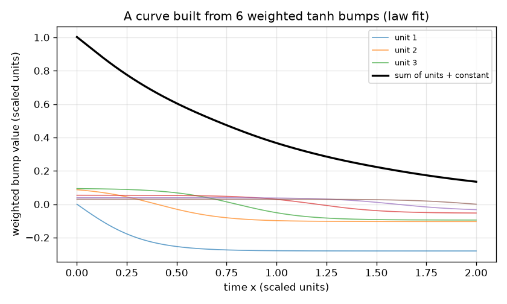
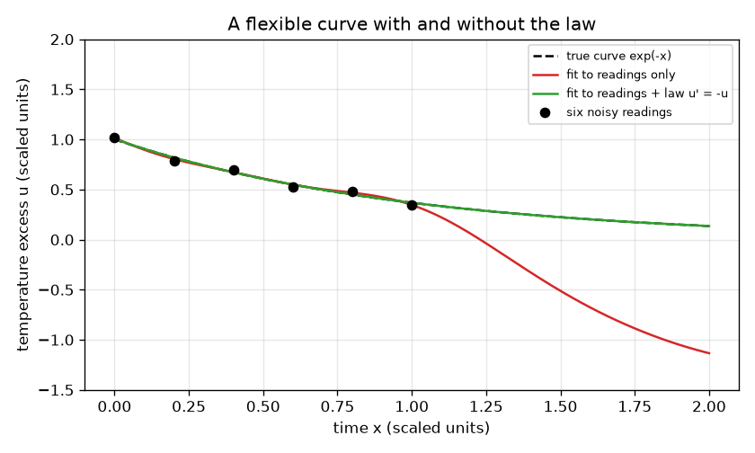

# సెషన్ 1: ఒక నియమాన్ని కూడా పాటించగల సరళమైన వక్రం

[Session 1 — हिन्दी](README.hi.md)

*స్థాయి 1 (భావనాత్మక ఇంటరాక్టివ్ నమూనా) · సుమారు 60 నిమిషాలు · openpinn*

> ఇది సరళీకరించిన విద్యా నమూనా. ఇది ధృవీకరించబడిన (validated) డిజైన్ సాధనం కాదు; నిజమైన నిర్మాణాలు, విద్యుత్ ఇన్‌స్టలేషన్లు, వాహనాలు, పారిశ్రామిక ప్రక్రియలు లేదా వైద్య నిర్ణయాల కోసం దీనిని ఉపయోగించకూడదు.

**ముందస్తు అవసరాలు (Prerequisites)**

- పాఠశాల బీజగణితం: ప్రమేయాలు మరియు గ్రాఫ్‌లు.
- వాలు (slope; అవకలజం) అనే ఆలోచన; ఏ కలన సాంకేతికత అవసరం లేదు.
- మీరు PRIMER.md చదివి, `python start.py 1` ఒకసారి రన్ చేశారు.

**అభ్యసన లక్ష్యాలు (Learning objectives).** ఈ సెషన్ తర్వాత మీరు:

- నెట్‌వర్క్ అవుట్‌పుట్ మృదువైన బంప్‌ల (bumps) భారిత మొత్తమని, ఎక్కువ బంప్‌లు వక్రాన్ని ఎందుకు ఎక్కువ సరళంగా చేస్తాయని వివరించగలరు.
- ఆ వక్రాన్ని శబ్దం గల ఆరు రీడింగ్‌లకు కనీస వర్గాల (least squares) ద్వారా సరిపోల్చి, రీడింగ్‌ల మధ్య మరియు అవతల అది ఎక్కడ తప్పుతుందో చూడగలరు.
- అదే సరిపోలికలో ఒక భౌతిక నియమాన్ని అదనపు వరుసలుగా చేర్చి, మొత్తం పరిధిలో మెరుగుదలను కొలవగలరు.
- నియమం యొక్క బలంలో మరియు బంప్‌ల సంఖ్యలో రాజీని (trade-off) వివరించగలరు.

## A. వాస్తవ ప్రపంచ సమస్య
ఒక కప్పు టీని దాని మొదటి నిమిషంలో ఆరుసార్లు కొలుస్తారు మరియు రీడింగ్‌లలో శబ్దం ఉంది. మీరు తర్వాతి నిమిషం మొత్తానికి గది ఉష్ణోగ్రత కంటే ఉష్ణోగ్రత అధికాన్ని కూడా అంచనా వేయాలి. ఒక సరళమైన వక్రం ఆరు రీడింగ్‌ల దగ్గర గుండా వెళ్ళి, రీడింగ్‌లు లేని చోట విపరీతంగా ఊగవచ్చు. కానీ మీకు ఒక నియమం కూడా తెలుసు: అధికం తనకే అనులోమానుపాతంలో తగ్గుతుంది. స్కేల్ చేసిన ప్రమాణాల్లో నియమం u' = -u అని చదవబడుతుంది, ఇక్కడ u' వక్రం యొక్క వాలు. ఇదే భౌతికశాస్త్ర-సమాచార నెట్‌వర్క్‌ల (physics-informed networks) ఆలోచన: వక్రాన్ని డేటా మరియు నియమం రెండూ వంచుతాయి. (సాధారణ విద్య మాత్రమే: ఇది బొమ్మ నమూనా, డిజైన్ సాధనం కాదు.)

## B. భావన మరియు సిద్ధాంతం
న్యూరల్-నెట్‌వర్క్ యూనిట్ ఒక మృదువైన మెట్టు, tanh(s), అది చాలా ఎడమ వైపు -1, చాలా కుడి వైపు +1, s = 0 వద్ద 0. దాన్ని x - m తో కదిలించి, నిటారుదనం (steepness) తో పదును పెడితే ఒక బంప్ వస్తుంది. H బంప్‌లతో నిర్మించిన వక్రం u(x) = c_1 tanh(3 (x - m_1)) + ... + c_H tanh(3 (x - m_H)) + c_0. ఈ సెషన్‌లో కేంద్రాలు m_j స్థిరం, 0 నుండి 2 వరకు సమానంగా విస్తరించి ఉన్నాయి, భారాలు c మాత్రమే ఎంచుకోబడతాయి. (వక్రం - రీడింగ్)^2 మొత్తాన్ని అతి చిన్నదిగా చేసే భారాలను కనీస వర్గాలు ఎంచుకుంటాయి; భారాల పరిమాణంపై చిన్న జరిమానా మొత్తాలను సమంజసంగా ఉంచుతుంది. వక్రం యొక్క వాలు కూడా మళ్ళీ భారిత మొత్తం, ఎందుకంటే tanh(s) వాలు 1 - tanh(s)^2. కాబట్టి 'ఎంచుకున్న బిందువుల వద్ద వాలు + విలువ = 0' అనే ప్రకటన కూడా భారాలలో రేఖీయ సమీకరణాల సమితి. వీటిని lam బలంతో సరిపోలికకు జోడిస్తాము: ఇదే భౌతికశాస్త్ర-సమాచార సరిపోలిక.

| గుర్తు | అర్థం | ప్రమాణం |
|---|---|---|
| x | కాలం (స్కేల్ చేసినది) | పరిమాణరహితం |
| u(x) | ఉష్ణోగ్రత అధికం (స్కేల్ చేసినది) | పరిమాణరహితం |
| H | tanh బంప్‌ల (యూనిట్ల) సంఖ్య | లెక్క |
| c_j | బంప్ j యొక్క భారం | పరిమాణరహితం |
| m_j | బంప్ j యొక్క కేంద్రం | x వలె అదే ప్రమాణం |
| lam | డేటాతో పోలిస్తే నియమం యొక్క బలం | పరిమాణరహితం |

**ఊహలు (Assumptions)**

- నిజమైన నియమం u' = -u, u స్కేల్ చేసిన ప్రమాణాల్లో కొలవబడుతుంది (నిజమైన చల్లబడే రేటు మరియు ఉష్ణోగ్రతలు స్కేలింగ్‌లో కలిసిపోయాయి).
- ఆరు రీడింగ్‌లకు 0.03 లేదా తక్కువ చిన్న శబ్దం ఉంది, ఒకసారి శాశ్వతంగా నిర్ణయించబడింది.
- బంప్ కేంద్రాలు మరియు నిటారుదనం (3) స్థిరం; భారాలు మాత్రమే సరిపోల్చబడతాయి (ఇది సరళీకరించిన నమూనా).

$$ u(x)=c_0+\sum_{j=1}^{H} c_j\tanh\!\big(3\,(x-m_j)\big) $$

$$ u'(x)=\sum_{j=1}^{H} 3\,c_j\left(1-\tanh^2\!\big(3\,(x-m_j)\big)\right) $$

$$ \min_c\ \sum_{i=1}^{6}\big(u(x_i)-y_i\big)^2+\lambda\sum_{k=1}^{21}\big(u'(s_k)+u(s_k)\big)^2 $$

## C. దృశ్య వివరణ
మొదటి చిత్రం ఆరు శబ్ద రీడింగ్‌లు (చుక్కలు), నిజమైన వక్రం exp(-x) (చుక్కల గీత) మరియు 0 నుండి 2 వరకు పరిధిలో రెండు సరిపోల్చిన వక్రాలను గీస్తుంది. ఎరుపు వక్రం రీడింగ్‌లను మాత్రమే ఉపయోగిస్తుంది: అది ఆరు రీడింగ్‌లకు దగ్గరగా వెళుతుంది, కానీ వాటి అవతల నిజం నుండి చాలా దూరం ఊగుతుంది. ఆకుపచ్చ వక్రం నియమాన్ని కూడా పాటించి నిజమైన వక్రంపై కూర్చుంటుంది. రెండవ చిత్రం ఆరు భారిత బంప్‌లు ఒక వక్రంగా ఎలా కూడతాయో చూపిస్తుంది.

*వక్రం అంటే భారిత tanh బంప్‌లు మరియు ఒక స్థిరాంకం యొక్క మొత్తం.*

*అదే పన్నెండు బంప్‌లు శబ్దం గల ఆరు రీడింగ్‌లకు సరిపోల్చబడ్డాయి: రీడింగ్‌లు మాత్రమే (ఎరుపు) దూరంగా ఊగుతుంది, నియమంతో (ఆకుపచ్చ) నిజాన్ని అనుసరిస్తుంది.*

## D. ఇంటరాక్టివ్ సిమ్యులేషన్
పాఠాన్ని రన్ చేయండి (`python start.py 1`), తర్వాత లైవ్ యాప్‌ను తెరవండి: [సెషన్ 1: నియమంతో మరియు నియమం లేకుండా ఒక వక్రం](https://krunalpanchal1995.github.io/pan-iit-oss/openpinn/session-01/) (లేదా ఈ ఫోల్డర్‌లోని `app.html`). రెండు వీక్షణల మధ్య మారండి. వక్ర వీక్షణలో నియమ భారాన్ని 0 నుండి పెంచి, ఎరుపు వక్రం కదలకుండా ఉండగా ఆకుపచ్చ వక్రం బూడిద వక్రంపై అతుక్కోవడం గమనించండి. తర్వాత యూనిట్ల సంఖ్యను 3 కి తగ్గించి, చాలా తక్కువ బంప్‌లతో నియమాన్ని పాటించడం సాధ్యం కాదని చూడండి.

**సవాలు.** ఆకుపచ్చ వక్రాన్ని నిజమైన వక్రం యొక్క 0.01 rms దోషంలోకి తీసుకురండి: కనీసం 6 యూనిట్లు మరియు 0.5 నుండి 5 మధ్య నియమ భారాన్ని ఉపయోగించండి.

## E. సాధించిన ఉదాహరణ మరియు ప్రయోగం
**సమస్య.** 12 బంప్‌లను ఆరు రీడింగ్‌లకు సరిపోల్చండి, మొదట డేటా మాత్రమే, తర్వాత నియమంతో (lam = 1). x 0 నుండి 2 వరకు exp(-x) కు వ్యతిరేకంగా rms దోషాన్ని మరియు |u' + u| యొక్క అతిపెద్ద విలువను పోల్చండి.

1. రీడింగ్‌లు x = 0, 0.2, ..., 1.0 వద్ద y = exp(-x) + శబ్దం. ఉదాహరణకు x = 0.4 వద్ద రీడింగ్ exp(-0.4) + 0.025 = 0.6703 + 0.025 = 0.695.
2. డేటా మాత్రమే: 13 భారాలు (12 బంప్‌లు మరియు స్థిరాంకం) 6 సంఖ్యలకు సరిపోవాలి, కాబట్టి అనేక వక్రాలు సమానంగా సరిపోతాయి; సరిపోలిక ప్రతి రీడింగ్ యొక్క 0.05 లోపల వెళుతుంది, కానీ 0 నుండి 2 వరకు exp(-x) కు వ్యతిరేకంగా దాని rms దోషం 0.5 కంటే ఎక్కువ.
3. నియమంతో (0 నుండి 2 వరకు 21 నియమ వరుసలు, lam = 1): rms దోషం 0.001 కంటే తక్కువకు పడిపోతుంది.
4. అతిపెద్ద |u' + u| నియమం లేకుండా 2 కంటే ఎక్కువ మరియు నియమంతో 0.03 కంటే తక్కువ: నియమ-సరిపోలిక వక్రం చుక్కల వద్ద మాత్రమే కాక, ప్రతిచోటా సమీకరణాన్ని దాదాపు పాటిస్తుంది.

**సమాధానం.** రీడింగ్‌లు మాత్రమే: rms దోషం 0.5 కంటే ఎక్కువ. రీడింగ్‌లు మరియు నియమం: rms దోషం 0.001 కంటే తక్కువ, అతిపెద్ద |u' + u| 2 కంటే ఎక్కువ నుండి 0.03 కంటే తక్కువకు పడిపోతుంది.

**ప్రయోగం.** నిజమైన చల్లబడే డేటా తీసుకోండి: కప్పులో గోరువెచ్చని నీరు పోసి, మూడు నిమిషాలు ప్రతి 15 సెకన్లకు థర్మామీటర్ చదివి గది ఉష్ణోగ్రత కంటే అధికాన్ని గీయండి. నియమం u' = -k u తో మరియు లేకుండా సరిపోల్చండి. నిజమైన కప్పులు నియమాన్ని సుమారుగా మాత్రమే పాటిస్తాయి (ఆవిరవడం, కప్పు స్వయంగా, గాలి), కాబట్టి నియమ-సరిపోలిక వక్రానికి చిన్న క్రమబద్ధ దోషం ఉంటుంది, కానీ ఇక్కడి నమూనాకు అది లేదు ఎందుకంటే డేటా నియమం మరియు శబ్దం నుండి వచ్చింది. నమూనా మరియు వాస్తవం: వక్రంపై బలవంతంగా రుద్దిన తప్పు నియమం, నియమం లేకపోవడం కంటే దారుణం.

## F. మూల్యాంకనం మరియు డిజైన్ సవాలు
**ప్రశ్న రకం A: భావనాత్మక.** ఆరు రీడింగ్‌ల 0.05 లోపల వెళ్ళే వక్రం రెండవ నిమిషానికి ఎందుకు చెడ్డ అంచనా కావచ్చు?

సూచన

తెలియని భారాలను మరియు రీడింగ్‌లను లెక్కించి, రీడింగ్‌లు లేని చోట వక్రాన్ని ఏమి చేయమని అడుగుతున్నారో అడగండి.

దశలవారీ పరిష్కారం

12 బంప్‌లతో 13 భారాలు ఉన్నాయి కానీ 6 రీడింగ్‌లు మాత్రమే, కాబట్టి చాలా విభిన్న వక్రాలు రీడింగ్‌లకు సమానంగా సరిపోతాయి, సమంజసమైనదాన్ని ఇష్టపడటానికి ఏ కారణమూ లేకుండా సరిపోలిక ఒకదాన్ని ఎంచుకుంటుంది. రీడింగ్‌ల బయట ఏదీ దాన్ని నియంత్రించదు, కాబట్టి అది విపరీతంగా ఊగవచ్చు (ఇక్కడ rms దోషం 0.5 కంటే ఎక్కువ). నియమం రీడింగ్‌లు లేని బిందువుల వద్ద అదనపు సమీకరణాలను ఇస్తుంది, అది ఆ స్వేచ్ఛను తొలగిస్తుంది.

**ప్రశ్న రకం B: సంఖ్యాత్మక.** అభ్యర్థి వక్రం u = exp(-0.9 x). x = 1 వద్ద నియమ అవశేషం (residual) u' + u ను లెక్కించండి. అభ్యర్థి u' = -u కి సాధనమా?

సూచన

exp(-0.9 x) వాలు -0.9 exp(-0.9 x).

దశలవారీ పరిష్కారం

u' + u = -0.9 exp(-0.9) + exp(-0.9) = 0.1 exp(-0.9) = 0.1 * 0.4066 = 0.0407 (స్కేల్ చేసిన ప్రమాణాలు), సున్నా కాదు, కాబట్టి అభ్యర్థి దగ్గరగా ఉంది కానీ సాధన కాదు. భౌతికశాస్త్ర-సమాచార నష్టం వర్గం చేసి సగటు తీసుకునే పరిమాణమే అవశేషం.

**ప్రశ్న రకం C: గ్రాఫ్ మరియు సిమ్యులేషన్ వ్యాఖ్యానం.** యాప్‌లో, 6 యూనిట్లతో, x = 2 వద్ద ఎరుపు మరియు ఆకుపచ్చ వక్రాలను పోల్చండి. తేడా ఏమి చెబుతుంది, నియమం ఆన్‌లో ఉన్నప్పుడు దోషం ఎంత?

సూచన

నియమ భారం 0 వద్ద, తర్వాత 1 వద్ద వక్ర వీక్షణను తెరవండి.

దశలవారీ పరిష్కారం

నియమ భారం 0 అయినప్పుడు ఎరుపు వక్రం x = 2 వద్ద బూడిద వక్రం నుండి చాలా దూరంగా ఉంటుంది, ఎందుకంటే అక్కడ దగ్గరలో రీడింగ్‌లు లేవు. భారం 1 అయినప్పుడు ఆకుపచ్చ వక్రం బూడిద వక్రంపై ఉంటుంది: 6 యూనిట్లు మరియు నియమ భారం 1 తో rms దోషం నియమం లేకుండా కంటే చాలా తక్కువ (10 రెట్లకు పైగా). నియమం రీడింగ్‌లకు అతీతమైన సమాచారాన్ని మోస్తుంది.

**ప్రశ్న రకం D: డిజైన్ మరియు ఆప్టిమైజేషన్ (optimisation) సవాలు.** డిజైన్: మీరు గరిష్టంగా 6 యూనిట్లు భరించగలరు మరియు rms దోషం 0.01 కంటే తక్కువ కావాలి. నియమ భారాన్ని ఎంచుకుని, అది చాలా పెద్దదైతే లేదా 3 యూనిట్లు మాత్రమే ఉపయోగిస్తే ఏమి జరుగుతుందో చెప్పండి.

సూచన

యాప్‌లో 6 యూనిట్లతో భారాలు 0.5, 1, 2, 5, 10 ప్రయత్నించండి, తర్వాత 3 యూనిట్లు.

దశలవారీ పరిష్కారం

6 యూనిట్లతో, 0.5 నుండి 5 వరకు ఏ నియమ భారమైనా 0.01 కంటే తక్కువ rms దోషం ఇస్తుంది, కాబట్టి సుమారు 1 ఎంచుకోండి. చాలా పెద్ద భారం (50) సరిపోలికను ఆరు రీడింగ్‌ల కంటే నియమం గురించి ఎక్కువ పట్టించుకునేలా చేస్తుంది, దోషం మళ్ళీ పెరుగుతుంది (భారం 1 వద్ద కంటే ఎక్కువ). కేవలం 3 యూనిట్లతో వక్రం నియమాన్ని పాటించేంతగా వంగదు: భారం 1 వద్ద దోషం 0.05 కంటే ఎక్కువగా ఉంటుంది. రాజీ (trade-off): నియమం ఆకారాన్ని, రీడింగ్‌లు స్కేల్‌ను నిర్ణయిస్తాయి, రెండూ చేయడానికి వక్రం తగినంత సరళంగా ఉండాలి.

[RUBRIC.md](../../RUBRIC.md) తో మిమ్మల్ని మీరు స్కోర్ చేసుకోండి. కాగితంపై చేయడానికి [కార్యాచరణ పత్రాన్ని](activity_sheet.md) ప్రింట్ చేయండి.

## సాధారణ అపోహలు
| సాధారణ అపోహ | వాస్తవంగా నిజమైనది |
|---|---|
| అన్ని డేటా బిందువులకు ఖచ్చితంగా సరిపోయే నెట్‌వర్క్ సరైనదై ఉండాలి. | అనేక వక్రాలు ఒకే బిందువులకు సరిపోతాయి. బిందువులు లేని చోట నియమం నియంత్రించకపోతే వక్రం ఏదైనా చేయవచ్చు. |
| భౌతికశాస్త్రాన్ని జోడించడం ఎల్లప్పుడూ సహాయపడుతుంది, ఎంత ఎక్కువైతే అంత మంచిది. | డేటాతో పోలిస్తే చాలా బలమైన నియమం, లేదా దాన్ని పాటించలేనంత చిన్న నెట్‌వర్క్, సరిపోలికను దెబ్బతీస్తుంది; భారం ఒక రాజీ. |
| న్యూరల్ నెట్‌వర్క్ మాయ. | ఇక్కడ అది tanh బంప్‌ల భారిత మొత్తం; 'నేర్చుకోవడం' అంటే కనీస వర్గాలు. |

## పదకోశం (Glossary)
- **యూనిట్ (న్యూరాన్, unit/neuron)**: నెట్‌వర్క్‌లో ఒక మృదువైన బంప్ tanh(a x + d)
- **భారం (weight)**: యూనిట్ అవుట్‌పుట్ సహకారాన్ని స్కేల్ చేసే సంఖ్య
- **కనీస వర్గాలు (least squares)**: వర్గ భేదాల మొత్తాన్ని అతి చిన్నదిగా చేసే సంఖ్యలను ఎంచుకోవడం
- **అవశేషం (residual)**: వక్రం సమీకరణాన్ని పాటించడం నుండి ఎంత దూరంలో ఉంది; ఇక్కడ u' + u
- **భౌతికశాస్త్ర-సమాచార (physics-informed)**: డేటాతో పాటు సమీకరణాన్ని కూడా తృప్తిపరచడానికి శిక్షణ పొందినది

## ముగింపు
1. [exercises.md](exercises.md) లోని మూడు కోడింగ్ పనులను చేయండి.
2. మీ మార్పుల తర్వాత `python start.py 1` మళ్ళీ రన్ చేయండి. అది చెక్‌పాయింట్‌తో ముగుస్తుంది; అది `PASS` ప్రింట్ చేసినప్పుడు మీరు పూర్తి చేశారు. (చెక్‌పాయింట్ మాత్రమే: `python start.py check 1`.)

తర్వాత: [సెషన్ 2](../session-02/README.md)
