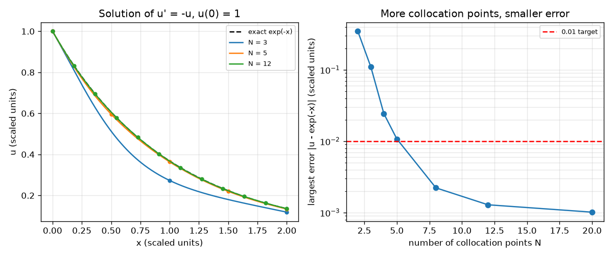
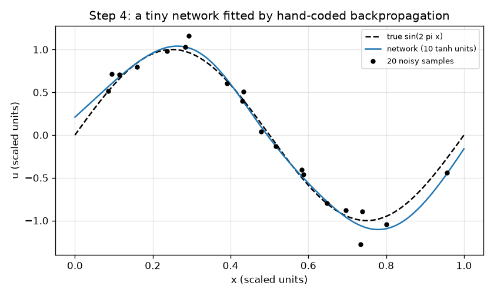

# Session 2: Train a tiny network on a differential equation

*Level 2 (mathematical engineering model) · about 75 minutes · openpinn*

> This is a simplified educational model. It is not a validated design tool and must not be used for real structures, electrical installations, vehicles, industrial processes or medical decisions.

**Prerequisites**

- Session 1: a curve as a sum of bumps, and the law as a residual.
- The chain rule (explained in Section B).
- Slopes of functions such as tanh and exp.

**Learning objectives.** After this session you can:

- Write a one-hidden-layer tanh network and its slope, and derive its gradients by hand (backpropagation).
- Verify the hand gradients against finite differences and train with Adam written in numpy.
- Build a physics-informed loss for u' = -u, u(0) = 1 from a residual term and a boundary term.
- Study how many collocation points are needed, and read the residual between the points.

## A. Real-world problem
Hot tea cools so that its excess temperature u obeys du/dx = -u, with u(0) = 1 (scaled units; x is time). The exact answer is exp(-x). Instead of stepping the equation forward in time, we ask a network to be a function whose slope plus value is zero at chosen points (collocation points) and which equals 1 at x = 0. How many collocation points must we choose before the network is right everywhere, not only at the points?

## B. Concept and theory
A network with H tanh units computes u(x) = sum_j c_j tanh(a_j x + d_j) + e. Its slope follows from the chain rule: since d tanh(z)/dz = 1 - tanh(z)^2 =: s, the slope is du/dx = sum_j c_j a_j s_j. A loss L measures how bad the network is; backpropagation uses the chain rule to find how L changes with each parameter, so each parameter can be nudged downhill. Adam is a gradient method that keeps running averages of the gradient and of its square, so parameters with small gradients still move. For the equation we do not need data: the loss is the average of the squared residual (du/dx + u) at N collocation points plus the squared boundary error (u(0) - 1)^2. The residual term is zero exactly when the law holds at the points; the boundary term fixes the amplitude, since the law alone allows any multiple of exp(-x). Between the points the law is not enforced: more points means a smaller gap.

| Symbol | Meaning | Unit |
|---|---|---|
| a_j, d_j | input weight and shift of unit j | dimensionless |
| c_j, e | output weight of unit j and constant offset | dimensionless |
| s_j | slope of tanh at unit j: 1 - tanh^2 | dimensionless |
| N | number of collocation points on x = 0 to 2 | count |
| r(x) | residual du/dx + u | dimensionless (scaled) |
| L | loss: mean squared residual plus boundary error squared | dimensionless |

**Assumptions**

- The equation is u' = -u with u(0) = 1 on x from 0 to 2 (scaled units).
- Collocation points are evenly spaced from 0 to 2, including the ends.
- Ten hidden units, 3000 Adam steps with step size 0.01, one fixed random start (seed 0).

$$ u(x)=\sum_{j=1}^{H} c_j\tanh(a_j x+d_j)+e,\qquad \frac{du}{dx}=\sum_{j=1}^{H} c_j a_j\left(1-\tanh^2(a_j x+d_j)\right) $$

$$ \frac{\partial u}{\partial c_j}=\tanh_j,\quad \frac{\partial u}{\partial a_j}=c_j s_j\,x,\quad \frac{\partial u}{\partial d_j}=c_j s_j,\quad s_j=1-\tanh_j^2 $$

$$ \mathcal L=\frac1N\sum_{i=1}^{N}\left(\frac{du}{dx}(x_i)+u(x_i)\right)^2+\big(u(0)-1\big)^2 $$

$$ m\leftarrow 0.9\,m+0.1\,g,\quad v\leftarrow 0.999\,v+0.001\,g^2,\quad p\leftarrow p-\eta\,\frac{\hat m}{\sqrt{\hat v}+10^{-8}} $$

## C. Visual explanation
The first figure shows the network fitted by backpropagation to 20 noisy samples of sin(2 pi x): the curve follows the trend; its rms distance to the noisy samples is below the noise level 0.1, so it has already begun to follow some of the noise. The second figure shows the physics-only solution of u' = -u for several numbers of collocation points N: with few points the curve is visibly off, with 12 it lies close to exp(-x). The right panel plots the largest error against N on a log axis, with the 0.01 target as a red line.

*Left: the network solution for N = 3, 5, 12 against exp(-x). Right: largest error against the number of collocation points.*

*A 10-unit network fitted to 20 noisy samples of sin(2 pi x) by hand-coded backpropagation.*

## D. Interactive simulation
Run the lesson (`python start.py 2`), then open the live app: [Session 2: how many collocation points?](https://krunalpanchal1995.github.io/pan-iit-oss/openpinn/session-02/) (or `app.html` in this folder). Raise the number of collocation points and watch the blue curve approach the grey one, then open the residual view: the residual is about zero at the dots but not between them, until the dots are close enough. Add more units and see the effect.

**Challenge.** Get the largest error below 0.01: use at least 10 collocation points and at least 8 units.

## E. Worked example and experiment
**Problem.** A trial solution u = exp(-0.8 x) is tested at the three collocation points x = 0, 1, 2. Compute the loss of Section B and compare with the exact solution; then read the error table for N collocation points.

1. u = exp(-0.8 x) has slope -0.8 exp(-0.8 x), so the residual is u' + u = 0.2 exp(-0.8 x).
2. At x = 0, 1, 2 the residuals are 0.2, 0.2 exp(-0.8) = 0.0899 and 0.2 exp(-1.6) = 0.0404.
3. Mean of the squares = (0.04 + 0.00808 + 0.00163) / 3 = 0.01657. The boundary term is (u(0) - 1)^2 = 0, so the loss is 0.0166.
4. For the exact solution exp(-x) every residual is 0 and the loss is 0.
5. Training the network (10 units) for several N gives the largest error against exp(-x) on 0 to 2: above 0.3 for N = 2, between 0.01 and 0.02 for N = 5, below 0.01 for N = 8 and below 0.002 for N = 20.

**Answer.** The trial solution has loss 0.0166 (the exact solution 0). The network error falls from above 0.3 at N = 2 to below 0.01 at N = 8.

**Experiment.** Compare with a classical numerical solution: Euler's method with a step 0.1 is a short loop of 20 steps from 0 to 2, while the network needs thousands of training steps for 8 points. For this one-variable equation a classical method is cheaper; the point is that the network treats data and law with the same loss. Differences between model and reality: a real cooling process is never exactly u' = -u, so the residual could never be zero on real data.

## F. Assessment and design challenge
**Question type A: Conceptual.** Why does the loss need the boundary term (u(0) - 1)^2? What would the network do without it?

Hint

Is u = 2 exp(-x) also a solution of u' = -u?

Step-by-step solution

The law is satisfied by any multiple of exp(-x), for example 2 exp(-x), which has zero residual but the wrong amplitude. The boundary term pins the amplitude through u(0) = 1. Without it the training would drift to any multiple (or just to u = 0, which has zero residual).

**Question type B: Numerical.** For a single unit u = tanh(x) (c = 1, a = 1, d = 0, e = 0), compute the residual u' + u at x = 0.5.

Hint

tanh(0.5) = 0.4621; the slope of tanh(x) is 1 - tanh(x)^2.

Step-by-step solution

u = 0.4621. The slope is 1 - 0.4621^2 = 1 - 0.2135 = 0.7864. The residual is 0.7864 + 0.4621 = 1.249 (scaled units): this unit is far from solving the equation, as expected (a decaying exponential needs the sum of several units).

**Question type C: Graph and simulation interpretation.** In the error-against-N plot, what is the smallest N tested that brings the largest error below 0.01, and what happens at N = 2?

Hint

Read where the curve crosses the red line; the tested values are 2, 3, 5, 8, 12 and 20.

Step-by-step solution

Among the tested values the first N with error below 0.01 is 8 (N = 5 gives an error just above 0.01). At N = 2 the error is above 0.3: two points can be satisfied by many wrong curves, because the network is free between and beyond them.

**Question type D: Design and optimisation challenge.** Design: you can afford at most 8 collocation points (each costs a training evaluation) but need the largest error below 0.01 on 0 to 2. Is that possible, and what would you change if a colleague wanted 0.001?

Hint

Look at the table of errors against N, and think about where the points could be placed.

Step-by-step solution

Yes: N = 8 gives an error below 0.01 (and N = 20 gives an error below 0.002). For 0.001 you would add more points, add more units or train longer; none of the tested settings is guaranteed to reach it. Trade-off: points and units cost compute, while accuracy is also limited by how long the optimiser runs.

Score yourself with [RUBRIC.md](../../RUBRIC.md). Print the [activity sheet](activity_sheet.md) to work on paper.

## Common misconceptions
| Common misconception | What is actually true |
|---|---|
| If the loss is small at the collocation points, the network solves the equation. | The law is only demanded at the points. Between them the residual can be much larger (it is about 0.30 at N = 3). |
| Backpropagation is a different mathematics from calculus. | It is the chain rule applied systematically; checking it against finite differences proves it. |
| Training on an equation needs measured data. | Here there are no data at all: the equation and one boundary value are enough. |

## Glossary
- **collocation point**: a point where the equation is demanded to hold
- **residual**: left side minus right side of the equation; zero if it holds
- **backpropagation**: the chain rule applied to find the gradient of the loss with respect to every parameter
- **Adam**: a gradient method with running averages of the gradient and its square
- **boundary condition**: a known value of the solution at an edge, here u(0) = 1

## Finish
1. Do the three coding tasks in [exercises.md](exercises.md).
2. Run `python start.py 2` again after your changes. It ends with the checkpoint; when it prints `PASS`, you are done. (Checkpoint only: `python start.py check 2`.)

Next: [Session 3](../session-03/README.md)
