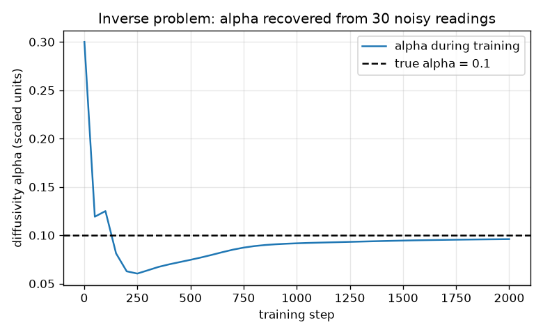
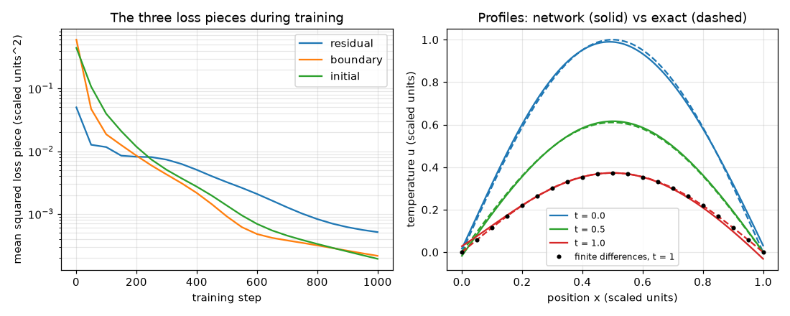

# Session 3: A network that solves the heat equation, and finds its diffusivity

*Level 3 (simulation and validation) · about 90 minutes · openpinn*

> This is a simplified educational model. It is not a validated design tool and must not be used for real structures, electrical installations, vehicles, industrial processes or medical decisions.

**Prerequisites**

- Session 2: backpropagation by hand, Adam and the physics-informed loss.
- Partial derivatives: u_t is the slope in time at fixed x and u_xx the curvature in x at fixed t.
- A Level 3 comfort with numerical error and a relative error.

**Learning objectives.** After this session you can:

- State the heat equation with its boundary and initial conditions and its exact solution.
- Derive and verify the formulas for u_t and u_xx of a one-hidden-layer tanh network, and train it with Adam on residual, boundary and initial losses.
- Validate against the exact solution and against an explicit finite-difference solver, and report the relative L2 error honestly.
- Study the failure cases (too few collocation points, a badly weighted loss, a higher-frequency solution) and compare cost with a classical solver.
- Recover the diffusivity from noisy readings by making it a trainable parameter, and judge when the estimate can be trusted.

## A. Real-world problem
A thin metal rod of length 1 (scaled units) has both ends held at temperature 0 and starts with a smooth hump of heat, u(x, 0) = sin(pi x). Heat leaks out and the rod cools according to the heat equation u_t = alpha u_xx, where alpha is the diffusivity. We ask a network u(x, t) to satisfy the equation inside, the ends and the starting hump, and we judge it against the exact solution and against a classical solver. Then we turn the problem around: from 30 noisy thermometer readings, what is alpha? (A simplified teaching model: real rods lose heat from their sides, and diffusivity varies with temperature.)

## B. Concept and theory
The heat equation u_t = alpha u_xx on 0 <= x <= 1 with u(0, t) = u(1, t) = 0 and u(x, 0) = sin(pi x) has the exact solution u = sin(pi x) exp(-alpha pi^2 t): the hump keeps its shape and decays, with half-life ln 2 / (alpha pi^2). The network u(x, t) = sum_j c_j tanh(a_j x + b_j t + d_j) + e has, by the chain rule, u_t = sum c_j b_j s_j and u_xx = sum c_j a_j^2 s2_j, where s = 1 - tanh^2, s2 = -2 tanh s and s3 = s (6 tanh^2 - 2) are the first three derivatives of tanh. Backpropagation through these formulas needs s3 too. The key correctness check compares the formulas with finite differences of u. The loss is w_res times the mean squared residual (u_t - alpha u_xx) at N random interior points, plus the mean squared boundary error, plus the mean squared initial error. The classical reference is the explicit scheme: each interior value moves towards the average of its neighbours, u_i(new) = u_i + r (u_(i-1) - 2 u_i + u_(i+1)) with r = alpha dt / dx^2, which is stable only for r <= 1/2. For the inverse problem alpha becomes a trainable parameter, a data term compares the network with the noisy readings, and a classical alternative is to fit alpha directly when the form of the solution is known.

| Symbol | Meaning | Unit |
|---|---|---|
| x | position along the rod (scaled) | dimensionless |
| t | time (scaled) | dimensionless |
| u(x, t) | temperature (scaled) | dimensionless |
| alpha | diffusivity (true value 0.1) | scaled length^2 per time |
| w_res | weight of the residual term in the loss | dimensionless |
| N | number of collocation points | count |
| r | explicit-scheme number alpha dt / dx^2 | dimensionless |

**Assumptions**

- One space dimension, ends held at 0, a smooth start sin(pi x), time from 0 to 1.
- Network: 20 tanh units, 200 random collocation points, 50 boundary points on each end and 50 initial points, Adam step 0.005 for 1000 steps (inverse problem: 2000 steps).
- Readings: 30 random points with noise 0.02; all numbers are in scaled units.
- A simplified educational model, not a validated engineering tool.

$$ u_t=\alpha\,u_{xx},\qquad u(0,t)=u(1,t)=0,\qquad u(x,0)=\sin(\pi x) $$

$$ u(x,t)=\sin(\pi x)\,e^{-\alpha\pi^2 t},\qquad t_{1/2}=\frac{\ln 2}{\alpha\pi^2} $$

$$ u=\sum_j c_j\tanh z_j+e,\quad u_t=\sum_j c_j b_j\,s_j,\quad u_{xx}=\sum_j c_j a_j^2\,s_j'',\quad z_j=a_jx+b_jt+d_j $$

$$ \mathcal L=w_{\mathrm{res}}\,\overline{(u_t-\alpha u_{xx})^2}+\overline{u(0,t)^2}+\overline{u(1,t)^2}+\overline{(u(x,0)-\sin\pi x)^2} $$

$$ u_i^{n+1}=u_i^n+r\,(u_{i-1}^n-2u_i^n+u_{i+1}^n),\qquad r=\frac{\alpha\,\Delta t}{\Delta x^2}\le\frac12 $$

$$ E=\frac{\lVert u_{\mathrm{net}}-u_{\mathrm{exact}}\rVert_2}{\lVert u_{\mathrm{exact}}\rVert_2} $$

## C. Visual explanation
The first figure shows three heat-maps of u(x, t) on the unit square: the exact solution, the network, and the absolute error between them; the network is close to the exact solution, with a small absolute error everywhere. The second figure has two panels: the three loss pieces falling during training on a log axis, and the temperature profiles at three times, network (solid) against exact (dashed), with the finite-difference values at t = 1 as dots. The third figure shows the diffusivity during the inverse training, starting at the wrong guess 0.3 and settling near the true 0.1.

![Exact solution, network solution and absolute error of the heat equation on x, t in [0, 1].](../../docs/figures/s03_heatmaps.png)

*Exact solution, network solution and absolute error of the heat equation on x, t in [0, 1].*

*The diffusivity during inverse training, started at 0.3, against the true value 0.1.*

*Left: the three loss pieces during training. Right: temperature profiles at t = 0, 0.5 and 1, network against exact, with the finite-difference values at t = 1.*

## D. Interactive simulation
Run the lesson (`python start.py 3`), then open the live app: [Session 3: the classical reference for the heat equation](https://krunalpanchal1995.github.io/pan-iit-oss/openpinn/session-03/) (or `app.html` in this folder). Use the app as the classical reference for the network: watch the exact heat-map, the explicit finite-difference profile and the decay of the centre temperature. Raise r above 0.5 with a tiny ripple on the start and watch the scheme blow up.

**Challenge.** Make the explicit scheme blow up: choose r at least 0.6, a time of at least 0.5, alpha at least 0.1 and a ripple of at least 0.001.

## E. Worked example and experiment
**Problem.** For alpha = 0.1 find the exact temperature at the rod centre at t = 1 and the half-life, then compare the trained network and the finite-difference scheme (20 intervals, r = 0.4) with it.

1. u(0.5, 1) = sin(pi / 2) exp(-0.1 pi^2) = exp(-0.987) = 0.3727.
2. Half-life: t = ln 2 / (0.1 pi^2) = 0.693 / 0.987 = 0.702, so the centre has fallen to 0.5 at t = 0.702 (the exact amplitude there is 0.5).
3. The trained network (20 units, 200 points, 1000 steps) gives a value within 0.01 of 0.3727 at (0.5, 1) and a relative L2 error below 0.02 over the whole square.
4. Finite differences: dx = 0.05 and r = 0.4 give dt = r dx^2 / alpha = 0.4 * 0.0025 / 0.1 = 0.01, so 100 steps; the relative error at t = 1 is below 0.005, while the network's error at t = 1 is more than five times larger.
5. Cost: finite differences need 100 steps of 19 updates, i.e. 1900 updates; the network training evaluates 20 units at 350 points in each of 1000 steps, i.e. 7,000,000 unit evaluations, over 1000 times more.

**Answer.** Exact u(0.5, 1) = 0.3727 and half-life 0.702. The network is within 0.01 at the centre and below 2 percent over the square; the classical solver is more accurate at t = 1 (error below 0.005) and costs over 1000 times less.

**Experiment.** Hold both ends of a metal rod in ice water, heat it into a smooth hump (for example by warming the middle), insulate the sides and log temperatures with thermocouples. Fit alpha by the direct method and by the inverse network and compare. Real rods lose heat sideways, thermocouples have lag and noise, the ends are only approximately at 0, and alpha depends a little on temperature, so the real decay is not exactly exp(-alpha pi^2 t): the model ignores these effects.

## Real-world application and mini-project: Recover the diffusivity of a rod from noisy temperature readings
A lab gives you 30 noisy temperature readings (noise 0.02) of a rod whose diffusivity is hidden; for this exercise the generator in Session 3 hides the true value 0.15. Start the network with the wrong guess 0.5 and train for 2000 steps with `train_pinn(alpha=0.0, readings=make_readings(0.15, 30, 0.02, 0), alpha_start=0.5, steps=2000)`. The history records alpha every 50 steps. Decide when you may trust the answer: the estimate dips inside 10 percent of the truth early on, long before the network is trained.

**Deliverable:** A script that prints the recovered diffusivity, the relative error of the classical direct fit `fit_alpha_direct`, the first recorded step at which alpha is within 10 percent of 0.15, and the step from which it stays within 10 percent; plus a plot of alpha against step with the true value marked.

**Success looks like:** The first visit inside 10 percent is at step 200 (a false alarm), the estimate only stays inside from step 1200, the final value 0.139 is within 10 percent of 0.15, and the direct fit is within 5 percent. Say in two sentences why the false alarm happens.

## F. Assessment and design challenge
**Question type A: Conceptual.** Why can both a too small and a too large weight of the residual term w_res make the network worse?

Hint

Think of what each of the three loss pieces insists on, and what happens when one of them is drowned out.

Step-by-step solution

With w_res = 0.01 the network pays little attention to the equation and fits the start and ends only: the relative L2 error is above 0.1. With w_res = 100 the residual dominates and the start and boundary conditions are neglected: the equation has many solutions, so the network settles on one that satisfies the equation but not the right start, and the error is above 0.05. The default w_res = 1 gives an error below 0.02. The weights balance the pieces; no value is always best.

**Question type B: Numerical.** The diffusivity is doubled to 0.2. Find the centre temperature at t = 1 and compare with alpha = 0.1. For dx = 0.05 and dt = 0.01, what is r now, and is the explicit scheme stable?

Hint

Use u(0.5, 1) = exp(-alpha pi^2) and r = alpha dt / dx^2.

Step-by-step solution

u(0.5, 1) = exp(-0.2 pi^2) = exp(-1.974) = 0.1389 (against 0.3727 for alpha = 0.1): the rod cools faster. r = 0.2 * 0.01 / 0.0025 = 0.8, above 1/2, so the explicit scheme is unstable at that dt; you would have to halve dt (r = 0.4). The original r = 0.4 was for alpha = 0.1.

**Question type C: Graph and simulation interpretation.** In the loss figure, which piece starts the largest and how far do the pieces fall? What does the profile panel show about the time t = 1?

Hint

Read the starting and final values on the log axis.

Step-by-step solution

The untrained network is neither zero at the ends nor equal to sin(pi x), so the boundary and initial pieces start large; at the end all three pieces are below 1e-3. The boundary and initial pieces fall by more than 1000 times and the residual by more than 50 times. In the profile panel the network follows the exact curves closely; the relative error is largest at t = 1, where the true values are smallest (the network error at t = 1 exceeds that of finite differences by more than five times).

**Question type D: Design and optimisation challenge.** Design: you want a relative L2 error below 0.03 at the smallest training cost by changing the number of collocation points. Which of N = 5, 20 and 200 would you choose, and what is the risk of N = 5?

Hint

Compare the errors of the three runs in the sensitivity table.

Step-by-step solution

N = 20 gives an error below 0.03 (N = 200 gives an error below 0.02, and N = 5 gives above 0.15). N = 20 is the cheapest of the tested settings that meets the target. The risk of N = 5 is that the network satisfies the equation at the five points but not in between, and the error is well above the target. Trade-off: fewer points cost less per step but need more luck; extra accuracy needs more points, more units or more steps.

Score yourself with [RUBRIC.md](../../RUBRIC.md). Print the [activity sheet](activity_sheet.md) to work on paper.

## Common misconceptions
| Common misconception | What is actually true |
|---|---|
| A small training loss means a small error against the exact solution. | The loss only measures the points used for training. With 5 collocation points the loss can be small while the error is above 0.15. |
| A PINN is better than a classical solver. | For this easy forward problem finite differences are more accurate at t = 1 and cost over 1000 times less. PINNs are attractive for inverse and irregular problems, not for easy forward ones. |
| A bigger weight on the physics is always better. | Both w_res = 0.01 and w_res = 100 were worse than w_res = 1 here. |
| The same small network can solve any heat problem. | A start sin(3 pi x) with the same network gives an error above 0.3: this is the spectral bias of small tanh networks towards smooth, low-frequency solutions. |

## Glossary
- **diffusivity**: alpha: how fast heat spreads, in length^2 per time
- **relative L2 error**: the size of the error divided by the size of the exact solution
- **spectral bias**: the tendency of a network to learn smooth, low-frequency patterns first and others slowly
- **inverse problem**: finding a parameter (here alpha) from observations of the solution
- **stability**: whether numerical errors die out (stable) or grow (unstable) as the scheme runs

## Finish
1. Do the three coding tasks in [exercises.md](exercises.md).
2. Run `python start.py 3` again after your changes. It ends with the checkpoint; when it prints `PASS`, you are done. (Checkpoint only: `python start.py check 3`.)

Next: the [roadmap](../../promo/roadmap.md). Session 4 is yours to build.
