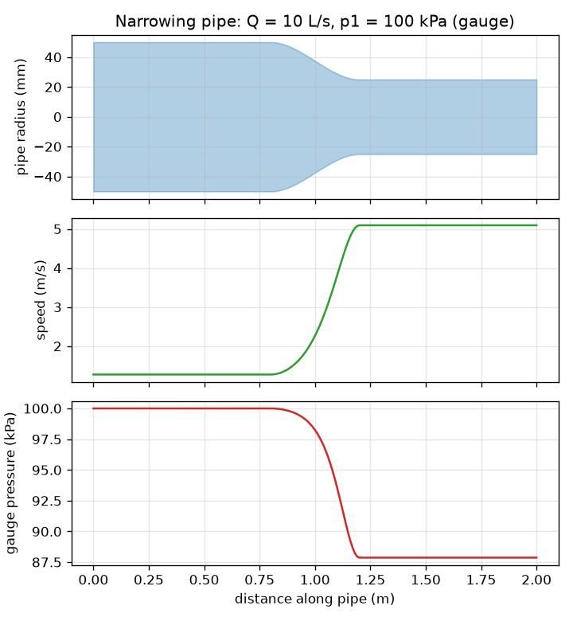
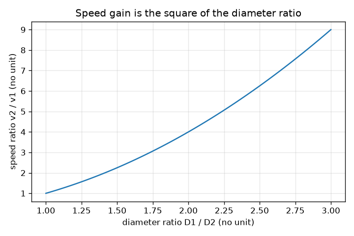

# सत्र 1: सँकरा होता पाइप: चाल बढ़ती है, दाब घटता है

*स्तर 1 (अवधारणात्मक इंटरैक्टिव मॉडल) · लगभग 60 मिनट · openpipeflow*

> यह एक सरलीकृत शैक्षिक मॉडल है। यह कोई प्रमाणित डिज़ाइन उपकरण नहीं है और इसका उपयोग वास्तविक संरचनाओं, विद्युत संस्थापनों, वाहनों, औद्योगिक प्रक्रियाओं या चिकित्सा निर्णयों के लिए नहीं किया जाना चाहिए।

**पूर्वापेक्षाएँ (Prerequisites)**

- वृत्त का क्षेत्रफल, वर्ग और वर्गमूल।
- आपने PRIMER.md पढ़ लिया है और `python start.py 1` एक बार चला लिया है।

**सीखने के उद्देश्य (Learning objectives)।** इस सत्र के बाद आप:

- सांतत्य (continuity) बता सकेंगे: आयतन प्रवाह दर (volume flow rate) Q हर अनुप्रस्थ काट पर समान है, इसलिए A1 v1 = A2 v2।
- प्रवाह दर और व्यास से पाइप में औसत चाल की गणना कर सकेंगे।
- बर्नूली के समीकरण (Bernoulli's equation) का उपयोग करके ज्ञात कर सकेंगे कि चाल बदलने पर दाब कैसे बदलता है (आदर्शीकृत प्रवाह)।
- सँकरे होते पाइप की चाल और दाब प्रोफ़ाइल पढ़ सकेंगे।

## A. वास्तविक दुनिया की समस्या
बाग़ की पाइप के सिरे पर अपना अँगूठा रखें और पानी तेज़ी से निकलता है। पानी को रास्ते में न दबाया जा सकता है न खोया जा सकता है, इसलिए जहाँ भी पाइप सँकरा है वहाँ पानी को तेज़ चलना ही होगा। पर तेज़ धारा को ऊर्जा चाहिए, और घर्षणरहित पाइप में वह ऊर्जा केवल दाब से आ सकती है। तो सँकरे होते पाइप में स्थिर, असंपीड्य प्रवाह के लिए औसत चाल और स्थैतिक दाब कैसे बदलते हैं? यह सत्र बिना घर्षण वाले आदर्शीकृत पाइप के लिए इसका उत्तर देता है; सत्र 2 घर्षण जोड़ता है। यह एक आदर्शीकृत मॉडल के बारे में सामान्य शिक्षा है, वास्तविक जल प्रणाली बनाने का मार्गदर्शन नहीं।

## B. अवधारणा और सिद्धांत
Q हर सेकंड किसी अनुप्रस्थ काट से गुज़रने वाले पानी का आयतन है। चूँकि पानी लगभग असंपीड्य (incompressible) है और प्रवाह स्थिर है, Q पूरे पाइप में हर जगह समान है। D व्यास वाले पाइप के लिए क्षेत्रफल A = pi D^2 / 4 है और औसत चाल v = Q / A है। D को आधा करने से क्षेत्रफल एक-चौथाई हो जाता है, इसलिए चाल चार गुना बढ़ जाती है। बर्नूली का समीकरण कहता है कि एक समतल, घर्षणरहित धारारेखा (streamline) के अनुदिश राशि p + (1/2) rho v^2 स्थिर रहती है: पद (1/2) rho v^2 गतिक दाब (dynamic pressure) है। जहाँ v बढ़ता है, वहाँ स्थैतिक दाब p को उतना ही घटना होगा।

| प्रतीक | अर्थ | इकाई |
|---|---|---|
| Q | आयतन प्रवाह दर | m^3/s (1 L/s = 0.001 m^3/s) |
| D | पाइप का भीतरी व्यास | m |
| A | अनुप्रस्थ काट का क्षेत्रफल, pi D^2 / 4 | m^2 |
| v | पानी की औसत चाल | m/s |
| p | स्थैतिक (गेज) दाब | Pa (1 kPa = 1000 Pa) |
| rho | पानी का घनत्व, 20 C पर 998 | kg/m^3 |

**मान्यताएँ (Assumptions)**

- स्थिर प्रवाह: समय के साथ कुछ नहीं बदलता।
- स्थिर घनत्व वाला असंपीड्य पानी।
- कोई घर्षण और कोई ऊष्मा स्थानांतरण नहीं (इसीलिए यह आदर्शीकृत है)।
- समतल पाइप, इसलिए ऊँचाई नहीं बदलती; पूरे अनुप्रस्थ काट पर चाल समान है (औसत चाल)।

$$ Q = A\,v = \tfrac{\pi}{4}D^2\,v $$

$$ A_1 v_1 = A_2 v_2 \;\Rightarrow\; v_2 = v_1\left(\frac{D_1}{D_2}\right)^2 $$

$$ p + \tfrac12 \rho v^2 = \text{constant} \;\Rightarrow\; p_2 = p_1 + \tfrac12 \rho\,(v_1^2 - v_2^2) $$

## C. दृश्य व्याख्या
पहला चित्र एक पाइप दिखाता है जो बीच में सहजता से सँकरा होता है, जिसमें चाल और गेज दाब एक ही दूरी अक्ष पर खींचे गए हैं। जहाँ पाइप सँकरा है वहाँ चाल वक्र सबसे ऊँचा और दाब वक्र सबसे नीचा है। आदर्श मॉडल में दाब अपने प्रारंभिक मान पर तभी लौटेगा जब पाइप फिर से उसी आकार तक चौड़ा हो। दूसरा चित्र व्यास अनुपात D1 / D2 के सापेक्ष चाल वृद्धि v2 / v1 दिखाता है: यह एक परवलय है, क्योंकि क्षेत्रफल व्यास के वर्ग के अनुसार बदलता है।

*सँकरा होता पाइप: सँकरे भाग में चाल बढ़ती है और गेज दाब घटता है।*

*चाल वृद्धि व्यास अनुपात के वर्ग के बराबर है।*

## D. इंटरैक्टिव सिमुलेशन
पाठ चलाएँ (`python start.py 1`), फिर लाइव ऐप खोलें: [सत्र 1: सँकरा होता पाइप](https://krunalpanchal1995.github.io/pan-iit-oss/openpipeflow/session-01/) (या इस फ़ोल्डर में `app.html`)। सँकरे भाग का व्यास नीचे खिसकाएँ और देखें कि चाल के तीर लंबे होते हैं और पाइप का रंग लाल हो जाता है। दाब और चाल के ग्राफ़ खोलें और उनके आकारों की तुलना करें: एक दूसरे का दर्पण प्रतिबिंब है।

**चुनौती।** सँकरे भाग में पानी को 5 m/s से तेज़ कराएँ जबकि उसका गेज दाब शून्य से ऊपर रहे।

## E. हल किया गया उदाहरण और प्रयोग
**समस्या।** पानी Q = 10 L/s पर 100 kPa गेज दाब पर 100 mm के पाइप से बहता है, फिर एक सहज सँकरेपन से 50 mm तक। सँकरे भाग में चालें और दाब ज्ञात कीजिए।

1. बदलें: Q = 10 L/s = 0.010 m^3/s। क्षेत्रफल: A1 = pi (0.100)^2 / 4 = 0.007854 m^2 और A2 = pi (0.050)^2 / 4 = 0.001963 m^2।
2. चालें: v1 = 0.010 / 0.007854 = 1.273 m/s और v2 = 0.010 / 0.001963 = 5.093 m/s। जाँच: (100/50)^2 = 4 और 4 x 1.273 = 5.093।
3. गतिक दाब: (1/2)(998)(1.273)^2 = 808.9 Pa और (1/2)(998)(5.093)^2 = 12 943 Pa (लगभग 0.81 kPa और 12.94 kPa)।
4. p2 = 100 kPa + 0.81 kPa - 12.94 kPa = 87.87 kPa (गेज)।
5. तर्कसंगतता जाँच: दोनों सिरों पर p + गतिक दाब = 100.81 kPa है, और सँकरे पाइप ने कम दाब दिया, जैसी अपेक्षा थी।

**उत्तर।** v1 = 1.273 m/s, v2 = 5.093 m/s (चार गुना तेज़) और p2 = 87.87 kPa, यानी 12.13 kPa की गिरावट।

**प्रयोग।** एक पाइप पर जहाँ वह सँकरा होता है, दो दाब गेज (या दो पारदर्शी ऊर्ध्वाधर नलियाँ) लगाएँ और मापी गई प्रवाह दर पर पानी चलाएँ (बाल्टी भरने में लगने वाला समय नापें)। मॉडल की तरह, सँकरे भाग में कम दाब दिखना चाहिए। अंतर घर्षण से और आकार के अचानक बदलाव पर विक्षोभ (turbulence) से आते हैं, जिन्हें बर्नूली का समीकरण छोड़ देता है, इसलिए वास्तविक दाब गिरावट कुछ अधिक होती है और चौड़ा होने के बाद दाब केवल आंशिक रूप से लौटता है।

## F. मूल्यांकन और डिज़ाइन चुनौती
**प्रश्न प्रकार A: अवधारणात्मक।** एक पाइप सँकरा होता है। शब्दों में समझाइए कि पानी तेज़ क्यों होता है और उसका स्थैतिक दाब क्यों घटता है, और एक चीज़ बताइए जो आदर्शीकृत मॉडल छोड़ देता है।

संकेत

सोचिए कि हर सेकंड कितना पानी गुज़रना चाहिए, और अतिरिक्त गतिज ऊर्जा कहाँ से आती है।

चरण-दर-चरण हल

हर अनुप्रस्थ काट से प्रति सेकंड उतना ही आयतन गुज़रना चाहिए, इसलिए छोटे क्षेत्रफल से पानी को तेज़ चलना होगा (A1 v1 = A2 v2)। तेज़ पानी में प्रति किलोग्राम अधिक गतिज ऊर्जा होती है; बिना घर्षण और बिना पंप के वह ऊर्जा केवल दाब ऊर्जा से आ सकती है, इसलिए p घटता है। मॉडल घर्षण (वास्तविक दाब घर्षण के कारण भी घटता है), विक्षोभ और अनुप्रस्थ काट पर चाल के अंतरों को छोड़ देता है।

**प्रश्न प्रकार B: संख्यात्मक।** 5 L/s पर पानी 150 kPa गेज दाब पर 80 mm के पाइप से बहता है जो 40 mm तक सँकरा होता है। v1, v2 और p2 ज्ञात कीजिए। इकाइयाँ जाँचिए।

संकेत

पहले 5 L/s को m^3/s में बदलें। v = 4 Q / (pi D^2) का उपयोग करें, फिर p2 = p1 + (1/2) rho (v1^2 - v2^2)।

चरण-दर-चरण हल

Q = 0.005 m^3/s। v1 = 4(0.005) / (pi (0.080)^2) = 0.995 m/s। v2 = 4(0.005) / (pi (0.040)^2) = 3.979 m/s (चार गुना, क्योंकि व्यास आधा हुआ)। p2 = 150 kPa + (1/2)(998)(0.990 - 15.83) Pa = 150 - 7.41 = 142.59 kPa। इकाइयाँ: चाल के लिए m/s; दाब पदों के लिए kg/m^3 x m^2/s^2 = Pa। तर्कसंगतता जाँच: सँकरे भाग में दाब कम है।

**प्रश्न प्रकार C: ग्राफ़ और सिमुलेशन की व्याख्या।** ऐप में, सँकरे व्यास को चौड़े व्यास से बड़ा रखें (चौड़ा होता पाइप)। दाब ग्राफ़ क्या करता है, और क्या यह यथार्थवादी है?

संकेत

v2 की तुलना v1 से करें और p2 = p1 + (1/2) rho (v1^2 - v2^2) का उपयोग करें।

चरण-दर-चरण हल

चाल घटती है, इसलिए दाब वक्र अपने प्रारंभिक मान से ऊपर उठता है (10 L/s पर 100 mm से 150 mm तक चौड़ा होने पर यह 100 kPa से 100.65 kPa हो जाता है)। यह बर्नूली की दाब पुनःप्राप्ति है। वास्तविक पाइप में अचानक या तीव्र चौड़ाव प्रवाह को अलग और भँवरदार बना देता है, इसलिए पुनःप्राप्ति का बड़ा भाग खो जाता है; आदर्श वक्र सबसे अच्छी स्थिति है।

**प्रश्न प्रकार D: डिज़ाइन और इष्टतमीकरण (optimisation) चुनौती।** डिज़ाइन: 100 mm पाइप में Q = 20 L/s, 100 kPa गेज दाब पर बहता है। एक प्रवाह-मापक कंठ (throat) को कम से कम 5 m/s की चाल तक पहुँचना चाहिए, पर गेज दाब 80 kPa से ऊपर रहना चाहिए। 50, 60, 70, 80 mm में से कंठ का व्यास चुनें और उसका औचित्य बताएँ।

संकेत

हर व्यास के लिए v और p की गणना करें; चाल की शर्त छोटा D चाहती है, दाब की शर्त बड़ा D।

चरण-दर-चरण हल

v1 = 2.546 m/s। 70 mm के लिए: v = 5.197 m/s और p = 100 + (1/2)(998)(6.485 - 27.01)/1000 = 89.76 kPa: दोनों शर्तें पूरी। 80 mm के लिए: v = 3.98 m/s, बहुत धीमा। 60 mm के लिए: v = 7.07 m/s और p = 100 + 499(6.485 - 49.97)/1000 = 78.3 kPa, जो 80 kPa से कम है। 50 mm के लिए: 10.19 m/s और लगभग 51 kPa। इसलिए 70 mm ही एकमात्र चुनाव है जो काम करता है। समझौता (trade-off): सँकरा कंठ बड़ा, पढ़ने में आसान संकेत देता है पर वास्तविक प्रवाह में अधिक दाब बर्बाद करता है।

[RUBRIC.md](../../RUBRIC.md) से स्वयं को अंक दें। काग़ज़ पर काम करने के लिए [गतिविधि पत्रक](activity_sheet.md) प्रिंट करें।

## आम भ्रांतियाँ (Common misconceptions)
| आम भ्रांति | वास्तव में क्या सही है |
|---|---|
| सँकरे पाइप का अर्थ है अधिक दाब क्योंकि पानी दबाया जाता है। | स्थिर प्रवाह में पानी तेज़ होता है, और उस चाल की क़ीमत स्थैतिक दाब में गिरावट से चुकाई जाती है। |
| सँकरे पाइप में पानी इसलिए तेज़ होता है क्योंकि कोई चीज़ उसे ज़्यादा ज़ोर से धकेलती है। | किसी अतिरिक्त धक्के की ज़रूरत नहीं: उतनी ही प्रवाह दर को छोटे क्षेत्रफल से गुज़रना है, इसलिए सांतत्य से चाल बढ़ती है। |
| बर्नूली का समीकरण किसी भी वास्तविक पाइप के लिए काम करता है। | इसके लिए धारारेखा के अनुदिश स्थिर, घर्षणरहित, असंपीड्य प्रवाह चाहिए; घर्षण के साथ कुल p + (1/2) rho v^2 पाइप के अनुदिश घटता है (सत्र 2)। |

## शब्दावली (Glossary)
- **सांतत्य (continuity)**: हर सेकंड हर अनुप्रस्थ काट से पानी का उतना ही आयतन गुज़रता है, इसलिए A v स्थिर है
- **प्रवाह दर (flow rate)**: हर सेकंड किसी अनुप्रस्थ काट से गुज़रने वाले पानी का आयतन, m^3/s या L/s में
- **गेज दाब (gauge pressure)**: आसपास की वायु के दाब से ऊपर मापा गया दाब
- **गतिक दाब (dynamic pressure)**: (1/2) rho v^2: पानी की गतिज ऊर्जा का दाब-आकार का माप
- **असंपीड्य (incompressible)**: दाब बदलने पर इसका घनत्व नहीं बदलता (पानी के लिए अच्छा)

## समापन
1. [exercises.md](exercises.md) में दिए तीन कोडिंग कार्य करें।
2. अपने बदलावों के बाद `python start.py 1` फिर से चलाएँ। यह चेकपॉइंट के साथ समाप्त होता है; जब यह `PASS` छापे, तो आपका काम पूरा है। (केवल चेकपॉइंट: `python start.py check 1`।)

आगे: [सत्र 2](../session-02/README.md)
