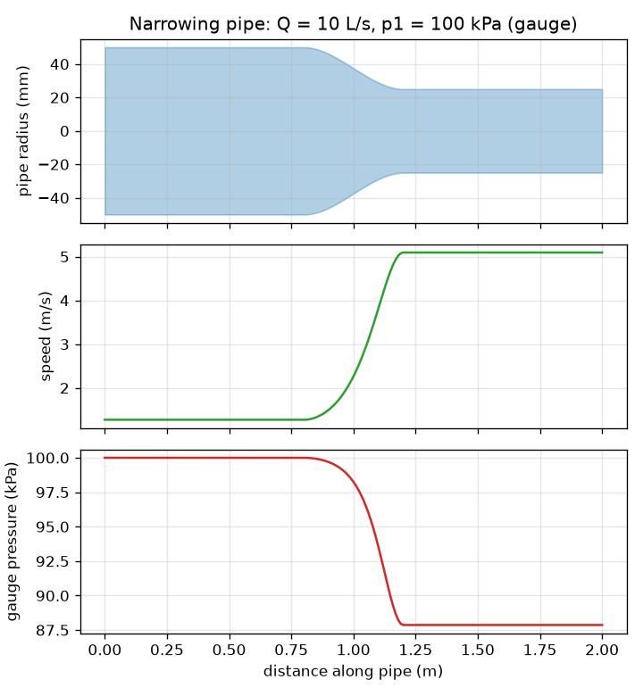
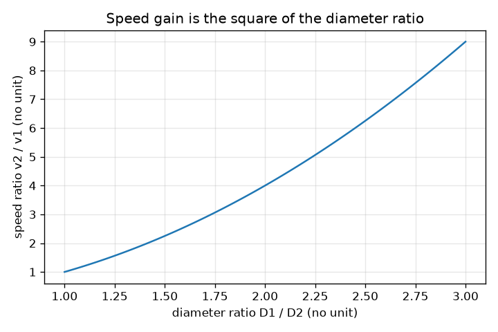

# സെഷൻ 1: ഇടുങ്ങുന്ന ഒരു പൈപ്പ്: വേഗത കൂടുന്നു, മർദ്ദം കുറയുന്നു

[Session 1 — हिन्दी](README.hi.md)

*ലെവൽ 1 (ആശയപരമായ ഇന്ററാക്ടീവ് മോഡൽ) · ഏകദേശം 60 മിനിറ്റ് · openpipeflow*

> ഇത് ഒരു ലളിതമാക്കിയ വിദ്യാഭ്യാസ മോഡൽ ആണ്. ഇത് സാധൂകരിക്കപ്പെട്ട ഒരു ഡിസൈൻ ഉപകരണമല്ല; യഥാർത്ഥ നിർമ്മിതികൾ, വൈദ്യുത ഇൻസ്റ്റലേഷനുകൾ, വാഹനങ്ങൾ, വ്യാവസായിക പ്രക്രിയകൾ അല്ലെങ്കിൽ വൈദ്യപരമായ തീരുമാനങ്ങൾ എന്നിവയ്ക്ക് ഇത് ഉപയോഗിക്കരുത്.

**മുൻ അറിവ് (Prerequisites)**

- വൃത്തത്തിന്റെ വിസ്തീർണ്ണം, വർഗ്ഗങ്ങളും വർഗ്ഗമൂലങ്ങളും.
- നിങ്ങൾ PRIMER.md വായിക്കുകയും `python start.py 1` ഒരു തവണ റൺ ചെയ്യുകയും ചെയ്തിട്ടുണ്ട്.

**പഠന ലക്ഷ്യങ്ങൾ (Learning objectives).** ഈ സെഷനു ശേഷം നിങ്ങൾക്ക് കഴിയും:

- തുടർച്ച (continuity) പറയാൻ: വ്യാപ്ത പ്രവാഹ നിരക്ക് Q ഓരോ ഛേദതലത്തിലും ഒരുപോലെയാണ്, അതിനാൽ A1 v1 = A2 v2.
- പ്രവാഹ നിരക്കിൽ നിന്നും വ്യാസത്തിൽ നിന്നും ഒരു പൈപ്പിലെ ശരാശരി വേഗത കണക്കാക്കാൻ.
- വേഗത മാറുമ്പോൾ മർദ്ദം എങ്ങനെ മാറുന്നു എന്ന് കണ്ടെത്താൻ ബെർണൂലി സമവാക്യം (Bernoulli's equation) ഉപയോഗിക്കാൻ (ആദർശ പ്രവാഹം).
- ഇടുങ്ങുന്ന ഒരു പൈപ്പിന്റെ വേഗതയും മർദ്ദ പ്രൊഫൈലും വായിക്കാൻ.

## A. യഥാർത്ഥ ലോക പ്രശ്നം
ഒരു തോട്ടം ഹോസിന്റെ അറ്റത്ത് തള്ളവിരൽ വയ്ക്കുക, വെള്ളം വേഗത്തിൽ പുറത്തുവരുന്നു. വെള്ളം ഞെരുക്കാനോ വഴിയിൽ നഷ്ടപ്പെടാനോ കഴിയില്ല, അതിനാൽ പൈപ്പ് എവിടെ ഇടുങ്ങിയിരിക്കുന്നുവോ അവിടെ വെള്ളം വേഗത്തിൽ നീങ്ങണം. പക്ഷേ വേഗതയേറിയ പ്രവാഹത്തിന് ഊർജ്ജം വേണം, ഘർഷണമില്ലാത്ത പൈപ്പിൽ ആ ഊർജ്ജം മർദ്ദത്തിൽ നിന്ന് മാത്രമേ വരാൻ കഴിയൂ. അപ്പോൾ ഇടുങ്ങുന്ന ഒരു പൈപ്പിലൂടെയുള്ള സ്ഥിരവും അസങ്കോച്യവുമായ പ്രവാഹത്തിൽ ശരാശരി വേഗതയും സ്ഥിതിക മർദ്ദവും എങ്ങനെ മാറുന്നു? ഘർഷണമില്ലാത്ത ഒരു ആദർശ പൈപ്പിന് ഈ സെഷൻ ഇതിന് ഉത്തരം നൽകുന്നു; സെഷൻ 2 ഘർഷണം ചേർക്കുന്നു. ഇത് ഒരു ആദർശ മോഡലിനെക്കുറിച്ചുള്ള പൊതു വിദ്യാഭ്യാസമാണ്, ഒരു യഥാർത്ഥ ജല സംവിധാനം നിർമ്മിക്കാനുള്ള മാർഗ്ഗനിർദ്ദേശമല്ല.

## B. ആശയവും സിദ്ധാന്തവും
Q എന്നത് ഓരോ സെക്കൻഡിലും ഒരു ഛേദതലത്തിലൂടെ കടന്നുപോകുന്ന വെള്ളത്തിന്റെ വ്യാപ്തമാണ്. വെള്ളം ഏതാണ്ട് അസങ്കോച്യമായതിനാലും പ്രവാഹം സ്ഥിരമായതിനാലും Q പൈപ്പിലുടനീളം ഒരുപോലെയാണ്. വ്യാസം D ഉള്ള ഒരു പൈപ്പിന് വിസ്തീർണ്ണം A = pi D^2 / 4 ഉം ശരാശരി വേഗത v = Q / A ഉം ആണ്. D പകുതിയാക്കിയാൽ വിസ്തീർണ്ണം നാലിലൊന്നാകും, അതിനാൽ വേഗത നാലിരട്ടി കൂടുന്നു. ഒരു നിരപ്പായ, ഘർഷണമില്ലാത്ത പ്രവാഹരേഖയിൽ p + (1/2) rho v^2 എന്ന അളവ് സ്ഥിരമായിരിക്കും എന്ന് ബെർണൂലി സമവാക്യം പറയുന്നു: (1/2) rho v^2 എന്ന പദം ഗതിക മർദ്ദമാണ് (dynamic pressure). v ഉയരുന്നിടത്ത് സ്ഥിതിക മർദ്ദം p അതേ അളവിൽ കുറയണം.

| ചിഹ്നം | അർത്ഥം | യൂണിറ്റ് |
|---|---|---|
| Q | വ്യാപ്ത പ്രവാഹ നിരക്ക് | m^3/s (1 L/s = 0.001 m^3/s) |
| D | പൈപ്പിന്റെ ആന്തരിക വ്യാസം | m |
| A | ഛേദതല വിസ്തീർണ്ണം, pi D^2 / 4 | m^2 |
| v | വെള്ളത്തിന്റെ ശരാശരി വേഗത | m/s |
| p | സ്ഥിതിക (ഗേജ്) മർദ്ദം | Pa (1 kPa = 1000 Pa) |
| rho | വെള്ളത്തിന്റെ സാന്ദ്രത, 20 C ൽ 998 | kg/m^3 |

**അനുമാനങ്ങൾ (Assumptions)**

- സ്ഥിര പ്രവാഹം: സമയത്തിനനുസരിച്ച് ഒന്നും മാറുന്നില്ല.
- സ്ഥിര സാന്ദ്രതയുള്ള അസങ്കോച്യ വെള്ളം.
- ഘർഷണമില്ല, താപ കൈമാറ്റമില്ല (അതുകൊണ്ടാണ് ഇത് ആദർശമായത്).
- നിരപ്പായ പൈപ്പ്, അതിനാൽ ഉയരം മാറുന്നില്ല; ഛേദതലം മുഴുവൻ വേഗത ഒരുപോലെയാണ് (ശരാശരി വേഗത).

$$ Q = A\,v = \tfrac{\pi}{4}D^2\,v $$

$$ A_1 v_1 = A_2 v_2 \;\Rightarrow\; v_2 = v_1\left(\frac{D_1}{D_2}\right)^2 $$

$$ p + \tfrac12 \rho v^2 = \text{constant} \;\Rightarrow\; p_2 = p_1 + \tfrac12 \rho\,(v_1^2 - v_2^2) $$

## C. ദൃശ്യ വിശദീകരണം
ആദ്യ ചിത്രം നടുവിൽ സുഗമമായി ഇടുങ്ങുന്ന ഒരു പൈപ്പ് കാണിക്കുന്നു, വേഗതയും ഗേജ് മർദ്ദവും ഒരേ ദൂര അക്ഷത്തിൽ വരച്ചിരിക്കുന്നു. പൈപ്പ് ഇടുങ്ങിയിരിക്കുന്നിടത്ത് വേഗത വക്രം ഏറ്റവും ഉയരത്തിലും മർദ്ദ വക്രം ഏറ്റവും താഴെയുമാണ്. ആദർശ മോഡലിൽ പൈപ്പ് അതേ വലിപ്പത്തിലേക്ക് തിരികെ വീതി കൂടിയാൽ മാത്രമേ മർദ്ദം അതിന്റെ തുടക്ക മൂല്യത്തിലേക്ക് തിരിച്ചെത്തൂ. രണ്ടാമത്തെ ചിത്രം വേഗതാ വർദ്ധനവ് v2 / v1 നെ വ്യാസ അനുപാതം D1 / D2 നെതിരെ കാണിക്കുന്നു: അത് ഒരു പരാബോളയാണ്, കാരണം വിസ്തീർണ്ണം വ്യാസത്തിന്റെ വർഗ്ഗത്തിനനുസരിച്ചാണ്.

*ഇടുങ്ങുന്ന ഒരു പൈപ്പ്: ഇടുങ്ങിയ ഭാഗത്ത് വേഗത കൂടുന്നു, ഗേജ് മർദ്ദം കുറയുന്നു.*

*വേഗതാ വർദ്ധനവ് വ്യാസ അനുപാതത്തിന്റെ വർഗ്ഗത്തിന് തുല്യമാണ്.*

## D. ഇന്ററാക്ടീവ് സിമുലേഷൻ
പാഠം റൺ ചെയ്യുക (`python start.py 1`), തുടർന്ന് ലൈവ് ആപ്പ് തുറക്കുക: [സെഷൻ 1: ഇടുങ്ങുന്ന ഒരു പൈപ്പ്](https://krunalpanchal1995.github.io/pan-iit-oss/openpipeflow/session-01/) (അല്ലെങ്കിൽ ഈ ഫോൾഡറിലെ `app.html`). ഇടുങ്ങിയ ഭാഗത്തിന്റെ വ്യാസം താഴേക്ക് സ്ലൈഡ് ചെയ്ത് വേഗത അമ്പുകൾ നീളം കൂടുന്നതും പൈപ്പിന്റെ നിറം ചുവപ്പാകുന്നതും നോക്കുക. മർദ്ദ, വേഗത ഗ്രാഫുകൾ തുറന്ന് അവയുടെ ആകൃതികൾ താരതമ്യം ചെയ്യുക: ഒന്ന് മറ്റൊന്നിന്റെ പ്രതിബിംബമാണ്.

**വെല്ലുവിളി (Challenge).** ഇടുങ്ങിയ ഭാഗത്തെ വെള്ളം 5 m/s ൽ കൂടുതൽ വേഗത്തിലാക്കുക, അതേസമയം അതിന്റെ ഗേജ് മർദ്ദം പൂജ്യത്തിന് മുകളിൽ നിൽക്കണം.

## E. ഉദാഹരണ പ്രശ്നവും പരീക്ഷണവും
**പ്രശ്നം.** Q = 10 L/s വെള്ളം 100 kPa ഗേജ് മർദ്ദത്തിൽ 100 mm പൈപ്പിലൂടെ ഒഴുകുന്നു, തുടർന്ന് 50 mm ലേക്ക് സുഗമമായി ഇടുങ്ങുന്നു. വേഗതകളും ഇടുങ്ങിയ ഭാഗത്തെ മർദ്ദവും കണ്ടെത്തുക.

1. പരിവർത്തനം: Q = 10 L/s = 0.010 m^3/s. വിസ്തീർണ്ണങ്ങൾ: A1 = pi (0.100)^2 / 4 = 0.007854 m^2, A2 = pi (0.050)^2 / 4 = 0.001963 m^2.
2. വേഗതകൾ: v1 = 0.010 / 0.007854 = 1.273 m/s, v2 = 0.010 / 0.001963 = 5.093 m/s. പരിശോധന: (100/50)^2 = 4, 4 x 1.273 = 5.093.
3. ഗതിക മർദ്ദങ്ങൾ: (1/2)(998)(1.273)^2 = 808.9 Pa, (1/2)(998)(5.093)^2 = 12 943 Pa (ഏകദേശം 0.81 kPa, 12.94 kPa).
4. p2 = 100 kPa + 0.81 kPa - 12.94 kPa = 87.87 kPa (ഗേജ്).
5. യുക്തി പരിശോധന: p + ഗതിക മർദ്ദം രണ്ട് അറ്റത്തും 100.81 kPa ആണ്, ഇടുങ്ങിയ പൈപ്പ് പ്രതീക്ഷിച്ചതുപോലെ കുറഞ്ഞ മർദ്ദം നൽകി.

**ഉത്തരം.** v1 = 1.273 m/s, v2 = 5.093 m/s (നാലിരട്ടി വേഗത), p2 = 87.87 kPa, 12.13 kPa കുറവ്.

**പരീക്ഷണം.** പൈപ്പ് ഇടുങ്ങുന്നിടത്ത് ഒരു ഹോസിൽ രണ്ട് മർദ്ദ ഗേജുകൾ (അല്ലെങ്കിൽ രണ്ട് സുതാര്യ ലംബ കുഴലുകൾ) ഘടിപ്പിച്ച്, അളന്ന പ്രവാഹ നിരക്കിൽ വെള്ളം ഒഴുക്കുക (ഒരു ബക്കറ്റ് നിറയാൻ എത്ര സമയമെടുക്കുന്നു എന്ന് അളക്കുക). മോഡലിലെന്നപോലെ ഇടുങ്ങിയ ഭാഗത്ത് കുറഞ്ഞ മർദ്ദം കാണണം. ബെർണൂലി സമവാക്യം ഒഴിവാക്കുന്ന ഘർഷണത്തിൽ നിന്നും ആകൃതി പെട്ടെന്ന് മാറുന്നിടത്തെ പ്രക്ഷുബ്ധതയിൽ നിന്നുമാണ് വ്യത്യാസങ്ങൾ വരുന്നത്, അതിനാൽ യഥാർത്ഥ മർദ്ദ നഷ്ടങ്ങൾ അല്പം കൂടുതലാണ്, വീതി കൂടിയതിന് ശേഷമുള്ള മർദ്ദം ഭാഗികമായി മാത്രം വീണ്ടെടുക്കുന്നു.

## F. വിലയിരുത്തലും ഡിസൈൻ വെല്ലുവിളിയും
**ചോദ്യ തരം A: ആശയപരം.** ഒരു പൈപ്പ് ഇടുങ്ങുന്നു. വെള്ളം വേഗത കൂടുന്നത് എന്തുകൊണ്ടെന്നും അതിന്റെ സ്ഥിതിക മർദ്ദം കുറയുന്നത് എന്തുകൊണ്ടെന്നും വാക്കുകളിൽ വിശദീകരിക്കുക, ആദർശ മോഡൽ ഒഴിവാക്കുന്ന ഒരു കാര്യം പേര് പറയുക.

സൂചന

ഓരോ സെക്കൻഡിലും എത്ര വെള്ളം കടന്നുപോകണം, അധിക ഗതികോർജ്ജം എവിടെ നിന്ന് വരുന്നു എന്ന് ചിന്തിക്കുക.

ഘട്ടം ഘട്ടമായുള്ള പരിഹാരം

ഓരോ സെക്കൻഡിലും ഒരേ വ്യാപ്തം ഓരോ ഛേദതലത്തിലൂടെയും കടന്നുപോകണം, അതിനാൽ ചെറിയ വിസ്തീർണ്ണത്തിലൂടെ വെള്ളം വേഗത്തിൽ നീങ്ങണം (A1 v1 = A2 v2). വേഗതയേറിയ വെള്ളത്തിന് ഓരോ കിലോഗ്രാമിനും കൂടുതൽ ഗതികോർജ്ജമുണ്ട്; ഘർഷണവും പമ്പും ഇല്ലാത്തപ്പോൾ ആ ഊർജ്ജം മർദ്ദ ഊർജ്ജത്തിൽ നിന്ന് മാത്രമേ വരാൻ കഴിയൂ, അതിനാൽ p കുറയുന്നു. മോഡൽ ഘർഷണം (യഥാർത്ഥ മർദ്ദം ഘർഷണം കാരണവും കുറയുന്നു), പ്രക്ഷുബ്ധത, ഛേദതലത്തിലെ വേഗത വ്യത്യാസങ്ങൾ എന്നിവ ഒഴിവാക്കുന്നു.

**ചോദ്യ തരം B: സംഖ്യാപരം.** 5 L/s വെള്ളം 150 kPa ഗേജിൽ 40 mm ലേക്ക് ഇടുങ്ങുന്ന 80 mm പൈപ്പിലൂടെ ഒഴുകുന്നു. v1, v2, p2 എന്നിവ കണ്ടെത്തുക. യൂണിറ്റുകൾ പരിശോധിക്കുക.

സൂചന

ആദ്യം 5 L/s നെ m^3/s ആക്കുക. v = 4 Q / (pi D^2) ഉപയോഗിക്കുക, തുടർന്ന് p2 = p1 + (1/2) rho (v1^2 - v2^2).

ഘട്ടം ഘട്ടമായുള്ള പരിഹാരം

Q = 0.005 m^3/s. v1 = 4(0.005) / (pi (0.080)^2) = 0.995 m/s. v2 = 4(0.005) / (pi (0.040)^2) = 3.979 m/s (നാലിരട്ടി, കാരണം വ്യാസം പകുതിയായി). p2 = 150 kPa + (1/2)(998)(0.990 - 15.83) Pa = 150 - 7.41 = 142.59 kPa. യൂണിറ്റുകൾ: വേഗതയ്ക്ക് m/s; മർദ്ദ പദങ്ങൾക്ക് kg/m^3 x m^2/s^2 = Pa. യുക്തി പരിശോധന: ഇടുങ്ങിയ ഭാഗത്ത് കുറഞ്ഞ മർദ്ദം.

**ചോദ്യ തരം C: ഗ്രാഫ്, സിമുലേഷൻ വ്യാഖ്യാനം.** ആപ്പിൽ, ഇടുങ്ങിയ വ്യാസം വീതിയുള്ളതിനേക്കാൾ വലുതാക്കുക (വീതി കൂടുന്ന ഒരു പൈപ്പ്). മർദ്ദ ഗ്രാഫ് എന്ത് ചെയ്യുന്നു, ഇത് യാഥാർത്ഥ്യമാണോ?

സൂചന

v2 നെ v1 മായി താരതമ്യം ചെയ്ത് p2 = p1 + (1/2) rho (v1^2 - v2^2) ഉപയോഗിക്കുക.

ഘട്ടം ഘട്ടമായുള്ള പരിഹാരം

വേഗത കുറയുന്നു, അതിനാൽ മർദ്ദ വക്രം അതിന്റെ തുടക്ക മൂല്യത്തിന് മുകളിലേക്ക് ഉയരുന്നു (10 L/s ൽ 100 mm ൽ നിന്ന് 150 mm ലേക്ക് വീതി കൂടുമ്പോൾ അത് 100 kPa യിൽ നിന്ന് 100.65 kPa ലേക്ക് പോകുന്നു). ഇത് ബെർണൂലി മർദ്ദ വീണ്ടെടുക്കലാണ്. യഥാർത്ഥ പൈപ്പിൽ പെട്ടെന്നുള്ളതോ കുത്തനെയുള്ളതോ ആയ വീതി കൂടൽ പ്രവാഹത്തെ വേർപിരിയുകയും കറങ്ങുകയും ചെയ്യിക്കുന്നു, അതിനാൽ വീണ്ടെടുക്കലിന്റെ വലിയ ഭാഗം നഷ്ടപ്പെടുന്നു; ആദർശ വക്രം ഏറ്റവും നല്ല സാഹചര്യമാണ്.

**ചോദ്യ തരം D: ഡിസൈൻ, ഒപ്റ്റിമൈസേഷൻ വെല്ലുവിളി.** ഡിസൈൻ: Q = 20 L/s 100 mm പൈപ്പിൽ 100 kPa ഗേജിൽ ഒഴുകുന്നു. ഒരു പ്രവാഹ-അളവ് തൊണ്ട (throat) കുറഞ്ഞത് 5 m/s വേഗതയിൽ എത്തണം, പക്ഷേ ഗേജ് മർദ്ദം 80 kPa ന് മുകളിൽ നിൽക്കണം. 50, 60, 70, 80 mm ൽ നിന്ന് ഒരു തൊണ്ട വ്യാസം തിരഞ്ഞെടുത്ത് ന്യായീകരിക്കുക.

സൂചന

ഓരോ വ്യാസത്തിനും v, p കണക്കാക്കുക; വേഗത വ്യവസ്ഥയ്ക്ക് ചെറിയ D വേണം, മർദ്ദ വ്യവസ്ഥയ്ക്ക് വലിയ D.

ഘട്ടം ഘട്ടമായുള്ള പരിഹാരം

v1 = 2.546 m/s. 70 mm ന്: v = 5.197 m/s, p = 100 + (1/2)(998)(6.485 - 27.01)/1000 = 89.76 kPa: രണ്ട് വ്യവസ്ഥകളും പാലിക്കുന്നു. 80 mm ന്: v = 3.98 m/s, വളരെ പതുക്കെ. 60 mm ന്: v = 7.07 m/s, p = 100 + 499(6.485 - 49.97)/1000 = 78.3 kPa, ഇത് 80 kPa ന് താഴെയാണ്. 50 mm ന്: 10.19 m/s ഉം ഏകദേശം 51 kPa ഉം. അതിനാൽ 70 mm മാത്രമാണ് പ്രവർത്തിക്കുന്ന തിരഞ്ഞെടുപ്പ്. ട്രേഡ്-ഓഫ് (Trade-off): ഇടുങ്ങിയ തൊണ്ട വലുതും വായിക്കാൻ എളുപ്പമുള്ളതുമായ സിഗ്നൽ നൽകുന്നു, പക്ഷേ യഥാർത്ഥ പ്രവാഹത്തിൽ കൂടുതൽ മർദ്ദം പാഴാക്കുന്നു.

[RUBRIC.md](../../RUBRIC.md) ഉപയോഗിച്ച് സ്വയം സ്കോർ ചെയ്യുക. പേപ്പറിൽ ചെയ്യാൻ [ആക്ടിവിറ്റി ഷീറ്റ്](activity_sheet.md) പ്രിന്റ് ചെയ്യുക.

## സാധാരണ തെറ്റിദ്ധാരണകൾ
| സാധാരണ തെറ്റിദ്ധാരണ | യഥാർത്ഥത്തിൽ ശരിയായത് |
|---|---|
| ഇടുങ്ങിയ പൈപ്പ് എന്നാൽ വെള്ളം ഞെരുക്കപ്പെടുന്നതിനാൽ ഉയർന്ന മർദ്ദം. | സ്ഥിര പ്രവാഹത്തിൽ വെള്ളം വേഗത കൂട്ടുന്നു, ആ വേഗതയ്ക്ക് വില നൽകുന്നത് സ്ഥിതിക മർദ്ദത്തിലെ കുറവാണ്. |
| ഇടുങ്ങിയ പൈപ്പിൽ എന്തോ കൂടുതൽ ശക്തമായി തള്ളുന്നതുകൊണ്ടാണ് വെള്ളം വേഗത കൂട്ടുന്നത്. | അധിക തള്ളൽ ആവശ്യമില്ല: അതേ പ്രവാഹ നിരക്ക് ചെറിയ വിസ്തീർണ്ണത്തിലൂടെ കടന്നുപോകണം, അതിനാൽ തുടർച്ച പ്രകാരം വേഗത ഉയരുന്നു. |
| ബെർണൂലി സമവാക്യം ഏത് യഥാർത്ഥ പൈപ്പിനും ബാധകമാണ്. | ഇതിന് ഒരു പ്രവാഹരേഖയിലൂടെ സ്ഥിരവും ഘർഷണരഹിതവും അസങ്കോച്യവുമായ പ്രവാഹം വേണം; ഘർഷണമുണ്ടെങ്കിൽ ആകെ p + (1/2) rho v^2 പൈപ്പിലൂടെ കുറയുന്നു (സെഷൻ 2). |

## പദാവലി (Glossary)
- **തുടർച്ച (continuity)**: ഓരോ സെക്കൻഡിലും ഒരേ വ്യാപ്തം വെള്ളം ഓരോ ഛേദതലത്തിലൂടെയും കടന്നുപോകുന്നു, അതിനാൽ A v സ്ഥിരമാണ്
- **പ്രവാഹ നിരക്ക് (flow rate)**: ഓരോ സെക്കൻഡിലും ഒരു ഛേദതലത്തിലൂടെ കടന്നുപോകുന്ന വെള്ളത്തിന്റെ വ്യാപ്തം, m^3/s അല്ലെങ്കിൽ L/s ൽ
- **ഗേജ് മർദ്ദം (gauge pressure)**: ചുറ്റുമുള്ള വായു മർദ്ദത്തിന് മുകളിൽ അളക്കുന്ന മർദ്ദം
- **ഗതിക മർദ്ദം (dynamic pressure)**: (1/2) rho v^2: വെള്ളത്തിന്റെ ഗതികോർജ്ജത്തിന്റെ മർദ്ദ-വലിപ്പത്തിലുള്ള അളവ്
- **അസങ്കോച്യം (incompressible)**: മർദ്ദം മാറുമ്പോൾ സാന്ദ്രത മാറുന്നില്ല (വെള്ളത്തിന് ശരി)

## പൂർത്തിയാക്കുക
1. [exercises.md](exercises.md) ലെ മൂന്ന് കോഡിംഗ് ടാസ്കുകൾ ചെയ്യുക.
2. നിങ്ങളുടെ മാറ്റങ്ങൾക്കു ശേഷം `python start.py 1` വീണ്ടും റൺ ചെയ്യുക. ഇത് ചെക്ക്‌പോയിന്റോടെ അവസാനിക്കുന്നു; അത് `PASS` എന്ന് പ്രിന്റ് ചെയ്യുമ്പോൾ നിങ്ങൾ പൂർത്തിയാക്കി. (ചെക്ക്‌പോയിന്റ് മാത്രം: `python start.py check 1`.)

അടുത്തത്: [സെഷൻ 2](../session-02/README.md)
