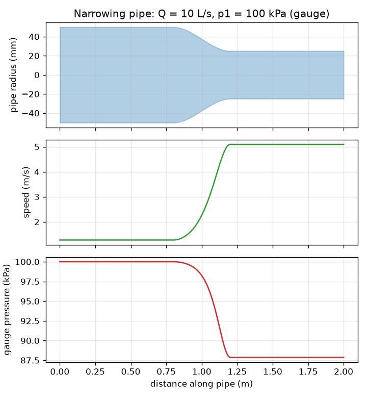
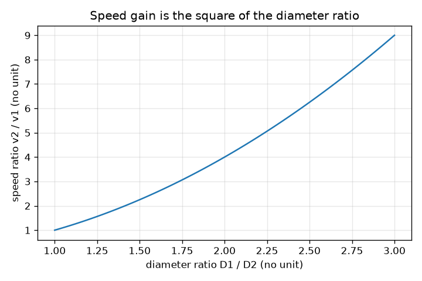

# அமர்வு 1: குறுகும் குழாய்: வேகம் கூடுகிறது, அழுத்தம் குறைகிறது

[Session 1 — हिन्दी](README.hi.md) · [Session 1 — മലയാളം](README.ml.md)

*நிலை 1 (கருத்தியல் ஊடாடும் மாதிரி) · சுமார் 60 நிமிடங்கள் · openpipeflow*

> இது ஒரு எளிமைப்படுத்தப்பட்ட கல்வி மாதிரி. இது சரிபார்க்கப்பட்ட வடிவமைப்புக் கருவி அல்ல; உண்மையான கட்டமைப்புகள், மின் நிறுவல்கள், வாகனங்கள், தொழில்துறை செயல்முறைகள் அல்லது மருத்துவ முடிவுகளுக்கு இதைப் பயன்படுத்தக் கூடாது.

**முன்தேவைகள் (Prerequisites)**

- வட்டத்தின் பரப்பு, வர்க்கங்கள் மற்றும் வர்க்கமூலங்கள்.
- நீங்கள் PRIMER.md ஐப் படித்து, `python start.py 1` ஐ ஒரு முறை இயக்கியிருக்கிறீர்கள்.

**கற்றல் நோக்கங்கள் (Learning objectives).** இந்த அமர்வுக்குப் பிறகு உங்களால் முடியும்:

- தொடர்ச்சி (continuity) கூற: கன அளவு பாய்வு வீதம் Q ஒவ்வொரு குறுக்குவெட்டிலும் ஒன்றே, எனவே A1 v1 = A2 v2.
- பாய்வு வீதம் மற்றும் விட்டத்திலிருந்து குழாயில் சராசரி வேகத்தைக் கணக்கிட.
- வேகம் மாறும்போது அழுத்தம் எவ்வாறு மாறுகிறது என்று கண்டறிய பெர்னூலி சமன்பாட்டை (Bernoulli's equation) பயன்படுத்த (இலட்சிய பாய்வு).
- குறுகும் குழாயின் வேகம் மற்றும் அழுத்த வடிவத்தைப் படிக்க.

## A. நிஜ உலகப் பிரச்சினை
தோட்டக் குழாயின் முனையில் கட்டை விரலை வையுங்கள், நீர் வேகமாக வெளியேறுகிறது. நீரை நசுக்கவோ வழியில் இழக்கவோ முடியாது, எனவே குழாய் எங்கு குறுகலாக உள்ளதோ அங்கு நீர் வேகமாக நகர வேண்டும். ஆனால் வேகமான நீரோட்டத்துக்கு ஆற்றல் தேவை, உராய்வற்ற குழாயில் அந்த ஆற்றல் அழுத்தத்திலிருந்து மட்டுமே வர முடியும். அப்படியானால் குறுகும் குழாய் வழியே நிலையான, அமுக்க முடியாத பாய்வில் சராசரி வேகமும் நிலையியல் அழுத்தமும் எவ்வாறு மாறுகின்றன? உராய்வு இல்லாத இலட்சியக் குழாய்க்கு இந்த அமர்வு இதற்குப் பதிலளிக்கிறது; அமர்வு 2 உராய்வைச் சேர்க்கிறது. இது ஒரு இலட்சிய மாதிரி பற்றிய பொதுக் கல்வி, உண்மையான நீர் அமைப்பை உருவாக்குவதற்கான வழிகாட்டுதல் அல்ல.

## B. கருத்தும் கோட்பாடும்
Q என்பது ஒவ்வொரு வினாடியும் ஒரு குறுக்குவெட்டைக் கடக்கும் நீரின் கன அளவு. நீர் கிட்டத்தட்ட அமுக்க முடியாதது, பாய்வு நிலையானது என்பதால், Q குழாய் முழுவதும் ஒன்றே. விட்டம் D கொண்ட குழாய்க்கு பரப்பு A = pi D^2 / 4 மற்றும் சராசரி வேகம் v = Q / A. D ஐப் பாதியாக்கினால் பரப்பு நான்கில் ஒரு பங்காகிறது, எனவே வேகம் நான்கு மடங்கு உயர்கிறது. ஒரு மட்டமான, உராய்வற்ற பாய்வுக்கோட்டில் p + (1/2) rho v^2 என்ற அளவு மாறாமல் இருக்கும் என்று பெர்னூலி சமன்பாடு சொல்கிறது: (1/2) rho v^2 என்ற உறுப்பு இயக்க அழுத்தம் (dynamic pressure). v உயரும் இடத்தில் நிலையியல் அழுத்தம் p அதே அளவு குறைய வேண்டும்.

| குறியீடு | பொருள் | அலகு |
|---|---|---|
| Q | கன அளவு பாய்வு வீதம் | m^3/s (1 L/s = 0.001 m^3/s) |
| D | குழாயின் உள் விட்டம் | m |
| A | குறுக்குவெட்டுப் பரப்பு, pi D^2 / 4 | m^2 |
| v | நீரின் சராசரி வேகம் | m/s |
| p | நிலையியல் (அளவி) அழுத்தம் | Pa (1 kPa = 1000 Pa) |
| rho | நீரின் அடர்த்தி, 20 C இல் 998 | kg/m^3 |

**அனுமானங்கள் (Assumptions)**

- நிலையான பாய்வு: காலத்துடன் எதுவும் மாறுவதில்லை.
- மாறா அடர்த்தி கொண்ட அமுக்க முடியாத நீர்.
- உராய்வும் வெப்பப் பரிமாற்றமும் இல்லை (இதனால்தான் இது இலட்சியமானது).
- மட்டமான குழாய், எனவே உயரம் மாறுவதில்லை; முழுக் குறுக்குவெட்டிலும் வேகம் ஒன்றே (சராசரி வேகம்).

$$ Q = A\,v = \tfrac{\pi}{4}D^2\,v $$

$$ A_1 v_1 = A_2 v_2 \;\Rightarrow\; v_2 = v_1\left(\frac{D_1}{D_2}\right)^2 $$

$$ p + \tfrac12 \rho v^2 = \text{constant} \;\Rightarrow\; p_2 = p_1 + \tfrac12 \rho\,(v_1^2 - v_2^2) $$

## C. காட்சி விளக்கம்
முதல் படம் நடுவில் மென்மையாகக் குறுகும் குழாயைக் காட்டுகிறது, வேகமும் அளவி அழுத்தமும் ஒரே தூர அச்சில் வரையப்பட்டுள்ளன. குழாய் குறுகலாக உள்ள இடத்தில் வேக வளைவு மிக உயரத்திலும் அழுத்த வளைவு மிகத் தாழ்விலும் உள்ளது. இலட்சிய மாதிரியில் குழாய் அதே அளவுக்குத் திரும்ப அகலமானால் மட்டுமே அழுத்தம் அதன் தொடக்க மதிப்புக்குத் திரும்பும். இரண்டாவது படம் வேக அதிகரிப்பு v2 / v1 ஐ விட்ட விகிதம் D1 / D2 க்கு எதிராகக் காட்டுகிறது: அது ஒரு பரவளையம், ஏனெனில் பரப்பு விட்டத்தின் வர்க்கத்தைப் பொறுத்தது.

*குறுகும் குழாய்: குறுகிய பகுதியில் வேகம் உயர்கிறது, அளவி அழுத்தம் குறைகிறது.*

*வேக அதிகரிப்பு விட்ட விகிதத்தின் வர்க்கத்துக்குச் சமம்.*

## D. ஊடாடும் உருவகப்படுத்துதல்
பாடத்தை இயக்கவும் (`python start.py 1`), பின்னர் நேரடிச் செயலியைத் திறக்கவும்: [அமர்வு 1: குறுகும் குழாய்](https://krunalpanchal1995.github.io/pan-iit-oss/openpipeflow/session-01/) (அல்லது இந்தக் கோப்புறையில் உள்ள `app.html`). குறுகிய பகுதியின் விட்டத்தைக் கீழே நழுவவிட்டு வேக அம்புகள் நீள்வதையும் குழாயின் நிறம் சிவப்பாவதையும் பாருங்கள். அழுத்த மற்றும் வேக வரைபடங்களைத் திறந்து அவற்றின் வடிவங்களை ஒப்பிடுங்கள்: ஒன்று மற்றொன்றின் கண்ணாடிப் பிம்பம்.

**சவால் (Challenge).** குறுகிய பகுதியில் நீரை 5 m/s ஐ விட வேகமாக்குங்கள், அதே நேரத்தில் அதன் அளவி அழுத்தம் பூஜ்ஜியத்துக்கு மேல் இருக்க வேண்டும்.

## E. தீர்க்கப்பட்ட எடுத்துக்காட்டும் சோதனையும்
**பிரச்சினை.** Q = 10 L/s நீர் 100 kPa அளவி அழுத்தத்தில் 100 mm குழாய் வழியே பாய்ந்து, பின்னர் மென்மையாக 50 mm ஆகக் குறுகுகிறது. வேகங்களையும் குறுகிய பகுதியில் அழுத்தத்தையும் கண்டறியுங்கள்.

1. மாற்றம்: Q = 10 L/s = 0.010 m^3/s. பரப்புகள்: A1 = pi (0.100)^2 / 4 = 0.007854 m^2 மற்றும் A2 = pi (0.050)^2 / 4 = 0.001963 m^2.
2. வேகங்கள்: v1 = 0.010 / 0.007854 = 1.273 m/s மற்றும் v2 = 0.010 / 0.001963 = 5.093 m/s. சரிபார்ப்பு: (100/50)^2 = 4 மற்றும் 4 x 1.273 = 5.093.
3. இயக்க அழுத்தங்கள்: (1/2)(998)(1.273)^2 = 808.9 Pa மற்றும் (1/2)(998)(5.093)^2 = 12 943 Pa (சுமார் 0.81 kPa மற்றும் 12.94 kPa).
4. p2 = 100 kPa + 0.81 kPa - 12.94 kPa = 87.87 kPa (அளவி).
5. பொருத்தச் சோதனை: p + இயக்க அழுத்தம் இரு முனைகளிலும் 100.81 kPa, குறுகிய குழாய் எதிர்பார்த்தபடி குறைந்த அழுத்தத்தைத் தந்தது.

**விடை.** v1 = 1.273 m/s, v2 = 5.093 m/s (நான்கு மடங்கு வேகம்) மற்றும் p2 = 87.87 kPa, 12.13 kPa வீழ்ச்சி.

**சோதனை.** குழாய் குறுகும் இடத்தில் ஒரு ஹோஸில் இரண்டு அழுத்த அளவிகளை (அல்லது இரண்டு தெளிவான செங்குத்துக் குழாய்களை) பொருத்தி, அளந்த பாய்வு வீதத்தில் நீரை ஓடவிடுங்கள் (ஒரு வாளி நிரம்ப எவ்வளவு நேரம் ஆகிறது என்று அளவிடுங்கள்). மாதிரியில் உள்ளது போல் குறுகிய பகுதி குறைந்த அழுத்தத்தைக் காட்ட வேண்டும். பெர்னூலி சமன்பாடு விட்டுவிடும் உராய்விலிருந்தும் வடிவம் திடீரென மாறும் இடத்தின் கொந்தளிப்பிலிருந்தும் வேறுபாடுகள் வருகின்றன, எனவே உண்மையான அழுத்த இழப்புகள் சற்றுப் பெரியவை, அகலமான பிறகு அழுத்தம் பகுதியாக மட்டுமே மீள்கிறது.

## F. மதிப்பீடும் வடிவமைப்புச் சவாலும்
**கேள்வி வகை A: கருத்தியல்.** ஒரு குழாய் குறுகுகிறது. நீர் ஏன் வேகமாகிறது, அதன் நிலையியல் அழுத்தம் ஏன் குறைகிறது என்று சொற்களில் விளக்குங்கள், இலட்சிய மாதிரி விட்டுவிடும் ஒன்றைப் பெயரிடுங்கள்.

குறிப்பு

ஒவ்வொரு வினாடியும் எவ்வளவு நீர் கடக்க வேண்டும், கூடுதல் இயக்க ஆற்றல் எங்கிருந்து வருகிறது என்று சிந்தியுங்கள்.

படிப்படியான தீர்வு

ஒவ்வொரு வினாடியும் ஒரே கன அளவு ஒவ்வொரு குறுக்குவெட்டையும் கடக்க வேண்டும், எனவே சிறிய பரப்பின் வழியே நீர் வேகமாக நகர வேண்டும் (A1 v1 = A2 v2). வேகமான நீருக்கு ஒரு கிலோகிராமுக்கு அதிக இயக்க ஆற்றல் உள்ளது; உராய்வும் பம்பும் இல்லாத நிலையில் அந்த ஆற்றல் அழுத்த ஆற்றலிலிருந்து மட்டுமே வர முடியும், எனவே p குறைகிறது. மாதிரி உராய்வு (உண்மையான அழுத்தம் உராய்வாலும் குறைகிறது), கொந்தளிப்பு, குறுக்குவெட்டு முழுவதும் வேக வேறுபாடுகள் ஆகியவற்றை விட்டுவிடுகிறது.

**கேள்வி வகை B: எண்ணியல்.** 5 L/s நீர் 150 kPa அளவியில் 40 mm ஆகக் குறுகும் 80 mm குழாய் வழியே பாய்கிறது. v1, v2 மற்றும் p2 ஐக் கண்டறியுங்கள். அலகுகளைச் சரிபாருங்கள்.

குறிப்பு

முதலில் 5 L/s ஐ m^3/s ஆக மாற்றுங்கள். v = 4 Q / (pi D^2) ஐப் பயன்படுத்தி, பின்னர் p2 = p1 + (1/2) rho (v1^2 - v2^2).

படிப்படியான தீர்வு

Q = 0.005 m^3/s. v1 = 4(0.005) / (pi (0.080)^2) = 0.995 m/s. v2 = 4(0.005) / (pi (0.040)^2) = 3.979 m/s (நான்கு மடங்கு, ஏனெனில் விட்டம் பாதியானது). p2 = 150 kPa + (1/2)(998)(0.990 - 15.83) Pa = 150 - 7.41 = 142.59 kPa. அலகுகள்: வேகத்துக்கு m/s; அழுத்த உறுப்புகளுக்கு kg/m^3 x m^2/s^2 = Pa. பொருத்தச் சோதனை: குறுகிய பகுதியில் குறைந்த அழுத்தம்.

**கேள்வி வகை C: வரைபடம் மற்றும் உருவகப்படுத்துதல் விளக்கம்.** செயலியில், குறுகிய விட்டத்தை அகலமானதை விடப் பெரிதாக்குங்கள் (அகலமாகும் குழாய்). அழுத்த வரைபடம் என்ன செய்கிறது, இது நிஜமானதா?

குறிப்பு

v2 ஐ v1 உடன் ஒப்பிட்டு p2 = p1 + (1/2) rho (v1^2 - v2^2) ஐப் பயன்படுத்துங்கள்.

படிப்படியான தீர்வு

வேகம் குறைகிறது, எனவே அழுத்த வளைவு அதன் தொடக்க மதிப்புக்கு மேலே உயர்கிறது (10 L/s இல் 100 mm இலிருந்து 150 mm ஆக அகலமாகும்போது அது 100 kPa இலிருந்து 100.65 kPa ஆகிறது). இது பெர்னூலி அழுத்த மீட்பு. உண்மையான குழாயில் திடீர் அல்லது செங்குத்தான அகலமாதல் பாய்வைப் பிரித்துச் சுழலச் செய்கிறது, எனவே மீட்பின் பெரும்பகுதி இழக்கப்படுகிறது; இலட்சிய வளைவு சிறந்த நிலை.

**கேள்வி வகை D: வடிவமைப்பு மற்றும் உகப்பாக்கச் சவால்.** வடிவமைப்பு: Q = 20 L/s 100 mm குழாயில் 100 kPa அளவியில் பாய்கிறது. பாய்வு அளக்கும் தொண்டை (throat) குறைந்தது 5 m/s வேகத்தை அடைய வேண்டும், ஆனால் அளவி அழுத்தம் 80 kPa க்கு மேல் இருக்க வேண்டும். 50, 60, 70, 80 mm இலிருந்து ஒரு தொண்டை விட்டத்தைத் தேர்ந்தெடுத்து நியாயப்படுத்துங்கள்.

குறிப்பு

ஒவ்வொரு விட்டத்துக்கும் v மற்றும் p ஐக் கணக்கிடுங்கள்; வேக நிபந்தனைக்குச் சிறிய D, அழுத்த நிபந்தனைக்குப் பெரிய D தேவை.

படிப்படியான தீர்வு

v1 = 2.546 m/s. 70 mm க்கு: v = 5.197 m/s மற்றும் p = 100 + (1/2)(998)(6.485 - 27.01)/1000 = 89.76 kPa: இரண்டு நிபந்தனைகளும் நிறைவேறுகின்றன. 80 mm க்கு: v = 3.98 m/s, மிக மெதுவு. 60 mm க்கு: v = 7.07 m/s மற்றும் p = 100 + 499(6.485 - 49.97)/1000 = 78.3 kPa, இது 80 kPa க்குக் கீழே. 50 mm க்கு: 10.19 m/s மற்றும் சுமார் 51 kPa. எனவே 70 mm மட்டுமே வேலை செய்யும் தேர்வு. பரிமாற்றம் (Trade-off): குறுகிய தொண்டை பெரிய, படிக்க எளிதான சமிக்ஞையைத் தருகிறது, ஆனால் உண்மையான பாய்வில் அதிக அழுத்தத்தை வீணாக்குகிறது.

[RUBRIC.md](../../RUBRIC.md) மூலம் உங்களை நீங்களே மதிப்பிடுங்கள். காகிதத்தில் செய்ய [செயல்பாட்டுத் தாளை](activity_sheet.md) அச்சிடுங்கள்.

## பொதுவான தவறான கருத்துகள்
| பொதுவான தவறான கருத்து | உண்மையில் சரியானது |
|---|---|
| குறுகிய குழாய் என்றால் நீர் நசுக்கப்படுவதால் அதிக அழுத்தம். | நிலையான பாய்வில் நீர் வேகமாகிறது, அந்த வேகத்துக்கான விலை நிலையியல் அழுத்தத்தில் ஏற்படும் வீழ்ச்சி. |
| குறுகிய குழாயில் ஏதோ ஒன்று வலுவாகத் தள்ளுவதால் நீர் வேகமாகிறது. | கூடுதல் தள்ளுதல் தேவையில்லை: அதே பாய்வு வீதம் சிறிய பரப்பைக் கடக்க வேண்டும், எனவே தொடர்ச்சியால் வேகம் உயர்கிறது. |
| பெர்னூலி சமன்பாடு எந்த உண்மையான குழாய்க்கும் வேலை செய்யும். | அதற்கு பாய்வுக்கோட்டில் நிலையான, உராய்வற்ற, அமுக்க முடியாத பாய்வு தேவை; உராய்வு இருந்தால் மொத்த p + (1/2) rho v^2 குழாய் வழியே குறைகிறது (அமர்வு 2). |

## சொற்களஞ்சியம் (Glossary)
- **தொடர்ச்சி (continuity)**: ஒவ்வொரு வினாடியும் ஒரே கன அளவு நீர் ஒவ்வொரு குறுக்குவெட்டையும் கடக்கிறது, எனவே A v மாறிலி
- **பாய்வு வீதம் (flow rate)**: ஒவ்வொரு வினாடியும் ஒரு குறுக்குவெட்டைக் கடக்கும் நீரின் கன அளவு, m^3/s அல்லது L/s இல்
- **அளவி அழுத்தம் (gauge pressure)**: சுற்றியுள்ள காற்றழுத்தத்துக்கு மேல் அளக்கப்படும் அழுத்தம்
- **இயக்க அழுத்தம் (dynamic pressure)**: (1/2) rho v^2: நீரின் இயக்க ஆற்றலின் அழுத்த அளவிலான அளவீடு
- **அமுக்க முடியாத (incompressible)**: அழுத்தம் மாறும்போது அடர்த்தி மாறாதது (நீருக்கு ஏற்றது)

## முடிக்கவும்
1. [exercises.md](exercises.md) இல் உள்ள மூன்று நிரலாக்கப் பணிகளைச் செய்யுங்கள்.
2. உங்கள் மாற்றங்களுக்குப் பிறகு `python start.py 1` ஐ மீண்டும் இயக்குங்கள். இது சோதனைச்சாவடியுடன் (checkpoint) முடிகிறது; அது `PASS` என்று அச்சிடும்போது நீங்கள் முடித்துவிட்டீர்கள். (சோதனைச்சாவடி மட்டும்: `python start.py check 1`.)

அடுத்து: [அமர்வு 2](../session-02/README.md)
