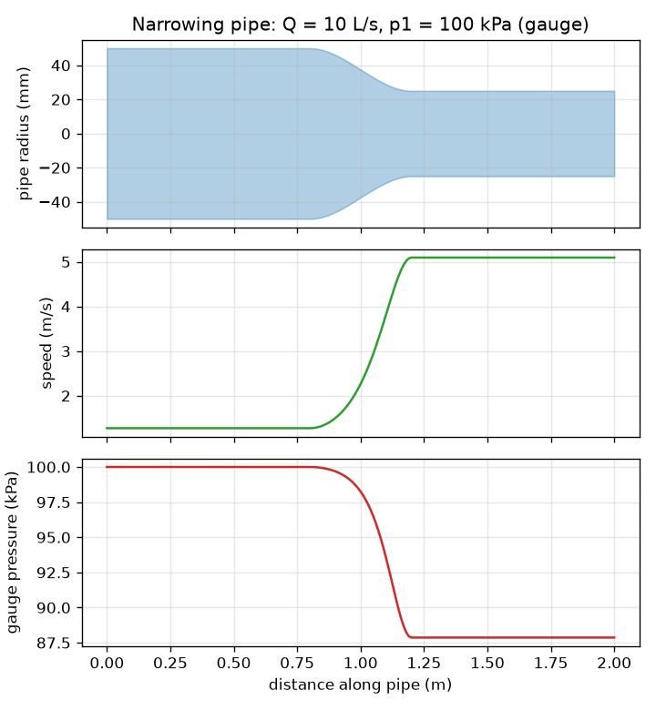
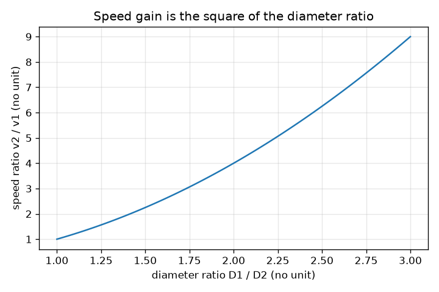

# సెషన్ 1: సన్నబడే పైపు: వేగం పెరుగుతుంది, పీడనం తగ్గుతుంది

[Session 1 — हिन्दी](README.hi.md) · [Session 1 — മലയാളം](README.ml.md) · [Session 1 — தமிழ்](README.ta.md)

*స్థాయి 1 (భావనాత్మక ఇంటరాక్టివ్ నమూనా) · సుమారు 60 నిమిషాలు · openpipeflow*

> ఇది ఒక సరళీకృత విద్యా నమూనా. ఇది ధృవీకరించబడిన డిజైన్ సాధనం కాదు; నిజమైన నిర్మాణాలు, విద్యుత్ ఇన్‌స్టలేషన్లు, వాహనాలు, పారిశ్రామిక ప్రక్రియలు లేదా వైద్య నిర్ణయాల కోసం దీనిని ఉపయోగించకూడదు.

**ముందస్తు అవసరాలు (Prerequisites)**

- వృత్త వైశాల్యం, వర్గాలు మరియు వర్గమూలాలు.
- మీరు PRIMER.md చదివి, `python start.py 1` ను ఒకసారి రన్ చేశారు.

**అభ్యసన లక్ష్యాలు (Learning objectives).** ఈ సెషన్ తర్వాత మీరు చేయగలరు:

- కొనసాగింపు (continuity) చెప్పడం: ఘనపరిమాణ ప్రవాహ రేటు Q ప్రతి అడ్డుకోతలో ఒకటే, కాబట్టి A1 v1 = A2 v2.
- ప్రవాహ రేటు మరియు వ్యాసం నుండి పైపులో సగటు వేగాన్ని లెక్కించడం.
- వేగం మారినప్పుడు పీడనం ఎలా మారుతుందో కనుగొనడానికి బెర్నౌలీ సమీకరణాన్ని (Bernoulli's equation) ఉపయోగించడం (ఆదర్శ ప్రవాహం).
- సన్నబడే పైపు యొక్క వేగం మరియు పీడన ప్రొఫైల్‌ను చదవడం.

## A. వాస్తవ ప్రపంచ సమస్య
తోట గొట్టం చివర బొటనవేలు పెట్టండి, నీరు వేగంగా బయటకు వస్తుంది. నీటిని నొక్కలేము లేదా దారిలో కోల్పోలేము, కాబట్టి పైపు ఎక్కడ సన్నగా ఉందో అక్కడ నీరు వేగంగా కదలాలి. కానీ వేగవంతమైన ప్రవాహానికి శక్తి కావాలి, ఘర్షణ లేని పైపులో ఆ శక్తి పీడనం నుండి మాత్రమే రాగలదు. అయితే సన్నబడే పైపు గుండా స్థిరమైన, సంపీడ్యం కాని ప్రవాహంలో సగటు వేగం మరియు స్థైతిక పీడనం ఎలా మారతాయి? ఘర్షణ లేని ఆదర్శ పైపుకు ఈ సెషన్ దీనికి జవాబిస్తుంది; సెషన్ 2 ఘర్షణను జోడిస్తుంది. ఇది ఆదర్శ నమూనా గురించి సాధారణ విద్య, నిజమైన నీటి వ్యవస్థను నిర్మించడానికి మార్గదర్శకం కాదు.

## B. భావన మరియు సిద్ధాంతం
Q అనేది ప్రతి సెకను ఒక అడ్డుకోతను దాటే నీటి ఘనపరిమాణం. నీరు దాదాపు సంపీడ్యం కానిది మరియు ప్రవాహం స్థిరం కాబట్టి, Q పైపు అంతటా ఒకటే. వ్యాసం D ఉన్న పైపుకు వైశాల్యం A = pi D^2 / 4 మరియు సగటు వేగం v = Q / A. D ని సగం చేస్తే వైశాల్యం నాలుగో వంతు అవుతుంది, కాబట్టి వేగం నాలుగు రెట్లు పెరుగుతుంది. మట్టంగా, ఘర్షణ లేని ప్రవాహరేఖ వెంట p + (1/2) rho v^2 అనే రాశి స్థిరంగా ఉంటుందని బెర్నౌలీ సమీకరణం చెబుతుంది: (1/2) rho v^2 పదం గతిక పీడనం (dynamic pressure). v పెరిగే చోట స్థైతిక పీడనం p అదే మొత్తంలో తగ్గాలి.

| గుర్తు | అర్థం | యూనిట్ |
|---|---|---|
| Q | ఘనపరిమాణ ప్రవాహ రేటు | m^3/s (1 L/s = 0.001 m^3/s) |
| D | పైపు అంతర్గత వ్యాసం | m |
| A | అడ్డుకోత వైశాల్యం, pi D^2 / 4 | m^2 |
| v | నీటి సగటు వేగం | m/s |
| p | స్థైతిక (గేజ్) పీడనం | Pa (1 kPa = 1000 Pa) |
| rho | నీటి సాంద్రత, 20 C వద్ద 998 | kg/m^3 |

**ఊహలు (Assumptions)**

- స్థిర ప్రవాహం: కాలంతో ఏదీ మారదు.
- స్థిర సాంద్రత ఉన్న సంపీడ్యం కాని నీరు.
- ఘర్షణ మరియు ఉష్ణ బదిలీ లేదు (అందుకే ఇది ఆదర్శమైనది).
- మట్టమైన పైపు, కాబట్టి ఎత్తు మారదు; మొత్తం అడ్డుకోతలో వేగం ఒకటే (సగటు వేగం).

$$ Q = A\,v = \tfrac{\pi}{4}D^2\,v $$

$$ A_1 v_1 = A_2 v_2 \;\Rightarrow\; v_2 = v_1\left(\frac{D_1}{D_2}\right)^2 $$

$$ p + \tfrac12 \rho v^2 = \text{constant} \;\Rightarrow\; p_2 = p_1 + \tfrac12 \rho\,(v_1^2 - v_2^2) $$

## C. దృశ్య వివరణ
మొదటి చిత్రం మధ్యలో సాఫీగా సన్నబడే పైపును చూపిస్తుంది, వేగం మరియు గేజ్ పీడనం ఒకే దూర అక్షంపై గీయబడ్డాయి. పైపు సన్నగా ఉన్న చోట వేగ వక్రం అత్యధికంగా, పీడన వక్రం అత్యల్పంగా ఉంటాయి. ఆదర్శ నమూనాలో పైపు అదే పరిమాణానికి తిరిగి వెడల్పయితేనే పీడనం దాని ప్రారంభ విలువకు తిరిగి వస్తుంది. రెండవ చిత్రం వేగ లాభం v2 / v1 ను వ్యాస నిష్పత్తి D1 / D2 కు వ్యతిరేకంగా చూపిస్తుంది: అది పరావలయం, ఎందుకంటే వైశాల్యం వ్యాసం వర్గంతో మారుతుంది.

*సన్నబడే పైపు: సన్నని భాగంలో వేగం పెరుగుతుంది, గేజ్ పీడనం తగ్గుతుంది.*

*వేగ లాభం వ్యాస నిష్పత్తి వర్గానికి సమానం.*

## D. ఇంటరాక్టివ్ సిమ్యులేషన్
పాఠాన్ని రన్ చేయండి (`python start.py 1`), తర్వాత లైవ్ యాప్‌ను తెరవండి: [సెషన్ 1: సన్నబడే పైపు](https://krunalpanchal1995.github.io/pan-iit-oss/openpipeflow/session-01/) (లేదా ఈ ఫోల్డర్‌లోని `app.html`). సన్నని భాగం వ్యాసాన్ని కిందికి స్లైడ్ చేసి వేగ బాణాలు పొడవవడం మరియు పైపు రంగు ఎరుపుగా మారడం చూడండి. పీడన మరియు వేగ గ్రాఫ్‌లను తెరిచి వాటి ఆకారాలను పోల్చండి: ఒకటి మరొకదాని అద్దం ప్రతిబింబం.

**సవాలు (Challenge).** సన్నని భాగంలో నీటిని 5 m/s కంటే వేగంగా చేయండి, అదే సమయంలో దాని గేజ్ పీడనం సున్నా కంటే ఎక్కువగా ఉండాలి.

## E. సాధించిన ఉదాహరణ మరియు ప్రయోగం
**సమస్య.** Q = 10 L/s నీరు 100 kPa గేజ్ పీడనం వద్ద 100 mm పైపు గుండా ప్రవహించి, తర్వాత సాఫీగా 50 mm కు సన్నబడుతుంది. వేగాలను మరియు సన్నని భాగంలో పీడనాన్ని కనుగొనండి.

1. మార్పిడి: Q = 10 L/s = 0.010 m^3/s. వైశాల్యాలు: A1 = pi (0.100)^2 / 4 = 0.007854 m^2 మరియు A2 = pi (0.050)^2 / 4 = 0.001963 m^2.
2. వేగాలు: v1 = 0.010 / 0.007854 = 1.273 m/s మరియు v2 = 0.010 / 0.001963 = 5.093 m/s. సరిచూపు: (100/50)^2 = 4 మరియు 4 x 1.273 = 5.093.
3. గతిక పీడనాలు: (1/2)(998)(1.273)^2 = 808.9 Pa మరియు (1/2)(998)(5.093)^2 = 12 943 Pa (సుమారు 0.81 kPa మరియు 12.94 kPa).
4. p2 = 100 kPa + 0.81 kPa - 12.94 kPa = 87.87 kPa (గేజ్).
5. సహేతుకత పరీక్ష: p + గతిక పీడనం రెండు చివరల్లో 100.81 kPa, సన్నని పైపు ఊహించినట్లే తక్కువ పీడనం ఇచ్చింది.

**సమాధానం.** v1 = 1.273 m/s, v2 = 5.093 m/s (నాలుగు రెట్లు వేగం) మరియు p2 = 87.87 kPa, 12.13 kPa తగ్గుదల.

**ప్రయోగం.** పైపు సన్నబడే చోట గొట్టానికి రెండు పీడన గేజ్‌లను (లేదా రెండు స్పష్టమైన నిలువు గొట్టాలను) బిగించి, కొలిచిన ప్రవాహ రేటుతో నీటిని పంపండి (బకెట్ నిండటానికి ఎంత సమయం పడుతుందో కొలవండి). నమూనాలో లాగా సన్నని భాగం తక్కువ పీడనాన్ని చూపాలి. బెర్నౌలీ సమీకరణం విడిచిపెట్టే ఘర్షణ నుండి మరియు ఆకారం అకస్మాత్తుగా మారే చోట ఏర్పడే సంక్షోభం (turbulence) నుండి తేడాలు వస్తాయి, కాబట్టి నిజమైన పీడన నష్టాలు కొంచెం ఎక్కువ, వెడల్పైన తర్వాత పీడనం పాక్షికంగా మాత్రమే కోలుకుంటుంది.

## F. మూల్యాంకనం మరియు డిజైన్ సవాలు
**ప్రశ్న రకం A: భావనాత్మక.** ఒక పైపు సన్నబడుతుంది. నీరు ఎందుకు వేగవంతమవుతుందో, దాని స్థైతిక పీడనం ఎందుకు తగ్గుతుందో మాటల్లో వివరించండి, ఆదర్శ నమూనా విడిచిపెట్టే ఒక విషయం పేర్కొనండి.

సూచన

ప్రతి సెకను ఎంత నీరు దాటాలి, అదనపు గతి శక్తి ఎక్కడి నుండి వస్తుంది అని ఆలోచించండి.

దశలవారీ పరిష్కారం

ప్రతి సెకను ఒకే ఘనపరిమాణం ప్రతి అడ్డుకోతను దాటాలి, కాబట్టి చిన్న వైశాల్యం గుండా నీరు వేగంగా కదలాలి (A1 v1 = A2 v2). వేగవంతమైన నీటికి కిలోగ్రాముకు ఎక్కువ గతి శక్తి ఉంటుంది; ఘర్షణ మరియు పంపు లేనప్పుడు ఆ శక్తి పీడన శక్తి నుండి మాత్రమే రాగలదు, కాబట్టి p తగ్గుతుంది. నమూనా ఘర్షణను (నిజమైన పీడనం ఘర్షణ వల్ల కూడా తగ్గుతుంది), సంక్షోభాన్ని మరియు అడ్డుకోత అంతటా వేగ తేడాలను విడిచిపెడుతుంది.

**ప్రశ్న రకం B: సంఖ్యాత్మక.** 5 L/s నీరు 150 kPa గేజ్ వద్ద 40 mm కు సన్నబడే 80 mm పైపు గుండా ప్రవహిస్తుంది. v1, v2 మరియు p2 ను కనుగొనండి. యూనిట్లను సరిచూడండి.

సూచన

మొదట 5 L/s ను m^3/s కు మార్చండి. v = 4 Q / (pi D^2) ఉపయోగించి, తర్వాత p2 = p1 + (1/2) rho (v1^2 - v2^2).

దశలవారీ పరిష్కారం

Q = 0.005 m^3/s. v1 = 4(0.005) / (pi (0.080)^2) = 0.995 m/s. v2 = 4(0.005) / (pi (0.040)^2) = 3.979 m/s (నాలుగు రెట్లు, ఎందుకంటే వ్యాసం సగమైంది). p2 = 150 kPa + (1/2)(998)(0.990 - 15.83) Pa = 150 - 7.41 = 142.59 kPa. యూనిట్లు: వేగానికి m/s; పీడన పదాలకు kg/m^3 x m^2/s^2 = Pa. సహేతుకత పరీక్ష: సన్నని భాగంలో తక్కువ పీడనం.

**ప్రశ్న రకం C: గ్రాఫ్ మరియు సిమ్యులేషన్ వ్యాఖ్యానం.** యాప్‌లో, సన్నని వ్యాసాన్ని వెడల్పైన దాని కంటే పెద్దదిగా చేయండి (వెడల్పయ్యే పైపు). పీడన గ్రాఫ్ ఏమి చేస్తుంది, ఇది వాస్తవికమా?

సూచన

v2 ను v1 తో పోల్చి p2 = p1 + (1/2) rho (v1^2 - v2^2) ఉపయోగించండి.

దశలవారీ పరిష్కారం

వేగం తగ్గుతుంది, కాబట్టి పీడన వక్రం దాని ప్రారంభ విలువ పైకి పెరుగుతుంది (10 L/s వద్ద 100 mm నుండి 150 mm కు వెడల్పయితే అది 100 kPa నుండి 100.65 kPa కు వెళ్తుంది). ఇది బెర్నౌలీ పీడన పునరుద్ధరణ. నిజమైన పైపులో అకస్మాత్తు లేదా నిటారు వెడల్పు ప్రవాహాన్ని విడదీసి సుడులు తిప్పుతుంది, కాబట్టి పునరుద్ధరణలో ఎక్కువ భాగం పోతుంది; ఆదర్శ వక్రం ఉత్తమ సందర్భం.

**ప్రశ్న రకం D: డిజైన్ మరియు ఆప్టిమైజేషన్ సవాలు.** డిజైన్: Q = 20 L/s 100 mm పైపులో 100 kPa గేజ్ వద్ద ప్రవహిస్తుంది. ప్రవాహాన్ని కొలిచే గొంతు (throat) కనీసం 5 m/s వేగాన్ని చేరాలి, కానీ గేజ్ పీడనం 80 kPa కంటే ఎక్కువగా ఉండాలి. 50, 60, 70, 80 mm నుండి గొంతు వ్యాసాన్ని ఎంచుకుని సమర్థించండి.

సూచన

ప్రతి వ్యాసానికి v మరియు p లెక్కించండి; వేగ షరతుకు చిన్న D, పీడన షరతుకు పెద్ద D కావాలి.

దశలవారీ పరిష్కారం

v1 = 2.546 m/s. 70 mm కు: v = 5.197 m/s మరియు p = 100 + (1/2)(998)(6.485 - 27.01)/1000 = 89.76 kPa: రెండు షరతులూ నెరవేరతాయి. 80 mm కు: v = 3.98 m/s, చాలా నెమ్మది. 60 mm కు: v = 7.07 m/s మరియు p = 100 + 499(6.485 - 49.97)/1000 = 78.3 kPa, ఇది 80 kPa కంటే తక్కువ. 50 mm కు: 10.19 m/s మరియు సుమారు 51 kPa. కాబట్టి 70 mm మాత్రమే పనిచేసే ఎంపిక. ట్రేడ్-ఆఫ్ (Trade-off): సన్నని గొంతు పెద్ద, చదవడానికి సులభమైన సంకేతాన్ని ఇస్తుంది, కానీ నిజమైన ప్రవాహంలో ఎక్కువ పీడనాన్ని వృథా చేస్తుంది.

[RUBRIC.md](../../RUBRIC.md) తో మిమ్మల్ని మీరు స్కోర్ చేసుకోండి. కాగితంపై పని చేయడానికి [కార్యాచరణ పత్రాన్ని](activity_sheet.md) ప్రింట్ చేయండి.

## సాధారణ అపోహలు
| సాధారణ అపోహ | నిజానికి సరైనది |
|---|---|
| సన్నని పైపు అంటే నీరు నొక్కబడటం వల్ల ఎక్కువ పీడనం. | స్థిర ప్రవాహంలో నీరు వేగవంతమవుతుంది, ఆ వేగానికి చెల్లించే మూల్యం స్థైతిక పీడనంలో తగ్గుదల. |
| సన్నని పైపులో ఏదో గట్టిగా నెట్టడం వల్ల నీరు వేగవంతమవుతుంది. | అదనపు నెట్టుడు అవసరం లేదు: అదే ప్రవాహ రేటు చిన్న వైశాల్యాన్ని దాటాలి, కాబట్టి కొనసాగింపు వల్ల వేగం పెరుగుతుంది. |
| బెర్నౌలీ సమీకరణం ఏ నిజమైన పైపుకైనా పనిచేస్తుంది. | దీనికి ప్రవాహరేఖ వెంట స్థిరమైన, ఘర్షణ లేని, సంపీడ్యం కాని ప్రవాహం కావాలి; ఘర్షణ ఉంటే మొత్తం p + (1/2) rho v^2 పైపు వెంట తగ్గుతుంది (సెషన్ 2). |

## పదకోశం (Glossary)
- **కొనసాగింపు (continuity)**: ప్రతి సెకను ఒకే ఘనపరిమాణం నీరు ప్రతి అడ్డుకోతను దాటుతుంది, కాబట్టి A v స్థిరం
- **ప్రవాహ రేటు (flow rate)**: ప్రతి సెకను ఒక అడ్డుకోతను దాటే నీటి ఘనపరిమాణం, m^3/s లేదా L/s లో
- **గేజ్ పీడనం (gauge pressure)**: చుట్టూ ఉన్న గాలి పీడనం కంటే పైన కొలిచే పీడనం
- **గతిక పీడనం (dynamic pressure)**: (1/2) rho v^2: నీటి గతి శక్తి యొక్క పీడన-పరిమాణ కొలత
- **సంపీడ్యం కాని (incompressible)**: పీడనం మారినప్పుడు సాంద్రత మారదు (నీటికి సరిపోతుంది)

## ముగించండి
1. [exercises.md](exercises.md) లోని మూడు కోడింగ్ పనులను చేయండి.
2. మీ మార్పుల తర్వాత `python start.py 1` ను మళ్ళీ రన్ చేయండి. ఇది చెక్‌పాయింట్‌తో ముగుస్తుంది; అది `PASS` అని ప్రింట్ చేసినప్పుడు మీరు పూర్తి చేశారు. (చెక్‌పాయింట్ మాత్రమే: `python start.py check 1`.)

తదుపరి: [సెషన్ 2](../session-02/README.md)
