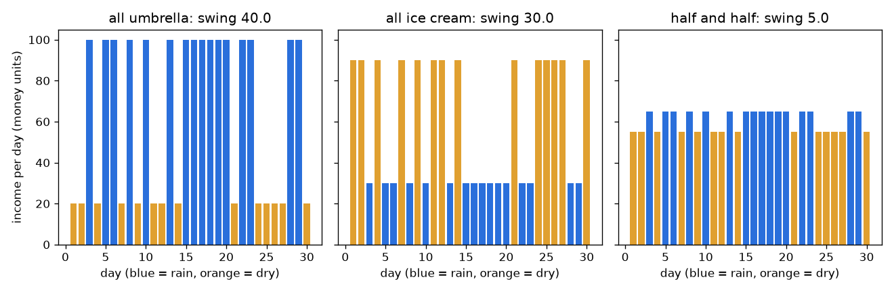
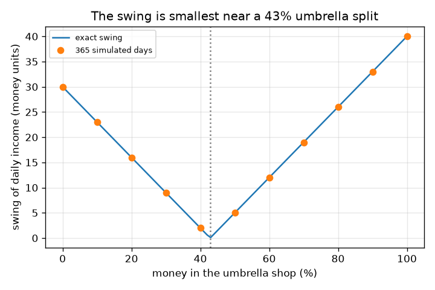

# सत्र 1: अपने सारे अंडे एक ही टोकरी में न रखें

*स्तर 1 (वैचारिक इंटरैक्टिव मॉडल) · लगभग 60 मिनट · openportfolio*

> यह एक सरलीकृत शैक्षिक मॉडल है। यह कोई प्रमाणित डिज़ाइन टूल नहीं है और इसका उपयोग वास्तविक संरचनाओं, बिजली की वायरिंग (electrical installations), वाहनों, औद्योगिक प्रक्रियाओं या चिकित्सा निर्णयों के लिए नहीं किया जाना चाहिए।

**पूर्व-आवश्यकताएँ (Prerequisites)**

- संख्याओं की सूची का औसत, और एक रेखा ग्राफ़ पढ़ना।
- आपने PRIMER.md पढ़ लिया है और एक बार `python start.py 1` चलाया है।

**सीखने के उद्देश्य (Learning objectives).** इस सत्र के बाद आप:

- दो दुकानों के उदाहरण से समझा सकेंगे कि विपरीत दिशाओं में चलने वाली चीज़ों को मिलाने से कुल योग अधिक स्थिर क्यों होता है।
- दैनिक आय का औसत और उतार-चढ़ाव (मानक विचलन (standard deviation)) गणना कर सकेंगे।
- पैसे का वह बँटवारा (split) ज्ञात कर सकेंगे जो आय को सबसे स्थिर बनाता है।
- बँटवारे के सापेक्ष उतार-चढ़ाव का ग्राफ़ पढ़ सकेंगे।

## A. वास्तविक दुनिया की समस्या
आपके पास कुछ बचत है जिसे एक छोटे व्यवसाय में लगाना है। एक दुकान छाते बेचती है, दूसरी आइसक्रीम। बरसात के दिनों में छाते की दुकान बहुत कमाती है और आइसक्रीम की दुकान कम; सूखे दिनों में उलटा होता है। सब कुछ एक दुकान में लगाइए और आपकी आय मौसम के साथ उछलती है। कुछ हर एक में लगाइए और दोनों दुकानें एक-दूसरे की कमी पूरी करती हैं। यह कितना अधिक स्थिर हो जाता है, और सबसे अच्छा बँटवारा क्या है? यह सीखने के लिए एक खिलौना मॉडल है, केवल सामान्य शिक्षा, निवेश सलाह नहीं: दुकानें और आय काल्पनिक हैं, और वास्तविक बाज़ार मौसम के सिक्का उछालने जैसा व्यवहार नहीं करते।

## B. अवधारणा और सिद्धांत
हर दिन p = 0.5 की संभावना से बरसात वाला होता है या सूखा। सारा पैसा छाते की दुकान में हो तो आय बरसात के दिन 100 और सूखे दिन 20 है; सारा पैसा आइसक्रीम की दुकान में हो तो यह 30 और 90 है (प्रति दिन काल्पनिक मुद्रा इकाइयाँ)। यदि पैसे का एक अंश f छाते की दुकान में और 1 - f आइसक्रीम की दुकान में जाता है, तो आय दोनों का वही बँटवारा है: f गुणा छाते की आय जमा (1 - f) गुणा आइसक्रीम की आय। औसत आय (average income) दिनों पर औसत है। उतार-चढ़ाव (swing) मानक विचलन है: किसी दिन की औसत से सामान्य दूरी। क्योंकि केवल दो प्रकार के दिन हैं, उतार-चढ़ाव बरसात-दिन और सूखा-दिन आय के अंतर गुणा p (1 - p) का वर्गमूल है। छोटे उतार-चढ़ाव का अर्थ है स्थिर आय।

| प्रतीक | अर्थ | इकाई |
|---|---|---|
| f | छाते की दुकान में पैसे का अंश | कोई इकाई नहीं (0 से 1) |
| p | किसी दिन के बरसात वाला होने की संभावना | कोई इकाई नहीं (0 से 1) |
| R, D | बरसात के दिन, सूखे दिन की आय | प्रति दिन मुद्रा इकाइयाँ |
| average | औसत दैनिक आय | प्रति दिन मुद्रा इकाइयाँ |
| swing | दैनिक आय का मानक विचलन | प्रति दिन मुद्रा इकाइयाँ |

**मान्यताएँ (Assumptions)**

- सभी संख्याएँ काल्पनिक हैं; यह सीखने का मॉडल है, निवेश सलाह नहीं, और अतीत भविष्य की भविष्यवाणी नहीं करता।
- दिन स्वतंत्र (independent) हैं और बरसात की संभावना नहीं बदलती।
- आय लगाए गए पैसे के समानुपाती है, कोई लागत या कर नहीं।

$$ R(f)=100f+30(1-f),\qquad D(f)=20f+90(1-f) $$

$$ \text{average}=pR+(1-p)D,\qquad \text{swing}=|R-D|\sqrt{p(1-p)} $$

$$ \text{swing}=|70f-30|\quad(p=0.5),\qquad \text{zero swing at } f=\tfrac{3}{7} $$

## C. दृश्य व्याख्या
पहला चित्र तीन विकल्पों के लिए 30 दिनों की आय दिखाता है: सब छाते में, सब आइसक्रीम में, और आधा-आधा। नीले बार बरसात के दिन हैं, नारंगी बार सूखे दिन। एक-दुकान वाले दोनों चार्ट निचले और ऊँचे बारों के बीच उछलते हैं (365-दिन सिमुलेशन में उतार-चढ़ाव 40.0 और 30.0), जबकि आधा-आधा वाला चार्ट लगभग सपाट है (उतार-चढ़ाव 5.0)। दूसरा चित्र छाते की दुकान में प्रतिशत के सापेक्ष उतार-चढ़ाव दर्शाता है: एक V आकार जो लगभग 43 प्रतिशत पर शून्य को छूता है, और सिमुलेट किए गए बिंदु सटीक वक्र पर बैठे हैं।

*30 दिनों की आय: एक दुकान निचले और ऊँचे के बीच उछलती है; आधा-आधा लगभग सपाट है।*

*बँटवारे के सापेक्ष उतार-चढ़ाव: सटीक V-आकार का वक्र और सिमुलेट किए गए बिंदु, 43 प्रतिशत के पास शून्य।*

## D. इंटरैक्टिव सिमुलेशन
पाठ चलाइए (`python start.py 1`), फिर लाइव ऐप खोलिए: [सत्र 1: दो दुकानें, एक आय](https://krunalpanchal1995.github.io/pan-iit-oss/openportfolio/session-01/) (या इसी फ़ोल्डर में `app.html`)। बँटवारे का स्लाइडर खिसकाइए और अपने मिश्रण के बरसात-दिन और सूखा-दिन बारों को एक-दूसरे की ओर बढ़ते देखिए, फिर उतार-चढ़ाव का ग्राफ़ खोलिए और V का तल ढूँढिए। बरसात की संभावना बदलिए और देखिए कि तल उसी बँटवारे पर रहता है।

**चुनौती।** ऐसा बँटवारा चुनिए कि उतार-चढ़ाव प्रति दिन अधिकतम 5 मुद्रा इकाइयाँ हो (50 प्रतिशत बरसात की संभावना पर)।

## E. हल किया गया उदाहरण और प्रयोग
**समस्या।** आधा पैसा हर दुकान में लगाइए। बरसात के दिन और सूखे दिन की आय, औसत आय और उतार-चढ़ाव ज्ञात कीजिए।

1. बरसात का दिन: 0.5 * 100 + 0.5 * 30 = 65 मुद्रा इकाइयाँ।
2. सूखा दिन: 0.5 * 20 + 0.5 * 90 = 55 मुद्रा इकाइयाँ।
3. औसत = 0.5 * 65 + 0.5 * 55 = प्रति दिन 60 मुद्रा इकाइयाँ (अकेली किसी भी दुकान के बराबर)।
4. उतार-चढ़ाव = |65 - 55| * sqrt(0.5 * 0.5) = 10 * 0.5 = प्रति दिन 5 मुद्रा इकाइयाँ।
5. तुलना कीजिए: सब छाते में का उतार-चढ़ाव |100 - 20| * 0.5 = 40 है और सब आइसक्रीम में का |30 - 90| * 0.5 = 30 है।

**उत्तर।** आधा-आधा बरसात के दिन 65, सूखे दिन 55, औसत 60 और उतार-चढ़ाव 5 देता है, जबकि एक दुकान के लिए उतार-चढ़ाव 40 और 30 है। चेकपॉइंट 365 सीडेड (seeded) दिनों के साथ भी इसकी पुष्टि करता है: 189 बरसात के दिन और उतार-चढ़ाव 40.0, 30.0 और 5.0।

**प्रयोग।** स्वयं करके देखने वाला संस्करण: एक सिक्का 30 बार उछालिए (चित = बरसात)। हर उछाल के लिए दोनों दुकानों की आय लिखिए, हर एक का आधा जोड़िए, और तुलना कीजिए कि आपके 'एक दुकान' और 'आधा-आधा' स्तंभ कितना बदलते हैं। वास्तविक व्यवसाय मॉडल से भिन्न होते हैं: दिन स्वतंत्र नहीं होते (बरसात के मौसम होते हैं), आय ठीक-ठीक विपरीत नहीं होती, और दुकानों की लागतें होती हैं। इसलिए वास्तविक उतार-चढ़ाव 5 तक नहीं गिरेगा, केवल एक दुकान की तुलना में कुछ छोटा होगा।

## F. मूल्यांकन और डिज़ाइन चुनौती
**प्रश्न प्रकार A: वैचारिक।** दोनों दुकानों में पैसा लगाने से आय अधिक स्थिर क्यों होती है, जबकि हर दुकान अस्थिर है?

संकेत

देखिए कि हर दुकान बरसात के दिन और सूखे दिन क्या कमाती है।

चरण-दर-चरण हल

दोनों दुकानें विपरीत दिशाओं में अस्थिर हैं: जब एक बहुत कमाती है, तो दूसरी कम कमाती है। उन्हें जोड़ने से एक के ऊँचे दिन दूसरे के निचले दिनों की कमी पूरी कर देते हैं, इसलिए कुल योग लगभग एक ही संख्या के पास रहता है। यह केवल इसलिए काम करता है क्योंकि वे विपरीत दिशाओं में चलती हैं; दो छाते की दुकानें साथ-साथ ऊपर-नीचे होंगी और कोई लाभ नहीं देंगी।

**प्रश्न प्रकार B: संख्यात्मक।** 25 प्रतिशत पैसा छाते की दुकान में लगाइए। बरसात-दिन की आय, सूखा-दिन की आय, औसत और उतार-चढ़ाव ज्ञात कीजिए (बरसात की संभावना 0.5)।

संकेत

f = 0.25 के साथ R = 100 f + 30 (1 - f) और D = 20 f + 90 (1 - f)।

चरण-दर-चरण हल

R = 25 + 22.5 = 47.5 और D = 5 + 67.5 = 72.5 मुद्रा इकाइयाँ। औसत = 0.5 * 47.5 + 0.5 * 72.5 = 60। उतार-चढ़ाव = |47.5 - 72.5| * 0.5 = 12.5, जो |70 * 0.25 - 30| = 12.5 से मेल खाता है। समझदारी जाँच (sanity check): यह 5 (आधा-आधा) और 30 (सब आइसक्रीम) के बीच है।

**प्रश्न प्रकार C: ग्राफ़ और सिमुलेशन की व्याख्या।** बँटवारे के सापेक्ष उतार-चढ़ाव के ग्राफ़ में, उतार-चढ़ाव कहाँ शून्य है और 0 तथा 100 प्रतिशत पर उतार-चढ़ाव क्या हैं? तल के हर ओर V आकार का क्या अर्थ है?

संकेत

R = D रखिए, या V का तल पढ़िए।

चरण-दर-चरण हल

उतार-चढ़ाव f = 3/7 = 42.9 प्रतिशत पर शून्य है, जहाँ R = D। 0 प्रतिशत (सब आइसक्रीम) पर यह 30 है और 100 प्रतिशत (सब छाते) पर 40। तल के बाईं ओर आइसक्रीम की दुकान हावी है और आय सूखे दिनों में अधिक है; तल के दाईं ओर छाते की दुकान हावी है और यह बरसात के दिनों में अधिक है। किसी भी ओर, उतार-चढ़ाव बढ़ता है क्योंकि एक दुकान का पैटर्न जीत जाता है।

**प्रश्न प्रकार D: डिज़ाइन और अनुकूलन (optimisation) चुनौती।** डिज़ाइन: आप चाहते हैं कि उतार-चढ़ाव प्रति दिन अधिकतम 10 मुद्रा इकाइयाँ हो। कौन-से बँटवारे काम करते हैं? आप ठीक शून्य-उतार-चढ़ाव वाला बँटवारा क्यों न चुनें?

संकेत

|70 f - 30| <= 10 हल कीजिए।

चरण-दर-चरण हल

f, 2/7 = 28.6 प्रतिशत और 4/7 = 57.1 प्रतिशत के बीच होना चाहिए। शून्य-उतार-चढ़ाव वाला बँटवारा 42.9 प्रतिशत सबसे स्थिर है, पर यह काल्पनिक संख्याओं के ठीक-ठीक सही होने पर निर्भर करता है। यदि दुकानों की आय या बरसात की संभावना बदले, तो सबसे अच्छा बँटवारा खिसक जाता है, इसलिए पट्टी के बीच का कोई बँटवारा अधिक सुरक्षित विकल्प है। समझौता (trade-off): यहाँ हर बँटवारे के लिए औसत 60 रहता है, इसलिए स्थिरता मुफ़्त है; वास्तविक जीवन में कम जोखिम की क़ीमत अक्सर कुछ औसत प्रतिफल (return) होती है (सत्र 2)।

[RUBRIC.md](../../RUBRIC.md) से स्वयं को अंक दीजिए। काग़ज़ पर काम करने के लिए [गतिविधि पत्रक (activity sheet)](activity_sheet.md) प्रिंट कीजिए।

## आम भ्रांतियाँ (Common misconceptions)
| आम भ्रांति | वास्तव में क्या सही है |
|---|---|
| पैसा बाँटने से औसत आय घटती है। | यहाँ हर बँटवारे के लिए औसत 60 है, क्योंकि दुकानों का औसत समान है। विविधीकरण (diversifying) उतार-चढ़ाव बदलता है; यह औसत तभी बदलता है जब परिसंपत्तियों के औसत अलग हों (सत्र 2)। |
| दो दुकानें हमेशा एक से अधिक स्थिर होती हैं। | केवल तभी जब वे साथ-साथ न चलें। दो छाते की दुकानें साथ-साथ ऊपर-नीचे होती हैं, इसलिए उनके बीच बाँटने से उतार-चढ़ाव अपरिवर्तित रहता है। |
| उतार-चढ़ाव सबसे बड़ा संभव घाटा है। | उतार-चढ़ाव (मानक विचलन) औसत से एक सामान्य दूरी है, सबसे बुरी स्थिति नहीं। कोई बुरा दिन इससे और दूर हो सकता है। |
| काल्पनिक संख्याओं वाला मॉडल बताता है कि क्या होगा। | यह दिखाता है कि कोई विचार कैसे काम करता है। वास्तविक आय और वास्तविक बाज़ार पहले से ज्ञात नहीं होते, और पिछले परिणाम कभी भविष्य की भविष्यवाणी नहीं करते। |

## शब्दावली (Glossary)
- **औसत (average, mean)**: दैनिक आयों का योग भाग दिनों की संख्या
- **उतार-चढ़ाव (swing, standard deviation)**: किसी दिन की औसत से सामान्य दूरी; छोटा होने का अर्थ है स्थिर
- **बँटवारा (split)**: हर दुकान में लगाए गए पैसे का अंश
- **विविधीकरण (diversification)**: पैसे को ऐसी चीज़ों में फैलाना जो साथ-साथ नहीं चलतीं, ताकि कुल योग अधिक स्थिर हो
- **सीड (seed)**: एक संख्या जो किसी यादृच्छिक जनित्र (random generator) से हर बार वही संख्याएँ दोहरवाती है

## समापन
1. [exercises.md](exercises.md) में दिए गए तीन कोडिंग कार्य कीजिए।
2. अपने बदलावों के बाद `python start.py 1` फिर से चलाइए। यह चेकपॉइंट (checkpoint) के साथ समाप्त होता है; जब यह `PASS` प्रिंट करे, तो आपका काम पूरा हुआ। (केवल चेकपॉइंट: `python start.py check 1`।)

आगे: [सत्र 2](../session-02/README.md)
