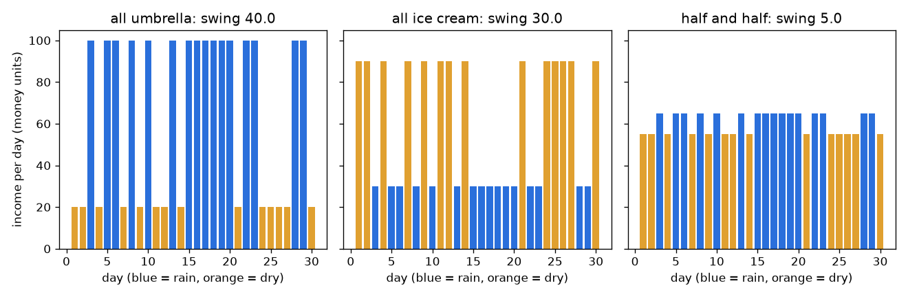
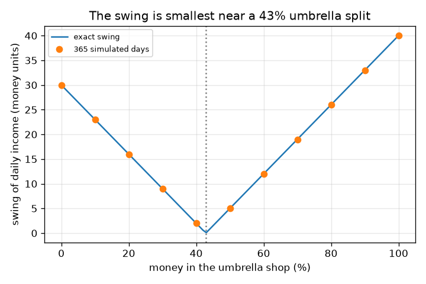

# സെഷൻ 1: എല്ലാ മുട്ടകളും ഒരേ കൊട്ടയിൽ വയ്ക്കരുത്

[Session 1 — हिन्दी](README.hi.md)

*ലെവൽ 1 (ആശയപരമായ ഇന്ററാക്ടീവ് മോഡൽ) · ഏകദേശം 60 മിനിറ്റ് · openportfolio*

> ഇത് ലളിതമാക്കിയ ഒരു വിദ്യാഭ്യാസ മോഡൽ (educational model) ആണ്. ഇത് സാധൂകരിക്കപ്പെട്ട ഒരു ഡിസൈൻ ഉപകരണമല്ല; യഥാർത്ഥ നിർമ്മിതികൾ, വൈദ്യുത ഇൻസ്റ്റലേഷനുകൾ, വാഹനങ്ങൾ, വ്യാവസായിക പ്രക്രിയകൾ അല്ലെങ്കിൽ വൈദ്യശാസ്ത്ര തീരുമാനങ്ങൾ എന്നിവയ്ക്ക് ഇത് ഉപയോഗിക്കരുത്.

**മുൻ‌അറിവ് (Prerequisites)**

- സംഖ്യകളുടെ ഒരു പട്ടികയുടെ ശരാശരിയും ഒരു രേഖാ ഗ്രാഫ് വായിക്കലും.
- നിങ്ങൾ PRIMER.md വായിക്കുകയും `python start.py 1` ഒരിക്കൽ റൺ ചെയ്യുകയും ചെയ്തിട്ടുണ്ട്.

**പഠന ലക്ഷ്യങ്ങൾ (Learning objectives).** ഈ സെഷനു ശേഷം നിങ്ങൾക്ക് കഴിയും:

- വിപരീത രീതിയിൽ ചലിക്കുന്ന കാര്യങ്ങൾ കൂട്ടിച്ചേർക്കുന്നത് കൂടുതൽ സ്ഥിരമായ ആകെത്തുക നൽകുന്നത് എന്തുകൊണ്ടെന്ന് രണ്ട് കടകൾ ഉപയോഗിച്ച് വിശദീകരിക്കാൻ.
- ദിവസ വരുമാനത്തിന്റെ ശരാശരിയും ചാഞ്ചാട്ടവും (swing) (സ്റ്റാൻഡേർഡ് ഡീവിയേഷൻ) കണക്കാക്കാൻ.
- വരുമാനം ഏറ്റവും സ്ഥിരമാക്കുന്ന പണ വിഭജനം കണ്ടെത്താൻ.
- വിഭജനത്തിനെതിരെ ചാഞ്ചാട്ടത്തിന്റെ ഗ്രാഫ് വായിക്കാൻ.

## A. യഥാർത്ഥ ജീവിതത്തിലെ പ്രശ്നം
ഒരു ചെറിയ ബിസിനസിൽ നിക്ഷേപിക്കാൻ നിങ്ങൾക്ക് കുറച്ച് സമ്പാദ്യമുണ്ട്. ഒരു കട കുടകൾ വിൽക്കുന്നു, മറ്റേത് ഐസ്ക്രീം. മഴയുള്ള ദിവസങ്ങളിൽ കുടക്കട ധാരാളം നേടുകയും ഐസ്ക്രീം കട കുറച്ച് മാത്രം നേടുകയും ചെയ്യുന്നു; വരണ്ട ദിവസങ്ങളിൽ നേരെ തിരിച്ച്. എല്ലാം ഒരു കടയിൽ ഇട്ടാൽ നിങ്ങളുടെ വരുമാനം കാലാവസ്ഥയ്ക്കനുസരിച്ച് ചാടും. രണ്ടിലും കുറച്ച് ഇട്ടാൽ രണ്ട് കടകളും പരസ്പരം നികത്തും. അത് എത്രമാത്രം സ്ഥിരമാകും, ഏറ്റവും നല്ല വിഭജനം ഏത്? ഇത് പഠനത്തിനുള്ള ഒരു കളിപ്പാട്ട മോഡലാണ്, പൊതു വിദ്യാഭ്യാസത്തിന് മാത്രം, നിക്ഷേപോപദേശമല്ല: കടകളും വരുമാനങ്ങളും കെട്ടിച്ചമച്ചവയാണ്, യഥാർത്ഥ വിപണികൾ കാലാവസ്ഥയുടെ നാണയം ടോസ് പോലെ പെരുമാറുന്നില്ല.

## B. ആശയവും സിദ്ധാന്തവും
ഓരോ ദിവസവും p = 0.5 സാധ്യതയോടെ മഴയുള്ളതോ വരണ്ടതോ ആണ്. എല്ലാ പണവും കുടക്കടയിൽ ആകുമ്പോൾ വരുമാനം മഴയുള്ള ദിവസം 100-ഉം വരണ്ട ദിവസം 20-ഉം ആണ്; എല്ലാം ഐസ്ക്രീം കടയിൽ ആകുമ്പോൾ അത് 30-ഉം 90-ഉം ആണ് (പ്രതിദിനം കെട്ടിച്ചമച്ച പണ യൂണിറ്റുകൾ). പണത്തിന്റെ ഒരു അംശം f കുടക്കടയിലും 1 - f ഐസ്ക്രീം കടയിലും ഇട്ടാൽ, വരുമാനം ഇരുവരുടെയും അതേ വിഭജനമാണ്: f ഗുണം കുടക്കട വരുമാനം പ്ലസ് (1 - f) ഗുണം ഐസ്ക്രീം കട വരുമാനം. ശരാശരി വരുമാനം എന്നത് ദിവസങ്ങളിലെ ശരാശരിയാണ്. ചാഞ്ചാട്ടം (swing) എന്നത് സ്റ്റാൻഡേർഡ് ഡീവിയേഷനാണ്: ഒരു ദിവസം ശരാശരിയിൽ നിന്ന് അകലുന്ന സാധാരണ ദൂരം. രണ്ട് തരം ദിവസങ്ങൾ മാത്രമുള്ളതിനാൽ, ചാഞ്ചാട്ടം എന്നത് മഴ ദിവസത്തെയും വരണ്ട ദിവസത്തെയും വരുമാനങ്ങൾ തമ്മിലുള്ള വ്യത്യാസം ഗുണം p (1 - p)-യുടെ വർഗ്ഗമൂലമാണ്. ചെറിയ ചാഞ്ചാട്ടം എന്നാൽ സ്ഥിരമായ വരുമാനം.

| ചിഹ്നം | അർത്ഥം | യൂണിറ്റ് |
|---|---|---|
| f | കുടക്കടയിലെ പണത്തിന്റെ അംശം | യൂണിറ്റ് ഇല്ല (0 മുതൽ 1 വരെ) |
| p | ഒരു ദിവസം മഴയുള്ളതാകാനുള്ള സാധ്യത | യൂണിറ്റ് ഇല്ല (0 മുതൽ 1 വരെ) |
| R, D | മഴയുള്ള ദിവസത്തെയും വരണ്ട ദിവസത്തെയും വരുമാനം | പ്രതിദിന പണ യൂണിറ്റുകൾ |
| average | ശരാശരി ദിവസ വരുമാനം | പ്രതിദിന പണ യൂണിറ്റുകൾ |
| swing | ദിവസ വരുമാനത്തിന്റെ സ്റ്റാൻഡേർഡ് ഡീവിയേഷൻ | പ്രതിദിന പണ യൂണിറ്റുകൾ |

**അനുമാനങ്ങൾ (Assumptions)**

- എല്ലാ സംഖ്യകളും കെട്ടിച്ചമച്ചവയാണ്; ഇത് ഒരു പഠന മോഡലാണ്, നിക്ഷേപോപദേശമല്ല, ഭൂതകാലം ഭാവിയെ പ്രവചിക്കുന്നില്ല.
- ദിവസങ്ങൾ പരസ്പരം സ്വതന്ത്രമാണ്, മഴയുടെ സാധ്യത മാറുന്നില്ല.
- വരുമാനം ഇട്ട പണത്തിന് ആനുപാതികമാണ്, ചെലവുകളോ നികുതികളോ ഇല്ല.

$$ R(f)=100f+30(1-f),\qquad D(f)=20f+90(1-f) $$

$$ \text{average}=pR+(1-p)D,\qquad \text{swing}=|R-D|\sqrt{p(1-p)} $$

$$ \text{swing}=|70f-30|\quad(p=0.5),\qquad \text{zero swing at } f=\tfrac{3}{7} $$

## C. ദൃശ്യ വിശദീകരണം
ആദ്യ ചിത്രം മൂന്ന് തിരഞ്ഞെടുപ്പുകൾക്ക് 30 ദിവസത്തെ വരുമാനം കാണിക്കുന്നു: എല്ലാം കുടക്കട, എല്ലാം ഐസ്ക്രീം കട, പകുതി പകുതി. നീല ബാറുകൾ മഴയുള്ള ദിവസങ്ങളാണ്, ഓറഞ്ച് ബാറുകൾ വരണ്ട ദിവസങ്ങൾ. രണ്ട് ഒറ്റക്കട ചാർട്ടുകളും താഴ്ന്നതും ഉയർന്നതുമായ ബാറുകൾക്കിടയിൽ ചാടുന്നു (365 ദിവസ സിമുലേഷനിൽ ചാഞ്ചാട്ടം 40.0, 30.0), പകുതി-പകുതി ചാർട്ട് ഏതാണ്ട് പരന്നതാണ് (ചാഞ്ചാട്ടം 5.0). രണ്ടാമത്തെ ചിത്രം കുടക്കടയിലെ ശതമാനത്തിനെതിരെ ചാഞ്ചാട്ടം വരയ്ക്കുന്നു: ഏകദേശം 43 ശതമാനത്തിൽ പൂജ്യം തൊടുന്ന ഒരു V ആകൃതി, സിമുലേറ്റ് ചെയ്ത കുത്തുകൾ കൃത്യമായ വക്രത്തിൽ ഇരിക്കുന്നു.

*30 ദിവസത്തെ വരുമാനം: ഒരു കട താഴ്ന്നതിനും ഉയർന്നതിനും ഇടയിൽ ചാടുന്നു; പകുതി പകുതി ഏതാണ്ട് പരന്നതാണ്.*

*വിഭജനത്തിനെതിരെ ചാഞ്ചാട്ടം: കൃത്യമായ V-ആകൃതി വക്രവും സിമുലേറ്റ് ചെയ്ത കുത്തുകളും, 43 ശതമാനത്തിനടുത്ത് പൂജ്യം.*

## D. ഇന്ററാക്ടീവ് സിമുലേഷൻ
പാഠം റൺ ചെയ്യുക (`python start.py 1`), എന്നിട്ട് ലൈവ് ആപ്പ് തുറക്കുക: [സെഷൻ 1: രണ്ട് കടകൾ, ഒരു വരുമാനം](https://krunalpanchal1995.github.io/pan-iit-oss/openportfolio/session-01/) (അല്ലെങ്കിൽ ഈ ഫോൾഡറിലെ `app.html`). വിഭജന സ്ലൈഡർ വലിച്ചുനീക്കി നിങ്ങളുടെ മിശ്രിതത്തിന്റെ മഴ-ദിവസ, വരണ്ട-ദിവസ ബാറുകൾ പരസ്പരം അടുക്കുന്നത് നിരീക്ഷിക്കുക, പിന്നെ ചാഞ്ചാട്ട ഗ്രാഫ് തുറന്ന് V-യുടെ അടിഭാഗം കണ്ടെത്തുക. മഴയുടെ സാധ്യത മാറ്റി അടിഭാഗം അതേ വിഭജനത്തിൽ തന്നെ നിൽക്കുന്നത് കാണുക.

**വെല്ലുവിളി.** (50 ശതമാനം മഴ സാധ്യതയിൽ) ചാഞ്ചാട്ടം പരമാവധി പ്രതിദിനം 5 പണ യൂണിറ്റ് ആകുന്ന ഒരു വിഭജനം തിരഞ്ഞെടുക്കുക.

## E. ഉദാഹരണവും പരീക്ഷണവും
**പ്രശ്നം.** പണത്തിന്റെ പകുതി ഓരോ കടയിലും ഇടുക. മഴയുള്ള ദിവസത്തെയും വരണ്ട ദിവസത്തെയും വരുമാനം, ശരാശരി വരുമാനം, ചാഞ്ചാട്ടം എന്നിവ കണ്ടെത്തുക.

1. മഴയുള്ള ദിവസം: 0.5 * 100 + 0.5 * 30 = 65 പണ യൂണിറ്റുകൾ.
2. വരണ്ട ദിവസം: 0.5 * 20 + 0.5 * 90 = 55 പണ യൂണിറ്റുകൾ.
3. ശരാശരി = 0.5 * 65 + 0.5 * 55 = പ്രതിദിനം 60 പണ യൂണിറ്റുകൾ (ഏതെങ്കിലും ഒരു കട മാത്രമായാലും ഇതുതന്നെ).
4. ചാഞ്ചാട്ടം = |65 - 55| * sqrt(0.5 * 0.5) = 10 * 0.5 = പ്രതിദിനം 5 പണ യൂണിറ്റുകൾ.
5. താരതമ്യം: എല്ലാം കുടക്കടയ്ക്ക് ചാഞ്ചാട്ടം |100 - 20| * 0.5 = 40, എല്ലാം ഐസ്ക്രീമിന് |30 - 90| * 0.5 = 30.

**ഉത്തരം.** പകുതി പകുതി മഴയുള്ള ദിവസം 65-ഉം വരണ്ട ദിവസം 55-ഉം ശരാശരി 60-ഉം ചാഞ്ചാട്ടം 5-ഉം നൽകുന്നു, ഒറ്റക്കടയ്ക്ക് ചാഞ്ചാട്ടം 40-ഉം 30-ഉം ആണ്. 365 സീഡ് ചെയ്ത ദിവസങ്ങൾ കൊണ്ടും ചെക്ക്‌പോയിന്റ് ഇത് സ്ഥിരീകരിക്കുന്നു: 189 മഴ ദിവസങ്ങളും ചാഞ്ചാട്ടങ്ങൾ 40.0, 30.0, 5.0-ഉം.

**പരീക്ഷണം.** പ്രായോഗിക രൂപം: ഒരു നാണയം 30 തവണ ടോസ് ചെയ്യുക (തല = മഴ). ഓരോ ടോസിനും രണ്ട് കടകളുടെ വരുമാനം എഴുതുക, ഓരോന്നിന്റെയും പകുതി കൂട്ടുക, നിങ്ങളുടെ 'ഒറ്റക്കട', 'പകുതി പകുതി' കോളങ്ങൾ എത്രമാത്രം മാറുന്നു എന്ന് താരതമ്യം ചെയ്യുക. യഥാർത്ഥ ബിസിനസുകൾ മോഡലിൽ നിന്ന് വ്യത്യസ്തമാണ്: ദിവസങ്ങൾ സ്വതന്ത്രമല്ല (മഴക്കാലങ്ങൾ ഉണ്ട്), വരുമാനങ്ങൾ കൃത്യമായി വിപരീതമല്ല, കടകൾക്ക് ചെലവുകളുണ്ട്. അതിനാൽ യഥാർത്ഥ ചാഞ്ചാട്ടം 5-ലേക്ക് വീഴില്ല, ഒറ്റക്കടയേക്കാൾ ചെറിയ ഒന്നിലേക്ക് മാത്രം.

## F. വിലയിരുത്തലും ഡിസൈൻ വെല്ലുവിളിയും
**ചോദ്യ തരം A: ആശയപരം.** ഓരോ കടയും അസ്ഥിരമാണെങ്കിലും, രണ്ട് കടകളിലും പണം ഇടുന്നത് വരുമാനം കൂടുതൽ സ്ഥിരമാക്കുന്നത് എന്തുകൊണ്ട്?

സൂചന

മഴയുള്ള ദിവസത്തും വരണ്ട ദിവസത്തും ഓരോ കടയും എത്ര നേടുന്നു എന്ന് നോക്കുക.

ഘട്ടം ഘട്ടമായുള്ള പരിഹാരം

രണ്ട് കടകളും വിപരീത ദിശകളിൽ അസ്ഥിരമാണ്: ഒന്ന് ധാരാളം നേടുമ്പോൾ മറ്റേത് കുറച്ച് നേടുന്നു. അവയെ കൂട്ടിച്ചേർക്കുമ്പോൾ ഒന്നിന്റെ ഉയർന്ന ദിവസങ്ങൾ മറ്റേതിന്റെ താഴ്ന്ന ദിവസങ്ങളെ നികത്തുന്നു, അതിനാൽ ആകെത്തുക ഏതാണ്ട് ഒരേ സംഖ്യയ്ക്ക് അടുത്ത് നിൽക്കുന്നു. അവ വിപരീത രീതിയിൽ ചലിക്കുന്നതുകൊണ്ട് മാത്രമാണ് ഇത് പ്രവർത്തിക്കുന്നത്; രണ്ട് കുടക്കടകൾ ഒരുമിച്ച് ഉയരുകയും താഴുകയും ചെയ്യും, ഒരു പ്രയോജനവും നൽകില്ല.

**ചോദ്യ തരം B: സംഖ്യാപരം.** പണത്തിന്റെ 25 ശതമാനം കുടക്കടയിൽ ഇടുക. മഴ-ദിവസ വരുമാനം, വരണ്ട-ദിവസ വരുമാനം, ശരാശരി, ചാഞ്ചാട്ടം എന്നിവ കണ്ടെത്തുക (മഴ സാധ്യത 0.5).

സൂചന

f = 0.25 ആയി R = 100 f + 30 (1 - f), D = 20 f + 90 (1 - f).

ഘട്ടം ഘട്ടമായുള്ള പരിഹാരം

R = 25 + 22.5 = 47.5, D = 5 + 67.5 = 72.5 പണ യൂണിറ്റുകൾ. ശരാശരി = 0.5 * 47.5 + 0.5 * 72.5 = 60. ചാഞ്ചാട്ടം = |47.5 - 72.5| * 0.5 = 12.5, ഇത് |70 * 0.25 - 30| = 12.5 മായി യോജിക്കുന്നു. യുക്തി പരിശോധന: ഇത് 5 (പകുതി പകുതി) നും 30 (എല്ലാം ഐസ്ക്രീം) നും ഇടയിലാണ്.

**ചോദ്യ തരം C: ഗ്രാഫും സിമുലേഷനും വ്യാഖ്യാനിക്കൽ.** വിഭജനത്തിനെതിരെ ചാഞ്ചാട്ടത്തിന്റെ ഗ്രാഫിൽ, ചാഞ്ചാട്ടം പൂജ്യമാകുന്നത് എവിടെ, 0-ലും 100 ശതമാനത്തിലും ചാഞ്ചാട്ടങ്ങൾ എത്ര? അടിഭാഗത്തിന്റെ ഇരുവശത്തും V ആകൃതി എന്താണ് അർത്ഥമാക്കുന്നത്?

സൂചന

R = D ആക്കുക, അല്ലെങ്കിൽ V-യുടെ അടിഭാഗം വായിക്കുക.

ഘട്ടം ഘട്ടമായുള്ള പരിഹാരം

ചാഞ്ചാട്ടം f = 3/7 = 42.9 ശതമാനത്തിൽ പൂജ്യമാണ്, അവിടെ R = D. 0 ശതമാനത്തിൽ (എല്ലാം ഐസ്ക്രീം) അത് 30-ഉം 100 ശതമാനത്തിൽ (എല്ലാം കുടക്കട) 40-ഉം ആണ്. അടിഭാഗത്തിന്റെ ഇടതുവശത്ത് ഐസ്ക്രീം കട ആധിപത്യം പുലർത്തുന്നു, വരണ്ട ദിവസങ്ങളിൽ വരുമാനം കൂടുതലാണ്; വലതുവശത്ത് കുടക്കട ആധിപത്യം പുലർത്തുന്നു, മഴ ദിവസങ്ങളിൽ കൂടുതലാണ്. ഇരുവശത്തും, ഒരു കടയുടെ പാറ്റേൺ വിജയിക്കുന്നതിനാൽ ചാഞ്ചാട്ടം കൂടുന്നു.

**ചോദ്യ തരം D: ഡിസൈനും ഒപ്റ്റിമൈസേഷൻ (optimisation) വെല്ലുവിളിയും.** ഡിസൈൻ: ചാഞ്ചാട്ടം പരമാവധി പ്രതിദിനം 10 പണ യൂണിറ്റ് ആകണം. ഏതൊക്കെ വിഭജനങ്ങൾ പ്രവർത്തിക്കും? പൂജ്യം-ചാഞ്ചാട്ട വിഭജനം തന്നെ നിങ്ങൾ തിരഞ്ഞെടുക്കാത്തത് എന്തുകൊണ്ടാകാം?

സൂചന

|70 f - 30| <= 10 നിർധാരണം ചെയ്യുക.

ഘട്ടം ഘട്ടമായുള്ള പരിഹാരം

f 2/7 = 28.6 ശതമാനത്തിനും 4/7 = 57.1 ശതമാനത്തിനും ഇടയിലായിരിക്കണം. പൂജ്യം-ചാഞ്ചാട്ട വിഭജനം 42.9 ശതമാനം ഏറ്റവും സ്ഥിരമാണ്, പക്ഷേ അത് കെട്ടിച്ചമച്ച സംഖ്യകൾ കൃത്യമായി ശരിയാകുന്നതിനെ ആശ്രയിക്കുന്നു. കടകളുടെ വരുമാനമോ മഴയുടെ സാധ്യതയോ മാറിയാൽ ഏറ്റവും നല്ല വിഭജനം നീങ്ങും, അതിനാൽ ബാൻഡിന്റെ മധ്യത്തിലുള്ള വിഭജനം കൂടുതൽ സുരക്ഷിതമായ തിരഞ്ഞെടുപ്പാണ്. ട്രേഡ്-ഓഫ് (trade-off): ഇവിടെ ഓരോ വിഭജനത്തിനും ശരാശരി 60 തന്നെ, അതിനാൽ സ്ഥിരത സൗജന്യമാണ്; യഥാർത്ഥ ജീവിതത്തിൽ കുറഞ്ഞ റിസ്കിന് പലപ്പോഴും കുറച്ച് ശരാശരി ആദായം വിലയാകും (സെഷൻ 2).

[RUBRIC.md](../../RUBRIC.md) ഉപയോഗിച്ച് സ്വയം സ്കോർ ചെയ്യുക. പേപ്പറിൽ ചെയ്യാൻ [ആക്ടിവിറ്റി ഷീറ്റ്](activity_sheet.md) പ്രിന്റ് ചെയ്യുക.

## സാധാരണ തെറ്റിദ്ധാരണകൾ
| സാധാരണ തെറ്റിദ്ധാരണ | യഥാർത്ഥത്തിൽ ശരിയായത് |
|---|---|
| പണം വിഭജിക്കുന്നത് ശരാശരി വരുമാനം കുറയ്ക്കുന്നു. | ഇവിടെ കടകൾക്ക് ഒരേ ശരാശരി ആയതിനാൽ ഓരോ വിഭജനത്തിനും ശരാശരി 60 ആണ്. വൈവിധ്യവൽക്കരണം (diversification) ചാഞ്ചാട്ടത്തെ മാറ്റുന്നു; ആസ്തികൾക്ക് വ്യത്യസ്ത ശരാശരികൾ ഉള്ളപ്പോൾ മാത്രമേ അത് ശരാശരിയെ മാറ്റൂ (സെഷൻ 2). |
| രണ്ട് കടകൾ എപ്പോഴും ഒന്നിനേക്കാൾ സ്ഥിരതയുള്ളതാണ്. | അവ ഒരുമിച്ച് ചലിക്കുന്നില്ലെങ്കിൽ മാത്രം. രണ്ട് കുടക്കടകൾ ഒരുമിച്ച് ഉയരുകയും താഴുകയും ചെയ്യുന്നു, അതിനാൽ അവയ്ക്കിടയിൽ വിഭജിക്കുന്നത് ചാഞ്ചാട്ടത്തെ മാറ്റമില്ലാതെ വിടുന്നു. |
| ചാഞ്ചാട്ടം നിങ്ങൾക്കുണ്ടാകാവുന്ന ഏറ്റവും വലിയ നഷ്ടമാണ്. | ചാഞ്ചാട്ടം (സ്റ്റാൻഡേർഡ് ഡീവിയേഷൻ) ശരാശരിയിൽ നിന്നുള്ള ഒരു സാധാരണ ദൂരമാണ്, ഏറ്റവും മോശം സാഹചര്യമല്ല. ഒരു മോശം ദിവസം അതിലും അകലെയാകാം. |
| കെട്ടിച്ചമച്ച സംഖ്യകളുള്ള ഒരു മോഡൽ എന്ത് സംഭവിക്കുമെന്ന് പറയുന്നു. | ഒരു ആശയം എങ്ങനെ പ്രവർത്തിക്കുന്നു എന്ന് അത് കാണിക്കുന്നു. യഥാർത്ഥ വരുമാനങ്ങളും വിപണികളും മുൻകൂട്ടി അറിയില്ല, കഴിഞ്ഞ ഫലങ്ങൾ ഒരിക്കലും ഭാവിയെ പ്രവചിക്കുന്നില്ല. |

## പദാവലി (Glossary)
- **ശരാശരി (average, mean)**: ദിവസ വരുമാനങ്ങളുടെ തുകയെ ദിവസങ്ങളുടെ എണ്ണം കൊണ്ട് ഹരിച്ചത്
- **ചാഞ്ചാട്ടം (swing, standard deviation)**: ഒരു ദിവസം ശരാശരിയിൽ നിന്ന് അകലുന്ന സാധാരണ ദൂരം; ചെറുത് എന്നാൽ സ്ഥിരം
- **വിഭജനം (split)**: ഓരോ കടയിലും ഇട്ട പണത്തിന്റെ അംശം
- **വൈവിധ്യവൽക്കരണം (diversification)**: ഒരുമിച്ച് ചലിക്കാത്ത കാര്യങ്ങളിൽ പണം വ്യാപിപ്പിക്കൽ, അങ്ങനെ ആകെത്തുക കൂടുതൽ സ്ഥിരമാകുന്നു
- **സീഡ് (seed)**: ഒരു റാൻഡം ജനറേറ്ററിനെ ഓരോ തവണയും ഒരേ സംഖ്യകൾ ആവർത്തിക്കാൻ പ്രേരിപ്പിക്കുന്ന ഒരു സംഖ്യ

## പൂർത്തിയാക്കുക
1. [exercises.md](exercises.md)-ലെ മൂന്ന് കോഡിംഗ് ടാസ്കുകൾ ചെയ്യുക.
2. മാറ്റങ്ങൾക്കു ശേഷം `python start.py 1` വീണ്ടും റൺ ചെയ്യുക. അത് ചെക്ക്‌പോയിന്റോടെ (checkpoint) അവസാനിക്കുന്നു; അത് `PASS` എന്ന് പ്രിന്റ് ചെയ്യുമ്പോൾ നിങ്ങൾ പൂർത്തിയാക്കി. (ചെക്ക്‌പോയിന്റ് മാത്രം: `python start.py check 1`.)

അടുത്തത്: [സെഷൻ 2](../session-02/README.md)
