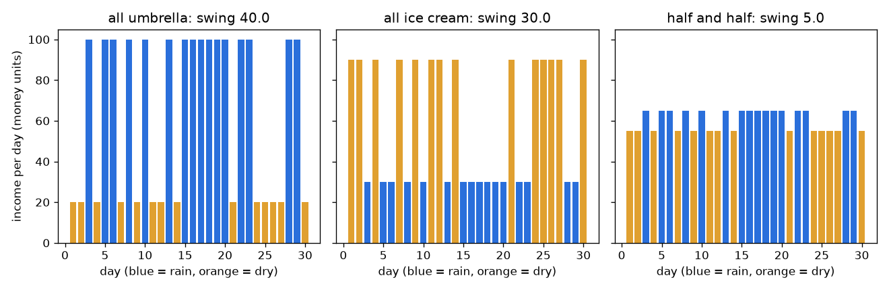
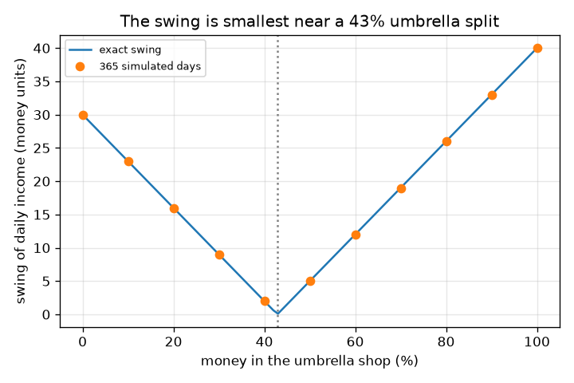

# அமர்வு 1: எல்லா முட்டைகளையும் ஒரே கூடையில் வைக்காதீர்கள்

[Session 1 — हिन्दी](README.hi.md)

*நிலை 1 (கருத்தியல் ஊடாடும் மாதிரி) · சுமார் 60 நிமிடங்கள் · openportfolio*

> இது எளிமைப்படுத்தப்பட்ட ஒரு கல்வி மாதிரி (educational model). இது சரிபார்க்கப்பட்ட வடிவமைப்புக் கருவி அல்ல; உண்மையான கட்டமைப்புகள், மின் நிறுவல்கள், வாகனங்கள், தொழில்துறை செயல்முறைகள் அல்லது மருத்துவ முடிவுகளுக்கு இதைப் பயன்படுத்தக் கூடாது.

**முன்தேவைகள் (Prerequisites)**

- எண்களின் பட்டியலின் சராசரியும் கோட்டு வரைபடத்தைப் படிப்பதும்.
- நீங்கள் PRIMER.md படித்து `python start.py 1` ஒருமுறை இயக்கியிருக்கிறீர்கள்.

**கற்றல் நோக்கங்கள் (Learning objectives).** இந்த அமர்வுக்குப் பிறகு உங்களால் முடியும்:

- எதிர் எதிராக நகரும் விஷயங்களை இணைப்பது ஏன் நிலையான மொத்தத்தைத் தருகிறது என்று இரண்டு கடைகளைக் கொண்டு விளக்க.
- தினசரி வருமானத்தின் சராசரியையும் ஊசலாட்டத்தையும் (swing) (திட்ட விலக்கம்) கணக்கிட.
- வருமானத்தை மிக நிலையானதாக்கும் பணப் பிரிவைக் கண்டறிய.
- பிரிவுக்கு எதிரான ஊசலாட்டத்தின் வரைபடத்தைப் படிக்க.

## A. நிஜ உலகப் பிரச்சினை
ஒரு சிறிய வணிகத்தில் முதலிட உங்களிடம் சிறிது சேமிப்பு உள்ளது. ஒரு கடை குடைகள் விற்கிறது, மற்றொன்று ஐஸ்கிரீம். மழை நாட்களில் குடைக்கடை நிறையச் சம்பாதிக்கிறது, ஐஸ்கிரீம் கடை குறைவாக; வறண்ட நாட்களில் நேர்மாறாக. எல்லாவற்றையும் ஒரே கடையில் போட்டால் உங்கள் வருமானம் வானிலையுடன் துள்ளும். இரண்டிலும் சிறிது போட்டால் இரண்டு கடைகளும் ஒன்றுக்கொன்று ஈடு செய்யும். அது எவ்வளவு நிலையாகும், சிறந்த பிரிவு எது? இது கற்றலுக்கான ஒரு பொம்மை மாதிரி, பொதுக் கல்விக்கு மட்டும், முதலீட்டு ஆலோசனை அல்ல: கடைகளும் வருமானங்களும் புனைவு, உண்மையான சந்தைகள் வானிலைக் காசு சுண்டலைப் போல நடந்துகொள்வதில்லை.

## B. கருத்தும் கோட்பாடும்
ஒவ்வொரு நாளும் p = 0.5 வாய்ப்புடன் மழை அல்லது வறட்சி. எல்லாப் பணமும் குடைக்கடையில் இருந்தால் வருமானம் மழை நாளில் 100, வறண்ட நாளில் 20; எல்லாம் ஐஸ்கிரீம் கடையில் இருந்தால் அது 30 மற்றும் 90 (நாளொன்றுக்குப் புனைவு பண அலகுகள்). பணத்தின் ஒரு பகுதி f குடைக்கடையிலும் 1 - f ஐஸ்கிரீம் கடையிலும் போட்டால், வருமானம் இரண்டின் அதே பிரிவு: f பெருக்கல் குடைக்கடை வருமானம் கூட்டல் (1 - f) பெருக்கல் ஐஸ்கிரீம் கடை வருமானம். சராசரி வருமானம் என்பது நாட்களின் சராசரி. ஊசலாட்டம் (swing) என்பது திட்ட விலக்கம்: ஒரு நாள் சராசரியிலிருந்து விலகும் வழக்கமான தூரம். இரண்டு வகை நாட்கள் மட்டுமே இருப்பதால், ஊசலாட்டம் என்பது மழை நாள் மற்றும் வறண்ட நாள் வருமானங்களுக்கிடையிலான இடைவெளி பெருக்கல் p (1 - p)-இன் வர்க்கமூலம். சிறிய ஊசலாட்டம் என்றால் நிலையான வருமானம்.

| குறியீடு | பொருள் | அலகு |
|---|---|---|
| f | குடைக்கடையில் உள்ள பணத்தின் பகுதி | அலகு இல்லை (0 முதல் 1) |
| p | ஒரு நாள் மழையாக இருக்கும் வாய்ப்பு | அலகு இல்லை (0 முதல் 1) |
| R, D | மழை நாளிலும் வறண்ட நாளிலும் வருமானம் | நாளொன்றுக்குப் பண அலகுகள் |
| average | சராசரித் தினசரி வருமானம் | நாளொன்றுக்குப் பண அலகுகள் |
| swing | தினசரி வருமானத்தின் திட்ட விலக்கம் | நாளொன்றுக்குப் பண அலகுகள் |

**அனுமானங்கள் (Assumptions)**

- எல்லா எண்களும் புனைவு; இது கற்றல் மாதிரி, முதலீட்டு ஆலோசனை அல்ல, கடந்த காலம் எதிர்காலத்தைக் கணிப்பதில்லை.
- நாட்கள் ஒன்றுக்கொன்று சார்பற்றவை, மழை வாய்ப்பு மாறுவதில்லை.
- வருமானம் போட்ட பணத்துக்கு விகிதசமம், செலவுகளோ வரிகளோ இல்லை.

$$ R(f)=100f+30(1-f),\qquad D(f)=20f+90(1-f) $$

$$ \text{average}=pR+(1-p)D,\qquad \text{swing}=|R-D|\sqrt{p(1-p)} $$

$$ \text{swing}=|70f-30|\quad(p=0.5),\qquad \text{zero swing at } f=\tfrac{3}{7} $$

## C. காட்சி விளக்கம்
முதல் படம் மூன்று தேர்வுகளுக்கு 30 நாள் வருமானத்தைக் காட்டுகிறது: எல்லாம் குடைக்கடை, எல்லாம் ஐஸ்கிரீம் கடை, பாதி பாதி. நீலக் கம்பிகள் மழை நாட்கள், ஆரஞ்சுக் கம்பிகள் வறண்ட நாட்கள். இரண்டு ஒற்றைக்கடை விளக்கப்படங்களும் தாழ்ந்த, உயர்ந்த கம்பிகளுக்கிடையே துள்ளுகின்றன (365 நாள் உருவகப்படுத்தலில் ஊசலாட்டங்கள் 40.0 மற்றும் 30.0), பாதி-பாதி விளக்கப்படம் கிட்டத்தட்ட தட்டையானது (ஊசலாட்டம் 5.0). இரண்டாவது படம் குடைக்கடையில் உள்ள சதவீதத்துக்கு எதிராக ஊசலாட்டத்தை வரைகிறது: சுமார் 43 சதவீதத்தில் பூஜ்ஜியத்தைத் தொடும் V வடிவம், உருவகப்படுத்தப்பட்ட புள்ளிகள் துல்லிய வளைவில் அமர்கின்றன.

*30 நாள் வருமானம்: ஒரு கடை தாழ்வுக்கும் உயர்வுக்கும் இடையே துள்ளுகிறது; பாதி பாதி கிட்டத்தட்ட தட்டை.*

*பிரிவுக்கு எதிரான ஊசலாட்டம்: துல்லிய V-வடிவ வளைவும் உருவகப்படுத்தப்பட்ட புள்ளிகளும், 43 சதவீதத்துக்கு அருகில் பூஜ்ஜியம்.*

## D. ஊடாடும் உருவகப்படுத்தல் (Interactive simulation)
பாடத்தை இயக்குங்கள் (`python start.py 1`), பிறகு நேரடிச் செயலியைத் திறக்கவும்: [அமர்வு 1: இரண்டு கடைகள், ஒரு வருமானம்](https://krunalpanchal1995.github.io/pan-iit-oss/openportfolio/session-01/) (அல்லது இந்தக் கோப்புறையில் உள்ள `app.html`). பிரிவு ஸ்லைடரை இழுத்து உங்கள் கலவையின் மழை-நாள், வறண்ட-நாள் கம்பிகள் ஒன்றையொன்று நெருங்குவதைக் கவனியுங்கள், பிறகு ஊசலாட்ட வரைபடத்தைத் திறந்து V-இன் அடிப்பகுதியைக் கண்டறியுங்கள். மழை வாய்ப்பை மாற்றி அடிப்பகுதி அதே பிரிவில் இருப்பதைப் பாருங்கள்.

**சவால்.** (50 சதவீத மழை வாய்ப்பில்) ஊசலாட்டம் அதிகபட்சம் நாளொன்றுக்கு 5 பண அலகுகள் ஆகும்படி ஒரு பிரிவைத் தேர்ந்தெடுங்கள்.

## E. தீர்க்கப்பட்ட எடுத்துக்காட்டும் சோதனையும்
**கணக்கு.** பணத்தில் பாதியை ஒவ்வொரு கடையிலும் போடுங்கள். மழை நாளிலும் வறண்ட நாளிலும் வருமானம், சராசரி வருமானம், ஊசலாட்டம் ஆகியவற்றைக் கண்டறியுங்கள்.

1. மழை நாள்: 0.5 * 100 + 0.5 * 30 = 65 பண அலகுகள்.
2. வறண்ட நாள்: 0.5 * 20 + 0.5 * 90 = 55 பண அலகுகள்.
3. சராசரி = 0.5 * 65 + 0.5 * 55 = நாளொன்றுக்கு 60 பண அலகுகள் (ஏதாவது ஒரு கடை மட்டும் இருந்தாலும் இதுவே).
4. ஊசலாட்டம் = |65 - 55| * sqrt(0.5 * 0.5) = 10 * 0.5 = நாளொன்றுக்கு 5 பண அலகுகள்.
5. ஒப்பீடு: எல்லாம் குடைக்கடைக்கு ஊசலாட்டம் |100 - 20| * 0.5 = 40, எல்லாம் ஐஸ்கிரீமுக்கு |30 - 90| * 0.5 = 30.

**விடை.** பாதி பாதி மழை நாளில் 65, வறண்ட நாளில் 55, சராசரி 60, ஊசலாட்டம் 5 தருகிறது, ஒற்றைக் கடைக்கு ஊசலாட்டங்கள் 40 மற்றும் 30. 365 விதையிடப்பட்ட நாட்களைக் கொண்டும் சோதனைச் சாவடி இதை உறுதிசெய்கிறது: 189 மழை நாட்கள், ஊசலாட்டங்கள் 40.0, 30.0, 5.0.

**சோதனை.** கைமுறைப் பதிப்பு: ஒரு நாணயத்தை 30 முறை சுண்டுங்கள் (தலை = மழை). ஒவ்வொரு சுண்டலுக்கும் இரண்டு கடை வருமானங்களை எழுதி, ஒவ்வொன்றிலும் பாதியைக் கூட்டி, உங்கள் 'ஒற்றைக் கடை', 'பாதி பாதி' நெடுவரிசைகள் எவ்வளவு மாறுகின்றன என்று ஒப்பிடுங்கள். உண்மையான வணிகங்கள் மாதிரியிலிருந்து வேறுபடுகின்றன: நாட்கள் சார்பற்றவை அல்ல (மழைக்காலங்கள் உண்டு), வருமானங்கள் சரியாக எதிரானவை அல்ல, கடைகளுக்குச் செலவுகள் உண்டு. எனவே உண்மையான ஊசலாட்டம் 5-க்கு விழாது, ஒற்றைக் கடையைவிடச் சிறிய ஒன்றுக்கு மட்டுமே.

## F. மதிப்பீடும் வடிவமைப்புச் சவாலும்
**கேள்வி வகை A: கருத்தியல்.** ஒவ்வொரு கடையும் நிலையற்றது என்றாலும், இரண்டு கடைகளிலும் பணம் போடுவது வருமானத்தை ஏன் நிலையானதாக்குகிறது?

குறிப்பு

மழை நாளிலும் வறண்ட நாளிலும் ஒவ்வொரு கடையும் எவ்வளவு சம்பாதிக்கிறது என்று பாருங்கள்.

படிப்படியான தீர்வு

இரண்டு கடைகளும் எதிர்த் திசைகளில் நிலையற்றவை: ஒன்று நிறையச் சம்பாதிக்கும்போது மற்றொன்று குறைவாகச் சம்பாதிக்கிறது. அவற்றைக் கூட்டுவதால் ஒன்றின் உயர்ந்த நாட்கள் மற்றொன்றின் தாழ்ந்த நாட்களை ஈடு செய்கின்றன, எனவே மொத்தம் கிட்டத்தட்ட ஒரே எண்ணுக்கு அருகில் இருக்கும். அவை எதிர் எதிராக நகர்வதால் மட்டுமே இது வேலை செய்கிறது; இரண்டு குடைக்கடைகள் ஒன்றாக ஏறி இறங்கும், எந்தப் பயனும் தராது.

**கேள்வி வகை B: எண்ணியல்.** பணத்தில் 25 சதவீதத்தைக் குடைக்கடையில் போடுங்கள். மழை-நாள் வருமானம், வறண்ட-நாள் வருமானம், சராசரி, ஊசலாட்டம் ஆகியவற்றைக் கண்டறியுங்கள் (மழை வாய்ப்பு 0.5).

குறிப்பு

f = 0.25 உடன் R = 100 f + 30 (1 - f) மற்றும் D = 20 f + 90 (1 - f).

படிப்படியான தீர்வு

R = 25 + 22.5 = 47.5 மற்றும் D = 5 + 67.5 = 72.5 பண அலகுகள். சராசரி = 0.5 * 47.5 + 0.5 * 72.5 = 60. ஊசலாட்டம் = |47.5 - 72.5| * 0.5 = 12.5, இது |70 * 0.25 - 30| = 12.5 உடன் ஒத்துப்போகிறது. பொருத்தச் சரிபார்ப்பு: இது 5 (பாதி பாதி) க்கும் 30 (எல்லாம் ஐஸ்கிரீம்) க்கும் இடையில் உள்ளது.

**கேள்வி வகை C: வரைபடம் மற்றும் உருவகப்படுத்தல் விளக்கம்.** பிரிவுக்கு எதிரான ஊசலாட்ட வரைபடத்தில், ஊசலாட்டம் பூஜ்ஜியமாவது எங்கே, 0 மற்றும் 100 சதவீதத்தில் ஊசலாட்டங்கள் என்ன? அடிப்பகுதியின் இருபுறமும் V வடிவம் என்ன பொருள் தருகிறது?

குறிப்பு

R = D என அமையுங்கள், அல்லது V-இன் அடிப்பகுதியைப் படியுங்கள்.

படிப்படியான தீர்வு

ஊசலாட்டம் f = 3/7 = 42.9 சதவீதத்தில் பூஜ்ஜியம், அங்கு R = D. 0 சதவீதத்தில் (எல்லாம் ஐஸ்கிரீம்) அது 30, 100 சதவீதத்தில் (எல்லாம் குடைக்கடை) 40. அடிப்பகுதியின் இடப்புறம் ஐஸ்கிரீம் கடை ஆதிக்கம் செலுத்துகிறது, வறண்ட நாட்களில் வருமானம் அதிகம்; வலப்புறம் குடைக்கடை ஆதிக்கம் செலுத்துகிறது, மழை நாட்களில் அதிகம். இரு புறமும், ஒரு கடையின் வடிவம் வெல்வதால் ஊசலாட்டம் கூடுகிறது.

**கேள்வி வகை D: வடிவமைப்பு மற்றும் உகப்பாக்கம் (optimisation) சவால்.** வடிவமைப்பு: ஊசலாட்டம் அதிகபட்சம் நாளொன்றுக்கு 10 பண அலகுகள் இருக்க வேண்டும். எந்தப் பிரிவுகள் வேலை செய்யும்? பூஜ்ஜிய-ஊசலாட்டப் பிரிவையே நீங்கள் ஏன் தேர்ந்தெடுக்காமல் இருக்கலாம்?

குறிப்பு

|70 f - 30| <= 10 தீர்க்கவும்.

படிப்படியான தீர்வு

f 2/7 = 28.6 சதவீதத்துக்கும் 4/7 = 57.1 சதவீதத்துக்கும் இடையில் இருக்க வேண்டும். பூஜ்ஜிய-ஊசலாட்டப் பிரிவு 42.9 சதவீதம் மிக நிலையானது, ஆனால் அது புனைவு எண்கள் சரியாக இருப்பதைச் சார்ந்தது. கடைகளின் வருமானங்களோ மழை வாய்ப்போ மாறினால் சிறந்த பிரிவு நகரும், எனவே பட்டையின் நடுவில் உள்ள பிரிவு பாதுகாப்பான தேர்வு. பரிமாற்றம் (trade-off): இங்கு ஒவ்வொரு பிரிவுக்கும் சராசரி 60 தான், எனவே நிலைத்தன்மை இலவசம்; நிஜ வாழ்வில் குறைந்த இடர் பெரும்பாலும் சிறிது சராசரி வருவாயைக் கொடுக்க வேண்டியிருக்கும் (அமர்வு 2).

[RUBRIC.md](../../RUBRIC.md) கொண்டு உங்களை மதிப்பிடுங்கள். தாளில் செய்ய [செயல்பாட்டுத் தாள்](activity_sheet.md)-ஐ அச்சிடுங்கள்.

## பொதுவான தவறான கருத்துகள்
| பொதுவான தவறான கருத்து | உண்மையில் சரியானது |
|---|---|
| பணத்தைப் பிரிப்பது சராசரி வருமானத்தைக் குறைக்கிறது. | இங்கு கடைகளுக்கு ஒரே சராசரி என்பதால் ஒவ்வொரு பிரிவுக்கும் சராசரி 60. பல்வகைப்படுத்துதல் (diversification) ஊசலாட்டத்தை மாற்றுகிறது; சொத்துகளுக்கு வெவ்வேறு சராசரிகள் இருக்கும்போது மட்டுமே சராசரியை மாற்றும் (அமர்வு 2). |
| இரண்டு கடைகள் எப்போதும் ஒன்றைவிட நிலையானவை. | அவை ஒன்றாக நகராவிட்டால் மட்டுமே. இரண்டு குடைக்கடைகள் ஒன்றாக ஏறி இறங்கும், எனவே அவற்றுக்கிடையே பிரிப்பது ஊசலாட்டத்தை மாற்றாமல் விடும். |
| ஊசலாட்டம் நீங்கள் அடையக்கூடிய மிகப்பெரிய இழப்பு. | ஊசலாட்டம் (திட்ட விலக்கம்) சராசரியிலிருந்து ஒரு வழக்கமான தூரம், மிக மோசமான நிலை அல்ல. ஒரு மோசமான நாள் அதைவிடத் தொலைவில் இருக்கலாம். |
| புனைவு எண்கள் கொண்ட மாதிரி என்ன நடக்கும் என்று சொல்கிறது. | ஒரு கருத்து எப்படிச் செயல்படுகிறது என்பதை அது காட்டுகிறது. உண்மையான வருமானங்களும் சந்தைகளும் முன்பே தெரியாதவை, கடந்த கால முடிவுகள் எதிர்காலத்தை ஒருபோதும் கணிப்பதில்லை. |

## சொற்களஞ்சியம் (Glossary)
- **சராசரி (average, mean)**: தினசரி வருமானங்களின் கூட்டுத்தொகையை நாட்களின் எண்ணிக்கையால் வகுத்தது
- **ஊசலாட்டம் (swing, standard deviation)**: ஒரு நாள் சராசரியிலிருந்து விலகும் வழக்கமான தூரம்; சிறியது என்றால் நிலையானது
- **பிரிவு (split)**: ஒவ்வொரு கடையிலும் போடப்பட்ட பணத்தின் பகுதி
- **பல்வகைப்படுத்துதல் (diversification)**: ஒன்றாக நகராத விஷயங்களில் பணத்தைப் பரப்புதல், இதனால் மொத்தம் நிலையாகும்
- **விதை (seed)**: ஒரு சீரற்ற எண் உருவாக்கியை ஒவ்வொரு முறையும் அதே எண்களை மீண்டும் தரச் செய்யும் எண்

## முடிவு
1. [exercises.md](exercises.md)-இல் உள்ள மூன்று நிரலாக்கப் பணிகளைச் செய்யுங்கள்.
2. உங்கள் மாற்றங்களுக்குப் பிறகு `python start.py 1` மீண்டும் இயக்குங்கள். அது சோதனைச் சாவடியுடன் (checkpoint) முடிகிறது; அது `PASS` என்று அச்சிடும்போது நீங்கள் முடித்துவிட்டீர்கள். (சோதனைச் சாவடி மட்டும்: `python start.py check 1`.)

அடுத்து: [அமர்வு 2](../session-02/README.md)
