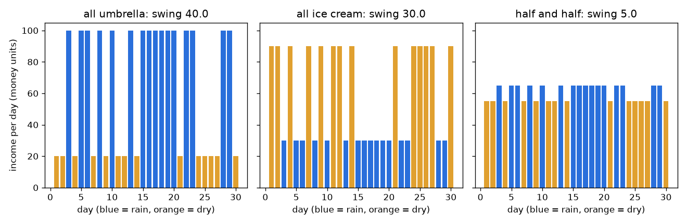
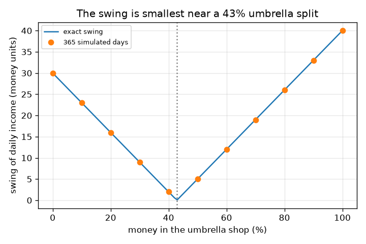

# సెషన్ 1: అన్ని గుడ్లను ఒకే బుట్టలో పెట్టకండి

[Session 1 — हिन्दी](README.hi.md)

*స్థాయి 1 (భావనాత్మక ఇంటరాక్టివ్ నమూనా) · సుమారు 60 నిమిషాలు · openportfolio*

> ఇది సరళీకరించిన ఒక విద్యా నమూనా (educational model). ఇది ధృవీకరించబడిన డిజైన్ సాధనం కాదు; నిజమైన నిర్మాణాలు, విద్యుత్ ఇన్‌స్టాలేషన్‌లు, వాహనాలు, పారిశ్రామిక ప్రక్రియలు లేదా వైద్య నిర్ణయాల కోసం దీనిని ఉపయోగించకూడదు.

**ముందస్తు జ్ఞానం (Prerequisites)**

- సంఖ్యల జాబితా సగటు మరియు లైన్ గ్రాఫ్ చదవడం.
- మీరు PRIMER.md చదివి `python start.py 1` ఒకసారి రన్ చేశారు.

**అభ్యాస లక్ష్యాలు (Learning objectives).** ఈ సెషన్ తర్వాత మీరు చేయగలరు:

- వ్యతిరేక రీతిలో కదిలే వాటిని కలపడం స్థిరమైన మొత్తాన్ని ఎందుకు ఇస్తుందో రెండు దుకాణాలతో వివరించడం.
- రోజువారీ ఆదాయం సగటును, ఊగిసలాటను (swing) (ప్రామాణిక విచలనం) లెక్కించడం.
- ఆదాయాన్ని అత్యంత స్థిరంగా చేసే డబ్బు విభజనను కనుగొనడం.
- విభజనకు వ్యతిరేకంగా ఊగిసలాట గ్రాఫ్‌ను చదవడం.

## A. వాస్తవ ప్రపంచ సమస్య
ఒక చిన్న వ్యాపారంలో పెట్టడానికి మీ దగ్గర కొంత పొదుపు ఉంది. ఒక దుకాణం గొడుగులు అమ్ముతుంది, మరొకటి ఐస్‌క్రీమ్. వర్షం రోజులలో గొడుగుల దుకాణం చాలా సంపాదిస్తుంది, ఐస్‌క్రీమ్ దుకాణం తక్కువ; పొడి రోజులలో దీనికి వ్యతిరేకం. మొత్తం ఒకే దుకాణంలో పెడితే మీ ఆదాయం వాతావరణంతో ఎగిరిపడుతుంది. రెండింటిలో కొంత పెడితే రెండు దుకాణాలు ఒకదానికొకటి భర్తీ చేసుకుంటాయి. అది ఎంత స్థిరంగా అవుతుంది, ఉత్తమ విభజన ఏది? ఇది నేర్చుకోవడానికి ఒక బొమ్మ నమూనా, సాధారణ విద్య కోసం మాత్రమే, పెట్టుబడి సలహా కాదు: దుకాణాలు, ఆదాయాలు కల్పితం, నిజమైన మార్కెట్‌లు వాతావరణ నాణెం ఎగరవేత లాగా ప్రవర్తించవు.

## B. భావన మరియు సిద్ధాంతం
ప్రతి రోజు p = 0.5 అవకాశంతో వర్షం లేదా పొడి. మొత్తం డబ్బు గొడుగుల దుకాణంలో ఉంటే ఆదాయం వర్షం రోజున 100, పొడి రోజున 20; మొత్తం ఐస్‌క్రీమ్ దుకాణంలో ఉంటే అది 30 మరియు 90 (రోజుకు కల్పిత డబ్బు యూనిట్లు). డబ్బులో ఒక భాగం f గొడుగుల దుకాణంలో, 1 - f ఐస్‌క్రీమ్ దుకాణంలో పెడితే, ఆదాయం రెండింటి అదే విభజన: f గుణకారం గొడుగుల ఆదాయం ప్లస్ (1 - f) గుణకారం ఐస్‌క్రీమ్ ఆదాయం. సగటు ఆదాయం అంటే రోజుల సగటు. ఊగిసలాట (swing) అంటే ప్రామాణిక విచలనం: ఒక రోజు సగటు నుండి ఉండే సాధారణ దూరం. రెండు రకాల రోజులు మాత్రమే ఉన్నాయి కాబట్టి, ఊగిసలాట అంటే వర్షం రోజు మరియు పొడి రోజు ఆదాయాల మధ్య అంతరం గుణకారం p (1 - p) వర్గమూలం. చిన్న ఊగిసలాట అంటే స్థిరమైన ఆదాయం.

| చిహ్నం | అర్థం | యూనిట్ |
|---|---|---|
| f | గొడుగుల దుకాణంలోని డబ్బు భాగం | యూనిట్ లేదు (0 నుండి 1) |
| p | ఒక రోజు వర్షంగా ఉండే అవకాశం | యూనిట్ లేదు (0 నుండి 1) |
| R, D | వర్షం రోజున, పొడి రోజున ఆదాయం | రోజుకు డబ్బు యూనిట్లు |
| average | సగటు రోజువారీ ఆదాయం | రోజుకు డబ్బు యూనిట్లు |
| swing | రోజువారీ ఆదాయం ప్రామాణిక విచలనం | రోజుకు డబ్బు యూనిట్లు |

**ఊహలు (Assumptions)**

- అన్ని సంఖ్యలు కల్పితం; ఇది అభ్యాస నమూనా, పెట్టుబడి సలహా కాదు, గతం భవిష్యత్తును అంచనా వేయదు.
- రోజులు ఒకదానిపై ఒకటి ఆధారపడవు, వర్షం అవకాశం మారదు.
- ఆదాయం పెట్టిన డబ్బుకు అనులోమానుపాతంలో ఉంటుంది, ఖర్చులు లేదా పన్నులు లేవు.

$$ R(f)=100f+30(1-f),\qquad D(f)=20f+90(1-f) $$

$$ \text{average}=pR+(1-p)D,\qquad \text{swing}=|R-D|\sqrt{p(1-p)} $$

$$ \text{swing}=|70f-30|\quad(p=0.5),\qquad \text{zero swing at } f=\tfrac{3}{7} $$

## C. దృశ్య వివరణ
మొదటి చిత్రం మూడు ఎంపికలకు 30 రోజుల ఆదాయాన్ని చూపిస్తుంది: మొత్తం గొడుగుల దుకాణం, మొత్తం ఐస్‌క్రీమ్ దుకాణం, సగం సగం. నీలం బార్లు వర్షం రోజులు, నారింజ బార్లు పొడి రోజులు. రెండు ఒకే-దుకాణం చార్టులు తక్కువ, ఎక్కువ బార్ల మధ్య ఎగిరిపడతాయి (365 రోజుల సిమ్యులేషన్‌లో ఊగిసలాటలు 40.0 మరియు 30.0), సగం-సగం చార్టు దాదాపు చదునుగా ఉంటుంది (ఊగిసలాట 5.0). రెండవ చిత్రం గొడుగుల దుకాణంలోని శాతానికి వ్యతిరేకంగా ఊగిసలాటను గీస్తుంది: సుమారు 43 శాతం వద్ద సున్నాను తాకే V ఆకారం, సిమ్యులేట్ చేసిన చుక్కలు ఖచ్చితమైన వక్రంపై ఉంటాయి.

*30 రోజుల ఆదాయం: ఒక దుకాణం తక్కువ, ఎక్కువ మధ్య ఎగిరిపడుతుంది; సగం సగం దాదాపు చదునుగా ఉంటుంది.*

*విభజనకు వ్యతిరేకంగా ఊగిసలాట: ఖచ్చితమైన V-ఆకార వక్రం మరియు సిమ్యులేట్ చేసిన చుక్కలు, 43 శాతం దగ్గర సున్నా.*

## D. ఇంటరాక్టివ్ సిమ్యులేషన్
పాఠాన్ని రన్ చేయండి (`python start.py 1`), తర్వాత లైవ్ యాప్‌ను తెరవండి: [సెషన్ 1: రెండు దుకాణాలు, ఒక ఆదాయం](https://krunalpanchal1995.github.io/pan-iit-oss/openportfolio/session-01/) (లేదా ఈ ఫోల్డర్‌లోని `app.html`). విభజన స్లైడర్‌ను లాగి మీ మిశ్రమం యొక్క వర్షం-రోజు, పొడి-రోజు బార్లు ఒకదానికొకటి దగ్గరవడాన్ని గమనించండి, తర్వాత ఊగిసలాట గ్రాఫ్ తెరిచి V అడుగు భాగాన్ని కనుగొనండి. వర్షం అవకాశాన్ని మార్చి అడుగు భాగం అదే విభజన వద్ద ఉండటాన్ని చూడండి.

**సవాలు.** (50 శాతం వర్షం అవకాశం వద్ద) ఊగిసలాట గరిష్ఠంగా రోజుకు 5 డబ్బు యూనిట్లు ఉండేలా ఒక విభజనను ఎంచుకోండి.

## E. సాధించిన ఉదాహరణ మరియు ప్రయోగం
**సమస్య.** డబ్బులో సగం ప్రతి దుకాణంలో పెట్టండి. వర్షం రోజున, పొడి రోజున ఆదాయం, సగటు ఆదాయం, ఊగిసలాట కనుగొనండి.

1. వర్షం రోజు: 0.5 * 100 + 0.5 * 30 = 65 డబ్బు యూనిట్లు.
2. పొడి రోజు: 0.5 * 20 + 0.5 * 90 = 55 డబ్బు యూనిట్లు.
3. సగటు = 0.5 * 65 + 0.5 * 55 = రోజుకు 60 డబ్బు యూనిట్లు (ఏ ఒక్క దుకాణం మాత్రమే ఉన్నా ఇదే).
4. ఊగిసలాట = |65 - 55| * sqrt(0.5 * 0.5) = 10 * 0.5 = రోజుకు 5 డబ్బు యూనిట్లు.
5. పోలిక: మొత్తం గొడుగుల దుకాణానికి ఊగిసలాట |100 - 20| * 0.5 = 40, మొత్తం ఐస్‌క్రీమ్‌కు |30 - 90| * 0.5 = 30.

**సమాధానం.** సగం సగం వర్షం రోజున 65, పొడి రోజున 55, సగటు 60, ఊగిసలాట 5 ఇస్తుంది, ఒకే దుకాణానికి ఊగిసలాటలు 40 మరియు 30. చెక్‌పాయింట్ 365 సీడ్ చేసిన రోజులతో కూడా దీనిని నిర్ధారిస్తుంది: 189 వర్షం రోజులు, ఊగిసలాటలు 40.0, 30.0 మరియు 5.0.

**ప్రయోగం.** ప్రత్యక్ష రూపం: ఒక నాణెం 30 సార్లు ఎగరవేయండి (బొమ్మ = వర్షం). ప్రతి ఎగరవేతకు రెండు దుకాణాల ఆదాయాలు రాసి, ప్రతిదానిలో సగం కలిపి, మీ 'ఒకే దుకాణం', 'సగం సగం' నిలువు వరుసలు ఎంత మారుతున్నాయో పోల్చండి. నిజమైన వ్యాపారాలు నమూనా కంటే భిన్నంగా ఉంటాయి: రోజులు స్వతంత్రం కావు (వర్షాకాలాలు ఉంటాయి), ఆదాయాలు సరిగ్గా వ్యతిరేకం కావు, దుకాణాలకు ఖర్చులు ఉంటాయి. కాబట్టి నిజమైన ఊగిసలాట 5 కి పడదు, ఒకే దుకాణం కంటే చిన్నదానికి మాత్రమే.

## F. మూల్యాంకనం మరియు డిజైన్ సవాలు
**ప్రశ్న రకం A: భావనాత్మక.** ప్రతి దుకాణం అస్థిరమైనా, రెండు దుకాణాలలో డబ్బు పెట్టడం ఆదాయాన్ని ఎందుకు స్థిరంగా చేస్తుంది?

సూచన

వర్షం రోజున, పొడి రోజున ప్రతి దుకాణం ఎంత సంపాదిస్తుందో చూడండి.

దశలవారీ పరిష్కారం

రెండు దుకాణాలు వ్యతిరేక దిశలలో అస్థిరంగా ఉంటాయి: ఒకటి ఎక్కువ సంపాదించినప్పుడు, మరొకటి తక్కువ సంపాదిస్తుంది. వాటిని కలపడం వల్ల ఒకదాని ఎక్కువ రోజులు మరొకదాని తక్కువ రోజులను భర్తీ చేస్తాయి, కాబట్టి మొత్తం దాదాపు అదే సంఖ్య దగ్గర ఉంటుంది. అవి వ్యతిరేక రీతిలో కదులుతాయి కాబట్టి మాత్రమే ఇది పనిచేస్తుంది; రెండు గొడుగుల దుకాణాలు కలిసి ఎగుడుదిగుడు అవుతాయి, ఏ ప్రయోజనమూ ఇవ్వవు.

**ప్రశ్న రకం B: సంఖ్యాత్మక.** డబ్బులో 25 శాతం గొడుగుల దుకాణంలో పెట్టండి. వర్షం-రోజు ఆదాయం, పొడి-రోజు ఆదాయం, సగటు, ఊగిసలాట కనుగొనండి (వర్షం అవకాశం 0.5).

సూచన

f = 0.25 తో R = 100 f + 30 (1 - f) మరియు D = 20 f + 90 (1 - f).

దశలవారీ పరిష్కారం

R = 25 + 22.5 = 47.5 మరియు D = 5 + 67.5 = 72.5 డబ్బు యూనిట్లు. సగటు = 0.5 * 47.5 + 0.5 * 72.5 = 60. ఊగిసలాట = |47.5 - 72.5| * 0.5 = 12.5, ఇది |70 * 0.25 - 30| = 12.5 తో సరిపోతుంది. సహేతుక పరిశీలన: ఇది 5 (సగం సగం) మరియు 30 (మొత్తం ఐస్‌క్రీమ్) మధ్య ఉంది.

**ప్రశ్న రకం C: గ్రాఫ్ మరియు సిమ్యులేషన్ వ్యాఖ్యానం.** విభజనకు వ్యతిరేకంగా ఊగిసలాట గ్రాఫ్‌లో, ఊగిసలాట సున్నా ఎక్కడ, 0 మరియు 100 శాతం వద్ద ఊగిసలాటలు ఎంత? అడుగు భాగానికి ఇరువైపులా V ఆకారం అంటే ఏమిటి?

సూచన

R = D అని పెట్టండి, లేదా V అడుగు భాగాన్ని చదవండి.

దశలవారీ పరిష్కారం

ఊగిసలాట f = 3/7 = 42.9 శాతం వద్ద సున్నా, అక్కడ R = D. 0 శాతం వద్ద (మొత్తం ఐస్‌క్రీమ్) అది 30, 100 శాతం వద్ద (మొత్తం గొడుగులు) 40. అడుగు భాగానికి ఎడమవైపు ఐస్‌క్రీమ్ దుకాణం ఆధిపత్యం చూపుతుంది, పొడి రోజులలో ఆదాయం ఎక్కువ; కుడివైపు గొడుగుల దుకాణం ఆధిపత్యం చూపుతుంది, వర్షం రోజులలో ఎక్కువ. ఇరువైపులా, ఒక దుకాణం నమూనా గెలుస్తుంది కాబట్టి ఊగిసలాట పెరుగుతుంది.

**ప్రశ్న రకం D: డిజైన్ మరియు ఆప్టిమైజేషన్ (optimisation) సవాలు.** డిజైన్: ఊగిసలాట గరిష్ఠంగా రోజుకు 10 డబ్బు యూనిట్లు ఉండాలి. ఏ విభజనలు పనిచేస్తాయి? సున్నా-ఊగిసలాట విభజననే మీరు ఎందుకు ఎంచుకోకపోవచ్చు?

సూచన

|70 f - 30| <= 10 సాధించండి.

దశలవారీ పరిష్కారం

f 2/7 = 28.6 శాతం మరియు 4/7 = 57.1 శాతం మధ్య ఉండాలి. సున్నా-ఊగిసలాట విభజన 42.9 శాతం అత్యంత స్థిరం, కానీ అది కల్పిత సంఖ్యలు ఖచ్చితంగా సరైనవి కావడంపై ఆధారపడుతుంది. దుకాణాల ఆదాయాలు లేదా వర్షం అవకాశం మారితే ఉత్తమ విభజన కదులుతుంది, కాబట్టి బ్యాండ్ మధ్యలోని విభజన సురక్షితమైన ఎంపిక. ట్రేడ్-ఆఫ్ (trade-off): ఇక్కడ ప్రతి విభజనకూ సగటు 60 అదే, కాబట్టి స్థిరత్వం ఉచితం; నిజ జీవితంలో తక్కువ రిస్క్‌కు తరచుగా కొంత సగటు రాబడి ఖర్చవుతుంది (సెషన్ 2).

[RUBRIC.md](../../RUBRIC.md)తో మిమ్మల్ని మీరు స్కోర్ చేసుకోండి. కాగితంపై చేయడానికి [కార్యాచరణ పత్రం](activity_sheet.md) ప్రింట్ చేయండి.

## సాధారణ అపోహలు
| సాధారణ అపోహ | నిజానికి సరైనది |
|---|---|
| డబ్బును విభజించడం సగటు ఆదాయాన్ని తగ్గిస్తుంది. | ఇక్కడ దుకాణాలకు ఒకే సగటు ఉంది కాబట్టి ప్రతి విభజనకూ సగటు 60. వైవిధ్యీకరణ (diversification) ఊగిసలాటను మారుస్తుంది; ఆస్తులకు వేర్వేరు సగటులు ఉన్నప్పుడు మాత్రమే సగటును మారుస్తుంది (సెషన్ 2). |
| రెండు దుకాణాలు ఎల్లప్పుడూ ఒకదాని కంటే స్థిరం. | అవి కలిసి కదలకపోతేనే. రెండు గొడుగుల దుకాణాలు కలిసి ఎగుడుదిగుడు అవుతాయి, కాబట్టి వాటి మధ్య విభజించడం ఊగిసలాటను మార్చకుండా వదిలేస్తుంది. |
| ఊగిసలాట అంటే మీరు పొందగల అతిపెద్ద నష్టం. | ఊగిసలాట (ప్రామాణిక విచలనం) సగటు నుండి ఒక సాధారణ దూరం, అత్యంత చెడ్డ సందర్భం కాదు. ఒక చెడ్డ రోజు దానికంటే దూరంగా ఉండవచ్చు. |
| కల్పిత సంఖ్యలున్న నమూనా ఏమి జరుగుతుందో చెబుతుంది. | ఒక ఆలోచన ఎలా పనిచేస్తుందో అది చూపిస్తుంది. నిజమైన ఆదాయాలు, మార్కెట్‌లు ముందే తెలియవు, గత ఫలితాలు భవిష్యత్తును ఎప్పుడూ అంచనా వేయవు. |

## పదకోశం (Glossary)
- **సగటు (average, mean)**: రోజువారీ ఆదాయాల మొత్తాన్ని రోజుల సంఖ్యతో భాగించినది
- **ఊగిసలాట (swing, standard deviation)**: ఒక రోజు సగటు నుండి ఉండే సాధారణ దూరం; చిన్నది అంటే స్థిరం
- **విభజన (split)**: ప్రతి దుకాణంలో పెట్టిన డబ్బు భాగం
- **వైవిధ్యీకరణ (diversification)**: కలిసి కదలని వాటిపై డబ్బును పంచడం, తద్వారా మొత్తం స్థిరంగా ఉంటుంది
- **సీడ్ (seed)**: యాదృచ్ఛిక జనరేటర్ ప్రతిసారీ అవే సంఖ్యలను పునరావృతం చేసేలా చేసే సంఖ్య

## ముగింపు
1. [exercises.md](exercises.md)లోని మూడు కోడింగ్ పనులు చేయండి.
2. మీ మార్పుల తర్వాత `python start.py 1` మళ్ళీ రన్ చేయండి. అది చెక్‌పాయింట్‌తో (checkpoint) ముగుస్తుంది; అది `PASS` అని ప్రింట్ చేసినప్పుడు మీరు పూర్తి చేశారు. (చెక్‌పాయింట్ మాత్రమే: `python start.py check 1`.)

తర్వాత: [సెషన్ 2](../session-02/README.md)
