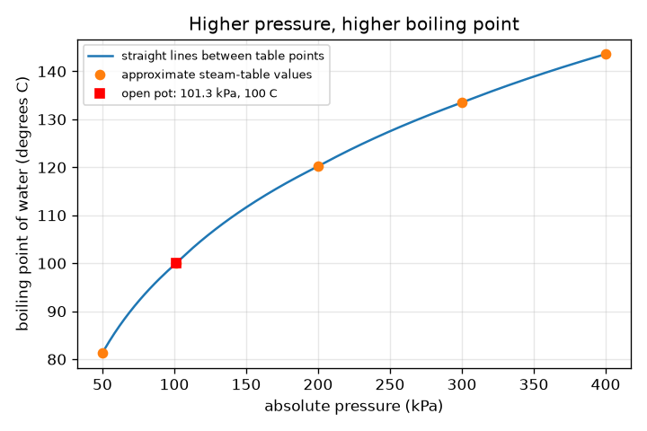
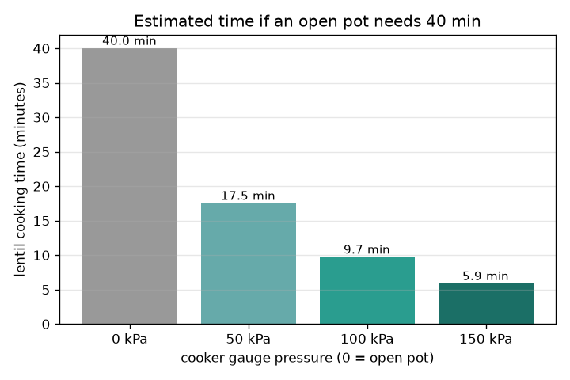

# सत्र 1: दाब क्वथनांक को बदलता है

*स्तर 1 (वैचारिक इंटरैक्टिव मॉडल) · लगभग 60 मिनट · openpressurecooker*

> यह एक सरलीकृत शैक्षिक मॉडल है। यह कोई प्रमाणित डिज़ाइन उपकरण नहीं है और इसका उपयोग वास्तविक संरचनाओं, विद्युत स्थापनाओं, वाहनों, औद्योगिक प्रक्रियाओं या चिकित्सा संबंधी निर्णयों के लिए नहीं किया जाना चाहिए।

**पूर्वापेक्षाएँ (Prerequisites)**

- यह जानना कि खुले बर्तन में पानी 100 डिग्री C पर उबलता है।
- आपने PRIMER.md पढ़ लिया है और `python start.py 1` एक बार चला लिया है।

**सीखने के उद्देश्य (Learning objectives)।** इस सत्र के बाद आप:

- समझा सकेंगे कि दाब (pressure) अधिक होने पर पानी अधिक तापमान पर क्यों उबलता है।
- समझा सकेंगे कि प्रेशर कुकर भाप को कैसे रोकता है और अधिक दाब कैसे बनाए रखता है।
- गेज (gauge) और निरपेक्ष (absolute) दाब का सही उपयोग करते हुए दाब तालिका और ग्राफ़ से क्वथनांक (boiling point) पढ़ सकेंगे।
- पकाने के समय का अनुमान लगाने के लिए प्रति-10-डिग्री-दुगुना अंगूठा नियम (rule of thumb) का उपयोग कर सकेंगे।

## A. वास्तविक दुनिया की समस्या
दालें खुले बर्तन में लगभग 40 मिनट लेती हैं और प्रेशर कुकर में, उसी आँच पर, बहुत कम समय। कुकर आँच को गर्म नहीं बनाता। बंद ढक्कन क्या बदलता है? यह समझने के लिए एक सरलीकृत शिक्षण मॉडल है, वास्तविक उपकरण के उपयोग या उसमें बदलाव की मार्गदर्शिका नहीं: किसी वास्तविक कुकर के वाल्वों को कभी भी न बदलें, न रोकें और न हटाएँ।

## B. अवधारणा और सिद्धांत
पानी तब उबलता है जब पानी के चारों ओर के दाब के विरुद्ध भाप के बुलबुले बन सकते हैं। समुद्र तल पर वायु के दाब, 101.3 kPa, पर ऐसा 100 डिग्री C पर होता है। यदि दाब अधिक हो, तो बुलबुलों को अधिक गर्म द्रव चाहिए, इसलिए क्वथनांक बढ़ जाता है। खुले बर्तन में भाप निकल जाती है, इसलिए दाब एक वायुमंडल पर रहता है और आँच कितनी भी बड़ी हो पानी 100 डिग्री C से अधिक गर्म नहीं हो सकता (अतिरिक्त ऊष्मा केवल अधिक भाप बनाती है)। कुकर में एक बंद ढक्कन और एक भारित वाल्व (weighted valve) होता है: भाप इकट्ठी होती है, दाब तब तक बढ़ता है जब तक वाल्व उठ न जाए, और फिर वह एक निर्धारित दाब बनाए रखता है। गेज वायु से ऊपर का दाब पढ़ता है, इसलिए निरपेक्ष दाब = गेज + 101.325 kPa। हम क्वथनांक अनुमानित भाप-तालिका (steam-table) मानों की एक छोटी तालिका से पढ़ते हैं। रसायन (नरम होना, टूटना) अधिक गर्म होने पर तेज़ी से होता है; एक अंगूठा नियम कहता है कि दर हर 10 डिग्री C पर लगभग दुगुनी होती है, इसलिए गति गुणक = 2 की घात (T - 100) / 10। यह एक अंगूठा नियम है, सटीक नियम नहीं।

| प्रतीक | अर्थ | इकाई |
|---|---|---|
| P_gauge | वायु से ऊपर का दाब, जैसा गेज दिखाता है | kPa |
| P_abs | निरपेक्ष दाब = गेज + 101.325 | kPa |
| T | उस दाब पर क्वथनांक | डिग्री C |
| f | 100 डिग्री C की तुलना में पकाने का गति गुणक | कोई इकाई नहीं |
| t_open, t_cooker | खुले बर्तन में और कुकर में पकाने का समय | min |

**मान्यताएँ (Assumptions)**

- तालिका मानों के बीच के क्वथनांक लॉग-दाब पैमाने पर सीधी रेखाओं से ज्ञात किए जाते हैं (अनुमानित)।
- तालिका मान अनुमानित भाप-तालिका मान हैं।
- भोजन उबलते पानी के तापमान पर है, और प्रति 10 डिग्री C दुगुना होना केवल एक अंगूठा नियम है।
- केवल शिक्षण मॉडल; वास्तविक उपकरण डिज़ाइन करने या बदलने के लिए नहीं।

$$ P_{\mathrm{abs}}=P_{\mathrm{gauge}}+101.325\ \mathrm{kPa} $$

$$ f=2^{(T-100)/10} $$

$$ t_{\mathrm{cooker}}=\frac{t_{\mathrm{open}}}{f} $$

## C. दृश्य व्याख्या
पहला चित्र निरपेक्ष दाब के सापेक्ष क्वथनांक आलेखित करता है: वक्र पहले तेज़ी से बढ़ता है और फिर सपाट होता जाता है, इसलिए पहले अतिरिक्त 100 kPa से लगभग 20 डिग्री C मिलते हैं और अगले 100 kPa से केवल लगभग 13। खुला बर्तन 101.3 kPa और 100 डिग्री C वाला बिंदु है। दूसरा चित्र एक ऐसी विधि के लिए जिसे खुले बर्तन में 40 मिनट चाहिए, 0, 50, 100 और 150 kPa गेज की कुकर सेटिंग्स पर दाल के अनुमानित समय का दंड चार्ट (bar chart) है: 40, 17.5, 9.7 और 5.9 मिनट।

*निरपेक्ष दाब के सापेक्ष क्वथनांक: अधिक दाब, अधिक क्वथनांक, सपाट होते वक्र के साथ।*

*चार कुकर सेटिंग्स पर 40 मिनट की खुले-बर्तन विधि के लिए दाल का अनुमानित समय।*

## D. इंटरैक्टिव सिमुलेशन
पाठ चलाइए (`python start.py 1`), फिर लाइव ऐप खोलिए: [सत्र 1: दाब और क्वथनांक](https://krunalpanchal1995.github.io/pan-iit-oss/openpressurecooker/session-01/) (या इसी फ़ोल्डर में `app.html`)। गेज दाब खींचिए और पानी के तापमान तथा क्वथनांक वक्र को खिसकते देखिए। खुले-बर्तन का समय बदलिए और कुकर के समय को उसके साथ बदलते देखिए।

**चुनौती।** खुले-बर्तन का समय 40 मिनट पर छोड़कर, अनुमानित कुकर समय को 15 मिनट या उससे कम कीजिए।

## E. हल किया गया उदाहरण और प्रयोग
**समस्या।** एक कुकर 100 kPa गेज बनाए रखता है। निरपेक्ष दाब, क्वथनांक, गति गुणक, और खुले बर्तन में 40 मिनट चाहने वाली विधि का समय क्या है?

1. निरपेक्ष दाब = 100 + 101.325 = 201.3 kPa।
2. तालिका में 200 kPa पर 120.2 डिग्री C और 300 kPa पर 133.5 डिग्री C है, इसलिए 201.3 kPa, 200 से ठीक ऊपर है: क्वथनांक लगभग 120.4 डिग्री C।
3. गति गुणक = 2^((120.4 - 100) / 10) = 2^2.04 = 4.12।
4. समय = 40 / 4.12 = 9.7 मिनट।

**उत्तर।** निरपेक्ष दाब 201.3 kPa, क्वथनांक लगभग 120.4 डिग्री C, लगभग 4.1 गुना तेज़, इसलिए लगभग 9.7 मिनट।

**प्रयोग।** सुरक्षित प्रयोग, केवल एक साधारण खुले बर्तन में: पानी उबालिए और रसोई के थर्मामीटर से तापमान मापिए; समुद्र तल पर यह लगभग 100 डिग्री C पढ़ना चाहिए और किसी पहाड़ी पर या समुद्र तल से काफ़ी ऊपर के शहर में थोड़ा कम, क्योंकि वायु दाब कम होता है। प्रेशर कुकर के अंदर कुछ भी मापने या बदलने का प्रयास न करें। मॉडल एक तालिका और एक अंगूठा नियम है, इसलिए यह विचार दिखाता है पर वास्तविक पकाने का समय भोजन, उसके आकार और ऊष्मा उसके अंदर कैसे पहुँचती है, इस पर भी निर्भर करता है।

## F. मूल्यांकन और डिज़ाइन चुनौती
**प्रश्न प्रकार A: वैचारिक।** खुला बर्तन, बहुत बड़ी आँच पर भी, पानी को लगभग 100 डिग्री C से अधिक गर्म क्यों नहीं कर सकता? अतिरिक्त ऊष्मा इसके बजाय क्या करती है?

संकेत

सोचिए कि भाप कहाँ जाती है और पानी के चारों ओर दाब क्या है।

चरण-दर-चरण हल

खुले बर्तन में दाब एक वायुमंडल पर रहता है क्योंकि भाप निकल जाती है। उस दाब पर पानी 100 डिग्री C पर उबलता है, और कोई भी अतिरिक्त ऊष्मा अधिक पानी को भाप में बदलने (गुप्त ऊष्मा (latent heat)) में जाती है, तापमान बढ़ाने में नहीं। अधिक गर्म पानी पाने के लिए दाब बढ़ाना होगा, जो बंद कुकर करता है।

**प्रश्न प्रकार B: संख्यात्मक।** एक कुकर 150 kPa गेज बनाए रखता है। निरपेक्ष दाब, तालिका से क्वथनांक, गति गुणक और खुले बर्तन में 60 मिनट चाहने वाली विधि का समय ज्ञात कीजिए।

संकेत

पहले 101.325 जोड़िए, फिर 200 और 300 kPa के बीच अंतर्वेशन (interpolate) कीजिए।

चरण-दर-चरण हल

निरपेक्ष = 251.3 kPa। क्वथनांक 120.2 (200 kPa) और 133.5 डिग्री C (300 kPa) के बीच है: लगभग 127.7 डिग्री C। गति गुणक = 2^(27.7/10) = 6.8। समय = 60 / 6.8 = लगभग 8.8 मिनट। जाँच: उसी 40 मिनट की विधि के लिए, 150 kPa पर 5.9 मिनट और 100 kPa पर 9.7, इसलिए अधिक दाब का अर्थ है अधिक गर्म बर्तन और कम समय, जैसा अपेक्षित है।

**प्रश्न प्रकार C: ग्राफ़ और सिमुलेशन की व्याख्या।** क्वथनांक ग्राफ़ पर, 101 और 200 kPa के बीच, और 200 और 300 kPa के बीच क्वथनांक कितना बढ़ता है? ढलान में बदलाव आपको अधिक दाब जोड़ने के बारे में क्या बताता है?

संकेत

तालिका के बिंदु पढ़िए: 100, 120.2 और 133.5 डिग्री C।

चरण-दर-चरण हल

101.3 से 200 kPa तक यह लगभग 20 डिग्री C बढ़ता है (100 से 120.2), लगभग 0.20 डिग्री C प्रति kPa। 200 से 300 kPa तक यह 13.3 डिग्री C बढ़ता है, लगभग 0.13 डिग्री C प्रति kPa। वक्र सपाट होता जाता है, इसलिए हर अतिरिक्त kPa कम तापमान देता है: बहुत अधिक दाब (और एक मज़बूत, अधिक खतरनाक पात्र) से घटते लाभ (diminishing returns) मिलते हैं।

**प्रश्न प्रकार D: डिज़ाइन और अनुकूलन चुनौती।** डिज़ाइन: एक गेज दाब चुनिए (पूरे 5 kPa के चरणों में) ताकि 40 मिनट की खुले-बर्तन विधि 12 मिनट या उससे कम ले, और बताइए कि आपको बस बहुत अधिक दाब चुनने से क्या रोकता है।

संकेत

आपको कम से कम 40 / 12 = 3.33 का गति गुणक चाहिए; उसके लिए तापमान ज्ञात कीजिए, फिर दाब।

चरण-दर-चरण हल

3.33 के गुणक के लिए कम से कम 100 + 10 log2(3.33) = 117.4 डिग्री C का क्वथनांक चाहिए। तालिका यह लगभग 82 kPa गेज पर देती है (82 kPa पर 11.8 min, 80 kPa पर 12.07), इसलिए 85 kPa चुनिए (लगभग 11.4 मिनट)। सीमाएँ: अधिक दाब के लिए मज़बूत पात्र और भारी वाल्व चाहिए, अधिक ऊर्जा खर्च होती है, भोजन ज़्यादा पक सकता है या टूट सकता है, और दाब के साथ लाभ सपाट होता जाता है। वास्तविक कुकरों की निश्चित, परीक्षित सेटिंग्स होती हैं; यह एक शिक्षण गणना है, वाल्व बदलने का कभी कोई कारण नहीं।

[RUBRIC.md](../../RUBRIC.md) से स्वयं को अंक दीजिए। कागज़ पर काम करने के लिए [गतिविधि पत्रक](activity_sheet.md) प्रिंट कीजिए।

## आम भ्रांतियाँ
| आम भ्रांति | वास्तव में क्या सच है |
|---|---|
| प्रेशर कुकर इसलिए काम करता है क्योंकि उसकी आँच अधिक गर्म होती है। | आँच वही है। बंद ढक्कन दाब बढ़ाता है, इसलिए पानी अधिक तापमान पर उबलता है, और भोजन अधिक गर्म होता है। |
| पानी हमेशा 100 डिग्री C पर उबलता है। | केवल 101.3 kPa (समुद्र तल के वायु दाब) पर। कम दाब (पहाड़) पर यह कम और अधिक दाब (कुकर) पर अधिक होता है। |
| गेज पर 0 पढ़ने का अर्थ है कोई दाब नहीं। | गेज वायु से ऊपर का दाब पढ़ता है। गेज 0 का अर्थ है एक वायुमंडल, 101.3 kPa निरपेक्ष। |
| कुकर तेज़ी से पकाता है क्योंकि भाप पानी से अधिक गर्म होती है। | साम्यावस्था (equilibrium) में पानी और भाप एक ही तापमान पर होते हैं; महत्वपूर्ण यह है कि पूरा बर्तन 100 के बजाय 120 डिग्री C पर है। |

## शब्दावली
- **क्वथनांक (boiling point)**: वह तापमान जिस पर द्रव स्वतंत्र रूप से वाष्प में बदलता है; दाब पर निर्भर करता है
- **निरपेक्ष दाब (absolute pressure)**: पूर्ण निर्वात से मापा गया दाब; इसमें वायु शामिल है
- **गेज दाब (gauge pressure)**: आसपास की वायु से ऊपर का दाब; गेज 0 एक वायुमंडल है
- **kPa**: किलोपास्कल, 1000 पास्कल; एक वायुमंडल लगभग 101.3 kPa है
- **अंगूठा नियम (rule of thumb)**: एक मोटा, आसान नियम जो उपयोगी है पर सटीक नहीं

## समापन
1. [exercises.md](exercises.md) में दिए तीन कोडिंग कार्य कीजिए।
2. अपने बदलावों के बाद `python start.py 1` फिर से चलाइए। यह चेकपॉइंट (checkpoint) पर समाप्त होता है; जब यह `PASS` छापे, तो आपका काम पूरा है। (केवल चेकपॉइंट: `python start.py check 1`।)

अगला: [सत्र 2](../session-02/README.md)
