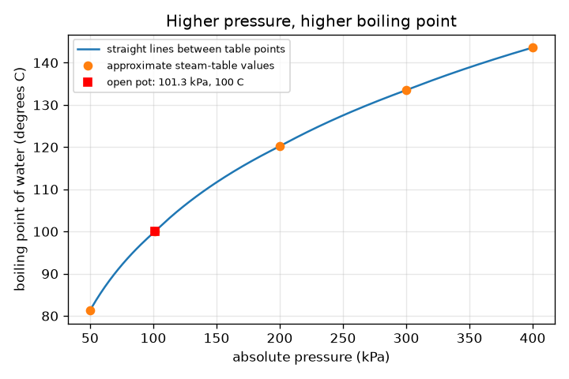
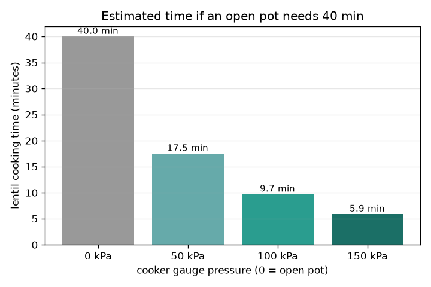

# സെഷൻ 1: മർദ്ദം തിളനില മാറ്റുന്നു

[Session 1 — हिन्दी](README.hi.md)

*ലെവൽ 1 (ആശയപരമായ ഇന്ററാക്ടീവ് മോഡൽ) · ഏകദേശം 60 മിനിറ്റ് · openpressurecooker*

> ഇത് പഠനാവശ്യത്തിനുള്ള ലളിതമാക്കിയ ഒരു മോഡലാണ്. ഇത് സാധൂകരിക്കപ്പെട്ട ഒരു ഡിസൈൻ ഉപകരണമല്ല; യഥാർത്ഥ ഘടനകൾ, വൈദ്യുത ഇൻസ്റ്റലേഷനുകൾ, വാഹനങ്ങൾ, വ്യാവസായിക പ്രക്രിയകൾ അല്ലെങ്കിൽ വൈദ്യശാസ്ത്ര തീരുമാനങ്ങൾ എന്നിവയ്ക്കായി ഇത് ഉപയോഗിക്കരുത്.

**മുൻ‌അറിവ് (Prerequisites)**

- തുറന്ന പാത്രത്തിൽ വെള്ളം 100 ഡിഗ്രി C-ൽ തിളയ്ക്കുന്നു എന്ന് അറിയുക.
- നിങ്ങൾ PRIMER.md വായിച്ചിട്ടുണ്ട്, `python start.py 1` ഒരിക്കൽ റൺ ചെയ്തിട്ടുണ്ട്.

**പഠന ലക്ഷ്യങ്ങൾ (Learning objectives).** ഈ സെഷനു ശേഷം നിങ്ങൾക്ക് കഴിയും:

- മർദ്ദം കൂടുമ്പോൾ വെള്ളം ഉയർന്ന താപനിലയിൽ തിളയ്ക്കുന്നത് എന്തുകൊണ്ടെന്ന് വിശദീകരിക്കാൻ.
- ഒരു പ്രഷർ കുക്കർ നീരാവിയെ കുടുക്കി ഉയർന്ന മർദ്ദം നിലനിർത്തുന്നത് എങ്ങനെയെന്ന് വിശദീകരിക്കാൻ.
- ഗേജ് മർദ്ദവും കേവല മർദ്ദവും ശരിയായി ഉപയോഗിച്ച് ഒരു മർദ്ദ പട്ടികയിൽ നിന്നും ഗ്രാഫിൽ നിന്നും തിളനില വായിക്കാൻ.
- പാചക സമയം കണക്കാക്കാൻ ഓരോ 10 ഡിഗ്രിക്കും ഇരട്ടിയാകുന്ന എന്ന ഏകദേശ നിയമം (rule of thumb) ഉപയോഗിക്കാൻ.

## A. യഥാർത്ഥ ലോക പ്രശ്നം
പരിപ്പ് തുറന്ന പാത്രത്തിൽ ഏകദേശം 40 മിനിറ്റ് എടുക്കും, അതേ തീയിൽ ഒരു പ്രഷർ കുക്കറിൽ വളരെ കുറഞ്ഞ സമയം മതി. കുക്കർ തീയെ ചൂടുള്ളതാക്കുന്നില്ല. അടച്ച അടപ്പ് എന്താണ് മാറ്റുന്നത്? ഇത് മനസ്സിലാക്കാനുള്ള ലളിതമാക്കിയ ഒരു അധ്യാപന മോഡലാണ്, യഥാർത്ഥ ഉപകരണങ്ങൾ ഉപയോഗിക്കാനോ മാറ്റം വരുത്താനോ ഉള്ള ഗൈഡ് അല്ല: ഒരു യഥാർത്ഥ കുക്കറിന്റെ വാൽവുകൾ ഒരിക്കലും മാറ്റം വരുത്തുകയോ തടയുകയോ നീക്കുകയോ ചെയ്യരുത്.

## B. ആശയവും സിദ്ധാന്തവും
വെള്ളത്തിന് ചുറ്റുമുള്ള മർദ്ദത്തിനെതിരെ നീരാവിക്കുമിളകൾ രൂപപ്പെടാൻ കഴിയുമ്പോഴാണ് വെള്ളം തിളയ്ക്കുന്നത്. സമുദ്രനിരപ്പിലെ വായുവിന്റെ മർദ്ദമായ 101.3 kPa-ൽ അത് 100 ഡിഗ്രി C-ൽ സംഭവിക്കുന്നു. മർദ്ദം കൂടുതലാണെങ്കിൽ, കുമിളകൾക്ക് ചൂടുള്ള ദ്രാവകം വേണം, അതിനാൽ തിളനില ഉയരുന്നു. തുറന്ന പാത്രത്തിൽ നീരാവി രക്ഷപ്പെടുന്നു, അതിനാൽ മർദ്ദം ഒരു അന്തരീക്ഷമായി (atmosphere) തുടരുന്നു, തീ എത്ര വലുതായാലും വെള്ളം 100 ഡിഗ്രി C-നേക്കാൾ ചൂടാകില്ല (അധിക താപം കൂടുതൽ നീരാവി മാത്രം ഉണ്ടാക്കുന്നു). ഒരു കുക്കറിന് അടച്ച അടപ്പും ഭാരമുള്ള വാൽവും ഉണ്ട്: നീരാവി ശേഖരിക്കപ്പെടുന്നു, വാൽവ് ഉയരുന്നതുവരെ മർദ്ദം കൂടുന്നു, പിന്നെ അത് ഒരു നിശ്ചിത മർദ്ദം നിലനിർത്തുന്നു. ഒരു ഗേജ് വായുവിന് മുകളിലുള്ള മർദ്ദം വായിക്കുന്നു, അതിനാൽ കേവല മർദ്ദം = ഗേജ് + 101.325 kPa. ഏകദേശ സ്റ്റീം-ടേബിൾ മൂല്യങ്ങളുടെ ഒരു ചെറിയ പട്ടികയിൽ നിന്ന് നാം തിളനിലകൾ വായിക്കുന്നു. കൂടുതൽ ചൂടാകുമ്പോൾ രസതന്ത്രം (മൃദുവാകൽ, വിഘടിക്കൽ) വേഗത്തിലാകുന്നു; ഓരോ 10 ഡിഗ്രി C-നും നിരക്ക് ഏകദേശം ഇരട്ടിയാകുന്നു എന്ന് ഒരു ഏകദേശ നിയമം പറയുന്നു, അതിനാൽ വേഗ ഘടകം = 2^((T - 100) / 10). ഇതൊരു ഏകദേശ നിയമമാണ്, കൃത്യമായ നിയമമല്ല.

| ചിഹ്നം | അർത്ഥം | യൂണിറ്റ് |
|---|---|---|
| P_gauge | ഗേജ് കാണിക്കുന്ന, വായുവിന് മുകളിലുള്ള മർദ്ദം | kPa |
| P_abs | കേവല മർദ്ദം = ഗേജ് + 101.325 | kPa |
| T | ആ മർദ്ദത്തിലെ തിളനില | ഡിഗ്രി C |
| f | 100 ഡിഗ്രി C-നെ അപേക്ഷിച്ചുള്ള പാചക വേഗ ഘടകം | യൂണിറ്റില്ല |
| t_open, t_cooker | തുറന്ന പാത്രത്തിലെയും കുക്കറിലെയും പാചക സമയം | min |

**അനുമാനങ്ങൾ (Assumptions)**

- പട്ടിക മൂല്യങ്ങൾക്കിടയിലെ തിളനിലകൾ ലോഗ്-മർദ്ദ സ്കെയിലിൽ നേർരേഖകൾ കൊണ്ട് കണ്ടെത്തുന്നു (ഏകദേശം).
- പട്ടിക മൂല്യങ്ങൾ ഏകദേശ സ്റ്റീം-ടേബിൾ മൂല്യങ്ങളാണ്.
- ഭക്ഷണം തിളയ്ക്കുന്ന വെള്ളത്തിന്റെ താപനിലയിലാണ്, 10 ഡിഗ്രി C-ന് ഇരട്ടിയാകുന്നത് ഒരു ഏകദേശ നിയമം മാത്രമാണ്.
- അധ്യാപന മോഡൽ മാത്രം; യഥാർത്ഥ ഉപകരണങ്ങൾ ഡിസൈൻ ചെയ്യാനോ മാറ്റാനോ ഉള്ളതല്ല.

$$ P_{\mathrm{abs}}=P_{\mathrm{gauge}}+101.325\ \mathrm{kPa} $$

$$ f=2^{(T-100)/10} $$

$$ t_{\mathrm{cooker}}=\frac{t_{\mathrm{open}}}{f} $$

## C. ദൃശ്യ വിശദീകരണം
ആദ്യത്തെ ചിത്രം കേവല മർദ്ദത്തിനെതിരെ തിളനില വരയ്ക്കുന്നു: വക്രം ആദ്യം വേഗത്തിൽ ഉയരുകയും പിന്നെ പരക്കുകയും ചെയ്യുന്നു, അതിനാൽ ആദ്യത്തെ അധിക 100 kPa ഏകദേശം 20 ഡിഗ്രി C നേടിത്തരുന്നു, അടുത്ത 100 kPa ഏകദേശം 13 മാത്രം. തുറന്ന പാത്രം 101.3 kPa, 100 ഡിഗ്രി C എന്ന ബിന്ദുവാണ്. രണ്ടാമത്തെ ചിത്രം, തുറന്ന പാത്രത്തിൽ 40 മിനിറ്റ് വേണ്ട ഒരു പാചകക്കുറിപ്പിന്, 0, 50, 100, 150 kPa ഗേജ് കുക്കർ ക്രമീകരണങ്ങൾക്കുള്ള കണക്കാക്കിയ പരിപ്പ് സമയത്തിന്റെ ബാർ ചാർട്ട് ആണ്: 40, 17.5, 9.7, 5.9 മിനിറ്റ്.

*കേവല മർദ്ദത്തിനെതിരെ തിളനില: ഉയർന്ന മർദ്ദം, ഉയർന്ന തിളനില, പരക്കുന്ന വക്രത്തോടെ.*

*40 മിനിറ്റ് തുറന്ന-പാത്ര പാചകക്കുറിപ്പിന് നാല് കുക്കർ ക്രമീകരണങ്ങളിൽ കണക്കാക്കിയ പരിപ്പ് സമയം.*

## D. ഇന്ററാക്ടീവ് സിമുലേഷൻ
പാഠം റൺ ചെയ്യുക (`python start.py 1`), എന്നിട്ട് ലൈവ് ആപ്പ് തുറക്കുക: [സെഷൻ 1: മർദ്ദവും തിളനിലയും](https://krunalpanchal1995.github.io/pan-iit-oss/openpressurecooker/session-01/) (അല്ലെങ്കിൽ ഈ ഫോൾഡറിലെ `app.html`). ഗേജ് മർദ്ദം വലിച്ച് വെള്ളത്തിന്റെ താപനിലയും തിളനില വക്രവും നീങ്ങുന്നത് കാണുക. തുറന്ന-പാത്ര സമയം മാറ്റി കുക്കർ സമയം അതിനെ പിന്തുടരുന്നത് കാണുക.

**വെല്ലുവിളി.** തുറന്ന-പാത്ര സമയം 40 മിനിറ്റിൽ നിലനിർത്തി, കണക്കാക്കിയ കുക്കർ സമയം 15 മിനിറ്റോ അതിൽ കുറവോ ആക്കുക.

## E. ചെയ്തുകാണിച്ച ഉദാഹരണവും പരീക്ഷണവും
**പ്രശ്നം.** ഒരു കുക്കർ 100 kPa ഗേജ് നിലനിർത്തുന്നു. കേവല മർദ്ദം, തിളനില, വേഗ ഘടകം, തുറന്ന പാത്രത്തിൽ 40 മിനിറ്റ് വേണ്ട ഒരു പാചകക്കുറിപ്പിന്റെ സമയം എന്നിവ എന്താണ്?

1. കേവല മർദ്ദം = 100 + 101.325 = 201.3 kPa.
2. പട്ടികയിൽ 200 kPa-ന് 120.2 ഡിഗ്രി C-ഉം 300 kPa-ന് 133.5 ഡിഗ്രി C-ഉം ഉണ്ട്, അതിനാൽ 201.3 kPa 200-ന് തൊട്ടുമുകളിലാണ്: തിളനില ഏകദേശം 120.4 ഡിഗ്രി C.
3. വേഗ ഘടകം = 2^((120.4 - 100) / 10) = 2^2.04 = 4.12.
4. സമയം = 40 / 4.12 = 9.7 മിനിറ്റ്.

**ഉത്തരം.** കേവല മർദ്ദം 201.3 kPa, തിളനില ഏകദേശം 120.4 ഡിഗ്രി C, ഏകദേശം 4.1 മടങ്ങ് വേഗത്തിൽ, അതിനാൽ ഏകദേശം 9.7 മിനിറ്റ്.

**പരീക്ഷണം.** സുരക്ഷിതമായ പരീക്ഷണം, ഒരു സാധാരണ തുറന്ന പാത്രത്തിൽ മാത്രം: വെള്ളം തിളപ്പിച്ച് ഒരു അടുക്കള തെർമോമീറ്റർ ഉപയോഗിച്ച് താപനില അളക്കുക; സമുദ്രനിരപ്പിൽ ഏകദേശം 100 ഡിഗ്രി C വായിക്കണം, ഒരു കുന്നിലോ സമുദ്രനിരപ്പിൽ നിന്ന് വളരെ ഉയരമുള്ള നഗരത്തിലോ വായുമർദ്ദം കുറവായതിനാൽ അല്പം കുറവ്. ഒരു പ്രഷർ കുക്കറിനുള്ളിൽ ഒന്നും അളക്കാനോ മാറ്റാനോ ശ്രമിക്കരുത്. മോഡൽ ഒരു പട്ടികയും ഒരു ഏകദേശ നിയമവുമാണ്, അതിനാൽ ആശയം കാണിക്കുന്നു, പക്ഷേ യഥാർത്ഥ പാചക സമയങ്ങൾ ഭക്ഷണം, അതിന്റെ വലിപ്പം, താപം അതിനുള്ളിൽ എങ്ങനെ എത്തുന്നു എന്നിവയെയും ആശ്രയിക്കുന്നു.

## F. മൂല്യനിർണ്ണയവും ഡിസൈൻ വെല്ലുവിളിയും
**ചോദ്യ തരം A: ആശയപരം.** ഒരു വലിയ തീ ഉണ്ടായാലും ഒരു തുറന്ന പാത്രത്തിന് വെള്ളത്തെ ഏകദേശം 100 ഡിഗ്രി C-നേക്കാൾ ചൂടാക്കാൻ കഴിയാത്തത് എന്തുകൊണ്ട്? അധിക താപം പകരം എന്ത് ചെയ്യുന്നു?

സൂചന

നീരാവി എവിടേക്ക് പോകുന്നു, വെള്ളത്തിന് ചുറ്റുമുള്ള മർദ്ദം എന്താണ് എന്ന് ചിന്തിക്കുക.

പടിപടിയായുള്ള പരിഹാരം

തുറന്ന പാത്രത്തിൽ നീരാവി രക്ഷപ്പെടുന്നതിനാൽ മർദ്ദം ഒരു അന്തരീക്ഷമായി തുടരുന്നു. ആ മർദ്ദത്തിൽ വെള്ളം 100 ഡിഗ്രി C-ൽ തിളയ്ക്കുന്നു, ഏതൊരു അധിക താപവും താപനില ഉയർത്തുന്നതിനല്ല, കൂടുതൽ വെള്ളത്തെ നീരാവിയാക്കുന്നതിലേക്ക് (ലീനതാപം) പോകുന്നു. ചൂടുള്ള വെള്ളം കിട്ടാൻ മർദ്ദം ഉയർത്തണം, അടച്ച കുക്കർ ചെയ്യുന്നത് അതാണ്.

**ചോദ്യ തരം B: സംഖ്യാപരം.** ഒരു കുക്കർ 150 kPa ഗേജ് നിലനിർത്തുന്നു. കേവല മർദ്ദം, പട്ടികയിൽ നിന്നുള്ള തിളനില, വേഗ ഘടകം, തുറന്ന പാത്രത്തിൽ 60 മിനിറ്റ് വേണ്ട ഒരു പാചകക്കുറിപ്പിന്റെ സമയം എന്നിവ കണ്ടെത്തുക.

സൂചന

ആദ്യം 101.325 കൂട്ടുക, പിന്നെ 200-നും 300 kPa-നും ഇടയിൽ ഇന്റർപോളേറ്റ് ചെയ്യുക.

പടിപടിയായുള്ള പരിഹാരം

കേവലം = 251.3 kPa. തിളനില 120.2 (200 kPa)-നും 133.5 ഡിഗ്രി C (300 kPa)-നും ഇടയിലാണ്: ഏകദേശം 127.7 ഡിഗ്രി C. വേഗ ഘടകം = 2^(27.7/10) = 6.8. സമയം = 60 / 6.8 = ഏകദേശം 8.8 മിനിറ്റ്. യുക്തിപരിശോധന: ഇതേ 40 മിനിറ്റ് പാചകക്കുറിപ്പിന്, 100 kPa-ൽ 9.7 മിനിറ്റിനെതിരെ 150 kPa 5.9 മിനിറ്റ് നൽകുന്നു, അതിനാൽ കൂടുതൽ മർദ്ദം എന്നാൽ ചൂടുള്ള പാത്രവും കുറഞ്ഞ സമയവും, പ്രതീക്ഷിച്ചതുപോലെ.

**ചോദ്യ തരം C: ഗ്രാഫ്, സിമുലേഷൻ വ്യാഖ്യാനം.** തിളനില ഗ്രാഫിൽ, 101-നും 200 kPa-നും ഇടയിലും 200-നും 300 kPa-നും ഇടയിലും തിളനില എത്ര ഉയരുന്നു? ചരിവിലെ മാറ്റം കൂടുതൽ മർദ്ദം ചേർക്കുന്നതിനെക്കുറിച്ച് എന്ത് പറയുന്നു?

സൂചന

പട്ടിക ബിന്ദുക്കൾ വായിക്കുക: 100, 120.2, 133.5 ഡിഗ്രി C.

പടിപടിയായുള്ള പരിഹാരം

101.3 മുതൽ 200 kPa വരെ അത് ഏകദേശം 20 ഡിഗ്രി C ഉയരുന്നു (100 മുതൽ 120.2 വരെ), ഏകദേശം kPa-യ്ക്ക് 0.20 ഡിഗ്രി C. 200 മുതൽ 300 kPa വരെ അത് 13.3 ഡിഗ്രി C ഉയരുന്നു, ഏകദേശം kPa-യ്ക്ക് 0.13 ഡിഗ്രി C. വക്രം പരക്കുന്നു, അതിനാൽ ഓരോ അധിക kPa-യും കുറച്ച് താപനില മാത്രം നേടിത്തരുന്നു: വളരെ ഉയർന്ന മർദ്ദം (ശക്തവും കൂടുതൽ അപകടകരവുമായ പാത്രവും) കുറഞ്ഞുവരുന്ന പ്രതിഫലം നൽകുന്നു.

**ചോദ്യ തരം D: ഡിസൈൻ, ഒപ്റ്റിമൈസേഷൻ വെല്ലുവിളി.** ഡിസൈൻ: 40 മിനിറ്റ് തുറന്ന-പാത്ര പാചകക്കുറിപ്പ് 12 മിനിറ്റോ അതിൽ കുറവോ എടുക്കുന്ന വിധം ഒരു ഗേജ് മർദ്ദം (പൂർണ്ണ 5 kPa ചുവടുകളിൽ) തിരഞ്ഞെടുക്കുക, വളരെ ഉയർന്ന മർദ്ദം തിരഞ്ഞെടുക്കുന്നതിൽ നിന്ന് നിങ്ങളെ തടയുന്നത് എന്താണെന്ന് പറയുക.

സൂചന

നിങ്ങൾക്ക് കുറഞ്ഞത് 40 / 12 = 3.33 വേഗ ഘടകം വേണം; അതിനുള്ള താപനിലയും പിന്നെ മർദ്ദവും കണ്ടെത്തുക.

പടിപടിയായുള്ള പരിഹാരം

3.33 ഘടകത്തിന് കുറഞ്ഞത് 100 + 10 log2(3.33) = 117.4 ഡിഗ്രി C തിളനില വേണം. പട്ടിക അത് ഏകദേശം 82 kPa ഗേജിൽ നൽകുന്നു (82 kPa-ൽ 11.8 മിനിറ്റ്, 80 kPa-ൽ 12.07), അതിനാൽ 85 kPa തിരഞ്ഞെടുക്കുക (ഏകദേശം 11.4 മിനിറ്റ്). പരിമിതികൾ: ഉയർന്ന മർദ്ദത്തിന് ശക്തമായ പാത്രവും ഭാരമുള്ള വാൽവും വേണം, കൂടുതൽ ഊർജ്ജം ചെലവാകുന്നു, ഭക്ഷണം അമിതമായി വേവുകയോ പൊടിയുകയോ ചെയ്യാം, മർദ്ദത്തോടൊപ്പം പ്രയോജനം പരക്കുന്നു. യഥാർത്ഥ കുക്കറുകൾക്ക് നിശ്ചിതവും പരീക്ഷിച്ചതുമായ ക്രമീകരണങ്ങളുണ്ട്; ഇതൊരു അധ്യാപന കണക്കുകൂട്ടൽ മാത്രമാണ്, ഒരു വാൽവ് മാറ്റാനുള്ള കാരണമല്ല.

[RUBRIC.md](../../RUBRIC.md) ഉപയോഗിച്ച് സ്വയം സ്കോർ ചെയ്യുക. കടലാസിൽ പ്രവർത്തിക്കാൻ [ആക്ടിവിറ്റി ഷീറ്റ്](activity_sheet.md) പ്രിന്റ് ചെയ്യുക.

## സാധാരണ തെറ്റിദ്ധാരണകൾ
| സാധാരണ തെറ്റിദ്ധാരണ | യഥാർത്ഥത്തിൽ ശരിയായത് |
|---|---|
| ഒരു പ്രഷർ കുക്കർ പ്രവർത്തിക്കുന്നത് അതിന്റെ തീ കൂടുതൽ ചൂടുള്ളതായതുകൊണ്ടാണ്. | തീ ഒന്നുതന്നെ. അടച്ച അടപ്പ് മർദ്ദം ഉയർത്തുന്നു, അതിനാൽ വെള്ളം ഉയർന്ന താപനിലയിൽ തിളയ്ക്കുന്നു, ഭക്ഷണം കൂടുതൽ ചൂടാകുന്നു. |
| വെള്ളം എപ്പോഴും 100 ഡിഗ്രി C-ൽ തിളയ്ക്കുന്നു. | 101.3 kPa-ൽ (സമുദ്രനിരപ്പിലെ വായുമർദ്ദം) മാത്രം. കുറഞ്ഞ മർദ്ദത്തിൽ (മലകൾ) അത് കുറവാണ്, ഉയർന്ന മർദ്ദത്തിൽ (കുക്കർ) കൂടുതലാണ്. |
| ഗേജ് റീഡിംഗ് 0 എന്നാൽ മർദ്ദമില്ല എന്നാണ്. | ഗേജ് വായുവിന് മുകളിലുള്ള മർദ്ദം വായിക്കുന്നു. ഗേജ് 0 എന്നാൽ ഒരു അന്തരീക്ഷം, കേവലമായി 101.3 kPa. |
| നീരാവി വെള്ളത്തേക്കാൾ ചൂടുള്ളതിനാലാണ് കുക്കർ വേഗത്തിൽ വേവിക്കുന്നത്. | സന്തുലിതാവസ്ഥയിൽ ആയിരിക്കുമ്പോൾ വെള്ളവും നീരാവിയും ഒരേ താപനിലയിലാണ്; പ്രധാനം മുഴുവൻ പാത്രവും 100-ന് പകരം 120 ഡിഗ്രി C-ൽ ആണെന്നതാണ്. |

## പദാവലി
- **തിളനില (boiling point)**: ഒരു ദ്രാവകം സ്വതന്ത്രമായി ബാഷ്പമാകുന്ന താപനില; മർദ്ദത്തെ ആശ്രയിക്കുന്നു
- **കേവല മർദ്ദം (absolute pressure)**: പൂർണ്ണ ശൂന്യതയിൽ നിന്ന് അളക്കുന്ന മർദ്ദം; വായു ഉൾപ്പെടുന്നു
- **ഗേജ് മർദ്ദം (gauge pressure)**: ചുറ്റുമുള്ള വായുവിന് മുകളിലുള്ള മർദ്ദം; ഗേജ് 0 ഒരു അന്തരീക്ഷമാണ്
- **kPa**: കിലോപാസ്കൽ, 1000 പാസ്കൽ; ഒരു അന്തരീക്ഷം ഏകദേശം 101.3 kPa
- **ഏകദേശ നിയമം (rule of thumb)**: ഉപയോഗപ്രദമായതും എന്നാൽ കൃത്യമല്ലാത്തതുമായ ഒരു പരുക്കൻ, എളുപ്പ നിയമം

## പൂർത്തിയാക്കുക
1. [exercises.md](exercises.md)-ലെ മൂന്ന് കോഡിംഗ് ജോലികൾ ചെയ്യുക.
2. നിങ്ങളുടെ മാറ്റങ്ങൾക്ക് ശേഷം `python start.py 1` വീണ്ടും റൺ ചെയ്യുക. അത് ചെക്ക്‌പോയിന്റോടെ അവസാനിക്കുന്നു; അത് `PASS` എന്ന് പ്രിന്റ് ചെയ്യുമ്പോൾ നിങ്ങൾ പൂർത്തിയാക്കി. (ചെക്ക്‌പോയിന്റ് മാത്രം: `python start.py check 1`.)

അടുത്തത്: [സെഷൻ 2](../session-02/README.md)
