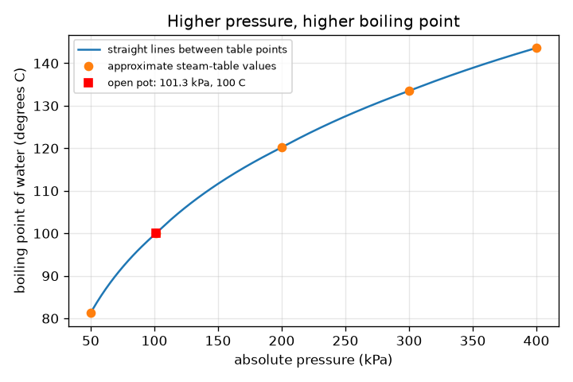
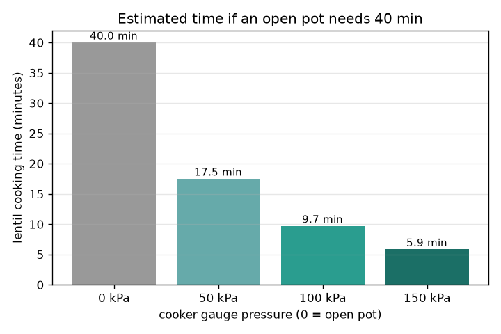

# அமர்வு 1: அழுத்தம் கொதிநிலையை மாற்றுகிறது

[Session 1 — हिन्दी](README.hi.md) · [Session 1 — മലയാളം](README.ml.md)

*நிலை 1 (கருத்தியல் ஊடாடும் மாதிரி) · சுமார் 60 நிமிடங்கள் · openpressurecooker*

> இது கல்விக்கான எளிமைப்படுத்தப்பட்ட மாதிரி. இது சரிபார்க்கப்பட்ட வடிவமைப்புக் கருவி அல்ல; உண்மையான கட்டமைப்புகள், மின் நிறுவல்கள், வாகனங்கள், தொழில்துறை செயல்முறைகள் அல்லது மருத்துவ முடிவுகளுக்கு இதைப் பயன்படுத்தக் கூடாது.

**முன்தேவைகள் (Prerequisites)**

- திறந்த பாத்திரத்தில் தண்ணீர் 100 டிகிரி C-இல் கொதிக்கிறது என்பதை அறிந்திருத்தல்.
- நீங்கள் PRIMER.md படித்து, `python start.py 1` ஒருமுறை இயக்கியுள்ளீர்கள்.

**கற்றல் நோக்கங்கள் (Learning objectives).** இந்த அமர்வுக்குப் பிறகு நீங்கள்:

- அழுத்தம் அதிகமாக இருக்கும்போது தண்ணீர் ஏன் அதிக வெப்பநிலையில் கொதிக்கிறது என்று விளக்க முடியும்.
- ஒரு பிரஷர் குக்கர் நீராவியை எப்படிச் சிக்க வைத்து அதிக அழுத்தத்தைத் தாங்குகிறது என்று விளக்க முடியும்.
- அளவி (gauge) அழுத்தத்தையும் தனி (absolute) அழுத்தத்தையும் சரியாகப் பயன்படுத்தி, அழுத்த அட்டவணையிலிருந்தும் வரைபடத்திலிருந்தும் கொதிநிலையைப் படிக்க முடியும்.
- சமையல் நேரத்தை மதிப்பிட, ஒவ்வொரு 10 டிகிரிக்கும் இரட்டிப்பாகும் என்ற தோராய விதியை (rule of thumb) பயன்படுத்த முடியும்.

## A. நிஜ உலகப் பிரச்சினை
பருப்பு திறந்த பாத்திரத்தில் சுமார் 40 நிமிடங்கள் எடுக்கும், அதே தீயில் பிரஷர் குக்கரில் மிகக் குறைந்த நேரமே ஆகும். குக்கர் தீயை அதிகச் சூடாக்குவதில்லை. மூடிய மூடி என்ன மாற்றுகிறது? இது புரிதலுக்கான எளிமைப்படுத்தப்பட்ட கற்பித்தல் மாதிரி, உண்மையான உபகரணங்களைப் பயன்படுத்தவோ மாற்றவோ வழிகாட்டி அல்ல: ஓர் உண்மையான குக்கரின் வால்வுகளை ஒருபோதும் மாற்றவோ அடைக்கவோ அகற்றவோ கூடாது.

## B. கருத்தும் கோட்பாடும்
தண்ணீரைச் சுற்றியுள்ள அழுத்தத்துக்கு எதிராக நீராவிக் குமிழ்கள் உருவாக முடியும்போது தண்ணீர் கொதிக்கிறது. கடல் மட்டத்தில் காற்றின் அழுத்தமான 101.3 kPa-இல் அது 100 டிகிரி C-இல் நிகழ்கிறது. அழுத்தம் அதிகமாக இருந்தால், குமிழ்களுக்குச் சூடான திரவம் தேவை, எனவே கொதிநிலை உயர்கிறது. திறந்த பாத்திரத்தில் நீராவி தப்பிவிடுகிறது, எனவே அழுத்தம் ஒரு வளிமண்டலமாகவே இருக்கிறது, தீ எவ்வளவு பெரிதாக இருந்தாலும் தண்ணீர் 100 டிகிரி C-ஐ விடச் சூடாகாது (கூடுதல் வெப்பம் அதிக நீராவியை மட்டுமே உருவாக்கும்). குக்கருக்கு மூடிய மூடியும் எடையுள்ள வால்வும் உள்ளன: நீராவி சேர்கிறது, வால்வு தூக்கும் வரை அழுத்தம் உயர்கிறது, பிறகு அது ஒரு குறிப்பிட்ட அழுத்தத்தைத் தாங்குகிறது. ஓர் அளவி காற்றுக்கு மேலான அழுத்தத்தைப் படிக்கிறது, எனவே தனி அழுத்தம் = அளவி + 101.325 kPa. தோராய நீராவி-அட்டவணை மதிப்புகளின் ஒரு சிறிய அட்டவணையிலிருந்து கொதிநிலைகளைப் படிக்கிறோம். வெப்பம் அதிகமாகும்போது வேதியியல் (மென்மையாதல், உடைதல்) வேகமாகிறது; ஒவ்வொரு 10 டிகிரி C-க்கும் வீதம் சுமார் இரட்டிப்பாகிறது என்று ஒரு தோராய விதி சொல்கிறது, எனவே வேகக் காரணி = 2^((T - 100) / 10). இது ஒரு தோராய விதி, துல்லியமான விதி அல்ல.

| குறியீடு | பொருள் | அலகு |
|---|---|---|
| P_gauge | அளவி காட்டும், காற்றுக்கு மேலான அழுத்தம் | kPa |
| P_abs | தனி அழுத்தம் = அளவி + 101.325 | kPa |
| T | அந்த அழுத்தத்தில் கொதிநிலை | டிகிரி C |
| f | 100 டிகிரி C-உடன் ஒப்பிட்ட சமையல் வேகக் காரணி | அலகு இல்லை |
| t_open, t_cooker | திறந்த பாத்திரத்திலும் குக்கரிலும் சமையல் நேரம் | min |

**அனுமானங்கள் (Assumptions)**

- அட்டவணை மதிப்புகளுக்கு இடையிலான கொதிநிலைகள் மடக்கை-அழுத்த அளவில் நேர்கோடுகளால் காணப்படுகின்றன (தோராயம்).
- அட்டவணை மதிப்புகள் தோராய நீராவி-அட்டவணை மதிப்புகள்.
- உணவு கொதிக்கும் தண்ணீரின் வெப்பநிலையில் உள்ளது, 10 டிகிரி C-க்கு இரட்டிப்பாதல் ஒரு தோராய விதி மட்டுமே.
- கற்பித்தல் மாதிரி மட்டும்; உண்மையான உபகரணங்களை வடிவமைக்க அல்லது மாற்ற அல்ல.

$$ P_{\mathrm{abs}}=P_{\mathrm{gauge}}+101.325\ \mathrm{kPa} $$

$$ f=2^{(T-100)/10} $$

$$ t_{\mathrm{cooker}}=\frac{t_{\mathrm{open}}}{f} $$

## C. காட்சி விளக்கம்
முதல் படம் தனி அழுத்தத்துக்கு எதிராகக் கொதிநிலையை வரைகிறது: வளைவு முதலில் விரைவாக உயர்ந்து பிறகு தட்டையாகிறது, எனவே முதல் கூடுதல் 100 kPa சுமார் 20 டிகிரி C தருகிறது, அடுத்த 100 kPa சுமார் 13 மட்டுமே. திறந்த பாத்திரம் 101.3 kPa மற்றும் 100 டிகிரி C என்ற புள்ளி. இரண்டாவது படம், திறந்த பாத்திரத்தில் 40 நிமிடம் தேவைப்படும் ஒரு சமையல் குறிப்புக்கு, 0, 50, 100, 150 kPa அளவி குக்கர் அமைப்புகளுக்கான மதிப்பிட்ட பருப்பு நேரத்தின் பட்டை வரைபடம்: 40, 17.5, 9.7, 5.9 நிமிடங்கள்.

*தனி அழுத்தத்துக்கு எதிராகக் கொதிநிலை: அதிக அழுத்தம், அதிகக் கொதிநிலை, தட்டையாகும் வளைவுடன்.*

*40 நிமிடத் திறந்த-பாத்திரச் சமையல் குறிப்புக்கு நான்கு குக்கர் அமைப்புகளில் மதிப்பிட்ட பருப்பு நேரம்.*

## D. ஊடாடும் உருவகப்படுத்தல்
பாடத்தை இயக்குங்கள் (`python start.py 1`), பிறகு நேரடிச் செயலியைத் திறங்கள்: [அமர்வு 1: அழுத்தமும் கொதிநிலையும்](https://krunalpanchal1995.github.io/pan-iit-oss/openpressurecooker/session-01/) (அல்லது இந்தக் கோப்புறையிலுள்ள `app.html`). அளவி அழுத்தத்தை இழுத்துத் தண்ணீரின் வெப்பநிலையும் கொதிநிலை வளைவும் நகர்வதைப் பாருங்கள். திறந்த-பாத்திர நேரத்தை மாற்றிக் குக்கர் நேரம் பின்தொடர்வதைப் பாருங்கள்.

**சவால்.** திறந்த-பாத்திர நேரத்தை 40 நிமிடங்களில் வைத்துக்கொண்டு, மதிப்பிட்ட குக்கர் நேரத்தை 15 நிமிடங்கள் அல்லது அதற்குக் குறைவாகக் கொண்டு வாருங்கள்.

## E. தீர்க்கப்பட்ட எடுத்துக்காட்டும் பரிசோதனையும்
**பிரச்சினை.** ஒரு குக்கர் 100 kPa அளவியைத் தாங்குகிறது. தனி அழுத்தம், கொதிநிலை, வேகக் காரணி, திறந்த பாத்திரத்தில் 40 நிமிடம் தேவைப்படும் ஒரு சமையல் குறிப்பின் நேரம் ஆகியவை என்ன?

1. தனி அழுத்தம் = 100 + 101.325 = 201.3 kPa.
2. அட்டவணையில் 200 kPa-க்கு 120.2 டிகிரி C-உம் 300 kPa-க்கு 133.5 டிகிரி C-உம் உள்ளன, எனவே 201.3 kPa 200-க்குச் சற்று மேல்: கொதிநிலை சுமார் 120.4 டிகிரி C.
3. வேகக் காரணி = 2^((120.4 - 100) / 10) = 2^2.04 = 4.12.
4. நேரம் = 40 / 4.12 = 9.7 நிமிடங்கள்.

**விடை.** தனி அழுத்தம் 201.3 kPa, கொதிநிலை சுமார் 120.4 டிகிரி C, சுமார் 4.1 மடங்கு வேகம், எனவே சுமார் 9.7 நிமிடங்கள்.

**பரிசோதனை.** பாதுகாப்பான பரிசோதனை, ஒரு சாதாரண திறந்த பாத்திரத்தில் மட்டும்: தண்ணீரைக் கொதிக்க வைத்து ஒரு சமையலறை வெப்பமானியால் வெப்பநிலையை அளவிடுங்கள்; கடல் மட்டத்தில் சுமார் 100 டிகிரி C காட்ட வேண்டும், ஒரு மலையிலோ கடல் மட்டத்துக்கு வெகு மேலுள்ள நகரத்திலோ காற்றழுத்தம் குறைவாக இருப்பதால் சற்றுக் குறைவாக. ஒரு பிரஷர் குக்கருக்குள் எதையும் அளக்கவோ மாற்றவோ முயலாதீர்கள். மாதிரி ஒரு அட்டவணையும் ஒரு தோராய விதியும் மட்டுமே, எனவே கருத்தைக் காட்டுகிறது, ஆனால் உண்மைச் சமையல் நேரங்கள் உணவு, அதன் அளவு, வெப்பம் அதன் உள்ளே எப்படிச் சேர்கிறது என்பதையும் சார்ந்தவை.

## F. மதிப்பீடும் வடிவமைப்புச் சவாலும்
**கேள்வி வகை A: கருத்தியல்.** ஒரு பெரிய தீ இருந்தாலும் ஒரு திறந்த பாத்திரம் தண்ணீரை சுமார் 100 டிகிரி C-ஐ விடச் சூடாக்க முடியாதது ஏன்? கூடுதல் வெப்பம் அதற்குப் பதிலாக என்ன செய்கிறது?

குறிப்பு

நீராவி எங்கே போகிறது, தண்ணீரைச் சுற்றியுள்ள அழுத்தம் என்ன என்று சிந்தியுங்கள்.

படிப்படியான தீர்வு

திறந்த பாத்திரத்தில் நீராவி தப்பிவிடுவதால் அழுத்தம் ஒரு வளிமண்டலமாகவே இருக்கிறது. அந்த அழுத்தத்தில் தண்ணீர் 100 டிகிரி C-இல் கொதிக்கிறது, எந்தக் கூடுதல் வெப்பமும் வெப்பநிலையை உயர்த்துவதற்கு அல்ல, மேலும் தண்ணீரை நீராவியாக்குவதற்கே (உள்ளுறை வெப்பம்) செல்கிறது. சூடான தண்ணீர் பெற அழுத்தத்தை உயர்த்த வேண்டும், மூடிய குக்கர் செய்வது அதுவே.

**கேள்வி வகை B: எண்ணியல்.** ஒரு குக்கர் 150 kPa அளவியைத் தாங்குகிறது. தனி அழுத்தம், அட்டவணையிலிருந்து கொதிநிலை, வேகக் காரணி, திறந்த பாத்திரத்தில் 60 நிமிடம் தேவைப்படும் ஒரு சமையல் குறிப்பின் நேரம் ஆகியவற்றைக் காணுங்கள்.

குறிப்பு

முதலில் 101.325-ஐக் கூட்டுங்கள், பிறகு 200-க்கும் 300 kPa-க்கும் இடையே இடைச்செருகுங்கள்.

படிப்படியான தீர்வு

தனி = 251.3 kPa. கொதிநிலை 120.2 (200 kPa)-க்கும் 133.5 டிகிரி C (300 kPa)-க்கும் இடையே: சுமார் 127.7 டிகிரி C. வேகக் காரணி = 2^(27.7/10) = 6.8. நேரம் = 60 / 6.8 = சுமார் 8.8 நிமிடங்கள். சரிபார்ப்பு: அதே 40 நிமிடச் சமையல் குறிப்புக்கு, 100 kPa-இல் 9.7 நிமிடத்துக்கு எதிராக 150 kPa 5.9 நிமிடம் தருகிறது, எனவே அதிக அழுத்தம் என்றால் சூடான பாத்திரமும் குறைந்த நேரமும், எதிர்பார்த்தபடி.

**கேள்வி வகை C: வரைபடம் மற்றும் உருவகப்படுத்தல் விளக்கம்.** கொதிநிலை வரைபடத்தில், 101-க்கும் 200 kPa-க்கும் இடையிலும் 200-க்கும் 300 kPa-க்கும் இடையிலும் கொதிநிலை எவ்வளவு உயர்கிறது? சாய்வில் ஏற்படும் மாற்றம் மேலும் அழுத்தம் சேர்ப்பது பற்றி என்ன சொல்கிறது?

குறிப்பு

அட்டவணைப் புள்ளிகளைப் படியுங்கள்: 100, 120.2, 133.5 டிகிரி C.

படிப்படியான தீர்வு

101.3 முதல் 200 kPa வரை அது சுமார் 20 டிகிரி C உயர்கிறது (100 முதல் 120.2 வரை), ஏறக்குறைய kPa-க்கு 0.20 டிகிரி C. 200 முதல் 300 kPa வரை அது 13.3 டிகிரி C உயர்கிறது, சுமார் kPa-க்கு 0.13 டிகிரி C. வளைவு தட்டையாகிறது, எனவே ஒவ்வொரு கூடுதல் kPa-உம் குறைவான வெப்பநிலையே தருகிறது: மிக அதிக அழுத்தம் (வலுவான, மேலும் ஆபத்தான பாத்திரமும்) குறைந்துவரும் பலனைத் தருகிறது.

**கேள்வி வகை D: வடிவமைப்பு மற்றும் உகப்பாக்கச் சவால்.** வடிவமைப்பு: 40 நிமிடத் திறந்த-பாத்திரச் சமையல் குறிப்பு 12 நிமிடங்கள் அல்லது அதற்குக் குறைவாக எடுக்கும்படி ஓர் அளவி அழுத்தத்தை (முழு 5 kPa படிகளில்) தேர்ந்தெடுங்கள், மிக அதிக அழுத்தத்தை வெறுமனே தேர்ந்தெடுப்பதிலிருந்து உங்களைத் தடுப்பது என்ன என்று சொல்லுங்கள்.

குறிப்பு

உங்களுக்குக் குறைந்தது 40 / 12 = 3.33 வேகக் காரணி தேவை; அதற்கான வெப்பநிலையையும் பிறகு அழுத்தத்தையும் காணுங்கள்.

படிப்படியான தீர்வு

3.33 காரணிக்குக் குறைந்தது 100 + 10 log2(3.33) = 117.4 டிகிரி C கொதிநிலை தேவை. அட்டவணை அதைச் சுமார் 82 kPa அளவியில் தருகிறது (82 kPa-இல் 11.8 நிமிடம், 80 kPa-இல் 12.07), எனவே 85 kPa தேர்ந்தெடுங்கள் (சுமார் 11.4 நிமிடங்கள்). வரம்புகள்: அதிக அழுத்தத்துக்கு வலுவான பாத்திரமும் கனமான வால்வும் தேவை, அதிக ஆற்றல் செலவாகிறது, உணவு அதிகமாக வேகலாம் அல்லது உடையலாம், அழுத்தத்துடன் பலன் தட்டையாகிறது. உண்மைக் குக்கர்களுக்கு நிலையான, சோதிக்கப்பட்ட அமைப்புகள் உள்ளன; இது ஒரு கற்பித்தல் கணக்கீடு மட்டுமே, ஒரு வால்வை மாற்றுவதற்கான காரணம் அல்ல.

[RUBRIC.md](../../RUBRIC.md) மூலம் உங்களை மதிப்பிடுங்கள். தாளில் வேலை செய்ய [செயல்பாட்டுத் தாளை](activity_sheet.md) அச்சிடுங்கள்.

## பொதுவான தவறான கருத்துகள்
| பொதுவான தவறான கருத்து | உண்மையில் சரியானது |
|---|---|
| ஒரு பிரஷர் குக்கர் அதன் தீ அதிகச் சூடாக இருப்பதால் வேலை செய்கிறது. | தீ அதேதான். மூடிய மூடி அழுத்தத்தை உயர்த்துகிறது, எனவே தண்ணீர் அதிக வெப்பநிலையில் கொதிக்கிறது, உணவு அதிகச் சூடாகிறது. |
| தண்ணீர் எப்போதும் 100 டிகிரி C-இல் கொதிக்கிறது. | 101.3 kPa-இல் (கடல் மட்டக் காற்றழுத்தம்) மட்டும். குறைந்த அழுத்தத்தில் (மலைகள்) குறைவு, அதிக அழுத்தத்தில் (குக்கர்) அதிகம். |
| அளவி வாசிப்பு 0 என்றால் அழுத்தம் இல்லை. | அளவி காற்றுக்கு மேலான அழுத்தத்தைப் படிக்கிறது. அளவி 0 என்றால் ஒரு வளிமண்டலம், தனியாக 101.3 kPa. |
| நீராவி தண்ணீரை விடச் சூடு என்பதால் குக்கர் வேகமாகச் சமைக்கிறது. | சமநிலையில் இருக்கும்போது தண்ணீரும் நீராவியும் ஒரே வெப்பநிலையில் உள்ளன; முக்கியம் முழுப் பாத்திரமும் 100-க்குப் பதில் 120 டிகிரி C-இல் இருப்பதே. |

## சொற்களஞ்சியம்
- **கொதிநிலை (boiling point)**: ஒரு திரவம் தடையின்றி ஆவியாகும் வெப்பநிலை; அழுத்தத்தைச் சார்ந்தது
- **தனி அழுத்தம் (absolute pressure)**: முழு வெற்றிடத்திலிருந்து அளக்கப்படும் அழுத்தம்; காற்றையும் உள்ளடக்கும்
- **அளவி அழுத்தம் (gauge pressure)**: சுற்றியுள்ள காற்றுக்கு மேலான அழுத்தம்; அளவி 0 ஒரு வளிமண்டலம்
- **kPa**: கிலோபாஸ்கல், 1000 பாஸ்கல்; ஒரு வளிமண்டலம் சுமார் 101.3 kPa
- **தோராய விதி (rule of thumb)**: பயனுள்ள ஆனால் துல்லியமற்ற, கரடுமுரடான, எளிய விதி

## முடிவு
1. [exercises.md](exercises.md)-இல் உள்ள மூன்று நிரலாக்கப் பணிகளைச் செய்யுங்கள்.
2. உங்கள் மாற்றங்களுக்குப் பிறகு `python start.py 1` மீண்டும் இயக்குங்கள். அது சோதனைச் சாவடியுடன் முடிகிறது; அது `PASS` என்று அச்சிடும்போது நீங்கள் முடித்துவிட்டீர்கள். (சோதனைச் சாவடி மட்டும்: `python start.py check 1`.)

அடுத்து: [அமர்வு 2](../session-02/README.md)
