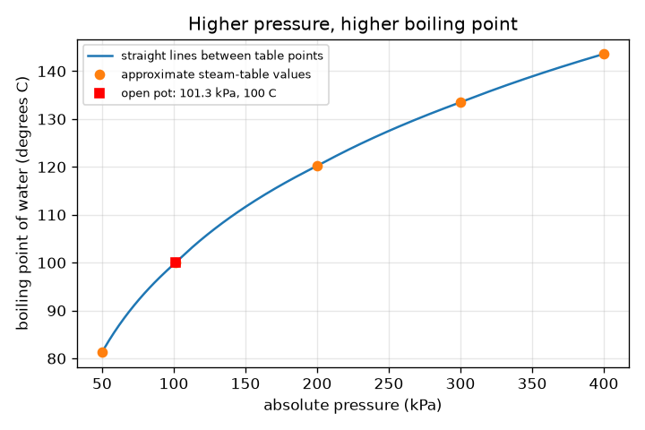
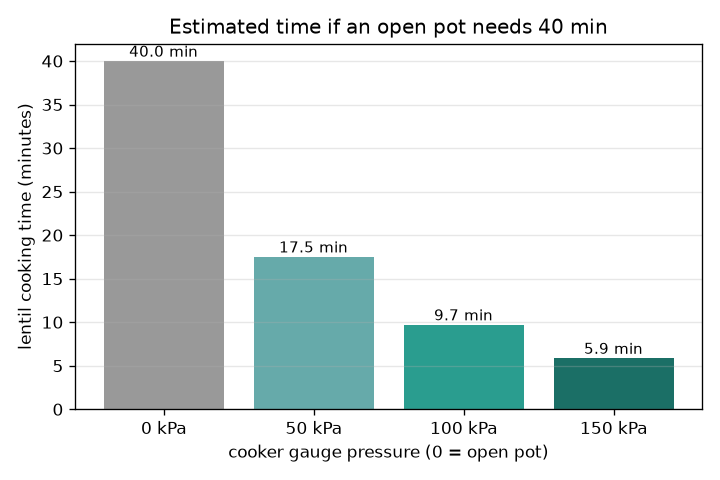

# సెషన్ 1: పీడనం మరుగు స్థానాన్ని మారుస్తుంది

[Session 1 — हिन्दी](README.hi.md) · [Session 1 — മലയാളം](README.ml.md) · [Session 1 — தமிழ்](README.ta.md)

*స్థాయి 1 (భావనాత్మక ఇంటరాక్టివ్ నమూనా) · సుమారు 60 నిమిషాలు · openpressurecooker*

> ఇది విద్య కోసం సరళీకరించిన నమూనా. ఇది ధ్రువీకరించబడిన డిజైన్ సాధనం కాదు; నిజమైన నిర్మాణాలు, విద్యుత్ ఇన్‌స్టలేషన్లు, వాహనాలు, పారిశ్రామిక ప్రక్రియలు లేదా వైద్య నిర్ణయాల కోసం దీనిని ఉపయోగించకూడదు.

**ముందస్తు అవసరాలు (Prerequisites)**

- తెరిచిన గిన్నెలో నీరు 100 డిగ్రీల C వద్ద మరుగుతుందని తెలుసుకోవడం.
- మీరు PRIMER.md చదివి, `python start.py 1` ఒకసారి రన్ చేశారు.

**అభ్యసన లక్ష్యాలు (Learning objectives).** ఈ సెషన్ తర్వాత మీరు:

- పీడనం ఎక్కువైనప్పుడు నీరు ఎక్కువ ఉష్ణోగ్రత వద్ద ఎందుకు మరుగుతుందో వివరించగలరు.
- ప్రెషర్ కుక్కర్ ఆవిరిని ఎలా బంధించి అధిక పీడనాన్ని నిలుపుతుందో వివరించగలరు.
- గేజ్ మరియు పరమ (absolute) పీడనాలను సరిగ్గా ఉపయోగించి పీడన పట్టిక నుండి మరియు గ్రాఫ్ నుండి మరుగు స్థానాన్ని చదవగలరు.
- వంట సమయాన్ని అంచనా వేయడానికి ప్రతి 10 డిగ్రీలకు రెట్టింపు అనే ఉజ్జాయింపు నియమాన్ని (rule of thumb) ఉపయోగించగలరు.

## A. నిజ జీవిత సమస్య
పప్పు తెరిచిన గిన్నెలో సుమారు 40 నిమిషాలు పడుతుంది, అదే మంటపై ప్రెషర్ కుక్కర్‌లో చాలా తక్కువ సమయం పడుతుంది. కుక్కర్ మంటను ఎక్కువ వేడిగా చేయదు. మూసిన మూత దేనిని మారుస్తుంది? ఇది అర్థం చేసుకోవడానికి సరళీకరించిన బోధనా నమూనా, నిజమైన పరికరాలను ఉపయోగించడానికి లేదా మార్చడానికి మార్గదర్శి కాదు: నిజమైన కుక్కర్ వాల్వులను ఎప్పుడూ మార్చకండి, అడ్డుకోకండి లేదా తొలగించకండి.

## B. భావన మరియు సిద్ధాంతం
నీటి చుట్టూ ఉన్న పీడనానికి వ్యతిరేకంగా ఆవిరి బుడగలు ఏర్పడగలిగినప్పుడు నీరు మరుగుతుంది. సముద్ర మట్టంలో గాలి పీడనం 101.3 kPa వద్ద అది 100 డిగ్రీల C వద్ద జరుగుతుంది. పీడనం ఎక్కువైతే, బుడగలకు వేడి ద్రవం కావాలి, కాబట్టి మరుగు స్థానం పెరుగుతుంది. తెరిచిన గిన్నెలో ఆవిరి తప్పించుకుంటుంది, కాబట్టి పీడనం ఒక వాతావరణం వద్దే ఉంటుంది, మంట ఎంత పెద్దదైనా నీరు 100 డిగ్రీల C కంటే వేడెక్కదు (అదనపు వేడి ఎక్కువ ఆవిరిని మాత్రమే చేస్తుంది). కుక్కర్‌కు మూసిన మూత మరియు బరువైన వాల్వ్ ఉంటాయి: ఆవిరి పేరుకుంటుంది, వాల్వ్ లేచే వరకు పీడనం పెరుగుతుంది, తర్వాత అది నిర్దిష్ట పీడనాన్ని నిలుపుతుంది. గేజ్ గాలి కంటే పైన ఉన్న పీడనాన్ని చదువుతుంది, కాబట్టి పరమ పీడనం = గేజ్ + 101.325 kPa. ఉజ్జాయింపు స్టీమ్-టేబుల్ విలువల చిన్న పట్టిక నుండి మరుగు స్థానాలను చదువుతాం. వేడి ఎక్కువైనప్పుడు రసాయనశాస్త్రం (మెత్తబడటం, విరిగిపోవడం) వేగవంతమవుతుంది; ప్రతి 10 డిగ్రీల C కి రేటు సుమారు రెట్టింపు అవుతుందని ఒక ఉజ్జాయింపు నియమం చెబుతుంది, కాబట్టి వేగ కారకం = 2^((T - 100) / 10). ఇది ఉజ్జాయింపు నియమం, ఖచ్చితమైన నియమం కాదు.

| గుర్తు | అర్థం | యూనిట్ |
|---|---|---|
| P_gauge | గేజ్ చూపే, గాలి కంటే పైన ఉన్న పీడనం | kPa |
| P_abs | పరమ పీడనం = గేజ్ + 101.325 | kPa |
| T | ఆ పీడనం వద్ద మరుగు స్థానం | డిగ్రీల C |
| f | 100 డిగ్రీల C తో పోల్చిన వంట వేగ కారకం | యూనిట్ లేదు |
| t_open, t_cooker | తెరిచిన గిన్నెలో మరియు కుక్కర్‌లో వంట సమయం | min |

**ఊహలు (Assumptions)**

- పట్టిక విలువల మధ్య మరుగు స్థానాలు లాగ్-పీడన స్కేలుపై సరళ రేఖలతో కనుగొనబడతాయి (ఉజ్జాయింపు).
- పట్టిక విలువలు ఉజ్జాయింపు స్టీమ్-టేబుల్ విలువలు.
- ఆహారం మరుగుతున్న నీటి ఉష్ణోగ్రత వద్ద ఉంది, 10 డిగ్రీల C కి రెట్టింపు అనేది ఉజ్జాయింపు నియమం మాత్రమే.
- బోధనా నమూనా మాత్రమే; నిజమైన పరికరాలను డిజైన్ చేయడానికి లేదా మార్చడానికి కాదు.

$$ P_{\mathrm{abs}}=P_{\mathrm{gauge}}+101.325\ \mathrm{kPa} $$

$$ f=2^{(T-100)/10} $$

$$ t_{\mathrm{cooker}}=\frac{t_{\mathrm{open}}}{f} $$

## C. దృశ్య వివరణ
మొదటి చిత్రం పరమ పీడనానికి వ్యతిరేకంగా మరుగు స్థానాన్ని గీస్తుంది: వక్రం మొదట వేగంగా పెరిగి తర్వాత చదునవుతుంది, కాబట్టి మొదటి అదనపు 100 kPa సుమారు 20 డిగ్రీల C ఇస్తుంది, తదుపరి 100 kPa సుమారు 13 మాత్రమే. తెరిచిన గిన్నె 101.3 kPa మరియు 100 డిగ్రీల C వద్ద ఉన్న బిందువు. రెండవ చిత్రం, తెరిచిన గిన్నెలో 40 నిమిషాలు పట్టే ఒక వంటకానికి, 0, 50, 100, 150 kPa గేజ్ కుక్కర్ సెట్టింగులకు అంచనా వేసిన పప్పు సమయం యొక్క బార్ చార్ట్: 40, 17.5, 9.7, 5.9 నిమిషాలు.

*పరమ పీడనానికి వ్యతిరేకంగా మరుగు స్థానం: ఎక్కువ పీడనం, ఎక్కువ మరుగు స్థానం, చదునవుతున్న వక్రంతో.*

*40 నిమిషాల తెరిచిన-గిన్నె వంటకానికి నాలుగు కుక్కర్ సెట్టింగులలో అంచనా వేసిన పప్పు సమయం.*

## D. ఇంటరాక్టివ్ సిమ్యులేషన్
పాఠాన్ని రన్ చేయండి (`python start.py 1`), తర్వాత లైవ్ యాప్ తెరవండి: [సెషన్ 1: పీడనం మరియు మరుగు స్థానం](https://krunalpanchal1995.github.io/pan-iit-oss/openpressurecooker/session-01/) (లేదా ఈ ఫోల్డర్‌లోని `app.html`). గేజ్ పీడనాన్ని లాగి నీటి ఉష్ణోగ్రత మరియు మరుగు స్థాన వక్రం కదలడం చూడండి. తెరిచిన-గిన్నె సమయాన్ని మార్చి కుక్కర్ సమయం అనుసరించడం చూడండి.

**సవాలు.** తెరిచిన-గిన్నె సమయాన్ని 40 నిమిషాల వద్ద ఉంచి, అంచనా కుక్కర్ సమయాన్ని 15 నిమిషాలు లేదా అంతకంటే తక్కువకు తీసుకురండి.

## E. సాధించిన ఉదాహరణ మరియు ప్రయోగం
**సమస్య.** ఒక కుక్కర్ 100 kPa గేజ్ నిలుపుతుంది. పరమ పీడనం, మరుగు స్థానం, వేగ కారకం, తెరిచిన గిన్నెలో 40 నిమిషాలు పట్టే వంటకం సమయం ఏమిటి?

1. పరమ పీడనం = 100 + 101.325 = 201.3 kPa.
2. పట్టికలో 200 kPa కు 120.2 డిగ్రీల C మరియు 300 kPa కు 133.5 డిగ్రీల C ఉన్నాయి, కాబట్టి 201.3 kPa 200 కు కొంచెం పైన: మరుగు స్థానం సుమారు 120.4 డిగ్రీల C.
3. వేగ కారకం = 2^((120.4 - 100) / 10) = 2^2.04 = 4.12.
4. సమయం = 40 / 4.12 = 9.7 నిమిషాలు.

**సమాధానం.** పరమ పీడనం 201.3 kPa, మరుగు స్థానం సుమారు 120.4 డిగ్రీల C, సుమారు 4.1 రెట్లు వేగంగా, కాబట్టి సుమారు 9.7 నిమిషాలు.

**ప్రయోగం.** సురక్షితమైన ప్రయోగం, సాధారణ తెరిచిన గిన్నెలో మాత్రమే: నీటిని మరిగించి వంటగది థర్మామీటర్‌తో ఉష్ణోగ్రత కొలవండి; సముద్ర మట్టంలో సుమారు 100 డిగ్రీల C చూపాలి, కొండపై లేదా సముద్ర మట్టానికి చాలా పైన ఉన్న నగరంలో గాలి పీడనం తక్కువ కాబట్టి కొంచెం తక్కువ. ప్రెషర్ కుక్కర్ లోపల దేనినీ కొలవడానికి లేదా మార్చడానికి ప్రయత్నించకండి. నమూనా ఒక పట్టిక మరియు ఉజ్జాయింపు నియమం మాత్రమే, కాబట్టి ఆలోచనను చూపిస్తుంది, కానీ నిజమైన వంట సమయాలు ఆహారం, దాని పరిమాణం, వేడి దాని లోపలికి ఎలా చేరుతుందనే దానిపై కూడా ఆధారపడతాయి.

## F. మూల్యాంకనం మరియు డిజైన్ సవాలు
**ప్రశ్న రకం A: భావనాత్మక.** భారీ మంట ఉన్నా తెరిచిన గిన్నె నీటిని సుమారు 100 డిగ్రీల C కంటే వేడిగా ఎందుకు చేయలేదు? అదనపు వేడి బదులుగా ఏమి చేస్తుంది?

సూచన

ఆవిరి ఎక్కడికి వెళ్తుందో, నీటి చుట్టూ పీడనం ఎంతో ఆలోచించండి.

దశలవారీ పరిష్కారం

తెరిచిన గిన్నెలో ఆవిరి తప్పించుకుంటుంది కాబట్టి పీడనం ఒక వాతావరణం వద్దే ఉంటుంది. ఆ పీడనం వద్ద నీరు 100 డిగ్రీల C వద్ద మరుగుతుంది, ఏ అదనపు వేడి అయినా ఉష్ణోగ్రత పెంచడానికి కాదు, మరింత నీటిని ఆవిరిగా మార్చడానికి (గుప్తోష్ణం) వెళ్తుంది. వేడి నీరు కావాలంటే పీడనం పెంచాలి, మూసిన కుక్కర్ చేసేది అదే.

**ప్రశ్న రకం B: సంఖ్యాత్మక.** ఒక కుక్కర్ 150 kPa గేజ్ నిలుపుతుంది. పరమ పీడనం, పట్టిక నుండి మరుగు స్థానం, వేగ కారకం, తెరిచిన గిన్నెలో 60 నిమిషాలు పట్టే వంటకం సమయం కనుగొనండి.

సూచన

మొదట 101.325 కలపండి, తర్వాత 200 మరియు 300 kPa మధ్య అంతర్వేశనం చేయండి.

దశలవారీ పరిష్కారం

పరమ = 251.3 kPa. మరుగు స్థానం 120.2 (200 kPa) మరియు 133.5 డిగ్రీల C (300 kPa) మధ్య: సుమారు 127.7 డిగ్రీల C. వేగ కారకం = 2^(27.7/10) = 6.8. సమయం = 60 / 6.8 = సుమారు 8.8 నిమిషాలు. సరిచూపు: అదే 40 నిమిషాల వంటకానికి, 100 kPa వద్ద 9.7 నిమిషాలకు వ్యతిరేకంగా 150 kPa 5.9 నిమిషాలు ఇస్తుంది, కాబట్టి ఎక్కువ పీడనం అంటే వేడి గిన్నె మరియు తక్కువ సమయం, ఆశించినట్లు.

**ప్రశ్న రకం C: గ్రాఫ్ మరియు సిమ్యులేషన్ వ్యాఖ్యానం.** మరుగు స్థాన గ్రాఫ్‌లో, 101 మరియు 200 kPa మధ్య, 200 మరియు 300 kPa మధ్య మరుగు స్థానం ఎంత పెరుగుతుంది? వాలులో మార్పు మరింత పీడనం జోడించడం గురించి ఏమి చెబుతుంది?

సూచన

పట్టిక బిందువులను చదవండి: 100, 120.2 మరియు 133.5 డిగ్రీల C.

దశలవారీ పరిష్కారం

101.3 నుండి 200 kPa వరకు అది సుమారు 20 డిగ్రీల C పెరుగుతుంది (100 నుండి 120.2), సుమారు kPa కు 0.20 డిగ్రీల C. 200 నుండి 300 kPa వరకు అది 13.3 డిగ్రీల C పెరుగుతుంది, సుమారు kPa కు 0.13 డిగ్రీల C. వక్రం చదునవుతుంది, కాబట్టి ప్రతి అదనపు kPa తక్కువ ఉష్ణోగ్రతనే ఇస్తుంది: చాలా ఎక్కువ పీడనం (బలమైన, మరింత ప్రమాదకరమైన పాత్ర కూడా) తగ్గుతున్న ప్రతిఫలాన్ని ఇస్తుంది.

**ప్రశ్న రకం D: డిజైన్ మరియు ఆప్టిమైజేషన్ సవాలు.** డిజైన్: 40 నిమిషాల తెరిచిన-గిన్నె వంటకం 12 నిమిషాలు లేదా అంతకంటే తక్కువ పట్టేలా ఒక గేజ్ పీడనాన్ని (పూర్తి 5 kPa అడుగులలో) ఎంచుకోండి, చాలా ఎక్కువ పీడనాన్ని వెంటనే ఎంచుకోకుండా మిమ్మల్ని ఏది ఆపుతుందో చెప్పండి.

సూచన

మీకు కనీసం 40 / 12 = 3.33 వేగ కారకం కావాలి; దానికి ఉష్ణోగ్రత, తర్వాత పీడనం కనుగొనండి.

దశలవారీ పరిష్కారం

3.33 కారకానికి కనీసం 100 + 10 log2(3.33) = 117.4 డిగ్రీల C మరుగు స్థానం కావాలి. పట్టిక దానిని సుమారు 82 kPa గేజ్ వద్ద ఇస్తుంది (82 kPa వద్ద 11.8 నిమిషాలు, 80 kPa వద్ద 12.07), కాబట్టి 85 kPa ఎంచుకోండి (సుమారు 11.4 నిమిషాలు). పరిమితులు: ఎక్కువ పీడనానికి బలమైన పాత్ర మరియు బరువైన వాల్వ్ కావాలి, ఎక్కువ శక్తి ఖర్చవుతుంది, ఆహారం ఎక్కువగా ఉడకవచ్చు లేదా విరిగిపోవచ్చు, పీడనంతో ప్రయోజనం చదునవుతుంది. నిజమైన కుక్కర్లకు స్థిరమైన, పరీక్షించిన సెట్టింగులు ఉంటాయి; ఇది బోధనా లెక్క మాత్రమే, వాల్వ్ మార్చడానికి కారణం కాదు.

[RUBRIC.md](../../RUBRIC.md) తో మిమ్మల్ని మీరు స్కోర్ చేసుకోండి. కాగితంపై పని చేయడానికి [కార్యాచరణ పత్రం](activity_sheet.md) ప్రింట్ చేయండి.

## సాధారణ అపోహలు
| సాధారణ అపోహ | నిజానికి ఏది సరైనది |
|---|---|
| ప్రెషర్ కుక్కర్ దాని మంట ఎక్కువ వేడిగా ఉండటం వల్ల పనిచేస్తుంది. | మంట అదే. మూసిన మూత పీడనాన్ని పెంచుతుంది, కాబట్టి నీరు ఎక్కువ ఉష్ణోగ్రత వద్ద మరుగుతుంది, ఆహారం ఎక్కువ వేడెక్కుతుంది. |
| నీరు ఎల్లప్పుడూ 100 డిగ్రీల C వద్ద మరుగుతుంది. | 101.3 kPa వద్ద (సముద్ర మట్టం గాలి పీడనం) మాత్రమే. తక్కువ పీడనంలో (పర్వతాలు) తక్కువ, ఎక్కువ పీడనంలో (కుక్కర్) ఎక్కువ. |
| గేజ్ రీడింగ్ 0 అంటే పీడనం లేదు. | గేజ్ గాలి కంటే పైన ఉన్న పీడనాన్ని చదువుతుంది. గేజ్ 0 అంటే ఒక వాతావరణం, పరమంగా 101.3 kPa. |
| ఆవిరి నీటి కంటే వేడిగా ఉంటుంది కాబట్టి కుక్కర్ వేగంగా వండుతుంది. | సమతుల్యతలో ఉన్నప్పుడు నీరు మరియు ఆవిరి ఒకే ఉష్ణోగ్రత వద్ద ఉంటాయి; ముఖ్యమైనది మొత్తం గిన్నె 100 కు బదులు 120 డిగ్రీల C వద్ద ఉండటం. |

## పదకోశం
- **మరుగు స్థానం (boiling point)**: ఒక ద్రవం స్వేచ్ఛగా ఆవిరిగా మారే ఉష్ణోగ్రత; పీడనంపై ఆధారపడుతుంది
- **పరమ పీడనం (absolute pressure)**: పరిపూర్ణ శూన్యం నుండి కొలిచిన పీడనం; గాలిని కలిగి ఉంటుంది
- **గేజ్ పీడనం (gauge pressure)**: చుట్టూ ఉన్న గాలి కంటే పైన ఉన్న పీడనం; గేజ్ 0 ఒక వాతావరణం
- **kPa**: కిలోపాస్కల్, 1000 పాస్కల్స్; ఒక వాతావరణం సుమారు 101.3 kPa
- **ఉజ్జాయింపు నియమం (rule of thumb)**: ఉపయోగకరమైన కానీ ఖచ్చితం కాని ఒక స్థూలమైన, సులభమైన నియమం

## ముగింపు
1. [exercises.md](exercises.md) లోని మూడు కోడింగ్ పనులు చేయండి.
2. మీ మార్పుల తర్వాత `python start.py 1` మళ్లీ రన్ చేయండి. అది చెక్‌పాయింట్‌తో ముగుస్తుంది; అది `PASS` అని ప్రింట్ చేసినప్పుడు మీరు పూర్తి చేశారు. (చెక్‌పాయింట్ మాత్రమే: `python start.py check 1`.)

తర్వాత: [సెషన్ 2](../session-02/README.md)
