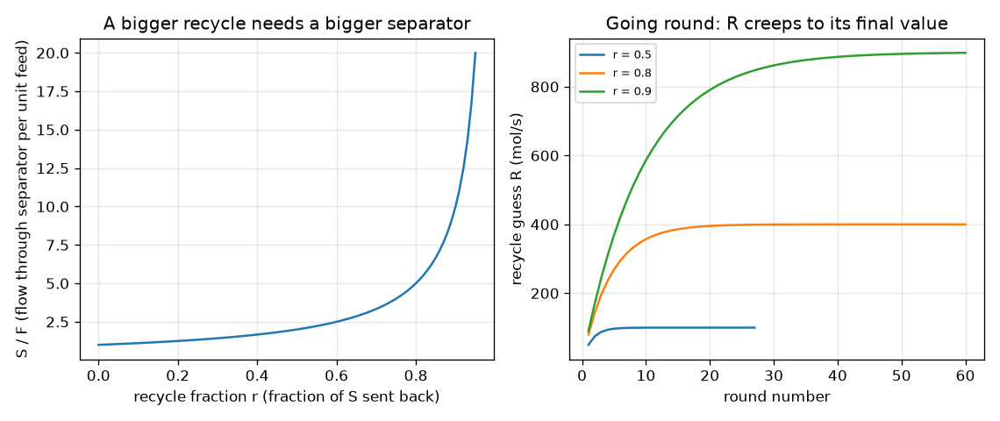

# सत्र 1: डिब्बे, पाइप और एक लूप: नियमों को एक साथ हल करें

*स्तर 1 (वैचारिक इंटरैक्टिव मॉडल) · लगभग 60 मिनट · openprocesssim*

> यह एक सरलीकृत शैक्षिक मॉडल है। यह कोई प्रमाणित डिज़ाइन उपकरण नहीं है और इसका उपयोग वास्तविक संरचनाओं, विद्युत संस्थापनों, वाहनों, औद्योगिक प्रक्रियाओं या चिकित्सा निर्णयों के लिए नहीं किया जाना चाहिए।

**पूर्वापेक्षाएँ (Prerequisites)**

- भिन्न (fractions) और प्रवाह दर (flow rate) क्या होती है।
- आपने PRIMER.md पढ़ लिया है और एक बार `python start.py 1` चला लिया है।

**सीखने के उद्देश्य (Learning objectives)।** इस सत्र के बाद आप:

- एक संयंत्र (plant) का वर्णन पाइपों से जुड़े डिब्बों के रूप में कर सकेंगे, जहाँ हर डिब्बे के अंतर्गम (inlets), निर्गम (outlets) और एक नियम होता है।
- हर डिब्बे के नियम को एक समीकरण के रूप में लिख सकेंगे और सभी समीकरणों को एक आव्यूह (matrix) से एक साथ हल कर सकेंगे।
- पुनर्चक्रण (recycle) का अनुमान लगाकर और चक्कर लगाकर (क्रमिक प्रतिस्थापन, successive substitution) उसी लूप को हल कर सकेंगे।
- समझा सकेंगे कि बड़े पुनर्चक्रण अंश (recycle fraction) के लिए बहुत बड़े पृथक्कारक (separator) की आवश्यकता क्यों होती है।

## A. वास्तविक दुनिया की समस्या
एक रासायनिक संयंत्र में द्रव की एक धारा एक पृथक्कारक में जाती है। अच्छा भाग उत्पाद (product) के रूप में निकल जाता है और बाक़ी को फिर से प्रयास के लिए शुरुआत में वापस भेज दिया जाता है। हर डिब्बा एक सरल नियम का पालन करता है (जो अंदर जाता है वही बाहर आता है), लेकिन लूप के कारण पहले डिब्बे में प्रवाह अंतिम डिब्बे से निकलने वाले प्रवाह पर निर्भर करता है। वास्तव में कितना द्रव पृथक्कारक से गुज़रता है, और यदि हम अधिक वापस भेजें तो यह कैसे बदलता है? फ़्लोशीट (flowsheet) प्रोग्राम सैकड़ों डिब्बों वाले संयंत्रों के लिए इसका उत्तर देते हैं; यह रिपॉज़िटरी व्यावसायिक फ़्लोशीट उपकरणों की भावना में सीखने के पैमाने का एक समरूप (analogue) बनाती है। सत्र 1 हर पाइप के लिए एक संख्या, mol/s में कुल प्रवाह, का उपयोग करता है। यह एक शिक्षण मॉडल है: वास्तविक संयंत्रों को प्रक्रिया-सुरक्षा (process-safety) इंजीनियरिंग की आवश्यकता होती है।

## B. अवधारणा और सिद्धांत
एक फ़्लोशीट एक ग्राफ़ है: डिब्बे नोड (nodes) हैं और पाइप (धाराएँ, streams) उनके बीच की रेखाएँ हैं। धाराओं के नाम रखें: F = ताज़ा फ़ीड (fresh feed) (ज्ञात), S = पृथक्कारक में प्रवाह, P = उत्पाद, R = पुनर्चक्रण। हर डिब्बा समीकरण देता है। मिक्सर (mixer) F और R को जोड़ता है, इसलिए S = F + R। पृथक्कारक S का एक अंश r वापस भेजता है और बाक़ी बाहर: R = r S और P = (1 - r) S। यह 3 अज्ञात (S, P, R) और 3 समीकरण हैं, इसलिए संयंत्र हल किया जा सकता है। आव्यूह के रूप में लिखा जाए तो, A x = b जिसमें x = [S, P, R], कंप्यूटर सभी नियमों को एक ही चरण में एक साथ हल करता है। दूसरा तरीक़ा है R का अनुमान लगाना, नया R पाने के लिए मिक्सर और पृथक्कारक को क्रम से चलाना, और तब तक दोहराना जब तक अनुमान बदलना बंद न कर दे: क्रमिक प्रतिस्थापन। इस लूप के लिए उत्तर है S = F / (1 - r): r = 0.5 पर पृथक्कारक फ़ीड का 2 गुना सँभालता है, r = 0.8 पर 5 गुना और r = 0.95 पर 20 गुना।

| प्रतीक | अर्थ | इकाई |
|---|---|---|
| F | ताज़ा फ़ीड प्रवाह (ज्ञात) | mol/s |
| S | पृथक्कारक में प्रवाह | mol/s |
| P | उत्पाद प्रवाह | mol/s |
| R | पुनर्चक्रण प्रवाह | mol/s |
| r | पुनर्चक्रण अंश, S का वापस भेजा गया हिस्सा (0 से 1 से नीचे तक) | कोई इकाई नहीं |

**मान्यताएँ (Assumptions)**

- स्थिर अवस्था (steady state): समय के साथ कुछ नहीं बदलता।
- हर पाइप के लिए एक संख्या (कुल मोलर प्रवाह); अभी कोई संघटन (composition), तापमान या रसायन नहीं।
- मिक्सर और पृथक्कारक कुछ नहीं खोते: जो अंदर जाता है वही बाहर आता है।
- पुनर्चक्रण अंश 1 से नीचे है, वरना कुछ भी बाहर नहीं निकल सकता।

$$ S = F + R $$

$$ R = r\,S,\qquad P = (1-r)\,S $$

$$ \begin{pmatrix}1&0&-1\\-r&0&1\\-(1-r)&1&0\end{pmatrix}\begin{pmatrix}S\\P\\R\end{pmatrix}=\begin{pmatrix}F\\0\\0\end{pmatrix}\ \Rightarrow\ S=\frac{F}{1-r} $$

## C. दृश्य व्याख्या
बायाँ चित्र पुनर्चक्रण अंश r के सापेक्ष S / F दिखाता है: यह r = 0 (कोई पुनर्चक्रण नहीं) पर 1 से शुरू होता है, r = 0.5 पर 2, r = 0.8 पर 5 और r = 0.95 पर 20 है, और लगातार अधिक तीव्रता से बढ़ता है। दायाँ चित्र अनुमान-लगाओ-और-चक्कर-लगाओ विधि दिखाता है: हर r के लिए पुनर्चक्रण अनुमान R अपने अंतिम मान की ओर चढ़ता है (r = 0.5 पर 100 mol/s, r = 0.8 पर 400 mol/s, r = 0.9 पर 900 mol/s) और r जितना 1 के क़रीब हो उतने अधिक चक्कर चाहिए।

*बायाँ: पुनर्चक्रण अंश के सापेक्ष प्रति इकाई फ़ीड पृथक्कारक प्रवाह। दायाँ: r = 0.5, 0.8 और 0.9 के लिए अनुमान-लगाओ-और-चक्कर-लगाओ पुनर्चक्रण अनुमान।*

## D. इंटरैक्टिव सिमुलेशन
पाठ चलाएँ (`python start.py 1`), फिर लाइव ऐप खोलें: [सत्र 1: डिब्बे, पाइप और एक लूप](https://krunalpanchal1995.github.io/pan-iit-oss/openprocesssim/session-01/) (या इस फ़ोल्डर में `app.html`)। पुनर्चक्रण अंश और फ़ीड को खिसकाएँ और संयंत्र चित्र में पाइपों की चौड़ाई देखें। फिर ग्राफ़ खोलें और लाल बिंदु को वक्र पर ऊपर खिसकते देखें। पढ़ें कि अनुमान-लगाओ-और-चक्कर-लगाओ विधि को कितने चक्कर चाहिए।

**चुनौती।** ताज़ा फ़ीड को 100 mol/s या उससे कम रखते हुए पृथक्कारक से कम-से-कम 400 mol/s सँभलवाएँ।

## E. हल किया गया उदाहरण और प्रयोग
**समस्या।** एक संयंत्र में ताज़ा फ़ीड F = 100 mol/s और पुनर्चक्रण अंश r = 0.6 है। S, R और P ज्ञात करें, और R = 0 से शुरू करके अनुमान-लगाओ-और-चक्कर-लगाओ विधि के पहले तीन चक्कर दिखाएँ।

1. मिक्सर: S = F + R। पृथक्कारक: R = 0.6 S और P = 0.4 S।
2. प्रतिस्थापित करें: S = 100 + 0.6 S, इसलिए 0.4 S = 100 और S = 250 mol/s।
3. तब R = 0.6 * 250 = 150 mol/s और P = 0.4 * 250 = 100 mol/s। जाँच: उत्पाद ताज़ा फ़ीड के बराबर है (100 = 100), जैसा कि समग्र संतुलन (overall balance) माँगता है।
4. चक्कर लगाएँ: R = 0 का अनुमान, तब S = 100 और नया R = 60। अगला S = 160 और R = 96। अगला S = 196 और R = 117.6। अनुमान 150 की ओर चढ़ते हैं और कोड को 1e-6 के भीतर पहुँचने के लिए 37 चक्कर चाहिए।

**उत्तर।** S = 250 mol/s, R = 150 mol/s, P = 100 mol/s; अनुमान 60, 96, 117.6 और इसी तरह 150 की ओर बढ़ते हैं।

**प्रयोग।** एक छोटे पानी के पंप, एक जग और Y-आकार के विभाजक फ़िटिंग से एक लूप बनाएँ जिसमें पंप प्रवाह का एक अंश जग में वापस भेजा जाता है, और मापक कप तथा स्टॉपवॉच से प्रवाह मापें। लूप में प्रवाह की तुलना F / (1 - r) से करें। मॉडल और वास्तविकता में अंतर है क्योंकि पंप प्रवाह पश्च-दाब (back-pressure) पर निर्भर करता है, विभाजन अंश वाल्व से तय होता है और प्रवाह के साथ बदलता है, और टंकी का स्तर स्थिर नहीं रहता।

## F. मूल्यांकन और डिज़ाइन चुनौती
**प्रश्न प्रकार A: वैचारिक।** उत्पाद प्रवाह ताज़ा फ़ीड के बराबर क्यों है, जबकि पृथक्कारक कहीं अधिक सँभालता है?

संकेत

पूरे संयंत्र के चारों ओर एक डिब्बा बनाएँ और केवल वही गिनें जो डिब्बे को पार करता है।

चरण-दर-चरण हल

स्थिर अवस्था में कुछ भी जमा नहीं होता, इसलिए जो संयंत्र में प्रवेश करता है उसे बाहर निकलना ही होगा। अंदर आते हुए केवल ताज़ा फ़ीड संयंत्र की सीमा पार करती है और बाहर जाते हुए केवल उत्पाद; पुनर्चक्रण अंदर ही रहता है। इसलिए P = F, चाहे S और R कितने भी बड़े हो जाएँ।

**प्रश्न प्रकार B: संख्यात्मक।** F = 100 mol/s और r = 0.75 के लिए S, R और P ज्ञात करें।

संकेत

S = F / (1 - r), फिर R = r S और P = (1 - r) S।

चरण-दर-चरण हल

S = 100 / 0.25 = 400 mol/s, R = 0.75 * 400 = 300 mol/s, P = 0.25 * 400 = 100 mol/s। इकाइयाँ: पूरे में mol/s। सामान्य जाँच (sanity check): P = F और S = F + R (400 = 100 + 300)।

**प्रश्न प्रकार C: ग्राफ़ और सिमुलेशन की व्याख्या।** बाएँ चित्र पर, r = 0.8 और r = 0.95 पर पृथक्कारक प्रति इकाई फ़ीड कितना सँभालता है, और उपकरण के आकार के लिए इसका क्या अर्थ है?

संकेत

वक्र से S / F पढ़ें।

चरण-दर-चरण हल

r = 0.8 पर यह फ़ीड का 5 गुना सँभालता है और r = 0.95 पर 20 गुना। उपकरण का आकार S के लिए तय किया जाता है, F के लिए नहीं, इसलिए r = 0.8 से 0.95 पर जाने से उसी उत्पाद के लिए पृथक्कारक चार गुना बड़ा हो जाता है।

**प्रश्न प्रकार D: डिज़ाइन और अनुकूलन (optimisation) चुनौती।** डिज़ाइन: पृथक्कारक अधिकतम 400 mol/s पारित कर सकता है। 100 mol/s की फ़ीड पर सबसे बड़ा पुनर्चक्रण अंश क्या है, और यदि फ़ीड को 150 mol/s तक बढ़ाया जाए तो क्या होता है? आप किस चीज़ का त्याग करेंगे?

संकेत

r = 1 - F / S_max।

चरण-दर-चरण हल

100 mol/s पर r = 1 - 100 / 400 = 0.75। 150 mol/s पर सबसे बड़ा r = 1 - 150 / 400 = 0.625 है (जाँच: S = 150 / 0.375 = 400)। कम पुनर्चक्रण अंश का अर्थ है कि 'पर्याप्त अच्छा नहीं' पदार्थ के कम हिस्से को दूसरा मौक़ा मिलता है, इसलिए एक वास्तविक संयंत्र में उत्पाद की गुणवत्ता या लब्धि (yield) गिरती है जब तक पृथक्कारक को बड़ा न किया जाए। इस खिलौना मॉडल में अभी पृथक्करण गुणवत्ता नहीं है; सत्र 2 और 3 इसे जोड़ते हैं।

[RUBRIC.md](../../RUBRIC.md) से स्वयं को अंक दें। काग़ज़ पर काम करने के लिए [गतिविधि पत्रक](activity_sheet.md) प्रिंट करें।

## सामान्य भ्रांतियाँ (Common misconceptions)
| सामान्य भ्रांति | वास्तव में क्या सही है |
|---|---|
| पुनर्चक्रण उत्पाद बढ़ाता है। | स्थिर अवस्था में उत्पाद ताज़ा फ़ीड के बराबर होता है। पुनर्चक्रण केवल पदार्थ को और मौक़े देता है; यह उपकरण से अधिक प्रवाह सँभलवाता है। |
| लूप को हल करने के लिए एक चक्कर काफ़ी है। | एक चक्कर केवल पहला अनुमान देता है (हल किए गए उदाहरण में 60 mol/s, वास्तविक मान 150)। 1e-6 तक पहुँचने में 37 चक्कर लगते हैं, और r = 0.9 पर 175 चक्कर। |
| बड़ा पुनर्चक्रण अंश थोड़ा ही महँगा पड़ता है। | r के 1 के क़रीब पहुँचने पर S = F / (1 - r) बहुत तेज़ी से बढ़ता है: 0.8 पर फ़ीड का 5 गुना, 0.95 पर 20 गुना। |
| 1 का पुनर्चक्रण अंश सबसे अच्छा पुनर्चक्रण है। | r = 1 के साथ कुछ भी बाहर नहीं निकल सकता, इसलिए समीकरणों का कोई हल नहीं है; कोड इसे अस्वीकार करता है। |

## शब्दावली (Glossary)
- **धारा (stream)**: एक पाइप, उसके द्वारा ले जाए जाने वाले प्रवाह के साथ
- **डिब्बा (box, unit)**: अंतर्गम, निर्गम और एक नियम वाला उपकरण का एक भाग
- **पुनर्चक्रण (recycle)**: किसी पिछले डिब्बे में वापस भेजी गई धारा
- **स्थिर अवस्था (steady state)**: समय के साथ कुछ नहीं बदलता
- **क्रमिक प्रतिस्थापन (successive substitution)**: अनुमान लगाएँ, डिब्बों को चलाएँ, परिणाम को अगला अनुमान मानें, दोहराएँ
- **आव्यूह समीकरण (matrix equation)**: सभी डिब्बा नियम A x = b के रूप में लिखे गए और एक साथ हल किए गए

## समापन
1. [exercises.md](exercises.md) में दिए तीन कोडिंग कार्य करें।
2. अपने बदलावों के बाद `python start.py 1` फिर से चलाएँ। यह चेकपॉइंट (checkpoint) के साथ समाप्त होता है; जब यह `PASS` प्रिंट करे, तो आपका काम पूरा है। (केवल चेकपॉइंट: `python start.py check 1`।)

आगे: [सत्र 2](../session-02/README.md)
