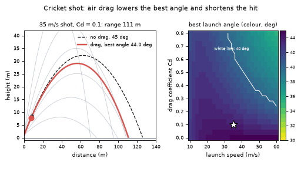
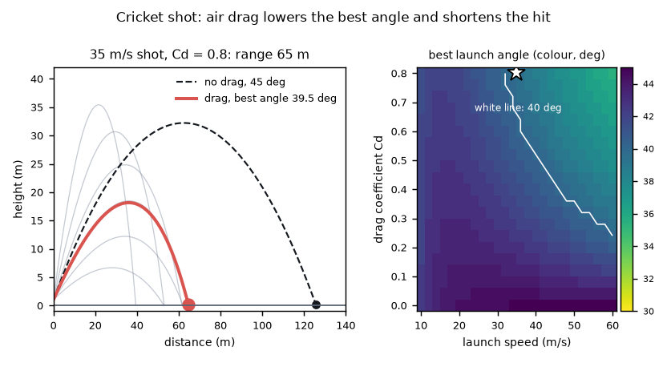
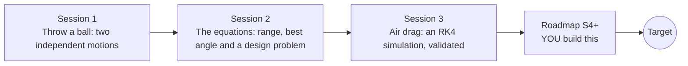

# openprojectile

[](https://github.com/KrunalPanchal1995/pan-iit-oss/actions/workflows/tests.yml)   [](https://colab.research.google.com/github/KrunalPanchal1995/pan-iit-oss/blob/main/openprojectile/sessions/session-01/lesson.ipynb) [](https://krunalpanchal1995.github.io/pan-iit-oss/openprojectile/)

**Plan a cricket shot with air drag, in three sessions.**

openprojectile teaches projectile motion from independent horizontal and vertical motion, to the range formula, to a Runge-Kutta solver with quadratic air drag, using only Python and a browser.

- **Start from a thrown ball.** Session 1 needs only school trigonometry and shows why sideways and vertical motion do not disturb each other.
- **Equations you can trust.** Session 2 derives the range formula and solves a real design problem, with every result checked in code.
- **Drag, solved properly.** Session 3 builds an RK4 solver for a cricket ball and validates it against exact results and an energy balance.
- **Build the missing half.** The repo stops at Session 3 on purpose; the roadmap shows the path to the Target.

[Target](#the-target) · [Who is this for](#who-is-this-for) · [Quick start](#quick-start) · [Sessions](#sessions) · [Roadmap](#roadmap) · [Contribute](#contribute) · [Explainer PDF](docs/explainer.pdf)

> **This repo is incomplete on purpose.** Sessions 1 to 3 are here and fully working. The finished Target below is a preview of what the community can build next. We show you the path, not the code. Sessions 4 and up are yours.

## The Target

A 35 m/s cricket shot is flown three times with a growing drag coefficient. Faint curves show a family of launch angles, the dashed line is the no-drag parabola, and the red line is the best-angle shot with drag: its best angle slips from about 44 to about 39.5 degrees and its range falls from about 111 m to about 65 m. On the right, a map shows the best launch angle for every speed and drag coefficient. Your goal over the coming sessions: build that map and that planner yourself, then add bounce, spin and crosswind.



*Target: drag-lowered best angle, a family of launch angles and the optimal-angle map*



*Target still: the Cd = 0.8 shot and the optimal-angle map*

Try it live:

- [Math Visual Studio: kinematics (Atlas S35)](https://krunalpanchal1995.github.io/studio/#atlas?ch=S35&ex=1)
- [Math Visual Studio: projectile motion project (Atlas S99)](https://krunalpanchal1995.github.io/studio/#atlas?ch=S99&ex=1)

How the Target was made is shown only as a path in [promo/roadmap.md](promo/roadmap.md).

## Who is this for
**secondary school to diploma / undergraduate (levels 3-5).** Topic area: Physics and the Science of Motion.

Prerequisites:

- Sine and cosine of an angle, and what a parabola looks like (school maths).
- Python 3.10 or newer; if `python --version` works, you are ready. PRIMER.md explains the rest.
- No prior GitHub, calculus or numerical-methods experience is needed; Session 3 explains RK4 from scratch.

New to Python? Read [PRIMER.md](PRIMER.md) first (10 minutes).

## Quick start

No installation knowledge needed. You need [Git](https://git-scm.com/downloads) and [Python 3.10+](https://www.python.org/downloads/) (Windows: tick "Add Python to PATH"). On Mac and Linux type `python3` wherever this page says `python`.

```bash
git clone https://github.com/KrunalPanchal1995/pan-iit-oss.git
cd pan-iit-oss/openprojectile
python start.py 1
```

`start.py` creates a private environment, installs what is needed and runs Session 1 with its checkpoint. Next: `python start.py 2`, `python start.py 3`, or `python start.py test` to check everything. Only a checkpoint: `python start.py check 1`.

<!-- friendly-help -->
<details>
<summary><b>Not working? Common fixes (no Git, "python not found", no internet)</b></summary>

- **No Git?** You do not need it. On the main page of this collection click the green **Code** button, then **Download ZIP**, unzip it, open a terminal inside the folder `pan-iit-oss-main/openprojectile` and run `python start.py 1`. The ZIP holds every project, so it is large; the live apps need no download at all.
- **"python is not recognized" or "command not found".** On Windows try `py start.py 1`. On Mac and Linux try `python3 start.py 1`. If neither works, install Python from [python.org](https://www.python.org/downloads/) and tick "Add Python to PATH".
- **Needs internet once.** The first run downloads NumPy and Matplotlib into a private folder (`.venv`); after that it works offline.
- **Rather not install anything?** Open the [live apps](https://krunalpanchal1995.github.io/pan-iit-oss/openprojectile/) in your browser, or use the Colab badge at the top of this page.
- **Still stuck?** [Open an issue](https://github.com/KrunalPanchal1995/pan-iit-oss/issues/new?title=%5Bopenprojectile%5D%20) with your operating system and the message you see. Questions from beginners are welcome.

</details>

Four lines turn the idea of Session 1 into a result (they work as they are): Save it as `try.py` and run it with `python start.py run try.py` (this uses the private environment, where NumPy is installed):

```python
import numpy as np
g, v, a = 9.81, 20.0, np.radians(30)             # speed 20 m/s at 30 degrees
T = 2 * v * np.sin(a) / g                       # time in the air, level ground
print(round(v * np.cos(a) * T, 1), round(T, 2))   # -> 35.3 2.04 (range in m, time in s)
```

Every session also opens in your browser with sliders (no install): [live apps](https://krunalpanchal1995.github.io/pan-iit-oss/openprojectile/). Or use the Colab badge above for the notebook.

## Sessions

| # | Session | Model level | Time | Live app |
|---|---|---|---|---|
| 1 | [Throw a ball: two independent motions](sessions/session-01/README.md) | Level 1: conceptual interactive model | 60 min | [open](https://krunalpanchal1995.github.io/pan-iit-oss/openprojectile/session-01/) |
| 2 | [The equations: range, best angle and a design problem](sessions/session-02/README.md) | Level 2: mathematical engineering model | 75 min | [open](https://krunalpanchal1995.github.io/pan-iit-oss/openprojectile/session-02/) |
| 3 | [Air drag: an RK4 simulation, validated](sessions/session-03/README.md) | Level 3: simulation and validation | 90 min | [open](https://krunalpanchal1995.github.io/pan-iit-oss/openprojectile/session-03/) |

Each session follows the same six steps: A real-world problem, B concept and theory, C visual explanation, D interactive simulation, E worked example and experiment, F assessment and design challenge. Each ends with `checkpoint.py`, which prints `PASS` or `FAIL` against reference numbers. Session 3 also contains the real-world mini-project: **Clear the boundary rope for a six**.

## Architecture



| Folder or file | What is inside |
|---|---|
| `sessions/` | three sessions: README (A-F), `lesson.py`, notebook, live app, exercises, activity sheet, checkpoint |
| `promo/` | the Target: media, live links, and the roadmap (path only) |
| `docs/` | `explainer.tex` and the built `explainer.pdf` |
| `tests/` | runs every lesson and checkpoint headless |
| `start.py` | one command to set up and run anything |
| `QUALITY.md`, `RUBRIC.md` | the quality checklist and the scoring rubric |
| `.github/` | CI, PDF build, Pages deploy, issue and PR templates |

## Roadmap

| Milestone | What you will build | Difficulty |
|---|---|---|
| Session 4: Bounce and roll | A flight that continues after the first landing with a bounce model (illustrative: vertical speed halved, horizontal speed times 0.8). | intermediate |
| Session 5: Crosswind in 3D | A 3D version of the solver with a sideways wind. | intermediate |
| Session 6: Fit the drag coefficient from a video | A least-squares fit of Cd to simulated camera points (positions every 0.1 s with 0.2 m of noise). | advanced |
| Session 7: The optimal-angle map, fast | A map of the best angle over 26 launch speeds (10 to 60 m/s) and 21 drag coefficients (0 to 0.8). | advanced |
| Session 8: A shot planner with uncertainty | A function that reports the lowest and highest range for Cd between 0.35 and 0.45 and wind between -3 and +3 m/s. | advanced |

Full detail with a checkpoint per milestone: [promo/roadmap.md](promo/roadmap.md).

## Contribute
New to GitHub? Read [CONTRIBUTING.md](CONTRIBUTING.md); it starts from zero. Pick an issue labelled `good first issue`. Translations into Hindi, Telugu, Tamil and Malayalam are welcome.

<details>
<summary>Development</summary>

```bash
python start.py test        # runs every lesson and checkpoint
```
Lessons use `# %%` cell markers so they open as notebooks in VS Code. See [QUALITY.md](QUALITY.md) for the standard every session meets.
</details>

## License
MIT. See [LICENSE](LICENSE). Media in `promo/media` is (c) Krunal Panchal, CC BY 4.0.

## Acknowledgments
Part of the [PAN IIT OSS](https://hellofoss.tech-iitb.org/projects) open-source teaching collection, modelled on the structure of [openspline](https://github.com/openspline/openspline). Built on ideas from the Math Visual Studio at https://krunalpanchal1995.github.io/studio/.
