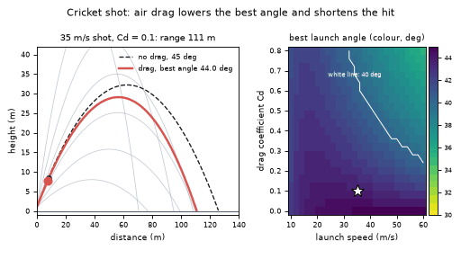
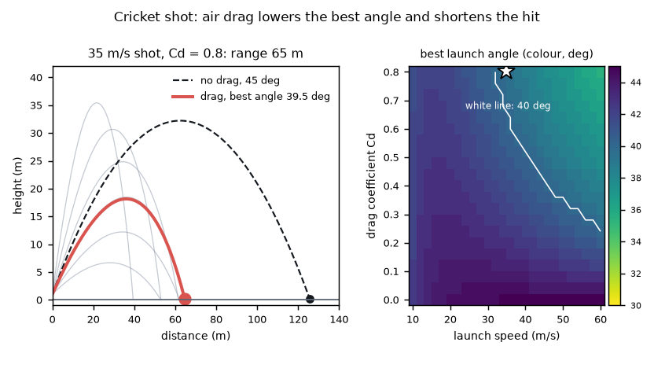

# What you are building toward

A 35 m/s cricket shot is flown three times with a growing drag coefficient. Faint curves show a family of launch angles, the dashed line is the no-drag parabola, and the red line is the best-angle shot with drag: its best angle slips from about 44 to about 39.5 degrees and its range falls from about 111 m to about 65 m. On the right, a map shows the best launch angle for every speed and drag coefficient. Your goal over the coming sessions: build that map and that planner yourself, then add bounce, spin and crosswind.

*Target: drag-lowered best angle, a family of launch angles and the optimal-angle map*

*Target still: the Cd = 0.8 shot and the optimal-angle map*

These results come from a private reference build. The code is not published; the roadmap shows the path so you can build your own.

Live links:

- [Math Visual Studio: kinematics (Atlas S35)](https://krunalpanchal1995.github.io/studio/#atlas?ch=S35&ex=1)
- [Math Visual Studio: projectile motion project (Atlas S99)](https://krunalpanchal1995.github.io/studio/#atlas?ch=S99&ex=1)
