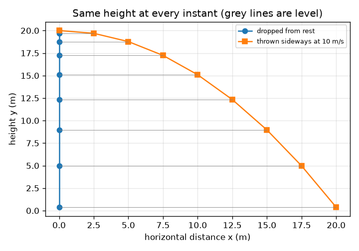
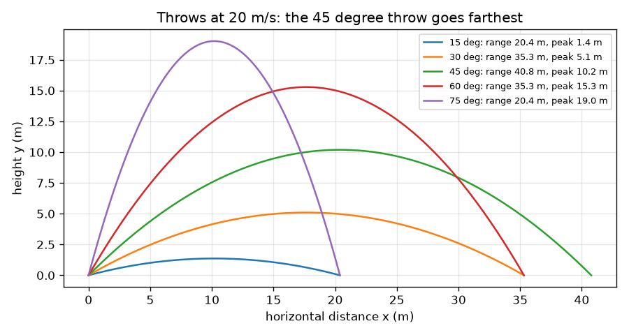

# सत्र 1: एक गेंद फेंकिए: दो स्वतंत्र गतियाँ

*स्तर 1 (संकल्पनात्मक इंटरैक्टिव मॉडल) · लगभग 60 मिनट · openprojectile*

> यह एक सरलीकृत शैक्षिक मॉडल है। यह कोई प्रमाणित डिज़ाइन टूल नहीं है और इसका उपयोग वास्तविक संरचनाओं, विद्युत स्थापनाओं, वाहनों, औद्योगिक प्रक्रियाओं या चिकित्सा निर्णयों के लिए नहीं किया जाना चाहिए।

**पूर्व-आवश्यकताएँ (Prerequisites)**

- स्कूल त्रिकोणमिति: ज्या (sine) और कोज्या (cosine)।
- आपने PRIMER.md पढ़ लिया है और `python start.py 1` एक बार चला लिया है।

**सीखने के उद्देश्य (Learning objectives)।** इस सत्र के बाद आप:

- प्रक्षेपण वेग (launch velocity) को एक क्षैतिज और एक ऊर्ध्वाधर भाग में बाँट सकेंगे।
- समझा सकेंगे कि क्षैतिज और ऊर्ध्वाधर गतियाँ एक-दूसरे को प्रभावित क्यों नहीं करतीं।
- समतल ज़मीन पर किसी फेंक का उड़ान काल (time of flight), शिखर ऊँचाई (peak height) और परास (range) ज्ञात कर सकेंगे।
- x(t) और y(t) ग्राफ़ पढ़ सकेंगे और बता सकेंगे कि कौन-सा सीधी रेखा है और कौन-सा परवलय (parabola)।

## A. वास्तविक दुनिया की समस्या
एक क्षेत्ररक्षक गेंद विकेट कीपर की ओर फेंकता है; एक बल्लेबाज़ उसे सीमा रेखा की ओर उछालता है। यह कितनी दूर जाती है, कितनी ऊँची उठती है और हवा में कितनी देर लटकी रहती है? वह आश्चर्य जो इसे आसान बनाता है: बगल की गति और ऊपर-नीचे की गति एक-दूसरे को परेशान नहीं करतीं, इसलिए हम उन्हें एक-एक करके सँभाल सकते हैं और फिर जोड़ सकते हैं।

## B. संकल्पना और सिद्धांत
एक गेंद क्षैतिज से ऊपर कोण a पर चाल v से हाथ छोड़ती है। इसका वेग एक बगल वाले भाग vx = v cos(a) और एक ऊपर वाले भाग vy = v sin(a) में बँट जाता है। बगल की ओर गेंद को कुछ भी नहीं धकेलता (हम हवा को अनदेखा करते हैं), इसलिए vx कभी नहीं बदलता और x = vx t। ऊपर-नीचे गुरुत्व त्वरण g से खींचता है, इसलिए vy लगातार घटता है और y = vy t - g t^2 / 2। गेंद तब ऊपर उठना बंद करती है जब vy - g t = 0, जो t = vy / g पर होता है। नीचे आने में भी उतना ही समय लगता है, इसलिए हवा में समय T = 2 vy / g है, शिखर ऊँचाई H = vy^2 / (2 g) है और परास R = vx T है।

| प्रतीक | अर्थ | इकाई |
|---|---|---|
| v | प्रक्षेपण चाल | m/s |
| a | क्षैतिज से ऊपर प्रक्षेपण कोण | डिग्री |
| vx, vy | प्रक्षेपण वेग के क्षैतिज और ऊर्ध्वाधर भाग | m/s |
| g | गुरुत्व का त्वरण (9.81) | m/s^2 |
| T, H, R | उड़ान काल, शिखर ऊँचाई, परास | s, m, m |
| t | प्रक्षेपण के बाद का समय | s |

**मान्यताएँ (Assumptions)**

- कोई हवा नहीं: गुरुत्व के अलावा गेंद पर कुछ भी कार्य नहीं करता।
- ज़मीन समतल है और गेंद ज़मीन के स्तर से प्रक्षेपित की जाती है।
- गेंद एक बिंदु है; घुमाव (spin) और स्विंग को अनदेखा किया गया है।

$$ v_x=v\cos a,\qquad v_y=v\sin a $$

$$ x=v_x\,t,\qquad y=v_y\,t-\tfrac12 g t^2 $$

$$ T=\frac{2v_y}{g},\qquad H=\frac{v_y^2}{2g},\qquad R=v_x\,T $$

## C. दृश्य व्याख्या
पहला चित्र समान चाल (20 m/s) पर पाँच फेंक दिखाता है: 15 और 75 डिग्री एक ही जगह गिरते हैं, वैसे ही 30 और 60 डिग्री, और 45 डिग्री सबसे दूर जाता है। दूसरा चित्र एक ही क्षण पर एक ही ऊँचाई से एक गेंद गिराता है और दूसरी को बगल की ओर फेंकता है: हर क्षण वे समान ऊँचाई पर होती हैं (धूसर रेखाएँ समतल हैं), यही दोनों गतियों की स्वतंत्रता है।

*एक गिराई गई गेंद और बगल की ओर फेंकी गई गेंद हर क्षण एक-दूसरे के समतल रहती हैं।*

*20 m/s पर पाँच फेंक: 45 डिग्री सबसे दूर जाता है, और जिन कोणों का योग 90 डिग्री है वे साथ गिरते हैं।*

## D. इंटरैक्टिव सिमुलेशन
पाठ चलाइए (`python start.py 1`), फिर लाइव ऐप खोलिए: [सत्र 1: एक गेंद फेंकिए](https://krunalpanchal1995.github.io/pan-iit-oss/openprojectile/session-01/) (या इसी फ़ोल्डर में `app.html`)। चाल और कोण बदलिए, समय स्लाइडर खिसकाइए और हरे बगल वाले तीर को वैसा ही रहते देखिए जबकि नीला ऊर्ध्वाधर तीर सिकुड़ता, पलटता और बढ़ता है। ग्राफ़ दृश्य पर जाइए और x(t) को सीधी रेखा और y(t) को परवलय के रूप में देखिए।

**चुनौती।** गेंद को कम से कम 60 m दूर गिराइए जबकि उसका शिखर 15 m या उससे नीचे रहे।

## E. हल किया गया उदाहरण और प्रयोग
**समस्या।** एक गेंद 30 डिग्री पर 20 m/s से ज़मीन छोड़ती है। इसके दो वेग भाग, उड़ान काल, शिखर ऊँचाई और परास ज्ञात कीजिए।

1. vx = 20 cos 30 = 20 * 0.8660 = 17.32 m/s और vy = 20 sin 30 = 20 * 0.5 = 10.00 m/s।
2. उड़ान काल T = 2 vy / g = 2 * 10.00 / 9.81 = 2.04 s।
3. शिखर ऊँचाई H = vy^2 / (2 g) = 100 / 19.62 = 5.10 m।
4. परास R = vx T = 17.32 * 2.039 = 35.3 m (अधिक अंक रखने पर 35.31 m मिलता है)।
5. जाँच: t = T पर, y = 10.00 * 2.039 - 4.905 * 2.039^2 = 20.39 - 20.39 = 0, इसलिए गेंद वापस ज़मीन पर है।

**उत्तर।** vx = 17.32 m/s, vy = 10.00 m/s, T = 2.04 s, H = 5.10 m और R = 35.3 m।

**प्रयोग।** एक शांत दिन पर ज़मीन से लगभग 30 डिग्री पर एक टेनिस गेंद फेंकिए और चिह्नित कीजिए कि वह पहले कहाँ गिरती है, या बगल से वीडियो बनाइए और वीडियो से उसकी ऊँचाई पढ़िए। अपेक्षा कीजिए कि यह पूर्वानुमान से पहले गिरेगी। मॉडल में कोई हवा नहीं है और प्रक्षेपण ज़मीन के स्तर से है; एक असली हाथ गेंद को ज़मीन से ऊपर छोड़ता है, जो परास बढ़ाता है, जबकि हवा परास घटाती है। मॉडल बनाम वास्तविकता: मॉडल आकार (एक परवलय) और स्वतंत्रता को सही बताता है; संख्याओं के लिए कर्षण (drag) और प्रक्षेपण ऊँचाई चाहिए, जो अगले दो सत्र हैं।

## F. मूल्यांकन और डिज़ाइन चुनौती
**प्रश्न प्रकार A: संकल्पनात्मक।** एक गेंद विराम से गिराई जाती है और दूसरी उसी ऊँचाई से उसी क्षण 10 m/s पर क्षैतिज रूप से फेंकी जाती है। कौन-सी पहले ज़मीन से टकराती है? समझाइए।

संकेत

y के सूत्र को देखिए: क्या उसमें बगल की चाल है?

चरण-दर-चरण हल

वे एक ही क्षण गिरती हैं। ऊँचाई सूत्र y = y0 - g t^2 / 2 में कोई बगल की चाल नहीं है: गुरुत्व केवल ऊर्ध्वाधर रूप से कार्य करता है और उसे परवाह नहीं कि गेंद बगल में कितनी तेज़ चलती है। फेंकी गई गेंद गिरते समय बस अधिक ज़मीन तय करती है।

**प्रश्न प्रकार B: संख्यात्मक।** एक गेंद ज़मीन से 36 डिग्री पर 25 m/s से मारी जाती है। vx, vy, उड़ान काल, शिखर ऊँचाई और परास ज्ञात कीजिए। क्या परास समझदारी भरा लगता है?

संकेत

sin 36 = 0.588 और cos 36 = 0.809। फिर T = 2 vy / g।

चरण-दर-चरण हल

vx = 25 * 0.809 = 20.23 m/s और vy = 25 * 0.588 = 14.69 m/s। T = 2 * 14.69 / 9.81 = 3.00 s। H = 14.69^2 / 19.62 = 11.0 m। R = 20.23 * 3.00 = 60.6 m। समझदारी जाँच (sanity check): 25 m/s (लगभग 90 km/h) का शॉट 60 m जाना, बिना-हवा के लिए एक संभव, यद्यपि थोड़ा लंबा, आँकड़ा है; हवा के साथ यह छोटा होगा (सत्र 3)। इकाइयाँ: m/s * s = m।

**प्रश्न प्रकार C: ग्राफ़ और सिमुलेशन की व्याख्या।** 20 m/s और 30 डिग्री पर ऐप के x(t) और y(t) ग्राफ़ में, हर वक्र का आकार क्या है, और y किस समय शून्य पर लौटता है? x(t) रेखा का ढाल आपको क्या बताता है?

संकेत

एक सूत्र में t है, दूसरे में t^2।

चरण-दर-चरण हल

x(t) = vx t एक सीधी रेखा है; इसका ढाल स्थिर बगल की चाल 17.32 m/s है। y(t) = vy t - g t^2 / 2 नीचे की ओर खुलने वाला परवलय है; यह T = 2.04 s पर शून्य पर लौटता है, आधे रास्ते (1.02 s) पर यह 5.10 m पर शिखर पर होता है। वक्र के मुक़ाबले सीधी रेखा ही दोनों गतियों की स्वतंत्रता है।

**प्रश्न प्रकार D: डिज़ाइन और इष्टतमीकरण (optimisation) चुनौती।** एक कीपर उस क्षेत्ररक्षक से 35 m दूर खड़ा है जो 20 m/s पर फेंकता है। ऐप का उपयोग करके, दो अलग-अलग कोण ढूँढ़िए जो दोनों उस तक पहुँचते हैं। उड़ानों की तुलना कीजिए और बताइए कि आप हर एक को कब चुनेंगे।

संकेत

30 डिग्री आज़माइए, फिर एक दूसरा कोण ढूँढ़िए जो समान परास देता है।

चरण-दर-चरण हल

20 m/s पर 30 और 60 डिग्री दोनों 35.3 m का परास देते हैं। 30 डिग्री पर उड़ान 2.04 s लेती है और 5.1 m पर शिखर पर होती है: तेज़ और नीची, सबसे अच्छी जब कोई धावक दौड़ रहा हो (पर गेंद तेज़ और सपाट आती है)। 60 डिग्री पर यह 3.53 s लेती है और 15.3 m पर शिखर पर होती है: धीमी, खड़ी गिरने के कारण पकड़ने में आसान, पर यह धावक को अधिक समय देती है। मान्यता: कोई हवा नहीं, समान ऊँचाइयाँ।

[RUBRIC.md](../../RUBRIC.md) से स्वयं को अंक दीजिए। कागज़ पर काम करने के लिए [गतिविधि पत्रक](activity_sheet.md) प्रिंट कीजिए।

## सामान्य भ्रांतियाँ (Common misconceptions)
| सामान्य भ्रांति | वास्तव में क्या सच है |
|---|---|
| फेंकी गई गेंद को फेंक लगातार आगे धकेलती रहती है। | हाथ छोड़ने के बाद उसे कुछ भी बगल की ओर नहीं धकेलता (हवा के बिना)। वह अपनी बगल की चाल बनाए रखती है क्योंकि उसे कुछ भी धीमा नहीं करता। |
| शिखर पर गेंद चलना बंद कर देती है। | शिखर पर केवल ऊर्ध्वाधर चाल शून्य होती है; बगल की चाल अपरिवर्तित रहती है, इसलिए गेंद अब भी v cos(a) पर चल रही है। |
| तेज़ बगल वाली फेंक अधिक धीरे गिरती है। | गिरना केवल गुरुत्व और समय पर निर्भर करता है। बगल की ओर फेंकी गई गेंद ठीक गिराई गई गेंद की तरह गिरती है। |
| सबसे लंबी फेंक सबसे ऊँची फेंक है। | बहुत ऊँची फेंक ऊपर जाकर लगभग उसी जगह नीचे आती है। समतल ज़मीन पर सबसे लंबा परास 45 डिग्री पर होता है। |

## शब्दावली (Glossary)
- **प्रक्षेप्य (projectile)**: प्रक्षेपित होने के बाद केवल गुरुत्व के अधीन चलने वाली वस्तु
- **घटक (component)**: वे भाग जिनमें एक सदिश बँटता है, जैसे बगल वाला भाग vx
- **परास (range)**: प्रक्षेपण से गिरने तक की क्षैतिज दूरी
- **उड़ान काल (time of flight)**: गेंद कितनी देर हवा में रहती है
- **प्रक्षेप-पथ (trajectory)**: अंतरिक्ष में गेंद का पथ

## समापन
1. [exercises.md](exercises.md) में दिए गए तीन कोडिंग कार्य कीजिए।
2. अपने बदलावों के बाद `python start.py 1` फिर से चलाइए। यह checkpoint के साथ समाप्त होता है; जब यह `PASS` छापे, तो आपका काम पूरा है। (केवल checkpoint: `python start.py check 1`।)

अगला: [सत्र 2](../session-02/README.md)
